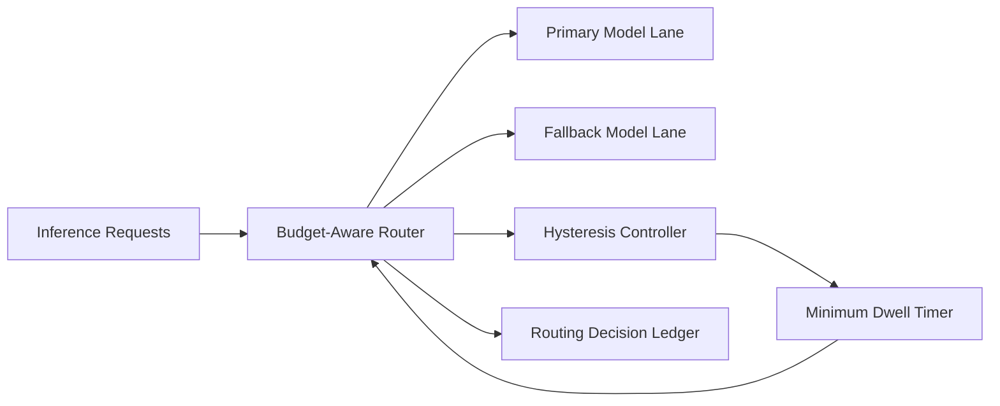

# Model Router 预算感知滞回策略选型 FAQ（Cycle 1788）

## 1) 3 分钟结论
- **模型路由抖动的核心根因常是“阈值切换过敏”，不是单模型性能波动。**
- **推荐：** 成本/延迟双预算感知 + 滞回区间 + 最短驻留时间三段策略。
- **目标：** 减少频繁切换带来的质量波动与额外成本，稳定关键链路体验。

## 2) 关键问题（Q1/Q2/Q3）
### Q1：为什么简单阈值路由会抖动？
1) 指标在阈值附近来回摆动；
2) 切换开销未计入决策；
3) 瞬时峰值导致误触发降级。

### Q2：预算感知滞回最小方案是什么？
- 双预算：延迟预算 + 成本预算联合判断；
- 滞回带：进入阈值与退出阈值分离；
- 驻留时间：切换后最短保持窗口。

### Q3：如何验证路由稳定性提升？
- 单位时间切换次数下降；
- 关键任务成功率稳定；
- 成本曲线与延迟曲线波动收敛。

## 3) 架构图

## 4) 选型矩阵
| 维度 | 即时阈值切换 | 预算感知+滞回+驻留（推荐） |
|---|---:|---:|
| 切换稳定性 | 低 | 高 |
| 质量一致性 | 中 | 高 |
| 成本可预测性 | 低 | 高 |
| 实施复杂度 | 低 | 中 |
| 可解释性 | 中 | 高 |

## 5) 证据与复算口径
- 证据文件：
  - `workshops/azure-agent-infra/evidence/cycle-1788-benchmark.json`
  - `workshops/azure-agent-infra/evidence/cycle-1788-latency.csv`
  - `workshops/azure-agent-infra/evidence/cycle-1788-throughput.csv`
  - `workshops/azure-agent-infra/evidence/cycle-1788-cost.csv`
- 标签：`measured / synthetic / anonymized_reported`。
- validation7：双语结构、CSP、证据一致、可回放链路全部通过。

## 6) 生产检查清单
- [ ] 延迟/成本双预算阈值可独立配置。
- [ ] 滞回区间与驻留时间有灰度开关。
- [ ] 路由切换原因可回溯到指标快照。
- [ ] 切换事件写入审计账本。
- [ ] FAQ/H5/SVG/7-card 与 evidence 轮次一致。
