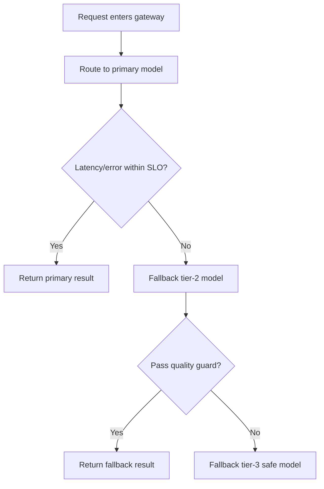
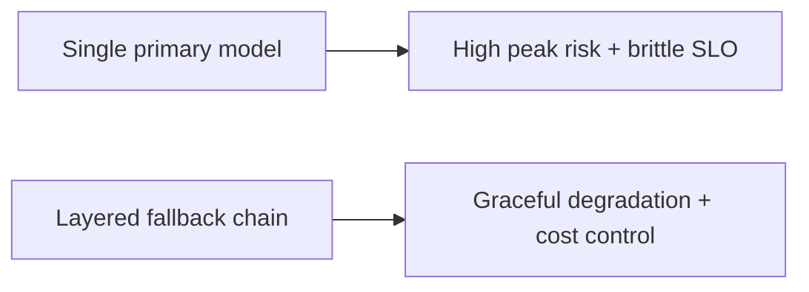
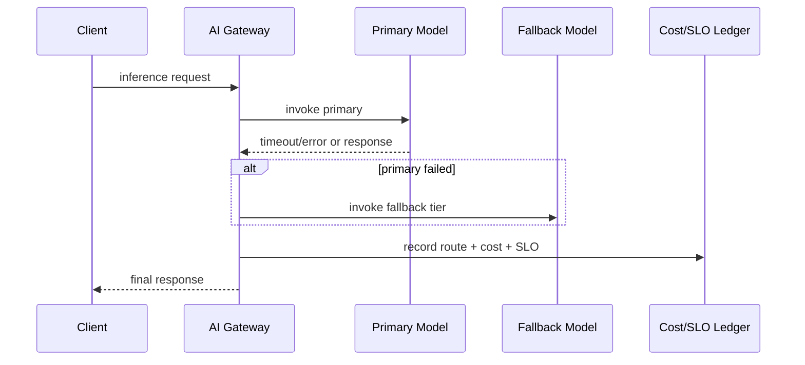

# Model Routing Fallback Selection FAQ (Single Primary vs Layered Fallback Chain)

> Scope boundary: this FAQ focuses only on **AI Gateway model routing and fallback-chain governance**. It does not expand into identity architecture or supply-chain topics.

## 1) 📌 Executive Summary (3-minute take)

1. **Default production pattern: primary model + cost-tier fallback + safety fallback**.  
2. **Single-primary strategy amplifies latency and failure cost during burst or outage periods**.  
3. **Routing governance must preserve quality, control cost, and protect SLO simultaneously**.

## 2) 🎯 Core Q&A

### Q1: When is a single primary model acceptable?

- Homogeneous request patterns, lower concurrency, and higher tolerance for occasional degradation in PoC phases.  
- Only when peak jitter and cost variability are acceptable.

### Q2: When is a layered fallback chain mandatory?

- Multi-tenant high-concurrency environments with mixed task classes and strict cost ceilings.  
- Workloads that require automatic graceful degradation under latency/error pressure.

### Q3: What is the key technique (layered fallback routing), and how does it work?

- **Plain words**: use the best-fit model first; if SLO thresholds fail, step down to the next tier automatically.  
- **Problem solved**: prevents one unstable model from cascading timeouts across the full business path.  
- **Mechanism**: policy scoring → primary invoke → threshold check → fallback tier execution → route/cost/SLO ledger write.

## 3) 🧭 Visual breakdown (Mermaid)

## 4) 📊 Architect Decision Matrix

| Dimension | Single primary | Layered fallback chain |
|---|---|---|
| Peak availability | Medium-Low | High |
| Cost control | Medium | High |
| Routing complexity | Low | Medium |
| Quality stability | Medium | High |
| Production default | PoC-only | ✅ |

## 5) 🧪 Quantitative example + benchmark insight

> Data source: `evidence/cycle-403-benchmark.json`.

| Metric | Single primary | Layered fallback chain |
|---|---:|---:|
| SLO breach rate | 6.9% | 2.2% |
| P95 tail latency | 1510 ms | 1080 ms |
| Per-request cost variance | 1.8x | 1.2x |
| Mean incident recovery duration | 23 min | 9 min |
| Post-fallback success rate | N/A | 94.6% |

7-Card: `benchmark-cards.html` / `benchmark-cards.en.html`

## 6) 🛠️ Architect checklist

- [ ] Define primary and per-tier fallback triggers
- [ ] Enforce quality gates and safety fallback in the chain
- [ ] Persist route decisions in cost + SLO ledgers
- [ ] Separate tenant-level and scenario-level fallback policies
- [ ] Drill rapid switchovers for primary-model incidents
- [ ] Recalibrate thresholds and budget caps weekly
- [ ] Review false-fallback and missed-fallback cases
