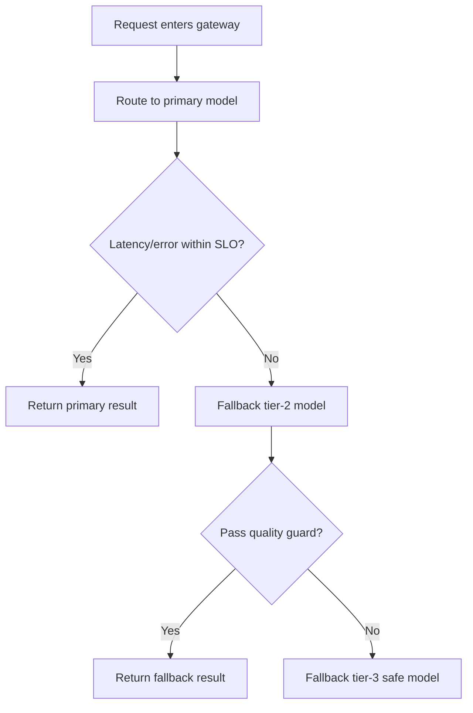
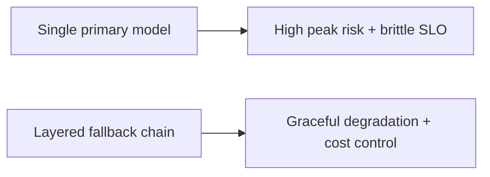
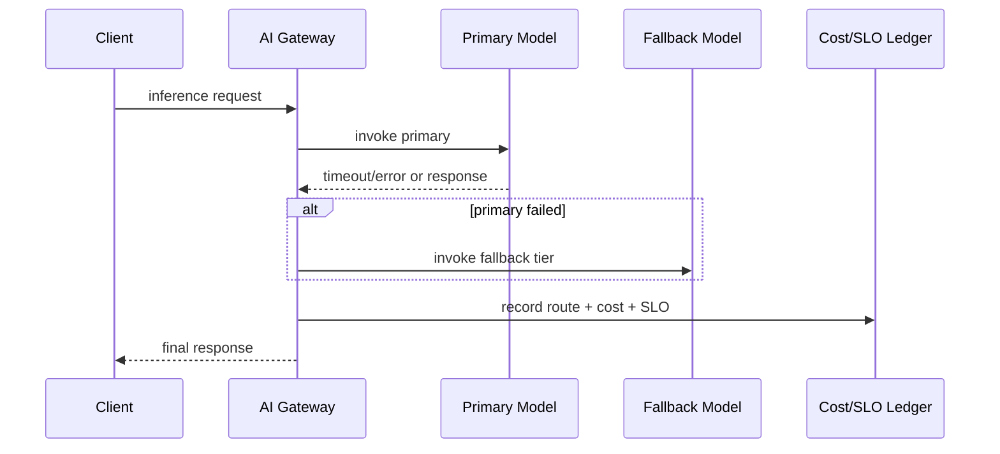

# 模型路由回退选型 FAQ（单一主模型 vs 分层回退链）

> 专题边界：仅讨论 **AI Gateway 模型路由与回退链治理**，不扩展到身份体系或供应链主题。

## 1) 📌 Executive Summary（3 分钟结论）

1. **生产默认建议“主模型 + 成本层回退 + 安全兜底层”三层回退链**，比单一主模型更稳。  
2. **单一主模型在高峰与异常期间会放大延迟和失败成本**。  
3. **路由治理目标是“质量不塌、成本可控、SLO 可守”三者同时满足。**

## 2) 🎯 灵魂拷问 Q&A

### Q1：什么时候单一主模型还能接受？

- 请求类型单一、并发较低、失败容忍度高的 PoC 阶段。  
- 前提是你能接受峰值时延抖动与成本波动。

### Q2：什么场景必须上分层回退链？

- 多租户高并发、请求类型差异大、成本上限严格。  
- 需要在“可用性优先”时自动降级到更稳/更便宜模型。

### Q3：核心技术 X（分层回退路由）是什么，怎么运作？

- **是什么（大白话）**：先走最优模型，不满足延迟/错误阈值就自动切到下一层。  
- **解决痛点**：避免单一模型抖动造成整条业务链大面积超时。  
- **底层运作**：策略打分 → 主模型调用 → 触发阈值检测 → 回退链执行 → 结果与成本回写账本。

## 3) 🧭 可视化图解（Mermaid）

## 4) 📊 Architect Decision Matrix

| 维度 | 单一主模型 | 分层回退链 |
|---|---|---|
| 峰值可用性 | 中-低 | 高 |
| 成本可控性 | 中 | 高 |
| 路由复杂度 | 低 | 中 |
| 质量稳定性 | 中 | 高 |
| 生产默认建议 | 仅 PoC | ✅ |

## 5) 🧪 定量算例 + Benchmark 洞察

> 数据来源：`evidence/cycle-403-benchmark.json`。

| 指标 | 单一主模型 | 分层回退链 |
|---|---:|---:|
| SLO 违约率 | 6.9% | 2.2% |
| P95 尾延迟 | 1510ms | 1080ms |
| 单请求成本波动幅度 | 1.8x | 1.2x |
| 故障恢复平均耗时 | 23min | 9min |
| 回退触发后成功率 | N/A | 94.6% |

7-Card：`benchmark-cards.html` / `benchmark-cards.en.html`

## 6) 🛠️ Architect Checklist

- [ ] 定义主模型与每层回退的触发阈值
- [ ] 回退链必须包含质量门禁与安全兜底
- [ ] 路由决策写入成本与 SLO 账本
- [ ] 区分租户级与场景级回退策略
- [ ] 建立“主模型异常”快速切换演练
- [ ] 每周校准阈值与成本配额
- [ ] 复盘误回退与漏回退案例
