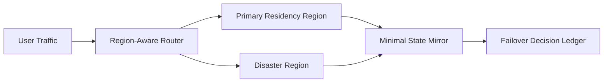

# Multi-Region Session Residency and Failover Selection FAQ (Cycle 1768)

## 1) Three-minute decision
- **Cross-region resiliency and data residency constraints must be designed together, not sequentially.**
- **Recommendation:** strict primary residency, minimal-state disaster mirror, and region-aware failover/failback.
- **Goal:** keep failover recovery within budget while respecting residency boundaries.

## 2) Core questions (Q1/Q2/Q3)
### Q1: Why full cross-region replication is not always optimal?
1) can violate residency policies,
2) raises consistency and operational overhead,
3) amplifies cross-region cost and latency.

### Q2: What is the minimum state to mirror?
- session recovery metadata,
- non-replayable operation summaries,
- minimal routing context for failback.

### Q3: What defines acceptable failover?
- RTO/RPO within budget,
- no residency boundary violations,
- no permission drift during failback.

## 3) Reference architecture

## 4) Decision matrix
| Dimension | Full cross-region replication | Minimal mirror + region failback (Recommended) |
|---|---:|---:|
| Compliance fitness | Medium | High |
| Failover speed | High | Medium-high |
| Cost control | Low | High |
| Consistency complexity | High | Medium |
| Failback explainability | Medium | High |

## 5) Evidence and reproducibility
- Evidence files:
  - `workshops/azure-agent-infra/evidence/cycle-1768-benchmark.json`
  - `workshops/azure-agent-infra/evidence/cycle-1768-latency.csv`
  - `workshops/azure-agent-infra/evidence/cycle-1768-throughput.csv`
  - `workshops/azure-agent-infra/evidence/cycle-1768-cost.csv`
- Labels: `measured / synthetic / anonymized_reported`.
- validation7 requires bilingual structure, CSP self-contained cards, evidence consistency, and replayability links.

## 6) Production checklist
- [ ] Residency boundaries are policy-enforced and auditable.
- [ ] Disaster region stores only minimal required state.
- [ ] Failover/failback thresholds are configurable and drilled.
- [ ] Incident replay covers cross-region execution chains.
- [ ] FAQ/H5/SVG/7-card references are cycle-aligned.
