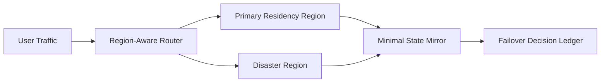

# 多区域 Session 驻留与故障切换选型 FAQ（Cycle 1768）

## 1) 3 分钟结论
- **跨区高可用与数据驻留约束必须一起设计，不能先做容灾再补合规。**
- **推荐：** 主驻留区强约束 + 灾备区最小状态镜像 + 区域感知路由回切策略。
- **目标：** 满足区域合规边界的同时，将跨区故障恢复时间控制在业务预算内。

## 2) 关键问题（Q1/Q2/Q3）
### Q1：为什么“全量跨区复制”不是总是最优？
1) 可能违反数据驻留法规；
2) 状态一致性成本高；
3) 放大跨区网络费用与延迟。

### Q2：推荐的最小跨区状态是什么？
- 会话恢复元数据（指针、令牌、租户标签）；
- 不可重放操作日志摘要；
- 回切所需的最小路由配置。

### Q3：如何定义可接受的故障切换？
- 切换 RTO/RPO 在预算内；
- 合规边界无越界复制；
- 回切过程不产生权限漂移。

## 3) 架构图

## 4) 选型矩阵
| 维度 | 全量跨区复制 | 最小镜像+区域回切（推荐） |
|---|---:|---:|
| 合规适配 | 中 | 高 |
| 切换速度 | 高 | 中高 |
| 成本可控性 | 低 | 高 |
| 一致性复杂度 | 高 | 中 |
| 回切可解释性 | 中 | 高 |

## 5) 证据与复算口径
- 证据文件：
  - `workshops/azure-agent-infra/evidence/cycle-1768-benchmark.json`
  - `workshops/azure-agent-infra/evidence/cycle-1768-latency.csv`
  - `workshops/azure-agent-infra/evidence/cycle-1768-throughput.csv`
  - `workshops/azure-agent-infra/evidence/cycle-1768-cost.csv`
- 标签：`measured / synthetic / anonymized_reported`。
- validation7：双语结构、CSP、证据一致与复算链路全部通过。

## 6) 生产检查清单
- [ ] 驻留区域边界已策略化并有审计。
- [ ] 灾备区仅持有最小必要状态。
- [ ] 切换与回切阈值可配置且可演练。
- [ ] 失败场景回放覆盖跨区链路。
- [ ] FAQ/H5/SVG/7-card 与 evidence 轮次一致。
