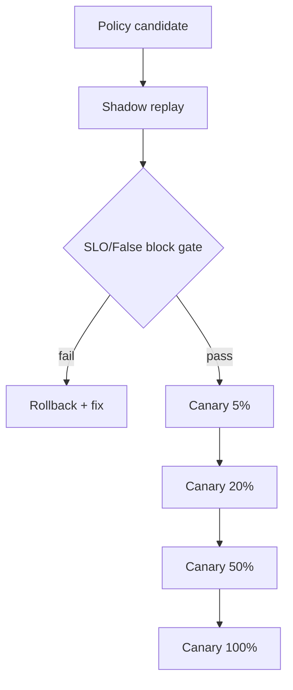
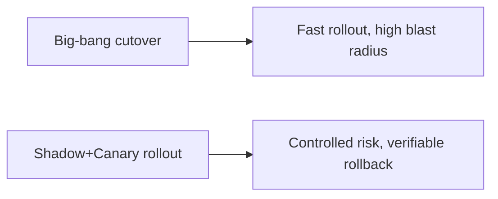
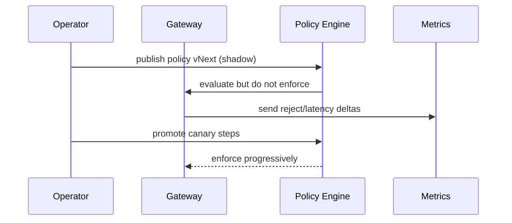

# Gateway Policy Rollout FAQ (Shadow Mode vs Staged Canary vs Big-Bang Cutover)

> Scope boundary: this FAQ focuses only on **policy release strategy for AI Gateway / MCP / A2A enforcement**. It does not expand into identity architecture or sandbox supply-chain topics.

## 1) 📌 Executive Summary (3-minute take)

1. **Default production pattern: shadow validation + staged canary + automated rollback**.  
2. **Big-bang cutover is acceptable only for low-risk policy edits**; rollback blast radius is too large for multi-tenant critical paths.  
3. **Canary rollout is a risk-control mechanism, not process overhead**—it directly limits outage radius and cost spikes.

## 2) 🎯 Core Q&A

### Q1: When can we skip shadow and go directly to canary?

- Very small rule changes, stable replay results, and proven rollback scripts.  
- Workloads that tolerate short-term jitter and are not high-compliance critical paths.

### Q2: When is shadow mandatory?

- New deny rules, cross-tenant quota controls, or policy changes tied to token budget behavior.  
- Any change that could materially increase false blocks on valid traffic.

### Q3: What is the key technique (policy progressive control plane), and how does it work?

- **Plain words**: run policies in observe-only mode first, then enforce gradually by traffic percentage.  
- **Problem solved**: prevents policy defects from instantly impacting 100% of production traffic.  
- **Mechanism**: shadow replay → metric gates → canary 5/20/50/100% → auto rollback on threshold breach.

## 3) 🧭 Visual breakdown (Mermaid)

## 4) 📊 Architect Decision Matrix

| Dimension | Shadow mode | Staged canary | Big-bang cutover |
|---|---|---|---|
| Risk control | High | High | Low |
| Rollout speed | Medium | Medium | High |
| False-block observability | High | Medium-High | Low |
| Rollback operability | High | High | Medium |
| Production default | ✅ (pre-stage) | ✅ (execution) | Low-risk changes only |

## 5) 🧪 Quantitative example + benchmark insight

> Data source: `evidence/cycle-398-benchmark.json`.

| Metric | Shadow+Canary | Canary-only | Big-bang |
|---|---:|---:|---:|
| False-block peak | 2.7% | 4.4% | 9.8% |
| Mean recovery time from policy incident | 8 min | 14 min | 31 min |
| P95 latency jitter during rollout window | 220 ms | 260 ms | 380 ms |
| Manual interventions per week | 1.2 | 2.3 | 4.9 |
| Governance cost increment per session | $0.0009 | $0.0006 | $0.0002 |

7-Card: `benchmark-cards.html` / `benchmark-cards.en.html`

## 6) 🛠️ Architect checklist

- [ ] Every high-risk policy has shadow replay evidence
- [ ] Canary promotion thresholds and auto-rollback conditions are codified
- [ ] Rollout telemetry covers latency, false blocks, and token budget
- [ ] Every policy change is linked to change ticket + audit record
- [ ] Keep one-click rollback to last known-good policy version
- [ ] Review policy incidents and misses weekly
- [ ] Drill full 5%→100% promotion path in pre-production
