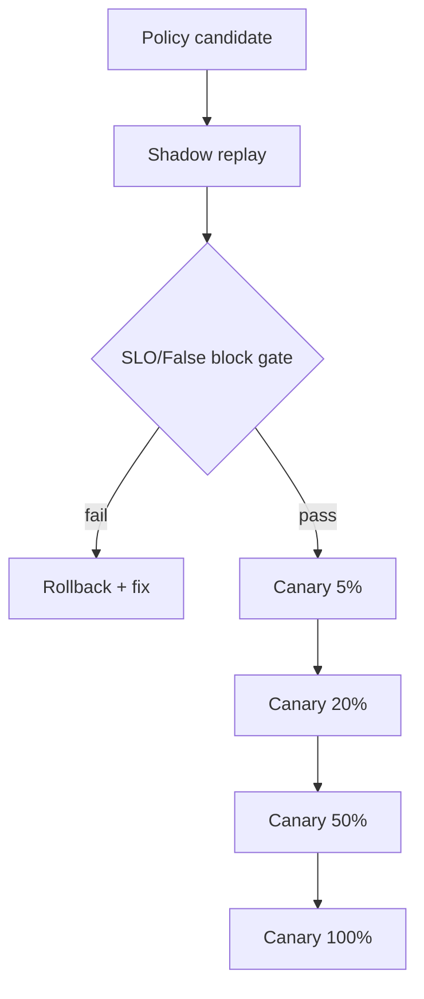
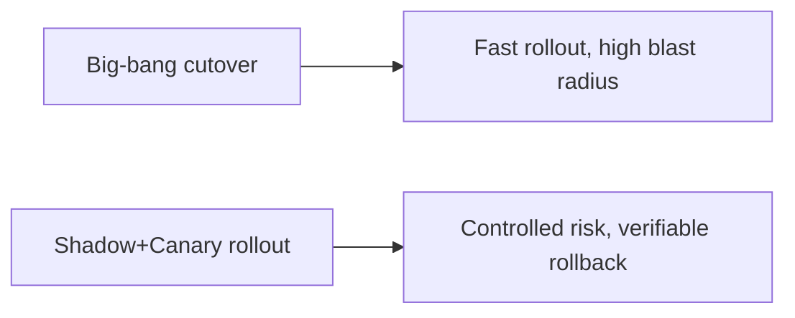
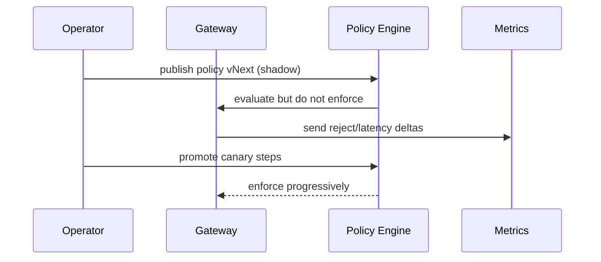

# 网关策略灰度发布选型 FAQ（Shadow 模式 vs 分阶段 Canary vs 一次性切换）

> 专题边界：仅讨论 **AI Gateway / MCP / A2A 策略变更发布路径**，不扩展到身份体系与沙箱供应链。

## 1) 📌 Executive Summary（3 分钟结论）

1. **生产默认建议“Shadow 验证 + 分阶段 Canary + 自动回滚”**，稳定性和上线速度最平衡。  
2. **一次性全量切换只适合低风险策略变更**，高并发多租户下回滚代价太高。  
3. **灰度发布不是流程负担，而是控制成本峰值与事故半径的核心机制**。

## 2) 🎯 灵魂拷问 Q&A

### Q1：什么时候可以跳过 Shadow，直接 Canary？

- 规则变更很小、回放结果稳定、且有完备回滚脚本。  
- 业务容忍短时间抖动，不是金融/高合规关键路径。

### Q2：什么场景必须做 Shadow？

- 新增拒绝规则、跨租户配额策略、或会影响 token 预算的变更。  
- 任何“可能让合法流量被误拦截”的策略都应先 Shadow。

### Q3：核心技术 X（策略灰度控制面）是什么，怎么运作？

- **是什么（大白话）**：先“旁路试跑看结果”，再按流量比例逐步放量。  
- **解决痛点**：避免一次性切换把策略缺陷直接放大到全量流量。  
- **底层运作**：shadow replay → 指标对比 → canary 5/20/50/100% → 达阈值自动回滚。

## 3) 🧭 可视化图解（Mermaid）

## 4) 📊 Architect Decision Matrix

| 维度 | Shadow 模式 | 分阶段 Canary | 一次性切换 |
|---|---|---|---|
| 风险控制能力 | 高 | 高 | 低 |
| 上线速度 | 中 | 中 | 高 |
| 误拦截可观测性 | 高 | 中-高 | 低 |
| 回滚可操作性 | 高 | 高 | 中 |
| 生产默认建议 | ✅（前置） | ✅（执行） | 仅低风险变更 |

## 5) 🧪 定量算例 + Benchmark 洞察

> 数据来源：`evidence/cycle-398-benchmark.json`。

| 指标 | Shadow+Canary | Canary-only | Big-bang |
|---|---:|---:|---:|
| 误拦截峰值 | 2.7% | 4.4% | 9.8% |
| 策略故障平均恢复时间 | 8min | 14min | 31min |
| 发布窗口 P95 延迟抖动 | 220ms | 260ms | 380ms |
| 需要人工介入次数/周 | 1.2 | 2.3 | 4.9 |
| 单会话治理成本增量 | $0.0009 | $0.0006 | $0.0002 |

7-Card：`benchmark-cards.html` / `benchmark-cards.en.html`

## 6) 🛠️ Architect Checklist

- [ ] 每条高风险策略都必须有 shadow 回放证据
- [ ] 定义 canary 放量阈值与自动回滚条件
- [ ] 发布过程接入延迟、误拦截、预算三类告警
- [ ] 任何策略变更都绑定变更单与审计记录
- [ ] 保留上一稳定版本快速回切入口
- [ ] 每周复盘策略发布事故与漏检样本
- [ ] 在演练环境模拟 5%→100% 全流程
