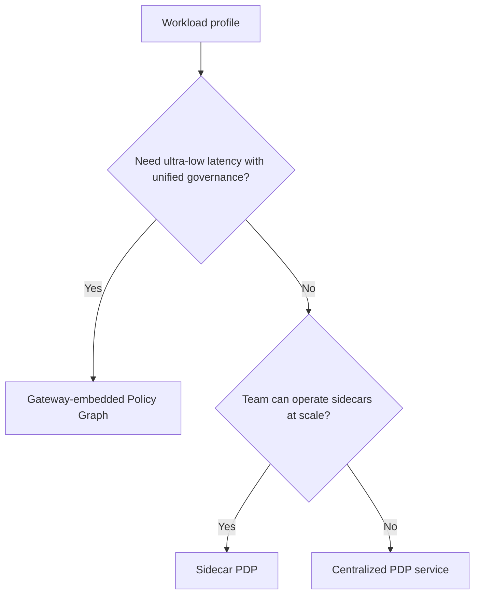
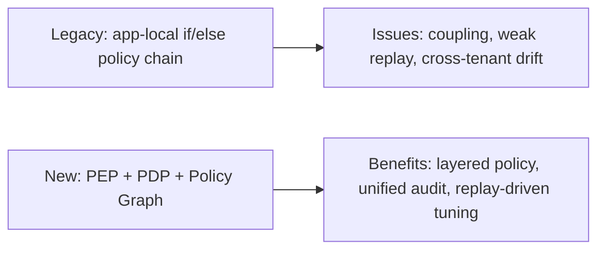
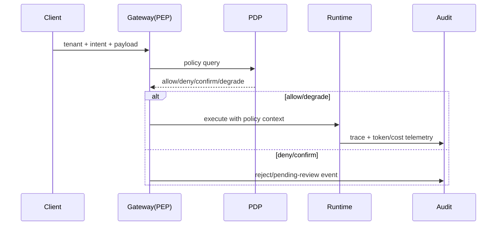

# Policy Engine Placement Selection FAQ (Gateway-Embedded Policy Graph vs Sidecar PDP vs Centralized PDP Service)

> Scope lock: this FAQ focuses only on **where the policy engine is deployed**, not runtime/state-store selection itself.

## 1) 📌 Executive Summary (3-minute read)

1. **Default choice is gateway-embedded Policy Graph + centralized audit** for shortest governance loop and lowest latency.  
2. **Sidecar PDP is best for high-autonomy teams** that need fast policy iteration and independent rollout.  
3. **Centralized PDP service is strongest for cross-domain consistency** but adds the highest peak-path latency.

## 2) 🎯 Hard Questions Q&A

### Q1: When should I choose gateway-embedded Policy Graph?

- You want identity, quota, content safety, and MCP/A2A policy checks in one AI Gateway hop.  
- You prioritize low latency, high observability, and fewer moving parts.

### Q2: When is Sidecar PDP strictly better?

- Each domain has sharply different policy logic and frequent policy releases.  
- Teams already operate Service Mesh/Sidecar patterns and need policy rollout decoupled from app releases.

### Q3: What is PEP/PDP/Policy Graph, what pain does it solve, and how does it work?

- **What (plain words)**:  
  - **PEP** is the gatekeeper that enforces decisions.  
  - **PDP** is the decision brain.  
  - **Policy Graph** is a dependency graph of policy checks instead of a long if-else chain.  
- **Pain solved**: monolithic rule chains are brittle, hard to explain, and hard to replay.  
- **How it works**: PEP sends a decision query to PDP; PDP evaluates identity → context → tool → content → budget nodes and returns allow/deny/confirm/degrade.

## 3) 🧭 Visual Explanations (Mermaid)

## 4) 📊 Architect Decision Matrix

| Dimension | Gateway-embedded Policy Graph | Sidecar PDP | Centralized PDP Service |
|---|---|---|---|
| Decision latency | Low | Medium | Medium-high |
| Policy consistency | High | Medium | Very high |
| Team autonomy | Medium | High | Medium |
| Ops complexity | Low-medium | High | Medium |
| Observability closure | High | Medium | High |
| Default recommendation | ✅ | Conditional | Conditional |

## 5) 🧪 Quantitative Example + Benchmark Insight

> Data source: `evidence/cycle-389-benchmark.json` (sealed evidence with measured/synthetic/anonymized_reported labels).

| Metric | Gateway-embedded | Sidecar | Centralized PDP | Insight |
|---|---:|---:|---:|---|
| Decision latency p50 | 18ms | 31ms | 44ms | more network hops increase latency |
| Decision latency p95 | 42ms | 67ms | 103ms | peak amplification is strongest in centralized path |
| Interception rate | 95.8% | 95.1% | 96.0% | accuracy can be close across designs |
| False positive rate | 3.6% | 3.4% | 3.3% | replay-driven tuning is still mandatory |
| Governance cost per session (20 min) | $0.0052 | $0.0058 | $0.0065 | centralized path pays extra network/service overhead |

7-card (4:5, CSP self-contained): `benchmark-cards.html` / `benchmark-cards.en.html`

## 6) 🛠️ Architect Checklist

- [ ] Define PEP/PDP ownership boundaries (block, explain, audit)  
- [ ] Standardize deny/confirm reason codes and replay context  
- [ ] Implement policy canary rollout and one-click rollback  
- [ ] Gate releases with decision latency p50/p95 SLOs  
- [ ] Audit cross-tenant policy coverage weekly  
- [ ] Enforce non-bypassable hard blocks for high-risk tools  
- [ ] Run weekly red-team replay for false-positive/false-negative drift  
