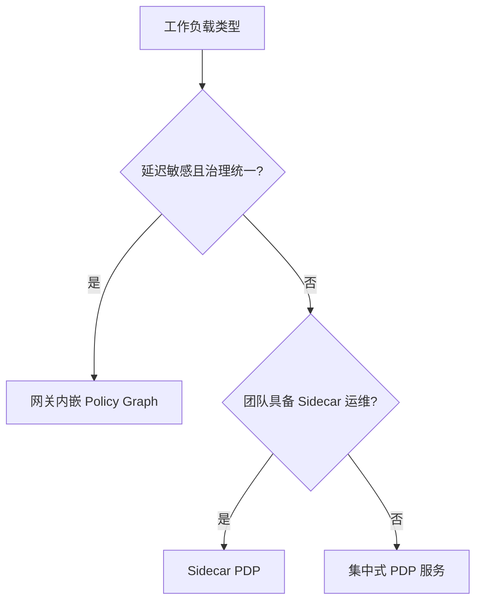
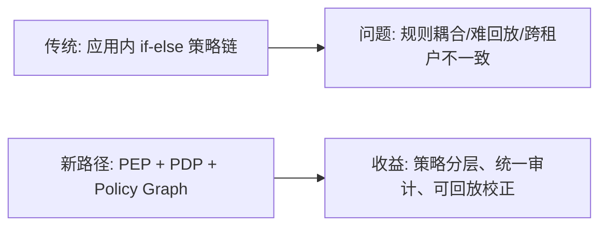
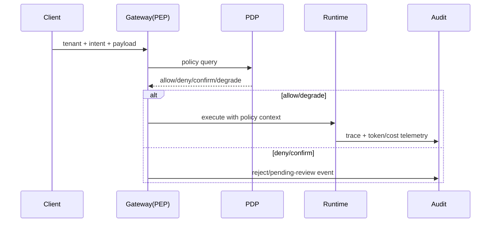

# 策略引擎部署选型 FAQ（网关内嵌 Policy Graph vs Sidecar PDP vs 集中式 PDP 服务）

> 专题边界：仅讨论 **策略引擎部署位置**，不展开 Runtime/State Store 本体选型。

## 1) 📌 Executive Summary（3 分钟结论）

1. **默认优先“网关内嵌 Policy Graph + 集中审计”**：延迟低、治理闭环最短。  
2. **Sidecar PDP 适合高自治团队**：策略发布更快，但运维复杂度显著提升。  
3. **集中式 PDP 服务适合跨域统一治理**：一致性最强，但峰值链路延迟最高。  

## 2) 🎯 灵魂拷问 Q&A

### Q1：什么时候选网关内嵌 Policy Graph？

- 你需要把鉴权、配额、内容安全、MCP/A2A 路由统一放在 AI Gateway 一跳内完成。  
- 你更看重“低延迟 + 强可观测 + 少组件”。

### Q2：什么场景 Sidecar PDP 严格更优？

- 每个业务域策略差异极大、发布节奏快，且团队具备 Service Mesh/Sidecar 运维能力。  
- 需要把策略生命周期与应用发布解耦，允许独立灰度。

### Q3：核心技术 X（PEP/PDP/Policy Graph）是什么，解决什么痛点，底层怎么运作？

- **是什么（大白话）**：  
  - **PEP**（Policy Enforcement Point）是“闸门”；  
  - **PDP**（Policy Decision Point）是“判官”；  
  - **Policy Graph** 是“把规则按依赖关系组织成图”的执行引擎。  
- **解决痛点**：传统 if-else 规则链一长就难维护、难解释、难回放。  
- **底层运作**：PEP 收到请求后调用 PDP，PDP 按图执行身份→上下文→工具→内容→预算节点，输出 allow/deny/confirm/degrade。

## 3) 🧭 可视化图解（Mermaid）

## 4) 📊 Architect Decision Matrix

| 维度 | 网关内嵌 Policy Graph | Sidecar PDP | 集中式 PDP 服务 |
|---|---|---|---|
| 决策延迟 | 低 | 中 | 中-高 |
| 策略一致性 | 高 | 中 | 很高 |
| 团队自治 | 中 | 高 | 中 |
| 运维复杂度 | 低-中 | 高 | 中 |
| 观测闭环 | 高 | 中 | 高 |
| 推荐默认 | ✅ | 条件适配 | 条件适配 |

## 5) 🧪 定量算例 + Benchmark 洞察

> 数据来源：`evidence/cycle-389-benchmark.json`（sealed evidence，标签 measured/synthetic/anonymized_reported）。

| 指标 | 网关内嵌 | Sidecar | 集中式 PDP | 洞察 |
|---|---:|---:|---:|---|
| p50 决策延迟 | 18ms | 31ms | 44ms | 组件越分散，链路越长 |
| p95 决策延迟 | 42ms | 67ms | 103ms | 峰值放大在集中式更明显 |
| 拦截率 | 95.8% | 95.1% | 96.0% | 三者可接近，关键差异在延迟与运维 |
| 误杀率 | 3.6% | 3.4% | 3.3% | 精度差异小，需持续回放校正 |
| 单会话治理成本（20 分钟） | $0.0052 | $0.0058 | $0.0065 | 集中式多一跳网络与服务开销 |

7-Card（4:5，CSP 自包含）：`benchmark-cards.html` / `benchmark-cards.en.html`

## 6) 🛠️ Architect Checklist

- [ ] 明确 PEP/PDP 边界与责任（谁阻断、谁解释、谁审计）  
- [ ] 对 deny/confirm 输出统一 reason code 与回放上下文  
- [ ] 建立策略灰度发布与一键回滚机制  
- [ ] 把 p50/p95 决策延迟写入 SLO 与发布门禁  
- [ ] 对跨租户策略覆盖率做周度审计  
- [ ] 对高风险工具建立“不可绕过硬拦截”白名单体系  
- [ ] 每周执行一次红队回放校验误杀/漏检  
