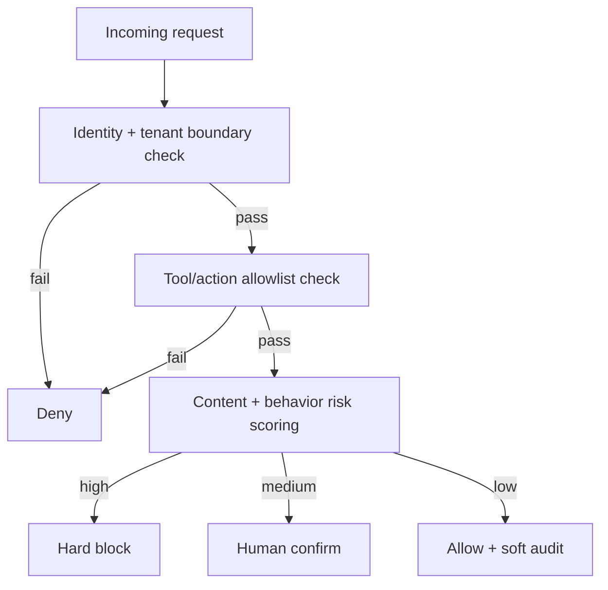
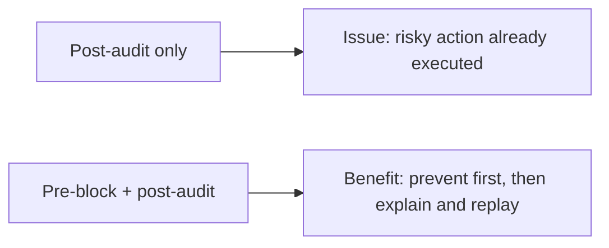
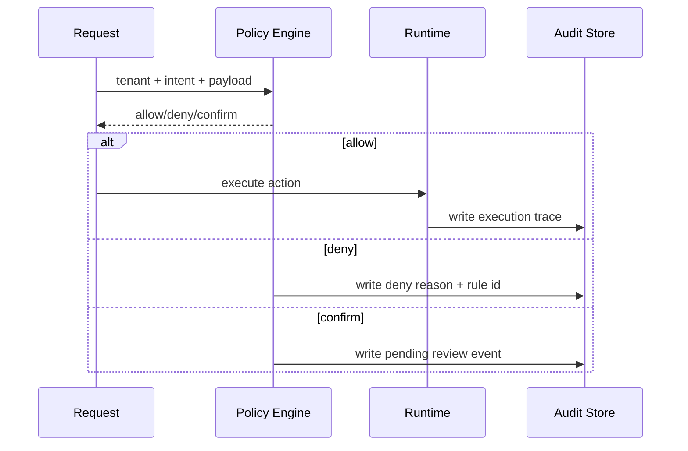

# Agent Policy Interception Selection FAQ (Pre-Execution Hard Blocks vs Post-Execution Soft Audit)

> Scope lock: this document focuses only on **policy interception architecture** (admission, in-flight, post-response).

## 1) 📌 Executive Summary (3-minute read)

1. **Production default is dual-layer policy: pre-execution hard block + post-execution soft audit.**  
2. **Post-audit-only is insufficient for high-risk actions**: it observes violations but does not prevent them.  
3. **Policy priority should start with identity/tenant boundary, then content and behavioral rules.**

## 2) 🎯 Hard Questions Q&A

### Q1: When is pre-execution hard block mandatory?

- Any action involving data exfiltration, privileged tool calls, sensitive writes, or cross-tenant access.  
- Compliance requires “must not execute” rather than “can execute but must be logged.”

### Q2: When can post-execution soft audit be primary?

- Low-risk advisory/search workloads where immediate rollback is practical.  
- Business explicitly accepts “execute then alert” mode.

### Q3: What is the core mechanism (policy decision graph), what does it solve, and how does it work?

- **What**: policy evaluation as a directed graph across identity, context, tool, content, and budget nodes.  
- **Pain solved**: monolithic linear rules are often high-false-positive, high-false-negative, and hard to explain.  
- **How**:  
  - low-cost hard predicates first;  
  - semantic and behavioral rules next;  
  - outputs are allow/deny/degrade/human-confirm.

## 3) 🧭 Visual Explanations (Mermaid)

## 4) 📊 Architect Decision Matrix

| Dimension | Pre-block + Post-audit | Post-audit Only |
|---|---|---|
| Risk prevention strength | Strong | Weak |
| Mistake blast-radius control | Strong | Weak |
| User flow smoothness | Medium | High |
| Traceability | Strong | Medium |
| Compliance fitness | Strong | Medium-to-weak |
| Production default | Recommended | Only for low-risk workloads |

## 5) 🧪 Quantitative Example + Benchmark Insight

> Data source: `evidence/cycle-388-benchmark.json` (sealed evidence).

| Metric | Dual-layer policy | Post-audit-only | Insight |
|---|---:|---:|---|
| High-risk interception rate | 96%+ | 41% | pre-blocking is the decisive difference |
| False positive rate | 3.8% | 1.2% | dual-layer needs continuous precision tuning |
| Decision latency p50 | 19ms | 7ms | meaningful protection with acceptable overhead |
| Decision latency p95 | 43ms | 15ms | peak overhead remains manageable |
| Governance cost per session (20 min) | $0.0054 | $0.0042 | extra cost buys major risk reduction |

7-card (4:5, CSP self-contained): `benchmark-cards.html` / `benchmark-cards.en.html`

## 6) 🛠️ Architect Checklist

- [ ] Define non-bypassable hard-block rules and priority order  
- [ ] Maintain weekly false-positive/false-negative replay dataset  
- [ ] Attach explainable reason codes for every deny outcome  
- [ ] Define SLA and timeout actions for human-confirm path  
- [ ] Gate interception rate, false positives, and decision latency  
- [ ] Implement policy hot-update with rollback safety  
- [ ] Run periodic adversarial red-team validation  

