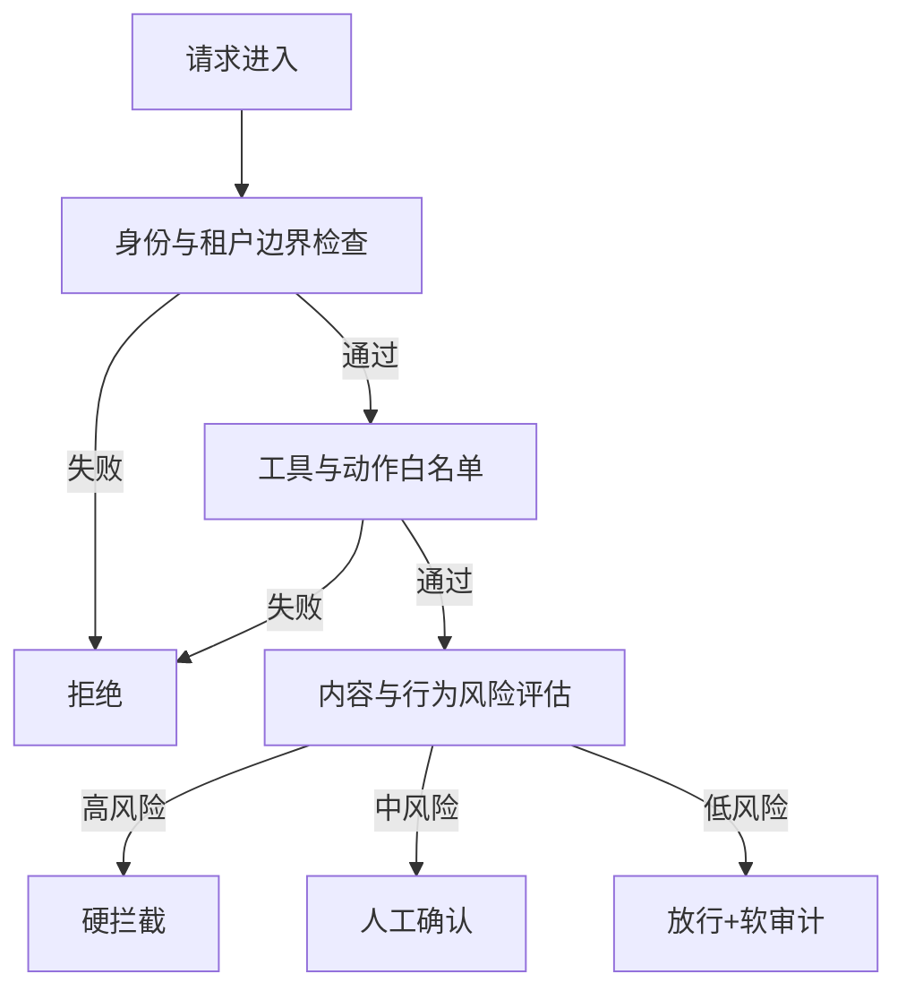
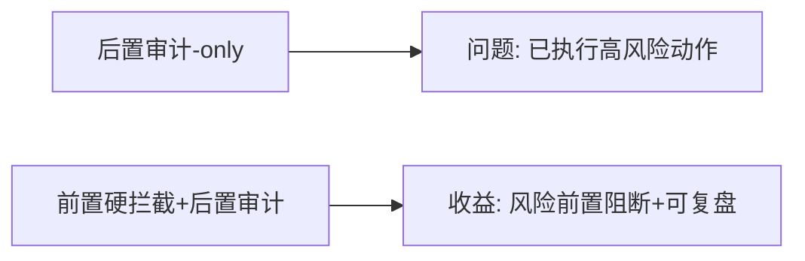
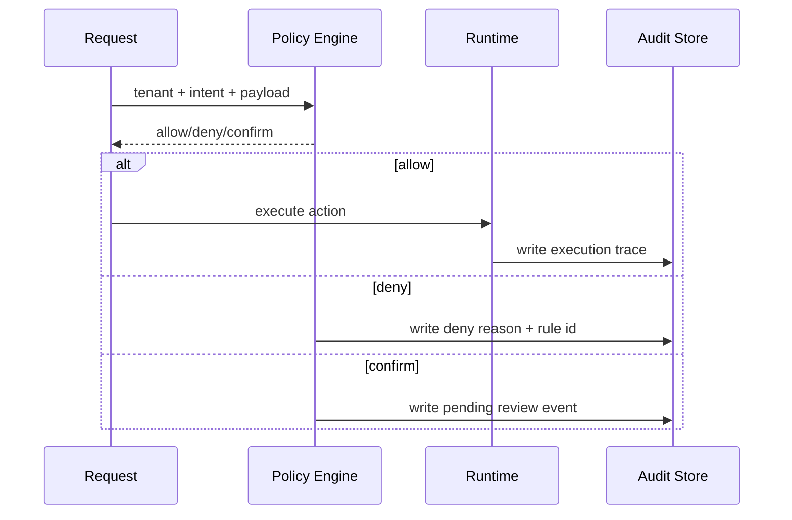

# Agent 策略拦截架构选型 FAQ（前置硬拦截 vs 后置软审计）

> 专题边界：仅讨论 **策略拦截链路设计**（准入、执行中、输出后）。

## 1) 📌 Executive Summary（3 分钟结论）

1. **生产默认采用“前置硬拦截 + 后置软审计”双层策略**：既控风险又保可追溯。  
2. **仅后置审计不适合高风险动作场景**：能看见问题，但拦不住问题。  
3. **拦截策略优先级应从“身份/租户边界”开始，再到内容与行为规则。**

## 2) 🎯 灵魂拷问 Q&A

### Q1：什么时候必须前置硬拦截？

- 涉及数据外传、越权工具调用、敏感写操作、跨租户访问等高风险动作。  
- 合规要求明确“违规动作不得执行”而非“执行后可审计”。

### Q2：什么时候后置软审计可以作为主策略？

- 低风险建议类任务、内容检索类任务；  
- 业务可接受“先执行后告警”的模式，并有快速回滚补救机制。

### Q3：核心技术 X（策略决策图）是什么？怎么运作？

- **是什么**：把策略评估拆成多个节点（身份、上下文、工具、内容、预算）并形成有向决策图。  
- **解决痛点**：单规则串行常出现误杀高、漏检高、解释性差。  
- **底层运作**：  
  - 先做低成本硬条件过滤；  
  - 再做语义与行为策略评估；  
  - 输出允许/拒绝/降级/人工确认四类动作。

## 3) 🧭 可视化图解（Mermaid）

## 4) 📊 Architect Decision Matrix

| 维度 | 前置硬拦截 + 后置审计 | 仅后置软审计 |
|---|---|---|
| 风险阻断能力 | 强 | 弱 |
| 误操作代价控制 | 强 | 弱 |
| 业务流畅度 | 中 | 高 |
| 可追溯性 | 强 | 中 |
| 合规适配度 | 强 | 中-弱 |
| 生产默认建议 | 推荐 | 仅低风险场景 |

## 5) 🧪 定量算例 + Benchmark 洞察

> 数据来源：`evidence/cycle-388-benchmark.json`（sealed evidence）。

| 指标 | 双层策略 | 后置审计-only | 洞察 |
|---|---:|---:|---|
| 高风险动作拦截率 | 96%+ | 41% | 前置拦截是核心差异 |
| 误杀率 | 3.8% | 1.2% | 双层策略需持续优化规则精度 |
| p50 决策延迟 | 19ms | 7ms | 风险防护引入可接受开销 |
| p95 决策延迟 | 43ms | 15ms | 峰值延迟仍在可控范围 |
| 单会话治理成本（20 分钟） | $0.0054 | $0.0042 | 多出的成本换来显著风险下降 |

7-Card（4:5，CSP 自包含）：`benchmark-cards.html` / `benchmark-cards.en.html`

## 6) 🛠️ Architect Checklist

- [ ] 定义硬拦截策略优先级与不可绕过规则  
- [ ] 建立误杀/漏检回放数据集并周度迭代  
- [ ] 为每条拒绝策略输出可解释 reason code  
- [ ] 对人工确认路径定义 SLA 与超时动作  
- [ ] 把拦截率、误杀率、决策延迟纳入发布门禁  
- [ ] 建立“策略热更新 + 回滚”机制  
- [ ] 定期执行红队对抗演练验证策略鲁棒性  

