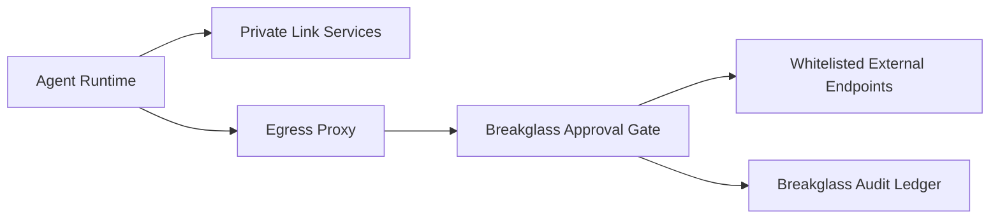

# Private Link Egress Proxy and Breakglass Selection FAQ (Cycle 1775)

## 1) Three-minute decision
- **In private-network agent platforms, the highest risk often sits in controlled egress exceptions (Breakglass), not routine internal calls.**
- **Recommendation:** default Private Link isolation + centralized egress proxy + short-lived approval-based breakglass lane.
- **Goal:** preserve zero-trust boundaries while enabling emergency dependency recovery.

## 2) Core questions (Q1/Q2/Q3)
### Q1: Why not ban all egress exceptions permanently?
1) incident triage sometimes requires temporary external access,
2) third-party outages may need controlled fallback,
3) total closure can convert recoverable faults into prolonged downtime.

### Q2: What is the minimum safe breakglass set?
- short-lived credentials,
- dual approval with full audit recording,
- proxy-only egress to strict allowlist targets.

### Q3: How to prove it cannot be abused?
- non-approved requests are consistently denied,
- approved channels auto-expire,
- audit replay shows who/when/what endpoint was accessed.

## 3) Reference architecture

## 4) Decision matrix
| Dimension | Always-open proxy | Approval-based short-lived breakglass (Recommended) |
|---|---:|---:|
| Security boundary | Low | High |
| Recovery capability | High | High |
| Abuse risk | High | Low |
| Ops complexity | Low | Medium |
| Audit traceability | Medium | High |

## 5) Evidence and reproducibility
- Evidence files:
  - `workshops/azure-agent-infra/evidence/cycle-1775-benchmark.json`
  - `workshops/azure-agent-infra/evidence/cycle-1775-latency.csv`
  - `workshops/azure-agent-infra/evidence/cycle-1775-policy.csv`
  - `workshops/azure-agent-infra/evidence/cycle-1775-cost.csv`
- Labels: `measured / synthetic / anonymized_reported`.
- validation7 requires bilingual structure, CSP self-contained cards, evidence consistency, and replayability.

## 6) Production checklist
- [ ] Breakglass lane is closed-by-default and approval-gated.
- [ ] Token TTL and auto-reclaim are enforced.
- [ ] Egress allowlists are segmented by tenant/environment.
- [ ] Operation logs and audit artifacts are replayable.
- [ ] FAQ/H5/SVG/7-card references are cycle-aligned.
