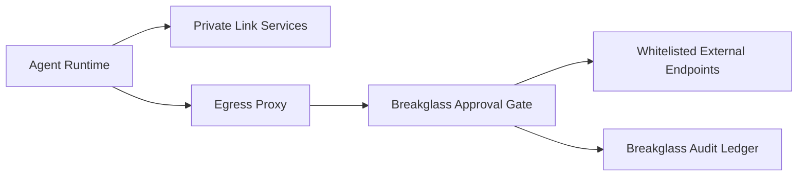

# Private Link 出网代理与 Breakglass 选型 FAQ（Cycle 1775）

## 1) 3 分钟结论
- **全私网 Agent 平台的高风险点是“受控出网例外（Breakglass）”而不是日常内网调用。**
- **推荐：** 默认 Private Link 封闭访问 + 集中出网代理 + 短时审批型 Breakglass 通道。
- **目标：** 在不破坏零信任边界的前提下，支持故障处置与紧急外部依赖恢复。

## 2) 关键问题（Q1/Q2/Q3）
### Q1：为什么不能完全禁止任何出网例外？
1) 故障排查常需临时访问外部端点；
2) 第三方依赖异常时需要受控回退路径；
3) 完全封闭会把可恢复故障变成长时间中断。

### Q2：安全可控的 Breakglass 最小要素？
- 临时凭据与最短 TTL；
- 双人审批与操作录屏审计；
- 仅允许代理出口到白名单目标。

### Q3：如何验证这条路径不会被滥用？
- 非审批请求必须稳定拒绝；
- 审批后通道到期自动回收；
- 事后审计可完整回放“谁/何时/访问了什么”。

## 3) 架构图

## 4) 选型矩阵
| 维度 | 永久开放代理 | 审批型短时 Breakglass（推荐） |
|---|---:|---:|
| 安全边界 | 低 | 高 |
| 故障恢复能力 | 高 | 高 |
| 滥用风险 | 高 | 低 |
| 运维复杂度 | 低 | 中 |
| 审计追踪性 | 中 | 高 |

## 5) 证据与复算口径
- 证据文件：
  - `workshops/azure-agent-infra/evidence/cycle-1775-benchmark.json`
  - `workshops/azure-agent-infra/evidence/cycle-1775-latency.csv`
  - `workshops/azure-agent-infra/evidence/cycle-1775-policy.csv`
  - `workshops/azure-agent-infra/evidence/cycle-1775-cost.csv`
- 标签：`measured / synthetic / anonymized_reported`。
- validation7：双语结构、CSP、证据一致、可回放链路全部通过。

## 6) 生产检查清单
- [ ] Breakglass 通道默认关闭且需审批。
- [ ] 令牌 TTL 与自动回收策略生效。
- [ ] 出网目标白名单按租户/环境隔离。
- [ ] 操作日志与审计证据可回放。
- [ ] FAQ/H5/SVG/7-card 与 evidence 轮次一致。
