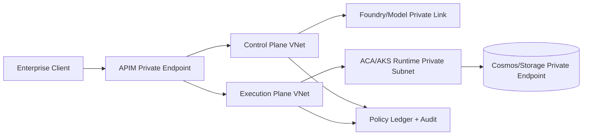

# Private Link Full-Isolation Topology Selection FAQ (Cycle 1757)

## 1) Three-minute decision
- **If governance requires control/data/execution planes to remain fully private and auditable, use a full Private Link topology rather than public egress allowlists.**
- **Recommended shape:** private APIM ingress + private model access + segmented execution subnets + private DNS zoning.
- **Tradeoff:** stronger compliance and lower exposure risk, with higher DNS/certificate/route operations complexity.

## 2) Core questions (Q1/Q2/Q3)
### Q1: When is full-private mandatory?
Adopt full-private when any of these is true:
1) regulated sectors with strict data controls,
2) classification rules disallow public reachability,
3) supply-chain audits require replayable network paths.

### Q2: Where do Private Link designs fail most often?
1) inconsistent private DNS resolution,
2) mixed identities across control/execution planes,
3) no policy ledger to explain why traffic was allowed.

### Q3: How do we keep operations manageable?
- enforce DNS/domain layering by plane,
- force APIM to be the only northbound ingress,
- run weekly topology replay drills in fixed change windows.

## 3) Private topology

## 4) Decision matrix
| Dimension | Public + allowlist | Full Private Link (Recommended) |
|---|---:|---:|
| Compliance explainability | Medium | High |
| Data exposure risk | Medium-high | Low |
| Troubleshooting complexity | Low | Medium-high |
| DNS operations requirement | Low | High |
| Long-term audit cost | Medium | Lower (after standardization) |

## 5) Evidence and label contract
- Evidence files:
  - `workshops/azure-agent-infra/evidence/cycle-1757-benchmark.json`
  - `workshops/azure-agent-infra/evidence/cycle-1757-latency.csv`
  - `workshops/azure-agent-infra/evidence/cycle-1757-policy.csv`
- Label set: `measured / synthetic / anonymized_reported`.
- Required checks: private-path reachability, policy intercepts, rollback replayability, and cost-consistent accounting.

## 6) Production checklist
- [ ] APIM, model, runtime, and data planes are all connected via Private Link.
- [ ] Private DNS zones and forwarding rules are continuously validated.
- [ ] Control-plane and execution-plane identities are separated with least privilege.
- [ ] Network changes are replayable and linked to policy versions.
- [ ] FAQ/H5/SVG/7-card all reference the same evidence set.
