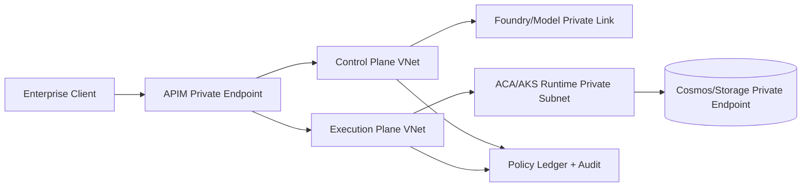

# Private Link 全私网隔离拓扑选型 FAQ（Cycle 1757）

## 1) 3 分钟结论
- **若行业要求“控制面、数据面、执行面全部私网可审计”，必须采用 Private Link 全私网拓扑，不可仅靠公网出口白名单。**
- **推荐形态：** APIM 内网入口 + Foundry/模型私网访问 + 执行平面（ACA/AKS）私网子网分层 + 私有 DNS 分域。
- **关键收益：** 降低数据外溢风险、提升合规审计可解释性，但会增加 DNS/证书/链路治理复杂度。

## 2) 关键问题（Q1/Q2/Q3）
### Q1：什么情况下必须做“全私网”？
满足任一条件即建议强制：
1) 金融/政务/医疗等高合规监管；
2) 数据分类要求禁止公网可达；
3) 供应链安全审计要求端到端网络路径可回放。

### Q2：Private Link 方案最容易失败在哪？
1) 私有 DNS 解析不一致导致跨环境偶发超时；
2) 控制面与执行面身份边界混用导致越权；
3) 仅做网络隔离但缺少策略账本，审计时无法解释“为什么放行”。

### Q3：如何把复杂度压到可运营？
- 统一命名与 DNS 分层（控制面/执行面/数据面）；
- 以 APIM 作为唯一北向入口并记录策略版本；
- 用“变更窗口 + 拓扑回放脚本”做每周演练。

## 3) 私网拓扑

## 4) 选型矩阵
| 维度 | 公网 + 白名单 | Private Link 全私网（推荐） |
|---|---:|---:|
| 合规可解释性 | 中 | 高 |
| 数据外溢风险 | 中高 | 低 |
| 排障复杂度 | 低 | 中高 |
| DNS 运维要求 | 低 | 高 |
| 长期审计成本 | 中 | 低（规范后） |

## 5) 证据与口径
- 证据文件：
  - `workshops/azure-agent-infra/evidence/cycle-1757-benchmark.json`
  - `workshops/azure-agent-infra/evidence/cycle-1757-latency.csv`
  - `workshops/azure-agent-infra/evidence/cycle-1757-policy.csv`
- 标签口径：`measured / synthetic / anonymized_reported`。
- 关键验证：私网路径连通、策略拦截率、回退可回放、成本口径一致。

## 6) 生产检查清单
- [ ] APIM、Foundry、执行平面、数据平面全部通过 Private Link 连接。
- [ ] 私有 DNS 分区与转发规则有自动化一致性检查。
- [ ] 身份边界（控制面/执行面）分离并最小权限。
- [ ] 网络变更可回放，且审计日志可关联到策略版本。
- [ ] FAQ/H5/SVG/7-card 引用同一轮证据文件。
