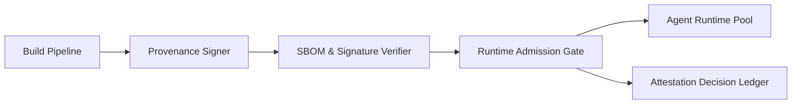

# Runtime Supply-Chain Attestation and Policy Gates Selection FAQ (Cycle 1777)

## 1) Three-minute decision
- **The runtime security floor is defined by verifiable supply-chain attestation plus execution-time policy gates.**
- **Recommendation:** chain image attestation, SBOM validation, and runtime admission policy; fail any gate, block launch.
- **Goal:** stop untrusted artifacts before production admission.

## 2) Core questions (Q1/Q2/Q3)
### Q1: Why vulnerability scanning alone is insufficient?
1) scan results can be stale,
2) build provenance is missing,
3) runtime policy can drift from build-time policy.

### Q2: What is the minimum viable gate chain?
- signed build provenance,
- pre-deploy signature/SBOM policy validation,
- runtime admission recheck before execution.

### Q3: How to prove gates work without stalling release?
- measure block vs false-block rates,
- track release-latency overhead,
- replay known-bad samples for deterministic rejection.

## 3) Reference architecture

## 4) Decision matrix
| Dimension | Vulnerability scan only | Attestation + policy gates (Recommended) |
|---|---:|---:|
| Supply-chain trust | Low | High |
| Violation blocking power | Medium | High |
| Rollout complexity | Low | Medium |
| Audit traceability | Medium | High |
| Post-incident burden | High | Low |

## 5) Evidence and reproducibility
- Evidence files:
  - `workshops/azure-agent-infra/evidence/cycle-1777-benchmark.json`
  - `workshops/azure-agent-infra/evidence/cycle-1777-latency.csv`
  - `workshops/azure-agent-infra/evidence/cycle-1777-throughput.csv`
  - `workshops/azure-agent-infra/evidence/cycle-1777-policy.csv`
- Labels: `measured / synthetic / anonymized_reported`.
- validation7 requires bilingual structure, CSP self-contained cards, evidence consistency, and replayability trace.

## 6) Production checklist
- [ ] Build artifacts include verifiable provenance.
- [ ] SBOM/signature checks are hard-gates.
- [ ] Runtime admission policy matches CI policy intent.
- [ ] Gate decisions are audit-ledgered.
- [ ] FAQ/H5/SVG/7-card references are cycle-aligned.
