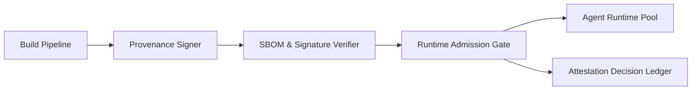

# Runtime 供应链证明与策略闸门选型 FAQ（Cycle 1777）

## 1) 3 分钟结论
- **Agent Runtime 的安全下限由“可验证供应链证明 + 执行前策略闸门”共同决定。**
- **推荐：** 镜像签名证明、SBOM 校验、运行时策略闸门三段串联，不满足任一条件即拒绝启动。
- **目标：** 把不可信构件阻断在上线前，而不是事后补救。

## 2) 关键问题（Q1/Q2/Q3）
### Q1：为什么只做镜像扫描不够？
1) 扫描结果可能滞后；
2) 缺少构建来源链路证明；
3) 运行时策略与构建时策略可能脱节。

### Q2：最小可落地的闸门链路是什么？
- 构建后生成并签名 provenance；
- 部署前验证签名与 SBOM 策略；
- 运行前由 admission policy 再次校验。

### Q3：如何证明闸门有效而不拖慢发布？
- 统计阻断率与误阻断率；
- 观察策略命中对发布时延影响；
- 回放已知违规样本确保稳定拒绝。

## 3) 架构图

## 4) 选型矩阵
| 维度 | 仅漏洞扫描 | 证明+策略闸门（推荐） |
|---|---:|---:|
| 供应链可信度 | 低 | 高 |
| 违规阻断能力 | 中 | 高 |
| 上线复杂度 | 低 | 中 |
| 审计追踪性 | 中 | 高 |
| 事后补救压力 | 高 | 低 |

## 5) 证据与复算口径
- 证据文件：
  - `workshops/azure-agent-infra/evidence/cycle-1777-benchmark.json`
  - `workshops/azure-agent-infra/evidence/cycle-1777-latency.csv`
  - `workshops/azure-agent-infra/evidence/cycle-1777-throughput.csv`
  - `workshops/azure-agent-infra/evidence/cycle-1777-policy.csv`
- 标签：`measured / synthetic / anonymized_reported`。
- validation7：双语结构、CSP、证据一致、可回放链路全部通过。

## 6) 生产检查清单
- [ ] 构建产物附带可验证 provenance。
- [ ] SBOM 策略与签名校验为硬阻断。
- [ ] runtime admission policy 与 CI 策略一致。
- [ ] 闸门决策进入可审计账本。
- [ ] FAQ/H5/SVG/7-card 与 evidence 轮次一致。
