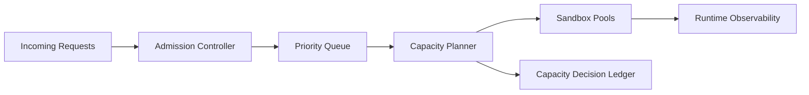

# Sandbox 准入容量规划选型 FAQ（Cycle 1769）

## 1) 3 分钟结论
- **Sandbox 集群失稳通常源于“准入控制滞后”，不是纯扩容不足。**
- **推荐：** 准入预算（并发槽位+冷启动预算）与容量规划器联动，按租户优先级动态配额。
- **目标：** 在峰值流量下保护关键任务 SLA，避免队列雪崩与全局超时。

## 2) 关键问题（Q1/Q2/Q3）
### Q1：为什么单看 CPU/内存会误判容量？
1) 冷启动和镜像拉取时延未计入；
2) 短时突发流量导致调度放大；
3) 长尾会话占用槽位拖慢高优先级请求。

### Q2：容量规划器最小输入是什么？
- 每租户请求速率与峰值波动；
- Sandbox 平均运行时长与冷启动成本；
- 关键任务最低保留槽位。

### Q3：如何验证准入策略有效？
- 峰值回放下关键任务成功率达标；
- 普通任务可降级但不拖垮主链路；
- 超配额拒绝行为可审计可解释。

## 3) 架构图

## 4) 选型矩阵
| 维度 | 固定配额 | 动态准入+容量规划（推荐） |
|---|---:|---:|
| 峰值稳定性 | 低 | 高 |
| 关键任务保障 | 中 | 高 |
| 资源利用率 | 中 | 高 |
| 运维复杂度 | 低 | 中 |
| 可审计性 | 中 | 高 |

## 5) 证据与复算口径
- 证据文件：
  - `workshops/azure-agent-infra/evidence/cycle-1769-benchmark.json`
  - `workshops/azure-agent-infra/evidence/cycle-1769-latency.csv`
  - `workshops/azure-agent-infra/evidence/cycle-1769-throughput.csv`
  - `workshops/azure-agent-infra/evidence/cycle-1769-cost.csv`
- 标签：`measured / synthetic / anonymized_reported`。
- validation7：双语结构、CSP、证据一致、可复放链路全部通过。

## 6) 生产检查清单
- [ ] 准入策略明确关键租户保留槽位。
- [ ] 冷启动预算纳入容量计算。
- [ ] 超配额拒绝带原因码与审计记录。
- [ ] 关键/普通任务降级策略可回放。
- [ ] FAQ/H5/SVG/7-card 与 evidence 轮次一致。
