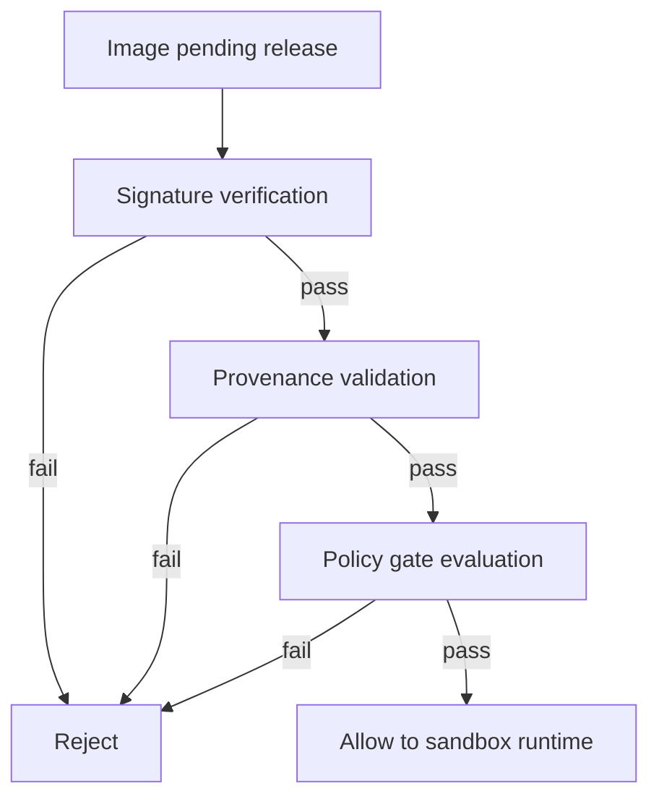
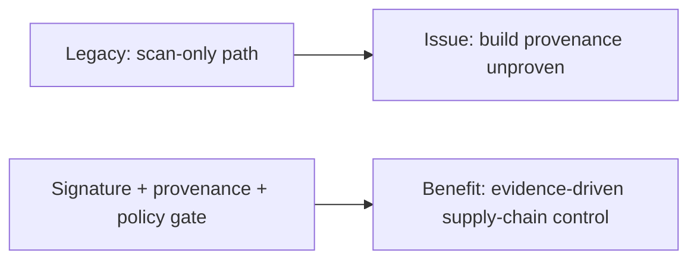
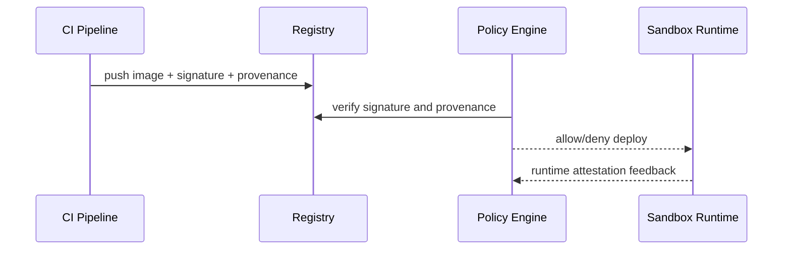

# Sandbox Image Supply-chain Attestation Selection FAQ (Signature-only vs SLSA Provenance + Policy Gate)

> Scope lock: this FAQ focuses only on **sandbox image and dependency supply-chain trust evidence**.

## 1) 📌 Executive Summary (3-minute read)

1. **Production default should be signature verification + SLSA provenance + policy gates.**  
2. **Signatures without provenance are insufficient**: you know who signed, not how artifacts were built.  
3. **Core goal is verifiable rejectability**: non-compliant artifacts must not reach runtime.

## 2) 🎯 Hard Questions Q&A

### Q1: When is signature-only acceptable?

- Small teams, low-risk environments, short transition windows.  
- Only with an explicit upgrade path to provenance and policy gating.

### Q2: When is SLSA provenance strictly better?

- Regulated and multi-tenant workloads requiring strong traceability.  
- You must prove build process, dependency origin, and release responsibility.

### Q3: What are policy gates and how do they work?

- **What (plain words)**: pre-deploy security checkpoint that blocks non-compliant images.  
- **Pain solved**: prevents risky artifacts from entering production.  
- **How**: verify signature → validate provenance → evaluate policy rules → allow/deny.

## 3) 🧭 Visual Explanations (Mermaid)

## 4) 📊 Architect Decision Matrix

| Dimension | Signature Only | Signature + SLSA + Policy Gate |
|---|---|---|
| Implementation complexity | Low | Medium-high |
| Traceability depth | Medium | High |
| Blocking strength | Medium | High |
| Compliance fitness | Medium | High |
| Production default | Transition only | ✅ |

## 5) 🧪 Quantitative Example + Benchmark Insight

> Data source: `evidence/cycle-396-benchmark.json`.

| Metric | Signature Only | Three-layer model |
|---|---:|---:|
| High-risk image interception | 72.1% | 96.8% |
| Mean incident trace time | 46min | 11min |
| Pre-release check latency p50 | 380ms | 620ms |
| False block rate | 2.1% | 2.9% |
| Governance cost per session | $0.0048 | $0.0057 |

7-card: `benchmark-cards.html` / `benchmark-cards.en.html`

## 6) 🛠️ Architect Checklist

- [ ] Require signatures and provenance for all deployable images
- [ ] Define deny policies (missing signature, weak SLSA level, high-risk deps)
- [ ] Record gate decisions in audit/change logs
- [ ] Prepare policy canary and rollback controls
- [ ] Review false block and missed block cases weekly
- [ ] Drill incident-to-block remediation flow
- [ ] Maintain trust allowlist for third-party base images
