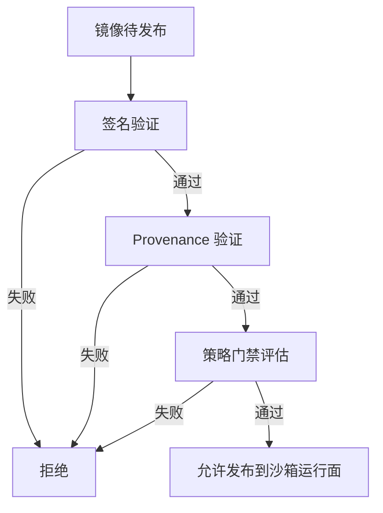
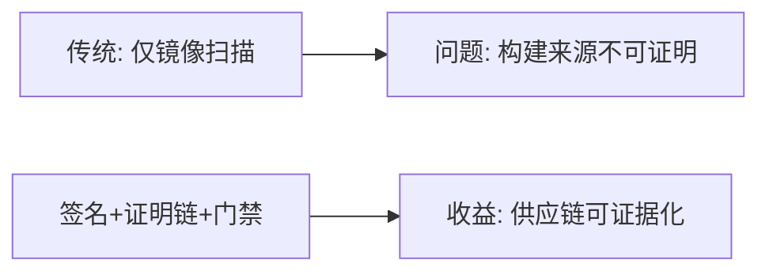
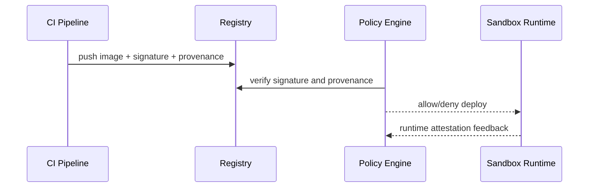

# 沙箱镜像供应链证明选型 FAQ（签名校验 vs SLSA 证明链 + 策略门禁）

> 专题边界：仅讨论 **Agent Sandbox 镜像与依赖供应链可信证明**。

## 1) 📌 Executive Summary（3 分钟结论）

1. **生产默认应采用“镜像签名 + SLSA provenance + 策略门禁”三件套**。  
2. **只有签名没有来源证明不够**：你知道“是谁签了”，但不知道“是怎么构建出来的”。  
3. **供应链治理核心是“可验证可拒绝”**，即不满足策略的镜像不能进入运行面。

## 2) 🎯 灵魂拷问 Q&A

### Q1：什么时候只做签名校验可以接受？

- 小团队、低风险环境、短期过渡阶段。  
- 前提是有明确的升级计划进入 provenance + policy 模式。

### Q2：什么场景 SLSA 证明链严格更优？

- 金融/政企/多租户平台，需要强审计和可追溯构建链。  
- 你必须证明构建过程、依赖来源、发布责任人。

### Q3：核心技术 X（策略门禁）是什么，怎么运作？

- **是什么（大白话）**：发布前先“安检”，不合规镜像直接拦下。  
- **解决痛点**：把风险镜像挡在生产入口之外，而不是上线后再补救。  
- **底层运作**：校验签名 → 验 provenance → 评估策略规则 → allow/deny。

## 3) 🧭 可视化图解（Mermaid）

## 4) 📊 Architect Decision Matrix

| 维度 | 仅签名校验 | 签名+SLSA+门禁 |
|---|---|---|
| 实施复杂度 | 低 | 中-高 |
| 溯源能力 | 中 | 高 |
| 拦截能力 | 中 | 高 |
| 合规适配度 | 中 | 高 |
| 生产默认建议 | 过渡方案 | ✅ |

## 5) 🧪 定量算例 + Benchmark 洞察

> 数据来源：`evidence/cycle-396-benchmark.json`。

| 指标 | 仅签名 | 三件套 |
|---|---:|---:|
| 高风险镜像拦截率 | 72.1% | 96.8% |
| 供应链事件平均定位时间 | 46min | 11min |
| 发布前校验 p50 时延 | 380ms | 620ms |
| 误拦截率 | 2.1% | 2.9% |
| 单会话治理成本 | $0.0048 | $0.0057 |

7-Card：`benchmark-cards.html` / `benchmark-cards.en.html`

## 6) 🛠️ Architect Checklist

- [ ] 所有发布镜像必须携带签名与 provenance
- [ ] 定义拒绝策略（无签名/低SLSA等级/高危依赖）
- [ ] 将门禁结果写入审计与变更记录
- [ ] 建立策略灰度与回滚方案
- [ ] 周期复盘误拦截与漏拦截案例
- [ ] 演练“供应链告警到封禁”闭环流程
- [ ] 对第三方基础镜像建立信任白名单
