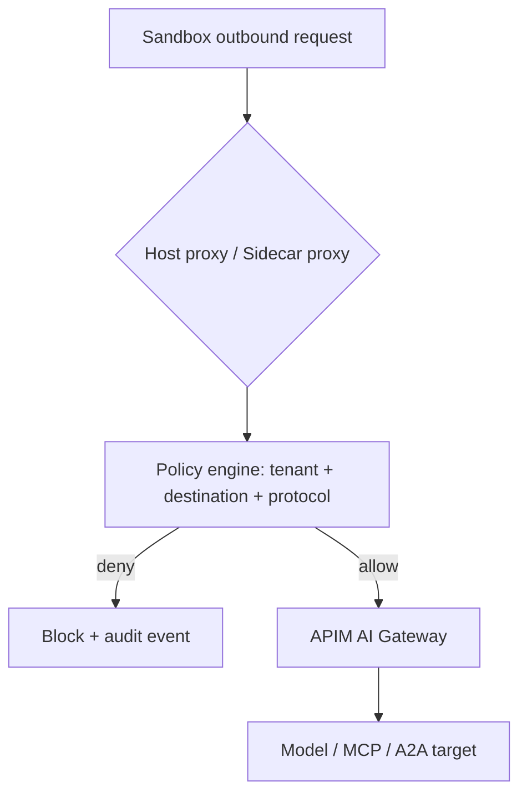
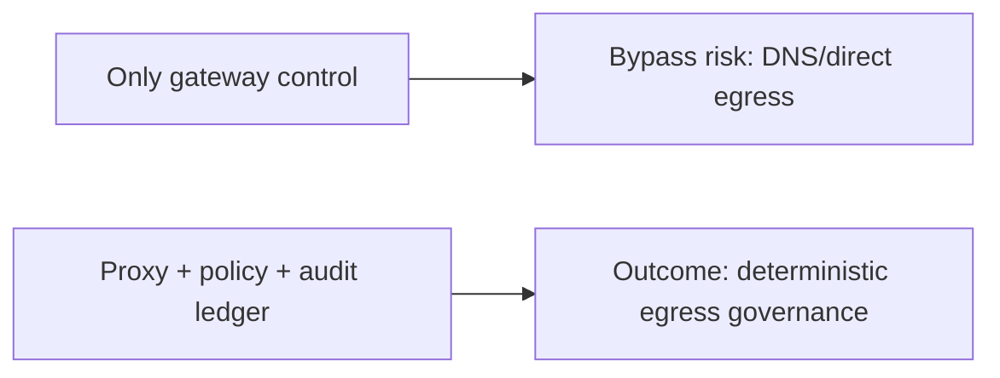
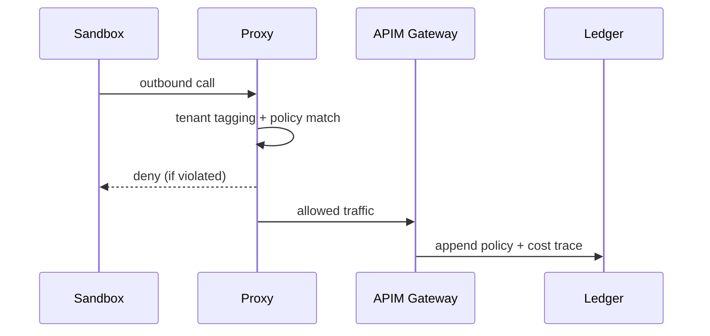

# Sandbox Egress Control Selection FAQ (Host Proxy vs Sidecar Proxy vs Gateway-Only)

> Scope boundary: this FAQ focuses only on **sandbox outbound governance** (DNS/HTTP(S)/tool egress). It does not expand into identity architecture or supply-chain attestation.

## 1) 📌 Executive Summary (3-minute take)

1. **Default production pattern: host-level unified proxy + policy plane + gateway audit** for deterministic control.  
2. **Gateway-only control is insufficient** because direct egress and DNS bypass paths can escape policy.  
3. **High-compliance environments need path evidence, rejectable policy, and traceable events as one closed loop**.

## 2) 🎯 Core Q&A

### Q1: When is a Sidecar proxy a good default?

- Mid-scale environments with workload-level autonomy and independent policy release cadence.  
- Only if the platform team can handle sidecar version drift and extra resource overhead.

### Q2: Why choose a host-level unified proxy?

- Single policy enforcement point, cleaner change governance, stronger audit continuity.  
- Better fit for multi-tenant SaaS with consistent egress boundaries and shared cost guardrails.

### Q3: What is the key technique (egress policy gate), and how does it work?

- **Plain words**: every outbound call must pass an inspection gate before leaving the sandbox.  
- **Problem solved**: prevents tool calls, dependency fetches, and webhooks from bypassing enterprise controls.  
- **Mechanism**: traffic redirect → tenant tagging → policy match (allow/deny/rate-limit) → audit ledger write.

## 3) 🧭 Visual breakdown (Mermaid)

## 4) 📊 Architect Decision Matrix

| Dimension | Host-level unified proxy | Sidecar proxy | Gateway-only control |
|---|---|---|---|
| Policy consistency | High | Medium | Low-Medium |
| Ops complexity | Medium | High | Low |
| Bypass resistance | High | Medium | Low |
| Multi-tenant auditability | High | Medium | Medium |
| Production default | ✅ | Conditional | PoC-only |

## 5) 🧪 Quantitative example + benchmark insight

> Data source: `evidence/cycle-397-benchmark.json`.

| Metric | Host proxy | Sidecar | Gateway-only |
|---|---:|---:|---:|
| High-risk egress intercept rate | 96.0% | 92.4% | 79.8% |
| False intercept rate | 2.6% | 2.9% | 2.1% |
| Policy decision latency p50 | 180ms | 210ms | 140ms |
| Egress trace completeness | 99.2% | 95.7% | 84.6% |
| Governance cost per session | $0.0054 | $0.0061 | $0.0042 |

7-Card: `benchmark-cards.html` / `benchmark-cards.en.html`

## 6) 🛠️ Architect checklist

- [ ] Force all sandbox outbound traffic through proxy layers
- [ ] Cover domain/IP/protocol/tenant/budget in policy rules
- [ ] Deny unknown destinations by default with an allowlist workflow
- [ ] Write policy intercept events to a unified audit + cost ledger
- [ ] Implement canary policy rollout and fast rollback
- [ ] Drill DNS/direct-path bypass and circuit-break recovery regularly
- [ ] Review false positives/false negatives/policy drift weekly
