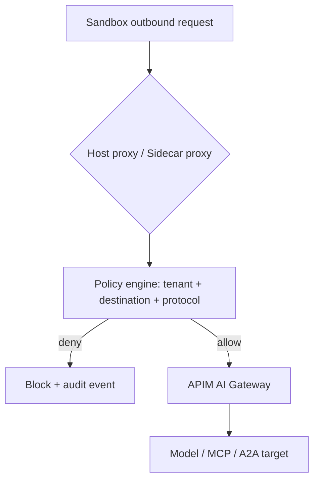
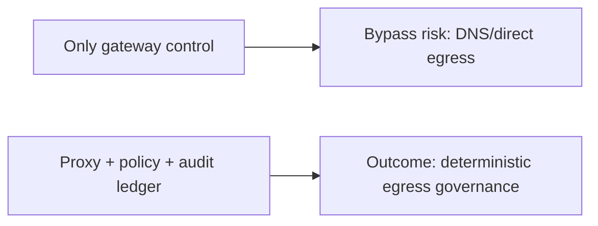
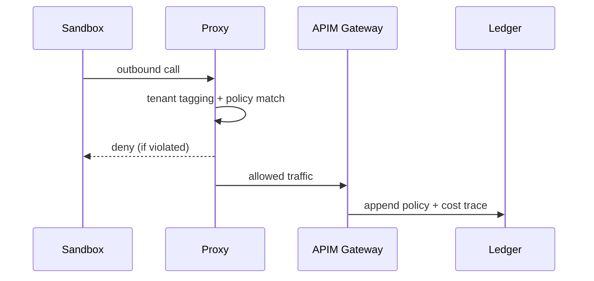

# 沙箱出网控制选型 FAQ（宿主代理 vs Sidecar 代理 vs 网关单点）

> 专题边界：仅讨论 **Agent Sandbox 的出网控制闭环**（DNS/HTTP(S)/工具调用出站），不扩展到身份体系或供应链证明。

## 1) 📌 Executive Summary（3 分钟结论）

1. **生产默认优先“宿主级统一代理 + 策略中心 + 网关审计”**，比每个沙箱各管各的更稳。  
2. **只做网关单点控制不够**：沙箱内直连路径、DNS 漏口、旁路通道会绕过治理。  
3. **高合规场景要做到“路径可证明 + 策略可拒绝 + 事件可追溯”三件套**。

## 2) 🎯 灵魂拷问 Q&A

### Q1：什么时候 Sidecar 代理可以作为默认？

- 中等规模、多团队自治、希望按工作负载独立发布策略时。  
- 前提是你有能力处理 Sidecar 版本漂移与资源开销。

### Q2：宿主级统一代理的核心优势是什么？

- 统一策略入口，变更治理简单，审计链条完整。  
- 更适合多租户 SaaS 场景下的一致出网边界和预算管理。

### Q3：核心技术 X（出网策略门禁）是什么，怎么运作？

- **是什么（大白话）**：所有沙箱外连都先过“安检闸机”，规则不通过就直接拒绝。  
- **解决痛点**：防止工具调用、下载依赖、Webhook 回调绕过企业策略。  
- **底层运作**：流量重定向 → 身份/租户打标 → 策略匹配（allow/deny/rate-limit）→ 审计落账。

## 3) 🧭 可视化图解（Mermaid）

## 4) 📊 Architect Decision Matrix

| 维度 | 宿主级统一代理 | Sidecar 代理 | 网关单点控制 |
|---|---|---|---|
| 策略一致性 | 高 | 中 | 低-中 |
| 运维复杂度 | 中 | 高 | 低 |
| 旁路防护 | 高 | 中 | 低 |
| 多租户审计 | 高 | 中 | 中 |
| 生产默认建议 | ✅ | 条件适用 | 仅 PoC |

## 5) 🧪 定量算例 + Benchmark 洞察

> 数据来源：`evidence/cycle-397-benchmark.json`。

| 指标 | 宿主代理 | Sidecar | 网关单点 |
|---|---:|---:|---:|
| 高风险出网拦截率 | 96.0% | 92.4% | 79.8% |
| 策略误拦截率 | 2.6% | 2.9% | 2.1% |
| 请求策略判定 p50 | 180ms | 210ms | 140ms |
| 出网事件追溯完整率 | 99.2% | 95.7% | 84.6% |
| 单会话治理成本 | $0.0054 | $0.0061 | $0.0042 |

7-Card：`benchmark-cards.html` / `benchmark-cards.en.html`

## 6) 🛠️ Architect Checklist

- [ ] 明确所有沙箱出站流量必须经过代理层
- [ ] 策略规则覆盖域名、IP、协议、租户与预算
- [ ] 默认拒绝未知目的地并建立白名单流程
- [ ] 将拦截事件写入统一审计与成本账本
- [ ] 建立策略灰度发布与快速回滚
- [ ] 例行演练 DNS/直连旁路与熔断恢复
- [ ] 每周复盘误拦截、漏拦截与策略漂移
