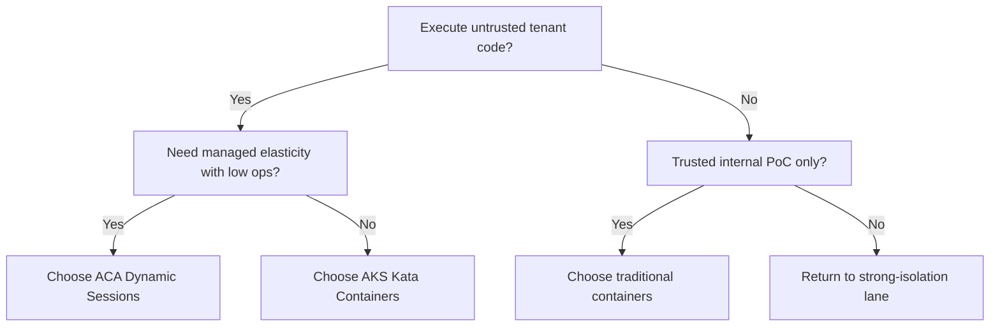
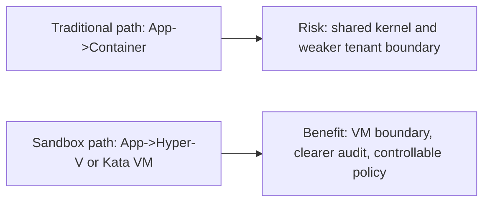
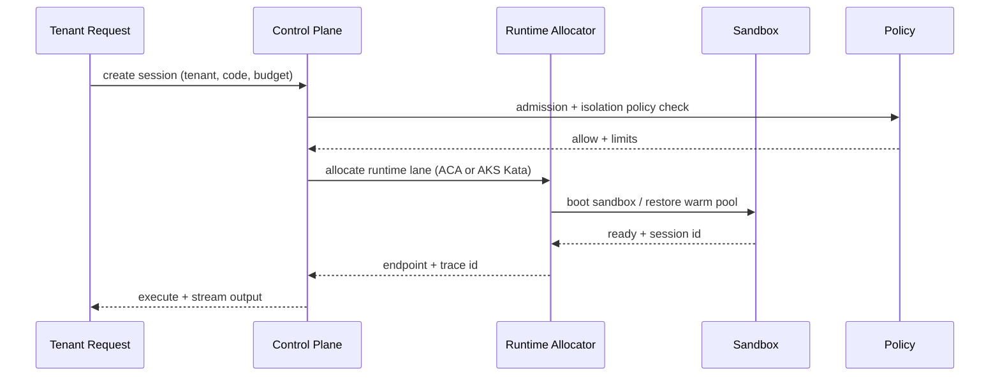

# Cloud-Native Agent Code Sandbox Selection FAQ (ACA Dynamic Sessions vs AKS Kata vs Traditional Containers)

> Scope lock: this document focuses only on **runtime/sandbox selection for code-executing Agents**.

## 1) 📌 Executive Summary (3-minute read)

1. **Use ACA Dynamic Sessions by default** when you need the best practical balance of strong isolation, delivery speed, and low ops burden.  
2. **Use AKS + Kata Containers** for high-compliance, high-control environments that require deep platform customization.  
3. **Use traditional containers only for trusted-code or low-risk PoC**; for untrusted multi-tenant execution they are usually not a production default.

## 2) 🎯 Hard Questions Q&A

### Q1: When should I choose ACA Dynamic Sessions vs AKS Kata?

- Choose **ACA Dynamic Sessions** when your priority is managed elasticity plus strong isolation without building a heavy platform team.  
- Choose **AKS Kata** when you need private topology control, deep policy customization, and enterprise-grade platform ownership.

### Q2: When are traditional containers strictly better?

- Internal trusted workloads with short lifecycle and low blast radius.  
- Cost-first PoC where weaker isolation is explicitly accepted.  
- Fast prototype paths that are not exposed to untrusted tenant code.

### Q3: What is the core mechanism (Hyper-V/Kata isolation), what pain does it solve, and how does it work?

- **What**: put each session/pod behind a VM-grade boundary instead of kernel-sharing only.  
- **Pain solved**: reduces cross-tenant breakout risk and noisy-neighbor security concerns.  
- **How**:  
  - Hyper-V/microVM lane: hardware-virtualized boundary with separate kernel.  
  - Kata lane: Kubernetes-native workflow with lightweight VM-backed containers (“container UX + VM isolation”).

## 3) 🧭 Visual Explanations (Mermaid)

## 4) 📊 Architect Decision Matrix

| Dimension | ACA Dynamic Sessions | AKS + Kata Containers | Traditional Containers |
|---|---|---|---|
| Isolation boundary | Strong (Hyper-V) | Strong (Kata VM) | Medium/weak (shared kernel) |
| Cold-start profile | Medium-good (warm pool) | Medium (node/image dependent) | Best (fastest) |
| Multi-tenant security | Strong | Strong | Weak |
| Platform control depth | Medium | Strong | Medium |
| Ops complexity | Low-medium | High | Low |
| Production default | Recommended | Recommended for strict-control compliance lanes | Not recommended for untrusted code |

## 5) 🧪 Quantitative Example + Benchmark Insight

> Data source: `evidence/cycle-383-benchmark.json` (sealed evidence), mapped into the 7-card deck.

| Metric | ACA Dynamic Sessions | AKS Kata | Traditional Containers | Insight |
|---|---:|---:|---:|---|
| Cold/restore p50 (ms) | 202 | 920 | 78 | containers are fast, but weakest boundary |
| Cold/restore p95 (ms) | 326 | 1420 | 130 | Kata has highest cold-start overhead |
| Session throughput p50 (RPS) | 1068 | 730 | 1490 | throughput and isolation often trade off |
| Policy interception rate | 95%+ | 96%+ | 81% | strong-isolation lanes align better with governance |
| Session cost (20 min) | $0.0061 | $0.0099 | $0.0042 | evaluate risk cost together with infra cost |

7-card (4:5, CSP self-contained): `benchmark-cards.html` / `benchmark-cards.en.html`

## 6) 🛠️ Architect Checklist

- [ ] Define threat model (untrusted code? multi-tenant mixed workloads?)  
- [ ] Define isolation baseline (container vs Hyper-V vs Kata VM)  
- [ ] Gate cold-start and restore SLO (p50/p95) in CI  
- [ ] Lock session cost model (per-session + peak concurrency)  
- [ ] Build policy/audit chain (admission, block, over-limit, rollback)  
- [ ] Drill three failures (slow image pull, node pressure, false policy block)  
- [ ] Prepare phased migration path from containers to strong-isolation sandboxes  

