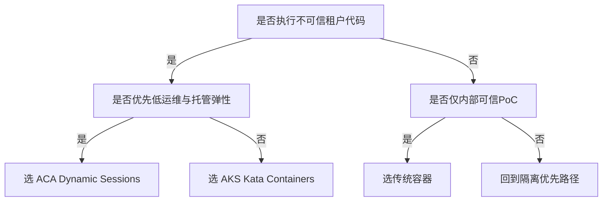
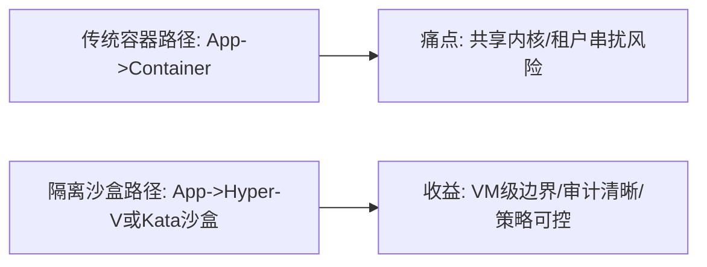
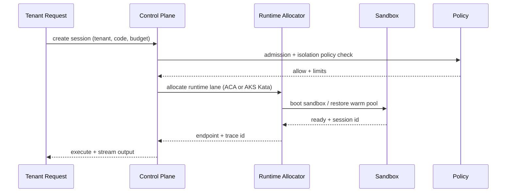

# 云原生 Agent 代码执行沙盒选型 FAQ（ACA Dynamic Sessions vs AKS Kata vs 传统容器）

> 专题边界：本文件只讨论 **Agent 代码执行沙盒 runtime 选型**，不扩展到 AI Gateway 与模型路由。

## 1) 📌 Executive Summary（3 分钟结论）

1. **默认首选 ACA Dynamic Sessions（Hyper-V 强隔离 + 托管弹性）**，当你要在“隔离强度、交付速度、运维复杂度”间取得综合最优。  
2. **AKS + Kata Containers 适合高合规、强主控、可定制内核/网络策略场景**，但平台工程与 SRE 成本更高。  
3. **传统容器（无 VM 级隔离）只适用于可信代码或低风险 PoC**；对多租户不可信代码执行，通常不建议作为生产默认。

## 2) 🎯 灵魂拷问 Q&A

### Q1：什么时候选 ACA Dynamic Sessions，什么时候选 AKS Kata？

- 选 **ACA Dynamic Sessions**：  
  - 业务目标是“快速上线 + 强隔离 + 低运维”；  
  - 团队不希望自建节点池、镜像基线和复杂调度体系。  
- 选 **AKS Kata**：  
  - 需要私有网络拓扑、细粒度策略、企业级平台主控；  
  - 对运行时和集群底层有深度定制诉求。

### Q2：什么场景下“传统容器”严格更优？

- 单租户、可信代码、短生命周期内部工具；  
- 成本敏感且明确接受“隔离边界较弱”风险；  
- 用于前期 PoC 快速验证，不承担生产级对抗威胁模型。

### Q3：核心技术 X（Hyper-V/Kata 隔离）是什么？解决什么痛点？底层如何运作？

- **是什么**：把每个会话或 Pod 放进 VM 级边界（而不只是 Linux namespace/cgroup）。  
- **解决痛点**：避免“同内核共享”导致的横向逃逸与租户串扰风险。  
- **底层原理**：  
  - Hyper-V / 微虚拟机：硬件虚拟化边界，内核独立；  
  - Kata：在 K8s 语义下，以轻量 VM 承载容器工作负载，实现“容器体验 + VM 隔离”。

## 3) 🧭 可视化图解（Mermaid）

## 4) 📊 Architect Decision Matrix

| 维度 | ACA Dynamic Sessions | AKS + Kata Containers | 传统容器 |
|---|---|---|---|
| 隔离边界 | 强（Hyper-V） | 强（Kata VM） | 中-弱（共享内核） |
| 冷启动体验 | 中-优（预热池） | 中（依赖节点与镜像） | 优（最快） |
| 多租户安全 | 强 | 强 | 弱 |
| 平台主控能力 | 中 | 强 | 中 |
| 运维复杂度 | 低-中 | 高 | 低 |
| 生产默认建议 | 推荐 | 合规强控场景推荐 | 不推荐（不可信代码） |

## 5) 🧪 定量算例 + Benchmark 洞察

> 数据来自 `evidence/cycle-383-benchmark.json`（sealed evidence），并映射至 7-Card 可视化报告。

| 指标 | ACA Dynamic Sessions | AKS Kata | 传统容器 | 洞察 |
|---|---:|---:|---:|---|
| 冷/恢复 p50 (ms) | 202 | 920 | 78 | 传统容器快，但隔离最弱 |
| 冷/恢复 p95 (ms) | 326 | 1420 | 130 | Kata 冷启开销最高 |
| 会话吞吐 p50 (RPS) | 1068 | 730 | 1490 | 吞吐与隔离通常反向拉扯 |
| 策略拦截率 | 95%+ | 96%+ | 81% | 强隔离路径更易落地统一治理 |
| 单会话成本（20 分钟） | $0.0061 | $0.0099 | $0.0042 | 风险成本需与资源成本合并评估 |

7-Card（4:5，CSP 自包含）：`benchmark-cards.html` / `benchmark-cards.en.html`

## 6) 🛠️ Architect Checklist

- [ ] 明确威胁模型：是否执行不可信代码、是否多租户混跑  
- [ ] 定义隔离等级基线：传统容器 / Hyper-V / Kata VM  
- [ ] 设定冷启与恢复 SLO（p50/p95）并做门禁  
- [ ] 固化预算模型：每会话成本 + 峰值并发资源  
- [ ] 建立策略审计链：准入、拦截、超限、回滚  
- [ ] 预演三类故障：镜像拉取慢、节点不足、策略误杀  
- [ ] 准备从传统容器迁移到强隔离沙盒的分阶段切换计划  

