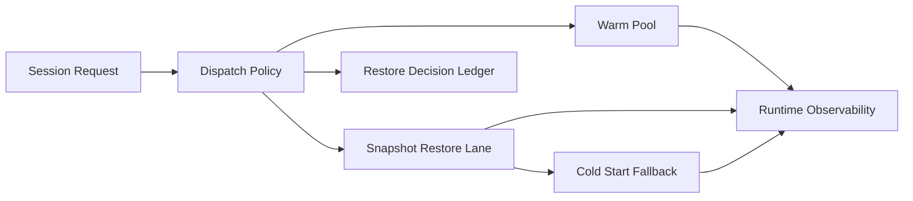

# Sandbox Snapshot Restore and Warm Pool Selection FAQ (Cycle 1778)

## 1) Three-minute decision
- **Session startup quality is bounded by snapshot-restore design plus warm-pool policy.**
- **Recommendation:** warm pool for steady load, snapshot restore for burst refill, cold start as guarded fallback.
- **Goal:** lower first-token latency during spikes while keeping idle-cost overhead controlled.

## 2) Core questions (Q1/Q2/Q3)
### Q1: Why warm-pool scaling alone is insufficient?
1) bursts can drain warm capacity quickly,
2) oversized steady pools waste cost,
3) image drift can reduce warm-hit quality.

### Q2: How should snapshot and warm pool cooperate?
- warm pool handles baseline fast admission,
- snapshot restore refills during burst windows,
- cold start is last-resort path behind budget gates.

### Q3: How to prove this beats single-path startup?
- clear P95 first-token latency reduction,
- smoother throughput recovery at peaks,
- controlled per-session cost growth.

## 3) Reference architecture

## 4) Decision matrix
| Dimension | Warm pool only | Warm pool + snapshot restore (Recommended) |
|---|---:|---:|
| First-token latency | Medium | High |
| Peak throughput recovery | Medium | High |
| Cost control | Low | High |
| Implementation complexity | Low | Medium |
| Stability | Medium | High |

## 5) Evidence and reproducibility
- Evidence files:
  - `workshops/azure-agent-infra/evidence/cycle-1778-benchmark.json`
  - `workshops/azure-agent-infra/evidence/cycle-1778-latency.csv`
  - `workshops/azure-agent-infra/evidence/cycle-1778-throughput.csv`
  - `workshops/azure-agent-infra/evidence/cycle-1778-cost.csv`
- Labels: `measured / synthetic / anonymized_reported`.
- validation7 requires bilingual structure, CSP self-contained cards, evidence consistency, and replayability trace.

## 6) Production checklist
- [ ] Warm-pool sizing and time-window policy are configurable.
- [ ] Snapshot/image version consistency is verifiable.
- [ ] Restore failure auto-falls back to cold start.
- [ ] Decisions and cost traces are ledgered.
- [ ] FAQ/H5/SVG/7-card references are cycle-aligned.
