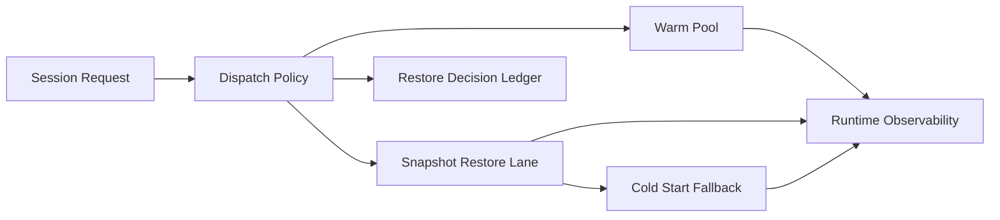

# Sandbox Snapshot 恢复与 Warm Pool 选型 FAQ（Cycle 1778）

## 1) 3 分钟结论
- **Sandbox 启动体验的上限由“快照恢复链路 + warm pool 策略”共同决定。**
- **推荐：** 基础 warm pool 承载稳定流量，突发时优先 snapshot restore 回补，再触发冷启动扩容。
- **目标：** 在突发并发下压低首包延迟，同时控制资源空转成本。

## 2) 关键问题（Q1/Q2/Q3）
### Q1：为什么只扩大 warm pool 不够？
1) 高峰突发会快速吃空 warm 实例；
2) 常态大池会造成长期闲置成本；
3) 池内镜像漂移可能降低命中质量。

### Q2：snapshot + warm pool 怎么配合？
- warm pool 负责常态快速承接；
- snapshot restore 负责峰值回补；
- 冷启动作为最后兜底并受预算闸门控制。

### Q3：如何验证方案优于单一路径？
- 首包延迟 P95 明显下降；
- 峰值阶段恢复吞吐更平滑；
- 单会话成本增长受控。

## 3) 架构图

## 4) 选型矩阵
| 维度 | 仅 Warm Pool | Warm Pool + Snapshot Restore（推荐） |
|---|---:|---:|
| 首包延迟 | 中 | 高 |
| 峰值吞吐恢复 | 中 | 高 |
| 成本可控性 | 低 | 高 |
| 实施复杂度 | 低 | 中 |
| 稳定性 | 中 | 高 |

## 5) 证据与复算口径
- 证据文件：
  - `workshops/azure-agent-infra/evidence/cycle-1778-benchmark.json`
  - `workshops/azure-agent-infra/evidence/cycle-1778-latency.csv`
  - `workshops/azure-agent-infra/evidence/cycle-1778-throughput.csv`
  - `workshops/azure-agent-infra/evidence/cycle-1778-cost.csv`
- 标签：`measured / synthetic / anonymized_reported`。
- validation7：双语结构、CSP、证据一致、可回放链路全部通过。

## 6) 生产检查清单
- [ ] warm pool 规模与时间窗策略可配置。
- [ ] snapshot 版本与基础镜像一致性可验证。
- [ ] restore 失败可自动回退冷启动。
- [ ] 决策与成本数据进入审计账本。
- [ ] FAQ/H5/SVG/7-card 与 evidence 轮次一致。
