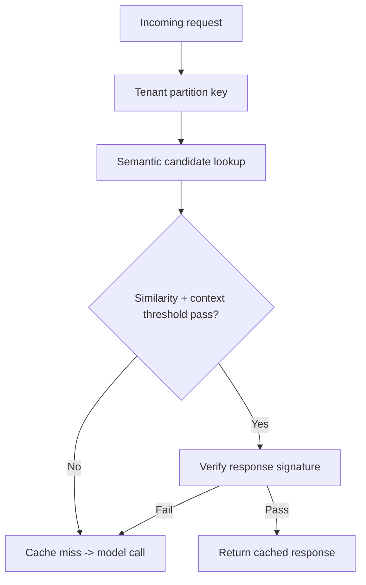
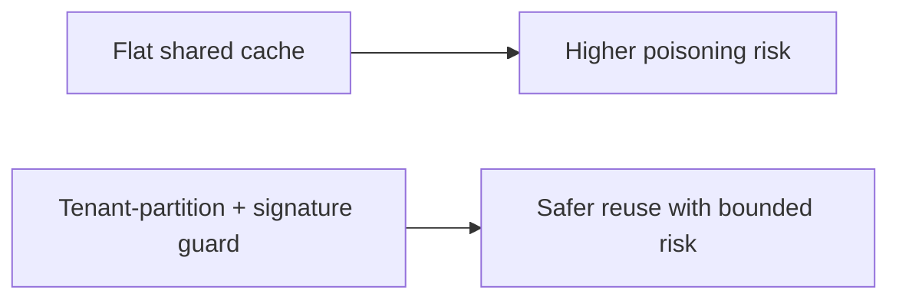
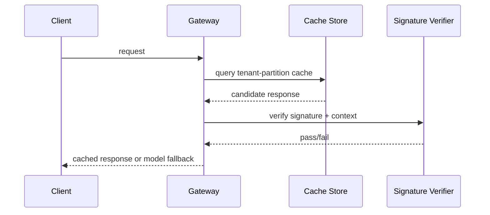

# Semantic Cache Poisoning Guard FAQ (Flat Cache vs Tenant Partition + Signature Guard)

> Scope boundary: this FAQ focuses only on **AI Gateway semantic-cache poisoning defense**. It does not expand into identity architecture or supply-chain topics.

## 1) 📌 Executive Summary (3-minute take)

1. **Default production pattern: tenant-partitioned cache + response signature verification + hit-threshold guardrails**.  
2. **Flat shared cache is highest risk in multi-tenant environments**—apparent hit gains can hide unsafe reuse.  
3. **Cache governance must balance hit-rate benefit, correctness, and security**, not optimize one metric alone.

## 2) 🎯 Core Q&A

### Q1: When is a flat cache acceptable?

- Single-tenant, low-sensitivity, short-lived experimental workloads.  
- Only when occasional incorrect hits have negligible business impact.

### Q2: When are tenant partition + signature checks mandatory?

- Multi-tenant SaaS and regulated industries requiring strict data boundaries.  
- Complex prompt context with elevated prompt-injection or cache-poisoning risk.

### Q3: What is the key technique (cache-poisoning guard), and how does it work?

- **Plain words**: before serving a cache hit, verify same tenant, same context class, and trusted signed payload.  
- **Problem solved**: prevents malicious or stale responses from being reused across incompatible requests.  
- **Mechanism**: tenant namespace partition → semantic threshold check → response signature verification → hit/deny with audit logging.

## 3) 🧭 Visual breakdown (Mermaid)

## 4) 📊 Architect Decision Matrix

| Dimension | Flat shared cache | Tenant partition + signature guard |
|---|---|---|
| Poisoning risk | High | Low |
| Hit-rate potential | High | Medium-High |
| Security control | Low | High |
| Ops complexity | Low | Medium |
| Production default | PoC-only | ✅ |

## 5) 🧪 Quantitative example + benchmark insight

> Data source: `evidence/cycle-404-benchmark.json`.

| Metric | Flat shared cache | Tenant partition + signature guard |
|---|---:|---:|
| Cache-poisoning incident rate | 4.7% | 0.6% |
| Incorrect-hit rate | 3.9% | 0.8% |
| P95 latency | 960 ms | 1020 ms |
| Audit traceability | 74.2% | 98.4% |
| Governance cost increment per session | $0.0002 | $0.0009 |

7-Card: `benchmark-cards.html` / `benchmark-cards.en.html`

## 6) 🛠️ Architect checklist

- [ ] Cache keys include tenant and scenario context
- [ ] Define semantic thresholds and low-confidence fallback rules
- [ ] Enforce signatures and integrity verification on cache payloads
- [ ] Log hit denials and signature failures into audit ledger
- [ ] Apply stricter thresholds for high-risk tenants
- [ ] Replay sampled hits regularly to monitor poisoning rate
- [ ] Drill cache-poisoning and fallback-surge scenarios
