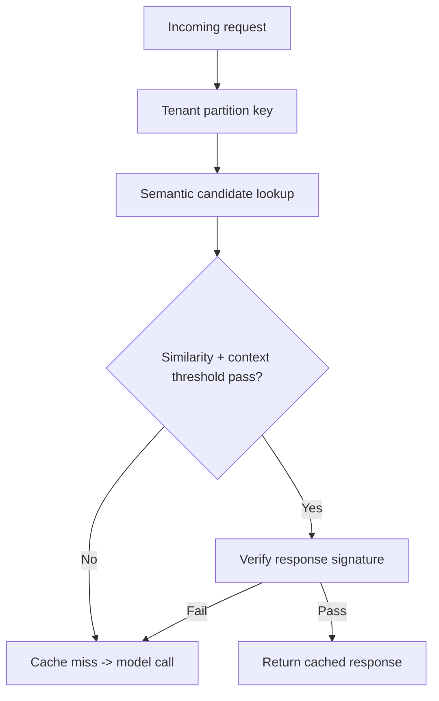
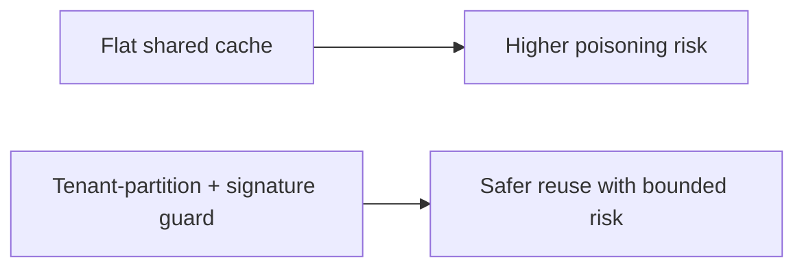
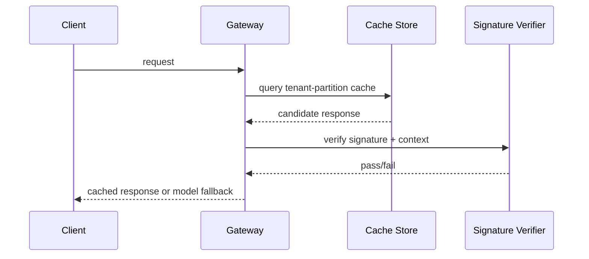

# 语义缓存污染防护选型 FAQ（无隔离缓存 vs 租户分区 + 签名校验）

> 专题边界：仅讨论 **AI Gateway 语义缓存污染防护**，不扩展到身份体系或供应链主题。

## 1) 📌 Executive Summary（3 分钟结论）

1. **生产默认建议“租户分区缓存 + 响应签名校验 + 命中阈值门禁”**，能显著降低缓存污染风险。  
2. **无隔离平铺缓存在多租户场景风险最高**，命中率看似高但错误复用代价大。  
3. **缓存治理目标是“命中收益、正确性、安全性”三者平衡**，不能只追命中率。

## 2) 🎯 灵魂拷问 Q&A

### Q1：什么时候平铺缓存还能接受？

- 单租户、低敏、短周期实验场景。  
- 前提是错误命中不会造成实质业务损失。

### Q2：什么场景必须做租户分区+签名校验？

- 多租户 SaaS、金融/政企等高合规场景。  
- 请求上下文复杂且存在提示注入、缓存投毒风险时。

### Q3：核心技术 X（缓存污染防护）是什么，怎么运作？

- **是什么（大白话）**：缓存命中前先验证“是不是同租户、同上下文、同可信响应”。  
- **解决痛点**：防止错误或恶意响应被复用到其他请求。  
- **底层运作**：tenant namespace 分区 → 语义相似度阈值 → 响应签名校验 → 命中/拒绝并记录审计。

## 3) 🧭 可视化图解（Mermaid）

## 4) 📊 Architect Decision Matrix

| 维度 | 无隔离平铺缓存 | 租户分区+签名校验 |
|---|---|---|
| 缓存污染风险 | 高 | 低 |
| 命中率潜力 | 高 | 中-高 |
| 安全可控性 | 低 | 高 |
| 运维复杂度 | 低 | 中 |
| 生产默认建议 | 仅 PoC | ✅ |

## 5) 🧪 定量算例 + Benchmark 洞察

> 数据来源：`evidence/cycle-404-benchmark.json`。

| 指标 | 无隔离平铺缓存 | 租户分区+签名校验 |
|---|---:|---:|
| 缓存污染事件率 | 4.7% | 0.6% |
| 错误命中率 | 3.9% | 0.8% |
| P95 延迟 | 960ms | 1020ms |
| 审计可追溯率 | 74.2% | 98.4% |
| 单会话治理成本增量 | $0.0002 | $0.0009 |

7-Card：`benchmark-cards.html` / `benchmark-cards.en.html`

## 6) 🛠️ Architect Checklist

- [ ] 缓存键必须包含 tenant 与场景上下文
- [ ] 定义语义阈值与低置信度回源策略
- [ ] 对缓存响应启用签名与完整性校验
- [ ] 命中拒绝与签名失败写入审计账本
- [ ] 对高风险租户开启更严格阈值策略
- [ ] 周期回放命中样本检查污染率
- [ ] 演练“缓存投毒 + 回源熔断”联动场景
