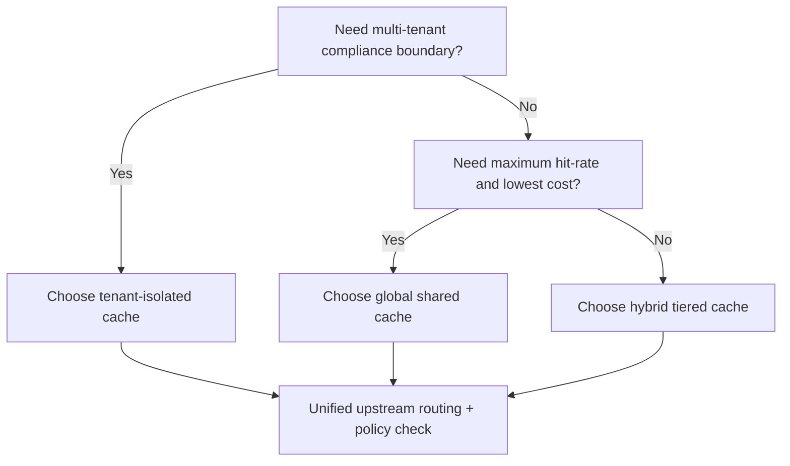
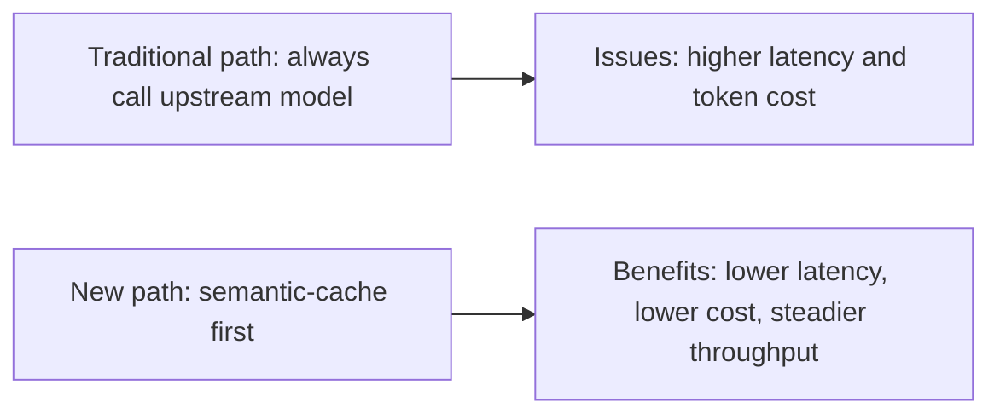
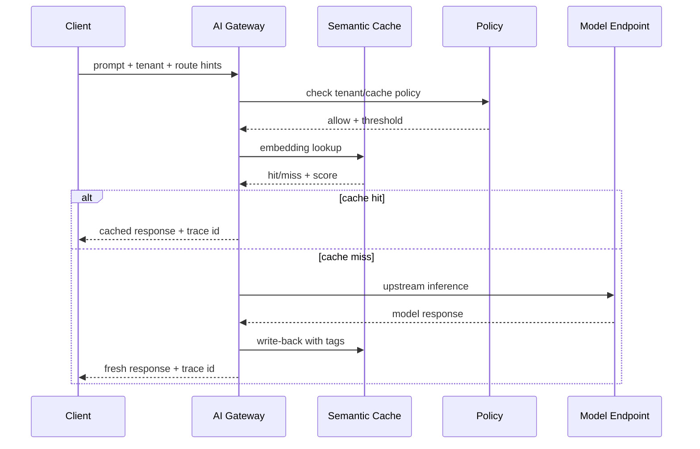

# AI Gateway Semantic Cache & Routing Selection FAQ (Tenant-Isolated Cache vs Global Shared Cache)

> Scope lock: this document focuses only on **semantic cache and routing strategy selection** in AI Gateway.

## 1) 📌 Executive Summary (3-minute read)

1. **For multi-tenant production, use tenant-isolated cache with shared upstream routing by default**: balanced hit-rate, boundary safety, and compliance.  
2. **Global shared cache is suitable only for low-sensitivity workloads**: highest hit-rate, but higher data-boundary risk.  
3. **When latency and token cost are both KPIs, semantic caching is the first lever**: optimize hit-rate before model downgrades.

## 2) 🎯 Hard Questions Q&A

### Q1: When should I choose tenant-isolated cache (A) vs global shared cache (B)?

- Choose **A** for multi-tenant SaaS and regulated industries where data boundary guarantees are mandatory.  
- Choose **B** for internal/public low-sensitivity Q&A where maximizing hit-rate is the top priority.

### Q2: When is B strictly better?

- Single-tenant, low-sensitivity, short campaign traffic.  
- Explicit acceptance of weaker isolation and lower cross-context risk concern.

### Q3: What is semantic cache, what pain does it solve, and how does it work?

- **What**: cache reuse based on semantic similarity instead of exact-string matching.  
- **Pain solved**: exact-match caches miss paraphrases and near-duplicate intents.  
- **How**:  
  - incoming prompt is embedded and searched against cached vectors;  
  - similarity threshold + policy labels + tenant boundary filter candidates;  
  - on hit return cached output, on miss call model and write back.

## 3) 🧭 Visual Explanations (Mermaid)

## 4) 📊 Architect Decision Matrix

| Dimension | Tenant-Isolated Cache | Global Shared Cache |
|---|---|---|
| Data boundary safety | Strong | Weak-to-medium |
| Cache hit-rate | Medium-high | High |
| Compliance auditability | Strong | Medium |
| Cost per request | Medium | Low |
| Operational complexity | Medium | Low |
| Production default | Recommended for multi-tenant | Recommended only for low-sensitivity workloads |

## 5) 🧪 Quantitative Example + Benchmark Insight

> Data source: `evidence/cycle-385-benchmark.json` (sealed evidence) and corresponding 7-card deck.

| Metric | Tenant-isolated cache | Global shared cache | Insight |
|---|---:|---:|---|
| p50 end-to-end latency | 118ms | 96ms | shared cache wins pure speed |
| p95 end-to-end latency | 186ms | 154ms | gap remains under peak load |
| Semantic hit-rate | 62% | 74% | shared cache has higher hit-rate |
| Policy misuse risk score (lower is better) | 0.18 | 0.41 | isolated cache has stronger safety profile |
| Session cost (20 min) | $0.0052 | $0.0046 | cost gap is smaller than risk gap |

7-card (4:5, CSP self-contained): `benchmark-cards.html` / `benchmark-cards.en.html`

## 6) 🛠️ Architect Checklist

- [ ] Define cache boundary tiers: global / tenant / session  
- [ ] Define similarity thresholds and miss fallback route  
- [ ] Attach tenant tags, sensitivity class, and TTL to cache entries  
- [ ] Monitor hit-rate, fallback-rate, latency, cost, and false-hit events  
- [ ] Drill cache pollution and cross-tenant leakage scenarios  
- [ ] Enforce hard rule: block shared cache for high-sensitivity requests  
- [ ] Run weekly threshold drift review + regression tests  

