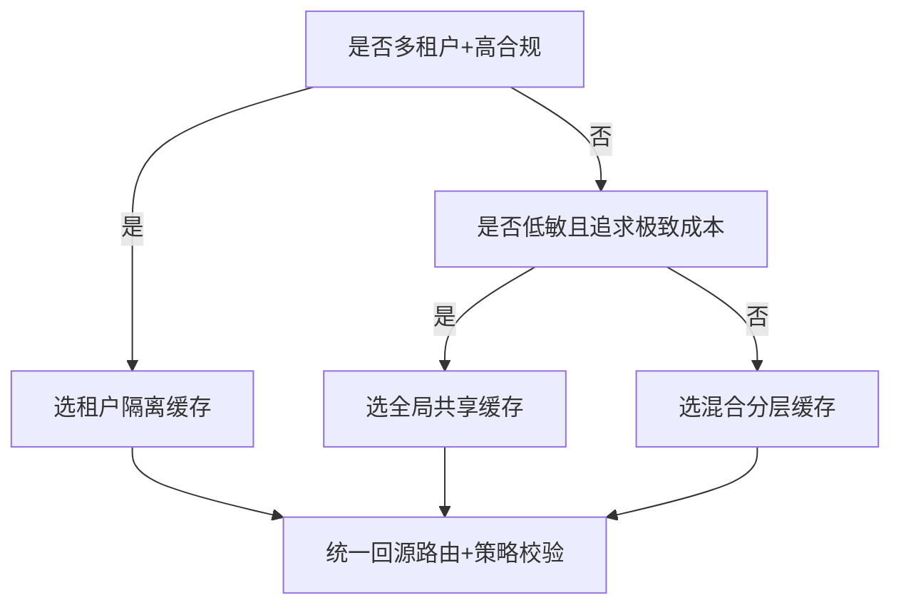
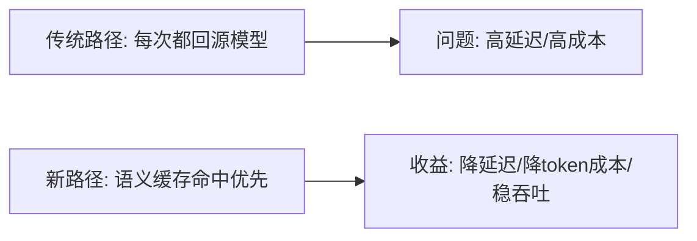
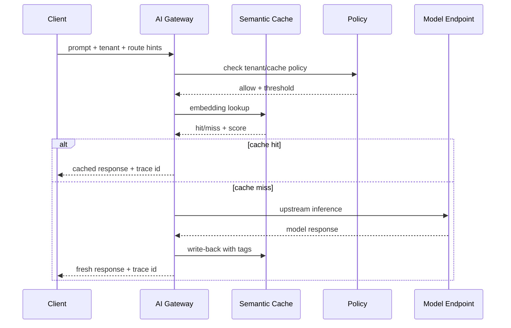

# AI Gateway 语义缓存与路由选型 FAQ（全局共享缓存 vs 租户隔离缓存）

> 专题边界：仅讨论 **AI Gateway 的语义缓存与路由策略选型**，不展开沙盒 runtime 细节。

## 1) 📌 Executive Summary（3 分钟结论）

1. **多租户生产默认采用“租户隔离缓存 + 全局回源路由”**：同时兼顾命中率、数据隔离与审计合规。  
2. **全局共享缓存仅适用于低敏感、弱隔离场景**：命中率高，但数据边界风险明显更高。  
3. **当 token 成本与延迟同时成为 KPI 时，语义缓存是首要杠杆**：先做命中率治理，再做模型降配。

## 2) 🎯 灵魂拷问 Q&A

### Q1：什么时候选“租户隔离缓存（A）”vs“全局共享缓存（B）”？

- 选 **A**：  
  - 多租户 SaaS、金融/医疗等高合规行业；  
  - 要求“缓存命中收益”与“数据边界”同时成立。  
- 选 **B**：  
  - 内部知识库问答、公开内容问答、低敏业务；  
  - 目标是极致命中率与最低单位请求成本。

### Q2：什么场景下 B 严格更优？

- 单租户、低敏、短周期活动流量（如活动 FAQ）；  
- 明确接受“命中污染”和跨上下文泄漏风险较低的业务。

### Q3：核心技术 X（语义缓存）是什么？解决什么痛点？底层如何运作？

- **是什么**：不是按字符串精确匹配，而是按“语义向量相似度”判定是否可复用历史响应。  
- **解决痛点**：同义表达很多，传统 KV 缓存命中率低。  
- **底层运作**：  
  - 请求先向量化并检索候选缓存；  
  - 通过相似度阈值、策略标签、租户边界做二次筛选；  
  - 命中则返回缓存，未命中则回源模型并写回缓存。

## 3) 🧭 可视化图解（Mermaid）

## 4) 📊 Architect Decision Matrix

| 维度 | 租户隔离缓存 | 全局共享缓存 |
|---|---|---|
| 数据边界安全 | 强 | 弱-中 |
| 缓存命中率 | 中-高 | 高 |
| 合规审计 | 强 | 中 |
| 单请求成本 | 中 | 低 |
| 运维复杂度 | 中 | 低 |
| 生产默认建议 | 推荐（多租户） | 仅低敏场景推荐 |

## 5) 🧪 定量算例 + Benchmark 洞察

> 数据来源：`evidence/cycle-385-benchmark.json`（sealed evidence）并同步 7-Card 报告。

| 指标 | 租户隔离缓存 | 全局共享缓存 | 洞察 |
|---|---:|---:|---|
| p50 端到端延迟 | 118ms | 96ms | 全局共享命中更快 |
| p95 端到端延迟 | 186ms | 154ms | 高峰期差距维持 |
| 语义命中率 | 62% | 74% | 共享缓存命中更高 |
| 策略误用风险评分（低越好） | 0.18 | 0.41 | 隔离缓存安全优势明显 |
| 单会话成本（20 分钟） | $0.0052 | $0.0046 | 成本差异小于风险差异 |

7-Card（4:5，CSP 自包含）：`benchmark-cards.html` / `benchmark-cards.en.html`

## 6) 🛠️ Architect Checklist

- [ ] 明确缓存边界：全局 / 租户 / 会话三级范围  
- [ ] 定义语义命中阈值与回退策略（命中不足自动回源）  
- [ ] 为缓存条目绑定租户标签、敏感等级、TTL  
- [ ] 监控命中率、回源率、延迟、成本与误命中事件  
- [ ] 定义缓存污染与越权命中演练流程  
- [ ] 配置“高敏请求禁止共享缓存”硬规则  
- [ ] 每周复盘阈值漂移并回归测试  

