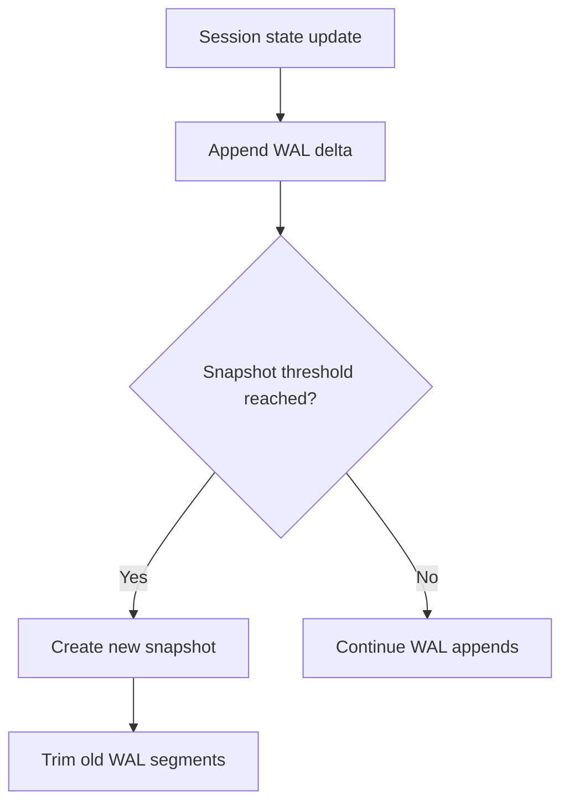
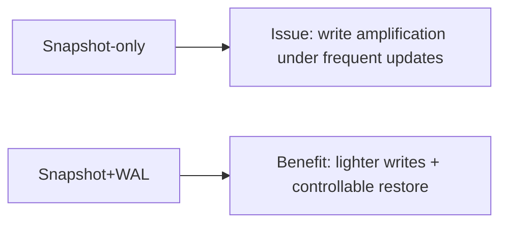
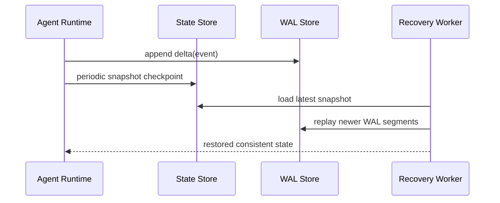

# Session State Consistency Selection FAQ (Full Snapshot vs Incremental Log vs Hybrid Snapshot+WAL)

> Scope lock: this FAQ focuses only on **session-state persistence consistency models for agents**.

## 1) 📌 Executive Summary (3-minute read)

1. **Production default should be hybrid Snapshot+WAL** for balanced recovery speed and consistency risk.  
2. **Full snapshots are simplest**, but they increase write amplification at high update rates.  
3. **Pure incremental logs maximize replay fidelity**, but long replay chains can hurt recovery latency.

## 2) 🎯 Hard Questions Q&A

### Q1: When should full snapshots be primary?

- Low update frequency, short session lifetimes, and non-strict restore latency requirements.  
- Team prioritizes implementation simplicity.

### Q2: When are incremental logs strictly better?

- You need complete replay/audit trails and can absorb offline replay cost.  
- Compliance requires fine-grained change history.

### Q3: What is Snapshot+WAL and how does it work?

- **What (plain words)**: periodic state photos plus lightweight delta journals in-between.  
- **Pain solved**: snapshot-only write cost vs log-only recovery slowness.  
- **How**: restore by loading latest snapshot then replaying newer WAL segments.

## 3) 🧭 Visual Explanations (Mermaid)

## 4) 📊 Architect Decision Matrix

| Dimension | Full Snapshot | Incremental Log | Snapshot+WAL |
|---|---|---|---|
| Write cost | High | Low | Medium |
| Restore latency stability | High | Low | High |
| Audit traceability | Medium | High | High |
| Implementation complexity | Low | Medium | Medium |
| Production default | Conditional | Conditional | ✅ |

## 5) 🧪 Quantitative Example + Benchmark Insight

> Data source: `evidence/cycle-394-benchmark.json`.

| Metric | Full Snapshot | Incremental Log | Snapshot+WAL |
|---|---:|---:|---:|
| Write amplification factor | 3.4x | 1.1x | 1.6x |
| Restore latency p50 | 420ms | 980ms | 310ms |
| Restore latency p95 | 870ms | 2140ms | 620ms |
| Audit replay completeness | 78.2% | 99.4% | 98.7% |
| Governance cost per session | $0.0049 | $0.0052 | $0.0054 |

7-card: `benchmark-cards.html` / `benchmark-cards.en.html`

## 6) 🛠️ Architect Checklist

- [ ] Define snapshot cadence and WAL segmentation policy
- [ ] Set restore SLOs (p50/p95) with alert thresholds
- [ ] Implement idempotent WAL replay and resumable checkpoints
- [ ] Apply retention, compaction, and archival policies
- [ ] Drill crash-recovery consistency under node failures
- [ ] Ensure audit reports map back to raw state-change events
- [ ] Review restore-time/cost tradeoffs weekly
