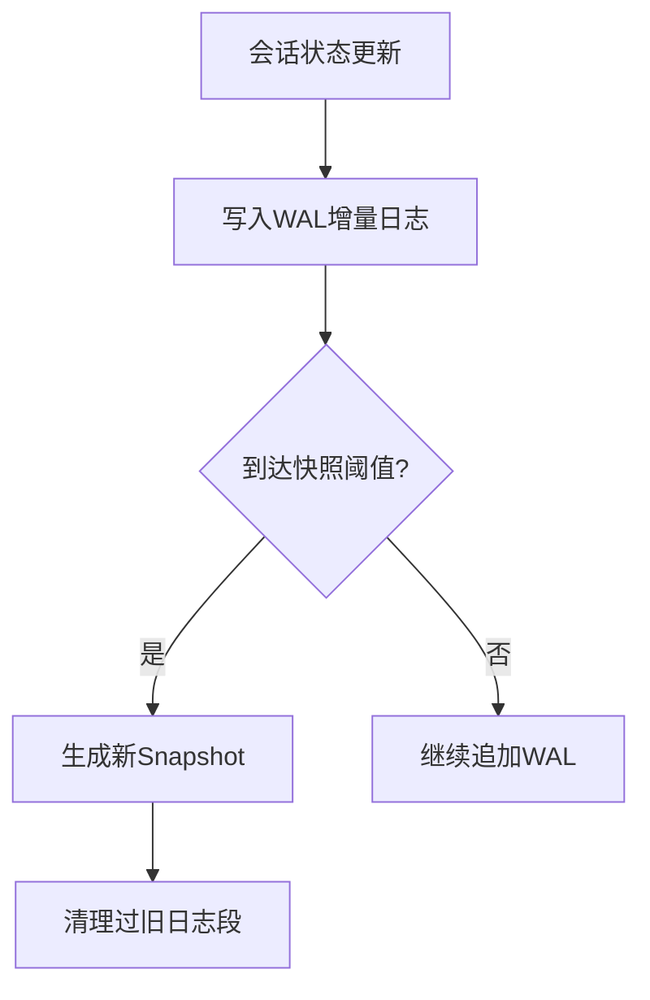
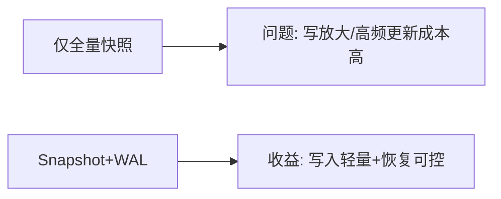
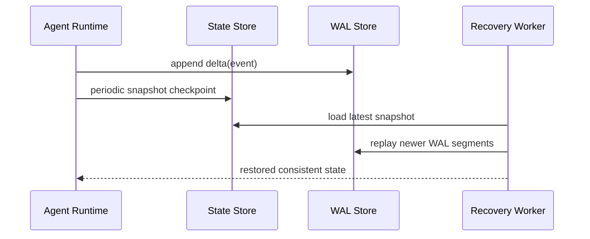

# 会话状态一致性选型 FAQ（全量快照 vs 增量日志 vs 混合 Snapshot+WAL）

> 专题边界：仅讨论 **Agent 会话状态持久化一致性模型**。

## 1) 📌 Executive Summary（3 分钟结论）

1. **生产默认建议 Snapshot+WAL 混合模型**：恢复速度和一致性风险之间最均衡。  
2. **全量快照实现最简单**，但在高频写入场景会拖慢吞吐并放大存储成本。  
3. **纯增量日志恢复最完整**，但回放链过长时恢复时间不可控。

## 2) 🎯 灵魂拷问 Q&A

### Q1：什么时候选全量快照？

- 状态更新频率低、会话生命周期短、恢复时延要求不苛刻。  
- 团队优先要简化实现与运维。

### Q2：什么场景增量日志严格更优？

- 需要完整审计与回放链路，且可接受离线重放成本。  
- 合规要求保留细粒度状态变更轨迹。

### Q3：核心技术 X（Snapshot+WAL）是什么，怎么运作？

- **是什么（大白话）**：定期拍“状态照片”，中间变更只记“流水账”。  
- **解决痛点**：单快照写放大、单日志恢复慢。  
- **底层运作**：恢复时先加载最近快照，再重放之后 WAL 增量。

## 3) 🧭 可视化图解（Mermaid）

## 4) 📊 Architect Decision Matrix

| 维度 | 全量快照 | 增量日志 | Snapshot+WAL |
|---|---|---|---|
| 写入成本 | 高 | 低 | 中 |
| 恢复时延稳定性 | 高 | 低 | 高 |
| 审计可追溯性 | 中 | 高 | 高 |
| 实现复杂度 | 低 | 中 | 中 |
| 生产默认建议 | 条件适配 | 条件适配 | ✅ |

## 5) 🧪 定量算例 + Benchmark 洞察

> 数据来源：`evidence/cycle-394-benchmark.json`。

| 指标 | 全量快照 | 增量日志 | Snapshot+WAL |
|---|---:|---:|---:|
| 写入放大系数 | 3.4x | 1.1x | 1.6x |
| 恢复 p50 | 420ms | 980ms | 310ms |
| 恢复 p95 | 870ms | 2140ms | 620ms |
| 审计回放完整率 | 78.2% | 99.4% | 98.7% |
| 单会话治理成本 | $0.0049 | $0.0052 | $0.0054 |

7-Card：`benchmark-cards.html` / `benchmark-cards.en.html`

## 6) 🛠️ Architect Checklist

- [ ] 定义快照周期与WAL段切分策略
- [ ] 建立恢复SLO（p50/p95）与告警阈值
- [ ] 设计WAL幂等重放与断点续跑机制
- [ ] 实施日志保留与压缩归档策略
- [ ] 演练节点故障后的一致性恢复
- [ ] 审计报表能回溯到原始变更事件
- [ ] 周度复盘恢复耗时与成本拐点
