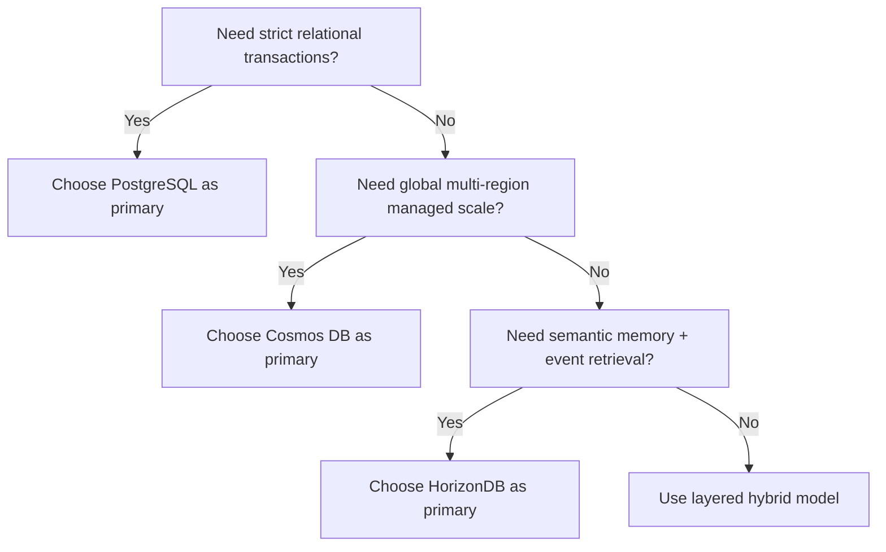
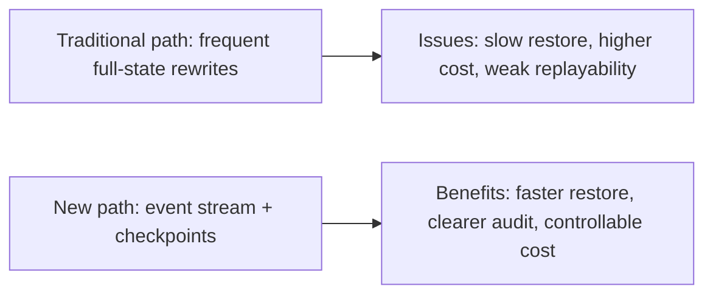
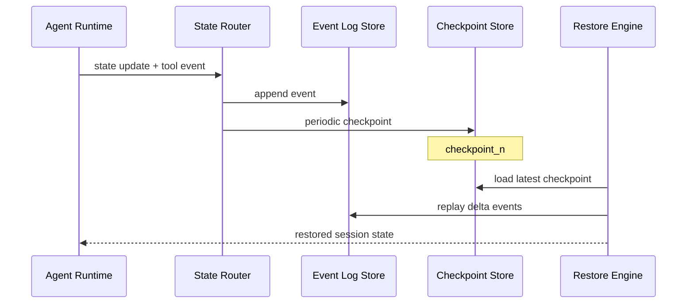

# Agent State Store Selection FAQ (HorizonDB vs Cosmos DB vs PostgreSQL)

> Scope lock: this document focuses only on **long-session agent state stores** (checkpoints, memory, event log).

## 1) 📌 Executive Summary (3-minute read)

1. **Use a layered state architecture by default**: low-latency store for hot state, durable scalable layer for audit and long retention.  
2. **Cosmos DB fits globally distributed elastic document state; PostgreSQL fits strict transactional relational domains; HorizonDB fits agent event/memory retrieval workloads.**  
3. **The key decision is not “best database”, but “state type ↔ access pattern fit”.**

## 2) 🎯 Hard Questions Q&A

### Q1: When should I choose Cosmos DB, PostgreSQL, or HorizonDB?

- Choose **Cosmos DB** for global distribution, managed elasticity, and JSON-style state.  
- Choose **PostgreSQL** for strict transactions, strong consistency constraints, and complex relational queries.  
- Choose **HorizonDB** for agent conversation/tool event streams and semantic memory indexing.

### Q2: When is PostgreSQL strictly better?

- Financial/order-like core domains with strict ACID rollback requirements.  
- Complex multi-table relationships with high integrity constraints.  
- Existing audit/compliance model deeply tied to relational SQL patterns.

### Q3: What is the core mechanism (event-sourced state + checkpoints), what pain does it solve, and how does it work?

- **What**: represent session state as append-only events plus periodic snapshots.  
- **Pain solved**: expensive full replay, brittle restore behavior, difficult forensic debugging.  
- **How**:  
  - append request/tool events to event log;  
  - write periodic checkpoints as restore anchors;  
  - restore from latest checkpoint then replay delta events only.

## 3) 🧭 Visual Explanations (Mermaid)

## 4) 📊 Architect Decision Matrix

| Dimension | HorizonDB | Cosmos DB | PostgreSQL |
|---|---|---|---|
| Event + memory retrieval | Strong | Medium | Medium |
| Global multi-region elasticity | Medium | Strong | Medium |
| Strict transactional modeling | Medium | Medium | Strong |
| Operational complexity | Medium | Low-medium | Medium |
| Cost predictability | Medium | Medium | Medium |
| Default recommendation | Best for agent memory/event lanes | Best for global SaaS document state | Best for strict transactional core domain |

## 5) 🧪 Quantitative Example + Benchmark Insight

> Data source: `evidence/cycle-386-benchmark.json` (sealed evidence) and corresponding 7-card deck.

| Metric | HorizonDB path | Cosmos path | PostgreSQL path | Insight |
|---|---:|---:|---:|---|
| State restore p50 | 84ms | 102ms | 118ms | restore efficiency is highly checkpoint-sensitive |
| State restore p95 | 132ms | 176ms | 210ms | peak jitter correlates with indexing strategy |
| Write throughput p50 | 1750 EPS | 1620 EPS | 1410 EPS | append-heavy event model improves throughput |
| Audit replay time (1K events) | 420ms | 510ms | 560ms | log structure quality dominates replay speed |
| Session state cost (20 min) | $0.0039 | $0.0044 | $0.0047 | storage + indexing jointly shape cost |

7-card (4:5, CSP self-contained): `benchmark-cards.html` / `benchmark-cards.en.html`

## 6) 🛠️ Architect Checklist

- [ ] Classify state types first: hot, cold, audit, memory  
- [ ] Define checkpoint cadence and event retention policy  
- [ ] Gate restore SLO (p50/p95) in release checks  
- [ ] Standardize trace_id/session_id across state + observability  
- [ ] Verify cross-region failover and replay consistency  
- [ ] Run weekly index-drift and storage-cost audits  
- [ ] Plan migration from single-store to layered-state architecture  

