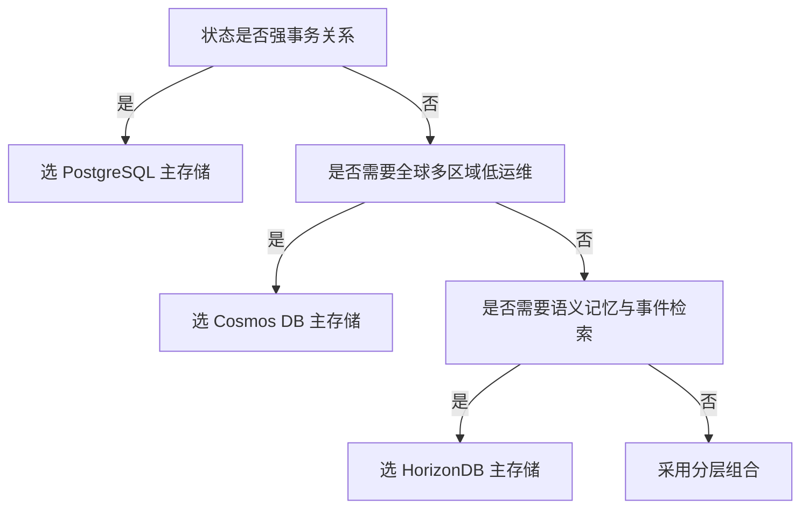
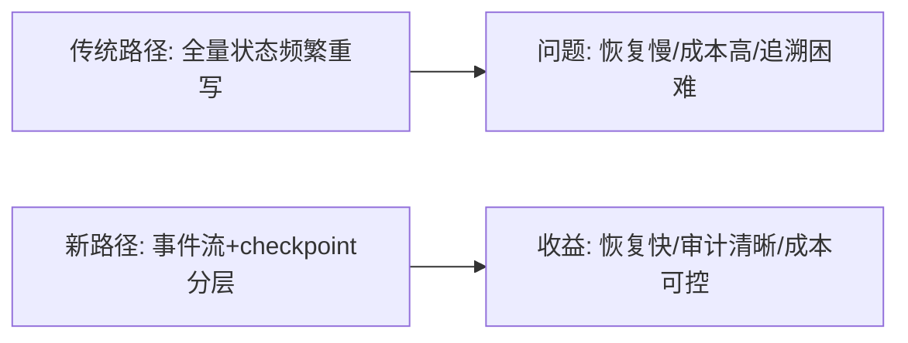
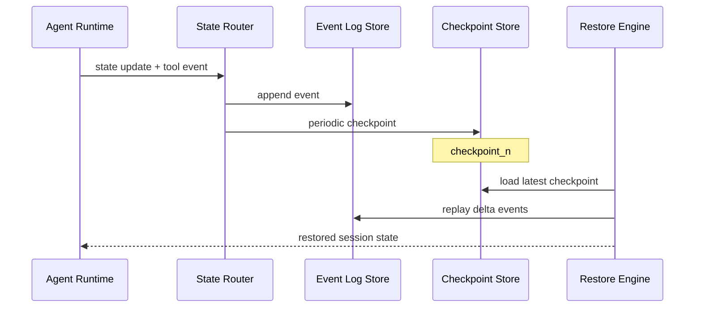

# Agent 状态存储选型 FAQ（HorizonDB vs Cosmos DB vs PostgreSQL）

> 专题边界：仅聚焦 **Agent 长会话状态存储**（checkpoint、memory、event log）选型。

## 1) 📌 Executive Summary（3 分钟结论）

1. **默认优先“分层状态架构”**：热状态放低延迟存储，审计与长留存放可扩展持久层。  
2. **Cosmos DB 适合全球多区域与弹性扩展；PostgreSQL 适合强事务关系模型；HorizonDB 适合 Agent 事件与记忆检索场景。**  
3. **真正的选型关键不是“哪个数据库最好”，而是“状态类型与访问模式是否匹配”。**

## 2) 🎯 灵魂拷问 Q&A

### Q1：什么时候选 Cosmos DB，什么时候选 PostgreSQL，什么时候选 HorizonDB？

- 选 **Cosmos DB**：全球分布、低运维、弹性吞吐、JSON 文档型状态。  
- 选 **PostgreSQL**：强事务、一致性约束、复杂关联查询。  
- 选 **HorizonDB**：Agent 对话/工具事件流、语义检索、长会话 memory 索引。

### Q2：什么场景下 PostgreSQL 严格更优？

- 金融/订单系统式强一致事务写入；  
- 多表关系复杂且需要严格 ACID 回滚语义；  
- 审计建模已深度依赖 SQL 关系模型。

### Q3：核心技术 X（事件源状态 + checkpoint）是什么？解决什么痛点？底层如何运作？

- **是什么**：把 Agent 会话拆成“事件流 + 周期快照”。  
- **解决痛点**：全量重放成本高、调试回溯困难、跨版本恢复不稳定。  
- **底层运作**：  
  - 请求/工具调用写入 event log；  
  - 定期写 checkpoint 作为恢复锚点；  
  - 恢复时从最近 checkpoint 增量回放，降低启动成本。

## 3) 🧭 可视化图解（Mermaid）

## 4) 📊 Architect Decision Matrix

| 维度 | HorizonDB | Cosmos DB | PostgreSQL |
|---|---|---|---|
| 事件流与记忆检索 | 强 | 中 | 中 |
| 全球多区域弹性 | 中 | 强 | 中 |
| 强事务关系建模 | 中 | 中 | 强 |
| 运维复杂度 | 中 | 低-中 | 中 |
| 成本可预测性 | 中 | 中 | 中 |
| 生产默认建议 | Agent memory/event 场景推荐 | 全球 SaaS 文档状态推荐 | 强事务核心域推荐 |

## 5) 🧪 定量算例 + Benchmark 洞察

> 数据来源：`evidence/cycle-386-benchmark.json`（sealed evidence）与 7-Card 评测卡。

| 指标 | HorizonDB 路径 | Cosmos 路径 | PostgreSQL 路径 | 洞察 |
|---|---:|---:|---:|---|
| 状态恢复 p50 | 84ms | 102ms | 118ms | 事件+checkpoint 对恢复效率最敏感 |
| 状态恢复 p95 | 132ms | 176ms | 210ms | 峰值抖动与索引策略相关 |
| 写入吞吐 p50 | 1750 EPS | 1620 EPS | 1410 EPS | 事件追加模型更有吞吐优势 |
| 审计回放耗时（1K 事件） | 420ms | 510ms | 560ms | 日志结构化程度决定回放效率 |
| 单会话状态成本（20 分钟） | $0.0039 | $0.0044 | $0.0047 | 存储策略与索引策略共同影响成本 |

7-Card（4:5，CSP 自包含）：`benchmark-cards.html` / `benchmark-cards.en.html`

## 6) 🛠️ Architect Checklist

- [ ] 先分类状态：热状态、冷状态、审计状态、记忆状态  
- [ ] 设计 checkpoint 周期与事件保留策略  
- [ ] 定义恢复 SLO（p50/p95）并纳入发布门禁  
- [ ] 统一 trace_id 与 session_id 贯通存储与观测  
- [ ] 验证跨区域故障切换与回放一致性  
- [ ] 建立索引漂移和存储成本周度审计  
- [ ] 制定从单存储到分层存储的迁移路径  

