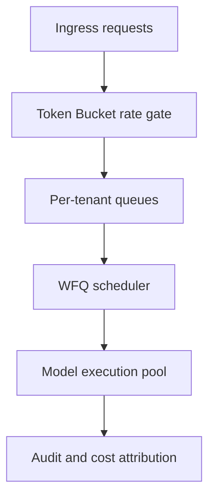
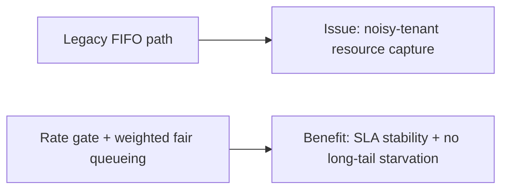
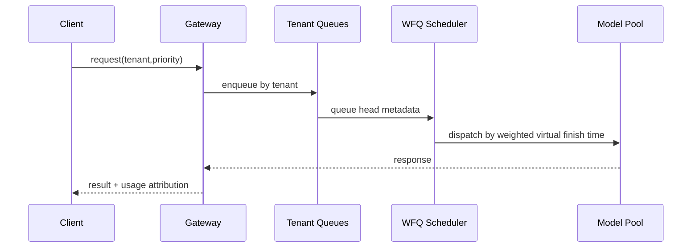

# Multi-tenant Quota Fairness Selection FAQ (Static Quota Slices vs Token Bucket vs WFQ)

> Scope lock: this FAQ focuses only on **multi-tenant quota fairness scheduling in the agent gateway**.

## 1) 📌 Executive Summary (3-minute read)

1. **Production default is Token Bucket ingress + WFQ egress scheduling** for burst tolerance and fairness.  
2. **Static quota slicing fits stable workloads** but wastes capacity under skewed traffic.  
3. **Fairness means explainable SLA priority without starving long-tail tenants**, not equal split.

## 2) 🎯 Hard Questions Q&A

### Q1: When should static quota slicing be primary?

- Few tenants, low volatility, simple SLA hierarchy.  
- Predictability and low ops overhead matter most.

### Q2: When is WFQ strictly better?

- Mixed tenant tiers, heavy bursts, and strict queue-delay control.  
- You must protect premium SLA while keeping long-tail tenants alive.

### Q3: What is WFQ and how does it work?

- **What (plain words)**: weighted lanes where each tenant gets scheduled proportionally.  
- **Pain solved**: FIFO allows noisy tenants to dominate queues.  
- **How**: per-tenant queues compute virtual finish time; scheduler picks the smallest next.

## 3) 🧭 Visual Explanations (Mermaid)

## 4) 📊 Architect Decision Matrix

| Dimension | Static Quota Slices | Token Bucket | Token Bucket + WFQ |
|---|---|---|---|
| Implementation complexity | Low | Medium | Medium-high |
| Burst tolerance | Low | High | High |
| Cross-tenant fairness | Medium | Medium | High |
| SLA explainability | Medium | Medium | High |
| Production default | Conditional | Conditional | ✅ |

## 5) 🧪 Quantitative Example + Benchmark Insight

> Data source: `evidence/cycle-393-benchmark.json`.

| Metric | Static Slices | Token Bucket | Token Bucket + WFQ |
|---|---:|---:|---:|
| Premium tenant latency p95 | 122ms | 98ms | 81ms |
| Long-tail starvation rate | 7.9% | 4.8% | 1.6% |
| Peak throughput (req/s) | 1,320 | 1,540 | 1,610 |
| Idle capacity ratio | 15.2% | 9.3% | 6.7% |
| Governance cost per session | $0.0047 | $0.0051 | $0.0056 |

7-card: `benchmark-cards.html` / `benchmark-cards.en.html`

## 6) 🛠️ Architect Checklist

- [ ] Define tenant tiers and baseline weights
- [ ] Configure burst and sustained thresholds per tenant
- [ ] Alert on starvation and queue-delay KPIs
- [ ] Audit and approve WFQ weight changes
- [ ] Run peak-hour replay drills
- [ ] Enforce tenant/product-line cost attribution
- [ ] Review SLA and fairness drift weekly
