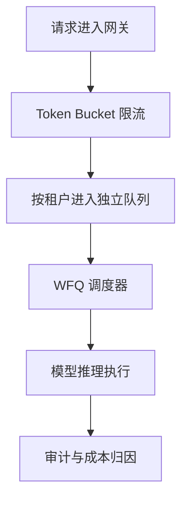
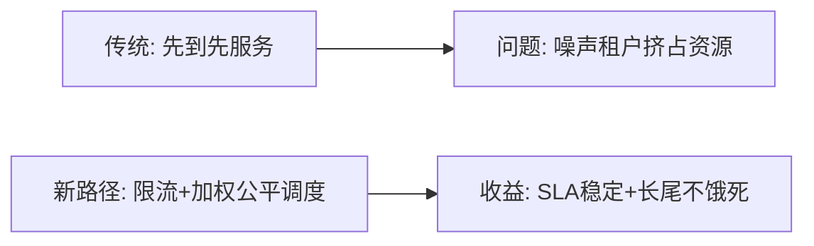
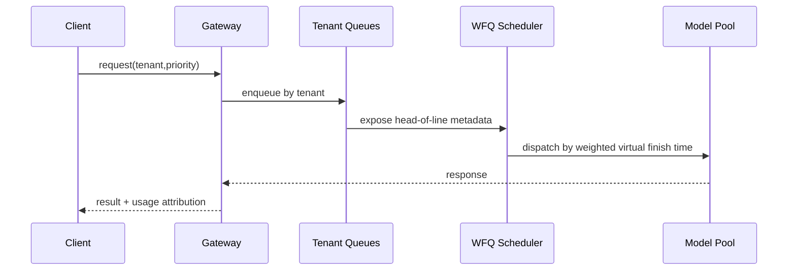

# 多租户配额公平调度选型 FAQ（静态配额切片 vs Token Bucket vs WFQ）

> 专题边界：仅讨论 **多租户 Agent Gateway 配额公平调度**，不展开模型选型与缓存选型。

## 1) 📌 Executive Summary（3 分钟结论）

1. **生产默认推荐“Token Bucket 入站限流 + WFQ 出站调度”组合**：兼顾突发吸收与跨租户公平。  
2. **静态配额切片适合负载稳定场景**：简单但容易造成资源空置或抢占。  
3. **公平调度的核心目标不是平均分配，而是“可解释的 SLA 优先级 + 不饿死长尾租户”。**

## 2) 🎯 灵魂拷问 Q&A

### Q1：什么时候选静态配额切片？

- 租户数量少、业务波动小、SLA 层级简单。  
- 你优先要的是可预测与易运维。

### Q2：什么场景 WFQ 严格更优？

- 租户层级复杂（黄金/白银/长尾）、突发流量大、且必须控制排队延迟。  
- 需要保证高优租户 SLA 的同时避免低优租户长期饥饿。

### Q3：核心技术 X（WFQ）是什么，怎么运作？

- **是什么（大白话）**：给不同租户“不同粗细的管道”，按权重轮流放行请求。  
- **解决痛点**：先到先服务在高峰会让噪声租户占满队列。  
- **底层运作**：每个租户队列计算虚拟完成时间，调度器优先取完成时间最小者。

## 3) 🧭 可视化图解（Mermaid）

## 4) 📊 Architect Decision Matrix

| 维度 | 静态配额切片 | Token Bucket | Token Bucket + WFQ |
|---|---|---|---|
| 实现复杂度 | 低 | 中 | 中-高 |
| 突发吸收能力 | 低 | 高 | 高 |
| 跨租户公平性 | 中 | 中 | 高 |
| SLA 可解释性 | 中 | 中 | 高 |
| 生产默认建议 | 条件适配 | 条件适配 | ✅ |

## 5) 🧪 定量算例 + Benchmark 洞察

> 数据来源：`evidence/cycle-393-benchmark.json`。

| 指标 | 静态切片 | Token Bucket | Token Bucket+WFQ |
|---|---:|---:|---:|
| 高优租户 p95 延迟 | 122ms | 98ms | 81ms |
| 长尾租户饥饿率 | 7.9% | 4.8% | 1.6% |
| 峰值吞吐（req/s） | 1,320 | 1,540 | 1,610 |
| 资源空置率 | 15.2% | 9.3% | 6.7% |
| 单会话治理成本 | $0.0047 | $0.0051 | $0.0056 |

7-Card：`benchmark-cards.html` / `benchmark-cards.en.html`

## 6) 🛠️ Architect Checklist

- [ ] 定义租户分层（黄金/白银/长尾）与权重基线
- [ ] 对每租户设置 burst、sustained 双阈值
- [ ] 建立饥饿率与队列时延门禁告警
- [ ] 将 WFQ 权重变更纳入审计与审批
- [ ] 高峰期执行配额回放演练
- [ ] 统一成本归因到租户/产品线
- [ ] 周度复盘 SLA 与公平性偏差
