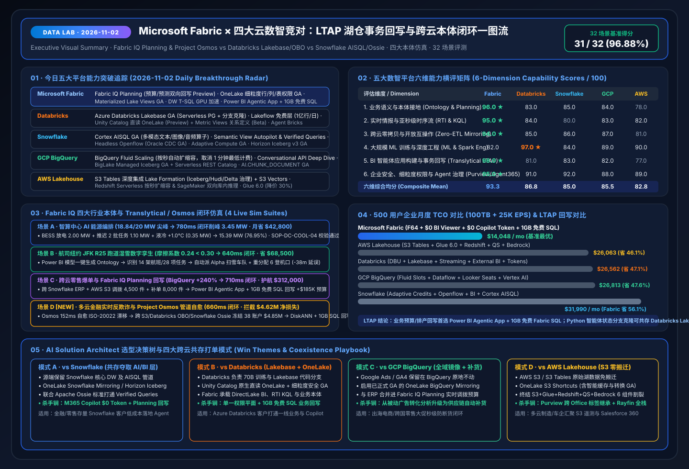

# 🔬 Data Lab — Microsoft Fabric × 4-Cloud Competitors (Databricks / Snowflake / GCP / AWS) Deep Research & AI Solution Architect Lab

> **Language**: [中文 (`README.md`)](README.md) | **English (Current)**  
> **Latest Daily Run**: `2026-11-02` (includes [`2026-11-01`](research/daily/2026-11-01.en.md) baseline) · **Benchmark Pass Rate**: `27 / 28 (96.43%)` · **Unit Tests**: `10 / 10 Passed (100%)`

[](assets/svg/01-data-lab-executive-summary-2026-11-02.svg)

---

## 🎯 Lab Mission & Six AI Solution Architect Pillars

**Data Lab** is built from the perspective of a Principal **AI Solution Architect**, delivering daily capability breakthrough tracking, head-to-head competitive battlecards, reference architectures, interactive H5 simulators, reproducible 7-Card 4:5 benchmarks, and presales win/coexistence playbooks across **Microsoft Fabric (Fabric IQ, Fabric IQ Planning, OneLake, Real-Time Intelligence, Power BI Semantic Models & Agentic Apps, Data/Operations Agents, Database Hub)** and its four primary cloud competitors: **Databricks, Snowflake, Google Cloud (BigQuery / Looker / Vertex AI), and AWS (SageMaker Lakehouse / S3 Tables / Redshift / Bedrock)**.

| Pillar | Core Workstream | Primary Deliverables | Key Quantitative Finding (`2026-11-02`) |
| :--- | :--- | :--- | :--- |
| **Pillar 0** | **Daily Domain Breakthrough Tracking** | [`research/daily/2026-11-02.en.md`](research/daily/2026-11-02.en.md) · [`中文`](research/daily/2026-11-02.md) · [`11-01`](research/daily/2026-11-01.en.md) | Tracks Fabric IQ Planning + OneLake Fine-Grained Security GA vs Databricks Lakebase GA, Snowflake Cortex AISQL GA, BigQuery Fluid Scaling, AWS S3 Tables Lake Formation |
| **Pillar 1** | **Dedicated 4-Cloud Competitive Sub-Task** | [`comparisons/fabric-vs-4clouds-battlecards-2026.en.md`](comparisons/fabric-vs-4clouds-battlecards-2026.en.md) · [`中文`](comparisons/fabric-vs-4clouds-battlecards-2026.md) | 6-Dimension Composite Mean: **Fabric `93.3`** vs Databricks `86.8` vs GCP `85.5` vs Snowflake `85.0` vs AWS `82.8` + LTAP Write-back Matrix |
| **Pillar 2** | **Architecture Design (Microsoft IQ, Coexistence & LTAP)** | [`04-translytical-ltap-agentic-architecture.svg`](assets/svg/04-translytical-ltap-agentic-architecture.svg) · [`02-microsoft-iq`](assets/svg/02-microsoft-iq-fabric-iq-architecture.svg) · [`03-coexistence`](assets/svg/03-five-cloud-coexistence-topology.svg) | Work IQ + Fabric IQ + Foundry IQ + Web IQ + Agent 365 5-layer closed-loop, 4 Coexistence Modes (A/B/C/D) & Translytical LTAP blueprint |
| **Pillar 3** | **Interactive H5 Workbench & 3-Scenario Ontology Simulator** | [`live-demo.en.html` (EN)](live-demo.en.html) · [`index.html` (中文)](index.html) | Interactive 5-cloud battlecard compass, live TCO calculator, AIDC energy shaving (`780ms`), Airline JFK R25 (`640ms`) & Cross-Cloud Retail Planning write-back (`710ms`) |
| **Pillar 4** | **Reproducible Benchmark & 7-Card 4:5 Deck** | [`benchmark-cards.en.html` (EN)](benchmark-cards.en.html) · [`benchmark-cards.html` (中文)](benchmark-cards.html) · [`report.json`](reports/report.json) | `27/28` (`96.43%`) scenario accuracy; `46.1%–56.1%` 500-user TCO savings; `4.54x–9.47x` faster DirectLake + KQL concurrency |
| **Pillar 5** | **Business Scenario & Win/Loss Playbook** | [`playbooks/scenario-win-loss-playbook.en.md`](playbooks/scenario-win-loss-playbook.en.md) · [`中文`](playbooks/scenario-win-loss-playbook.md) | End-to-end Win Themes, Coexistence Patterns, and Anti-Patterns across AIDC Energy, Aviation Ops, Cross-Cloud Retail Planning, and Financial Risk |

---

## 📊 6-Dimension Capability Scores & 500-User Monthly TCO (`reports/report.json`)

| Dimension / Platform | Microsoft Fabric | Databricks | GCP BigQuery | Snowflake | AWS Lakehouse | Key Differentiator |
| :--- | :---: | :---: | :---: | :---: | :---: | :--- |
| **1. Semantic & Ontology Grounding** | **96.0 ★** | 83.0 | 84.0 | 85.0 | 78.0 | One-click Ontology from 20M+ Power BI models + Graph cascade + Apache Ossie |
| **2. Real-Time Intelligence & KQL** | **95.0 ★** | 84.0 | 83.0 | 80.0 | 82.0 | Eventstream + Eventhouse KQL `142ms` sub-second telemetry + Operations Agent |
| **3. Cross-Cloud Zero-ETL & Open Formats** | **94.0 ★** | 85.0 | 87.0 | 86.0 | 81.0 | GA Mirroring for BigQuery/Snowflake/Oracle/SAP + S3/GCS Shortcuts + IQ Sharing |
| **4. Large-Scale ML & Spark Engineering** | 82.0 | **97.0 ★** | 89.0 | 84.0 | 90.0 | Databricks leads in 70B+ distributed training & low-level Spark/Photon tuning |
| **5. BI, Agentic Apps & Write-back** | **98.0 ★** | 81.0 | 82.0 | 83.0 | 77.0 | DirectLake + Power BI Agentic App + 1GB free Fabric SQL + open-source Rayfin SDK |
| **6. Enterprise Governance & Agent Security** | **95.0 ★** | 91.0 | 88.0 | 92.0 | 89.0 | Purview sensitivity labels into Office/Teams + Agent 365 + Entra Agent ID |
| **Composite Mean Score** | **93.3** | **86.8** | **85.5** | **85.0** | **82.8** | Fabric ranks #1 in 5 of 6 enterprise evaluation dimensions |
| **500-User Monthly TCO (`100TB + 25K EPS + 5K queries/d`)** | **$14,048/mo** | $26,562/mo | $26,813/mo | $31,990/mo | $26,063/mo | **Fabric saves `46.1%–56.1%`** (`$0` BI viewer seats on F64+ & `$0` extra M365 Copilot token cost) |

---

## 🖼️ Core Architecture Diagrams (Self-Contained SVGs)

### 1. LTAP Translytical Operational Loop vs. 4-Cloud Competitors (`2026-11-02` New)
[](assets/svg/04-translytical-ltap-agentic-architecture.svg)

### 2. Microsoft IQ × Fabric IQ Enterprise Ontology & Multi-Agent Architecture
[](assets/svg/02-microsoft-iq-fabric-iq-architecture.svg)

### 3. OneLake Cross-Cloud Zero-Copy Coexistence Topology
[](assets/svg/03-five-cloud-coexistence-topology.svg)

---

## ⚡ Reproduce the Benchmark & Sealed `report.json`

```powershell
# 1. Run the 10-test verification suite
python -m unittest discover -s workshops/data-lab/tests -v

# 2. Regenerate the sealed evaluation report
python workshops/data-lab/src/data_lab/benchmark_suite.py --output workshops/data-lab/reports/report.json
```
