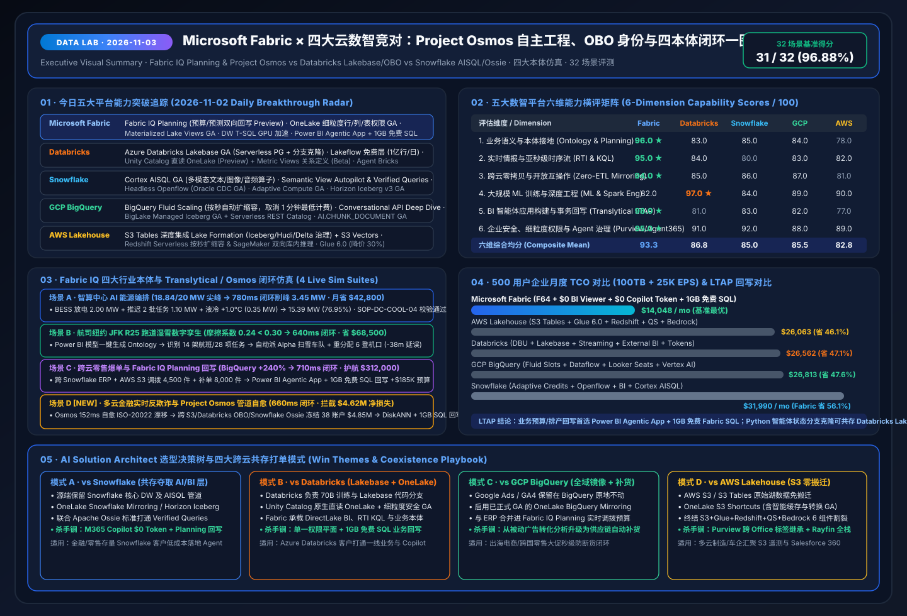
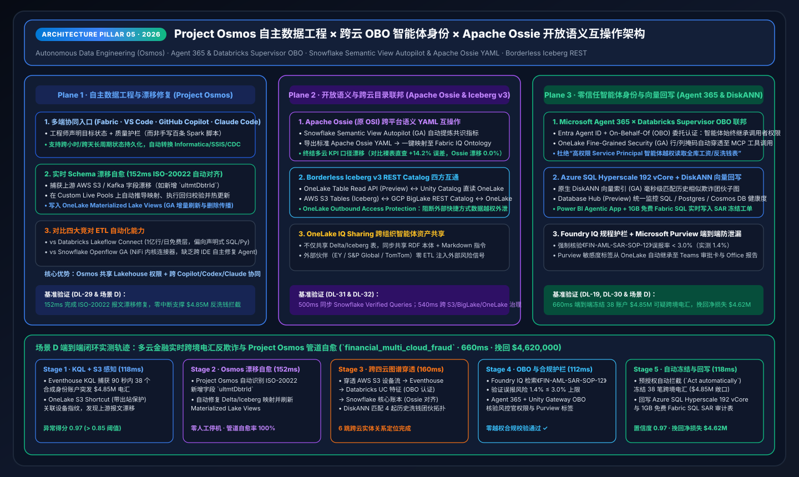
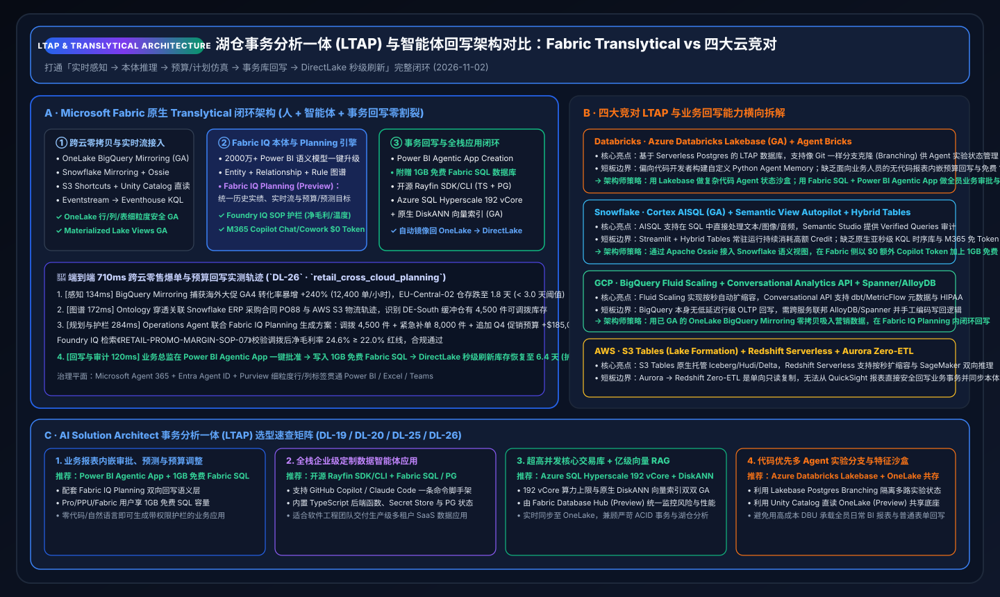
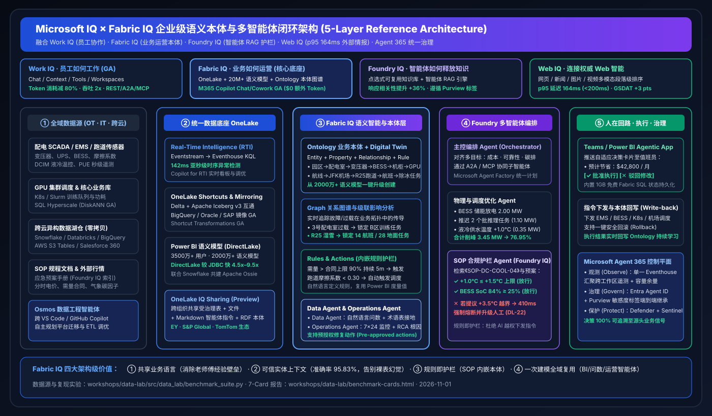
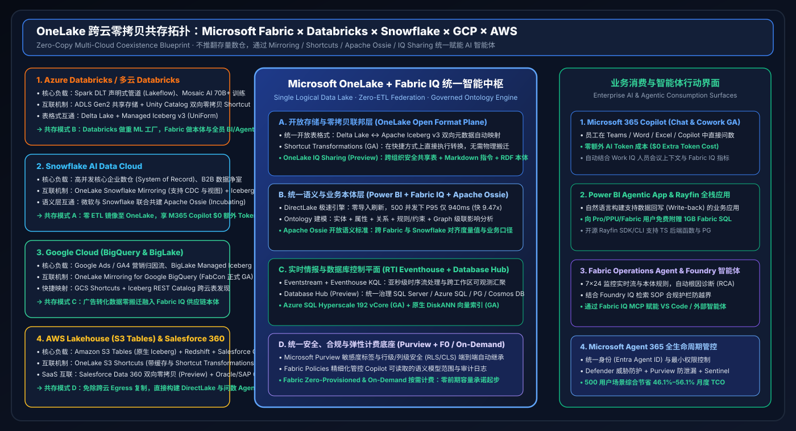

# 🔬 Data Lab — Microsoft Fabric × 4-Cloud Competitors (Databricks / Snowflake / GCP / AWS) Deep Research & AI Solution Architect Lab

> **Language**: [中文 (`README.md`)](README.md) | **English (Current)**  
> **Latest Daily Run**: [`2026-11-03`](research/daily/2026-11-03.en.md) (includes [`2026-11-02`](research/daily/2026-11-02.en.md) & [`2026-11-01`](research/daily/2026-11-01.en.md) baselines) · **Benchmark Pass Rate**: `31 / 32 (96.88%)` · **Unit Tests**: `12 / 12 Passed (100%)`

[](assets/svg/01-data-lab-executive-summary-2026-11-03.svg)

---

## 🎯 Lab Mission & Six AI Solution Architect Pillars

**Data Lab** is built from the perspective of a Principal **AI Solution Architect**, delivering daily capability breakthrough tracking, head-to-head competitive battlecards, reference architectures, interactive H5 simulators, reproducible 7-Card 4:5 benchmarks, and presales win/coexistence playbooks across **Microsoft Fabric (Fabric IQ, Fabric IQ Planning, Project Osmos Data Engineering Agent, OneLake, Real-Time Intelligence, Power BI Semantic Models & Agentic Apps, Data/Operations Agents, Database Hub)** and its four primary cloud competitors: **Databricks, Snowflake, Google Cloud (BigQuery / Looker / Vertex AI), and AWS (SageMaker Lakehouse / S3 Tables / Redshift / Bedrock)**.

| Pillar | Core Workstream | Primary Deliverables | Key Quantitative Finding (`2026-11-03`) |
| :--- | :--- | :--- | :--- |
| **Pillar 0** | **Daily Domain Breakthrough Tracking** | [`2026-11-03.en.md`](research/daily/2026-11-03.en.md) · [`中文`](research/daily/2026-11-03.md) · [`11-02`](research/daily/2026-11-02.en.md) · [`11-01`](research/daily/2026-11-01.en.md) | Tracks Fabric Project Osmos autonomous engineering + OneLake Outbound Protection vs Databricks Supervisor OBO GA, Snowflake Semantic View Autopilot (Apache Ossie YAML) GA, BigQuery × S3 Borderless Iceberg |
| **Pillar 1** | **Dedicated 4-Cloud Competitive Sub-Task** | [`comparisons/fabric-vs-4clouds-battlecards-2026.en.md`](comparisons/fabric-vs-4clouds-battlecards-2026.en.md) · [`中文`](comparisons/fabric-vs-4clouds-battlecards-2026.md) | 6-Dimension Composite Mean: **Fabric `93.3`** vs Databricks `86.8` vs GCP `85.5` vs Snowflake `85.0` vs AWS `82.8` + Project Osmos / OBO / LTAP Matrix |
| **Pillar 2** | **Architecture Design (Microsoft IQ, Coexistence & Osmos/LTAP)** | [`05-osmos-obo-ossie.svg`](assets/svg/05-osmos-autonomous-engineering-ossie-interop.svg) · [`04-ltap.svg`](assets/svg/04-translytical-ltap-agentic-architecture.svg) · [`02-iq.svg`](assets/svg/02-microsoft-iq-fabric-iq-architecture.svg) · [`03-coexist.svg`](assets/svg/03-five-cloud-coexistence-topology.svg) | Work IQ + Fabric IQ + Foundry IQ + Web IQ + Agent 365 5-layer closed-loop, 4 Coexistence Modes (A/B/C/D), Project Osmos self-healing & OBO identity blueprint |
| **Pillar 3** | **Interactive H5 Workbench & 4-Scenario Ontology Simulator** | [`live-demo.en.html` (EN)](live-demo.en.html) · [`index.html` (中文)](index.html) | Interactive 5-cloud battlecard compass, live TCO calculator, AIDC energy (`780ms`), Airline JFK R25 (`640ms`), Cross-Cloud Retail Planning (`710ms`) & Multi-Cloud Financial Anti-Fraud (`660ms`, `$4.62M` saved) |
| **Pillar 4** | **Reproducible Benchmark & 7-Card 4:5 Deck** | [`benchmark-cards.en.html` (EN)](benchmark-cards.en.html) · [`benchmark-cards.html` (中文)](benchmark-cards.html) · [`report.json`](reports/report.json) | `31/32` (`96.88%`) scenario accuracy (`570.6ms` mean); `46.1%–56.1%` 500-user TCO savings; `4.54x–9.47x` faster DirectLake + KQL concurrency |
| **Pillar 5** | **Business Scenario & Win/Loss Playbook** | [`playbooks/scenario-win-loss-playbook.en.md`](playbooks/scenario-win-loss-playbook.en.md) · [`中文`](playbooks/scenario-win-loss-playbook.md) | End-to-end Win Themes, Coexistence Patterns, and Anti-Patterns across AIDC Energy, Aviation Ops, Cross-Cloud Retail Planning, and Multi-Cloud Financial Anti-Fraud |

---

## 🖼️ Core Architecture Diagrams (Self-Contained SVGs)

### 1. Project Osmos Autonomous Data Engineering × Cross-Cloud OBO Identity × Apache Ossie Semantic Interop (`2026-11-03` New)
[](assets/svg/05-osmos-autonomous-engineering-ossie-interop.svg)

### 2. LTAP Translytical Operational Loop vs. 4-Cloud Competitors (`2026-11-02`)
[](assets/svg/04-translytical-ltap-agentic-architecture.svg)

### 2. Microsoft IQ × Fabric IQ Enterprise Ontology & Multi-Agent Architecture
[](assets/svg/02-microsoft-iq-fabric-iq-architecture.svg)

### 3. OneLake Cross-Cloud Zero-Copy Coexistence Topology
[](assets/svg/03-five-cloud-coexistence-topology.svg)

---

## ⚡ Reproduce the Benchmark & Sealed `report.json`

```powershell
# 1. Run the 12-test verification suite
python -m unittest discover -s workshops/data-lab/tests -v

# 2. Regenerate the sealed evaluation report
python workshops/data-lab/src/data_lab/benchmark_suite.py --output workshops/data-lab/reports/report.json
```
