# 🔬 Data Lab — Microsoft Fabric × 4-Cloud Competitors (Databricks / Snowflake / GCP / AWS) Deep Research & AI Solution Architect Lab

> **Language**: [中文 (`README.md`)](README.md) | **English (Current)**  
> **Latest Daily Run**: [`2026-11-14`](research/daily/2026-11-14.en.md) · [`2026-11-13`](research/daily/2026-11-13.en.md) · [`2026-11-12 / 11-13`](research/daily/2026-11-12.en.md) · [`2026-11-11 / 11-12`](research/daily/2026-11-11.en.md) · [`2026-11-09`](research/daily/2026-11-09.en.md) · [`2026-11-08`](research/daily/2026-11-08.en.md) · [`2026-11-06`](research/daily/2026-11-06.en.md) · [`2026-11-05`](research/daily/2026-11-05.en.md) · [`2026-11-04`](research/daily/2026-11-04.en.md) · [`2026-11-03`](research/daily/2026-11-03.en.md) (includes [`2026-11-02`](research/daily/2026-11-02.en.md) & [`2026-11-01`](research/daily/2026-11-01.en.md) baselines) · **Benchmark Pass Rate**: `343 / 344 (99.71%)` (`n=344` matrix mean `216.0ms` · `n=82` ontology sim mean `185.0ms`) · **Unit Tests**: `168 / 168 Passed (100%)`  
> **🌟 Flagship Architect Selection FAQs (Modeled on `ib-vs-ethernet-roce-selection-faq.md` · 75-Round Milestone! & -91.1% TCO)**:
> - **Round 1 (Zero-Copy & Ontology Selection)**: [`comparisons/fabric-onelake-iq-vs-4clouds-selection-faq.en.md` (OneLake Zero-Copy × Fabric IQ Ontology vs. 4 Clouds Selection FAQ)](comparisons/fabric-onelake-iq-vs-4clouds-selection-faq.en.md) · [`中文版 FAQ`](comparisons/fabric-onelake-iq-vs-4clouds-selection-faq.md)  
> - **Round 2 (Real-Time Streaming Selection)**: [`comparisons/fabric-realtime-eventhouse-vs-4clouds-streaming-faq.en.md` (Eventhouse KQL 142ms vs. Snowflake Dynamic Tables 60s vs. Databricks Lakeflow FAQ)](comparisons/fabric-realtime-eventhouse-vs-4clouds-streaming-faq.en.md) · [`中文版 FAQ`](comparisons/fabric-realtime-eventhouse-vs-4clouds-streaming-faq.md)  
> - **Round 3 (Zero-ETL Mirroring vs. CDC Selection)**: [`comparisons/fabric-mirroring-zero-etl-vs-cdc-faq.en.md` (Fabric Mirroring & Open Mirroring $0 Compute vs. Fivetran MAR / Debezium / Snowflake Openflow / Databricks Lakeflow Connect FAQ)](comparisons/fabric-mirroring-zero-etl-vs-cdc-faq.en.md) · [`中文版 FAQ`](comparisons/fabric-mirroring-zero-etl-vs-cdc-faq.md)  
> - **Round 4 (Open Table Format & Catalog Selection)**: [`comparisons/fabric-onelake-iceberg-delta-uniform-vs-4clouds-faq.en.md` (OneLake Iceberg↔Delta XTable $0 Virtualization vs. Databricks Delta UniForm vs. Snowflake Polaris vs. AWS S3 Tables vs. GCP BigLake FAQ)](comparisons/fabric-onelake-iceberg-delta-uniform-vs-4clouds-faq.en.md) · [`中文版 FAQ`](comparisons/fabric-onelake-iceberg-delta-uniform-vs-4clouds-faq.md)  
> - **Round 5 (Operational HTAP & 100M+ Vector Indexing Selection)**: [`comparisons/fabric-htap-vector-sql-cosmos-vs-lakebase-unistore-faq.en.md` (Fabric SQL DB + Cosmos DB SSD DiskANN -92% RAM vs. Databricks Lakebase vs. Snowflake Unistore vs. GCP AlloyDB ScaNN vs. AWS Aurora pgvector FAQ)](comparisons/fabric-htap-vector-sql-cosmos-vs-lakebase-unistore-faq.en.md) · [`中文版 FAQ`](comparisons/fabric-htap-vector-sql-cosmos-vs-lakebase-unistore-faq.md)  
> - **Round 6 (Multi-Cloud AI Security Governance & Agent OBO Selection)**: [`comparisons/fabric-onelake-purview-obo-governance-vs-4clouds-faq.en.md` (OneLake Unified RLS/CLS/OLS + Purview + Entra Agent ID OBO -85.3% Governance TCO vs. Databricks UC ABAC vs. Snowflake Horizon vs. AWS Lake Formation vs. GCP Dataplex FAQ)](comparisons/fabric-onelake-purview-obo-governance-vs-4clouds-faq.en.md) · [`中文版 FAQ`](comparisons/fabric-onelake-purview-obo-governance-vs-4clouds-faq.md)  
> - **Round 7 (Lakehouse Native Vectorized Spark & Autoscale FinOps Selection)**: [`comparisons/fabric-spark-native-gluten-autoscale-vs-photon-snowpark-faq.en.md` (Fabric Spark Gluten+Velox C++ $0 Surcharge + Autoscale Billing -58.6% Compute TCO vs. Databricks Photon vs. Snowflake Snowpark vs. GCP Dataproc vs. AWS EMR Serverless FAQ)](comparisons/fabric-spark-native-gluten-autoscale-vs-photon-snowpark-faq.en.md) · [`中文版 FAQ`](comparisons/fabric-spark-native-gluten-autoscale-vs-photon-snowpark-faq.md)  
> - **Round 8 (Enterprise NL2SQL & Agentic BI Selection)**: [`comparisons/fabric-data-agents-copilot-vs-genie-cortex-q-faq.en.md` (Fabric Data Agents + Copilot Studio + Foundry IQ $0 M365 Token -82.6% Agentic BI TCO vs. Databricks AI/BI Genie vs. Snowflake Cortex Agents vs. GCP Looker vs. AWS Amazon Q FAQ)](comparisons/fabric-data-agents-copilot-vs-genie-cortex-q-faq.en.md) · [`中文版 FAQ`](comparisons/fabric-data-agents-copilot-vs-genie-cortex-q-faq.md)  
> - **Round 9 (Enterprise Medallion Orchestration & Autonomous Self-Healing Selection)**: [`comparisons/fabric-data-factory-osmos-vs-lakeflow-tasks-composer-faq.en.md` (Fabric Data Factory + Project Osmos 152ms Healing + Materialized Lake Views -71.1% Orchestration TCO vs. Databricks Lakeflow vs. Snowflake Tasks & Dynamic Tables vs. GCP Composer vs. AWS Glue FAQ)](comparisons/fabric-data-factory-osmos-vs-lakeflow-tasks-composer-faq.en.md) · [`中文版 FAQ`](comparisons/fabric-data-factory-osmos-vs-lakeflow-tasks-composer-faq.md)  
> - **Round 10 (Multi-Workspace Capacity FinOps, Surge Protection & Rayfin Chargeback Selection)**: [`comparisons/fabric-capacity-finops-surge-rayfin-vs-4clouds-faq.en.md` (Fabric Surge Protection 75% Background Cap + 24h Smoothing + Rayfin 38-BU Chargeback -54.0% Overage vs. Databricks Serverless DBU Policies vs. Snowflake Resource Monitors vs. BigQuery Slots / Redshift RPU FAQ)](comparisons/fabric-capacity-finops-surge-rayfin-vs-4clouds-faq.en.md) · [`中文版 FAQ`](comparisons/fabric-capacity-finops-surge-rayfin-vs-4clouds-faq.md)  
> - **Round 11 (Enterprise DataOps CI/CD, Git PBIP/TMDL Serialization & Terraform Automation Selection)**: [`comparisons/fabric-cicd-git-tmdl-pipelines-vs-dabs-snowcli-faq.en.md` (Fabric Git Integration PBIP/TMDL + Variable Libraries + Zero-Copy Branch Out + Terraform Provider -76.1% DataOps TCO vs. Databricks DABs vs. Snowflake SnowCLI vs. GCP Dataform / AWS CodePipeline FAQ)](comparisons/fabric-cicd-git-tmdl-pipelines-vs-dabs-snowcli-faq.en.md) · [`中文版 FAQ`](comparisons/fabric-cicd-git-tmdl-pipelines-vs-dabs-snowcli-faq.md)  
> - **Round 12 (Zero-Trust Network Isolation, Managed VNet & Outbound Access Protection Exfiltration Defense Selection)**: [`comparisons/fabric-private-link-managed-vnet-security-vs-4clouds-faq.en.md` (Fabric Managed VNet + Workspace Private Link + OAP + Trusted Workspace Access -68.5% NetSec TCO vs. Databricks NCC/Classic VNet vs. Snowflake Business Critical PrivateLink vs. GCP VPC-SC / AWS VPC Endpoints FAQ)](comparisons/fabric-private-link-managed-vnet-security-vs-4clouds-faq.en.md) · [`中文版 FAQ`](comparisons/fabric-private-link-managed-vnet-security-vs-4clouds-faq.md)  
> - **Round 13 (Cross-Region BCDR, Availability Zones ZRS & Customer-Managed Keys CMK at $0 Edition Surcharge Selection)**: [`comparisons/fabric-bcdr-cross-region-cmk-recovery-vs-4clouds-faq.en.md` (Fabric OneLake BCDR + ZRS + Workspace CMK $0 Tier Tax + Variable Library Failover -70.7% BCDR/CMK TCO vs. Snowflake Tri-Secret Business Critical 1.5x vs. Databricks DEEP CLONE vs. BigQuery / AWS S3 CRR FAQ)](comparisons/fabric-bcdr-cross-region-cmk-recovery-vs-4clouds-faq.en.md) · [`中文版 FAQ`](comparisons/fabric-bcdr-cross-region-cmk-recovery-vs-4clouds-faq.md)  
> - **Round 14 (Cross-Organization External Data Sharing, OneLake IQ Semantic Monetization & Data Clean Room Selection)**: [`comparisons/fabric-external-data-sharing-clean-room-vs-4clouds-faq.en.md` (Fabric External Data Sharing + OneLake IQ Sharing $0 Provider Compute + .rdf/.md 0.0% Drift -72.4% B2B Sharing TCO vs. Snowflake Data Clean Rooms vs. Databricks OpenSharing vs. Analytics Hub / AWS Clean Rooms FAQ)](comparisons/fabric-external-data-sharing-clean-room-vs-4clouds-faq.en.md) · [`中文版 FAQ`](comparisons/fabric-external-data-sharing-clean-room-vs-4clouds-faq.md)  
> - **Round 15 (Cloud Data Warehouse Distributed T-SQL, Automatic V-Order Compression & DirectLake High-Concurrency BI Selection)**: [`comparisons/fabric-warehouse-tsql-vorder-directlake-vs-4clouds-faq.en.md` (Fabric Warehouse Cross-DB T-SQL ACID + V-Order Compression + DirectLake SQL-Bypass for 1,800 Concurrent Users -67.2% EDW+BI TCO vs. Snowflake Multi-Cluster vs. Databricks SQL Serverless vs. BigQuery / Redshift FAQ)](comparisons/fabric-warehouse-tsql-vorder-directlake-vs-4clouds-faq.en.md) · [`中文版 FAQ`](comparisons/fabric-warehouse-tsql-vorder-directlake-vs-4clouds-faq.md)  
> - **Round 16 (In-Lake AI Functions, Unstructured Multimodal RAG & Foundry PTU/Batch Selection)**: [`comparisons/fabric-ai-functions-multimodal-rag-vs-cortex-mosaic-faq.en.md` (Fabric AI Functions ai.extract/classify + OneLake Files Zero-Copy + Foundry PTU/50% Batch + SSD DiskANN -69.6% Multimodal AI TCO vs. Snowflake Cortex PARSE_DOCUMENT vs. Databricks ai_query vs. Object Tables / Bedrock FAQ)](comparisons/fabric-ai-functions-multimodal-rag-vs-cortex-mosaic-faq.en.md) · [`中文版 FAQ`](comparisons/fabric-ai-functions-multimodal-rag-vs-cortex-mosaic-faq.md)  
> - **Round 17 (Industrial Digital Twin Builder, IT/OT Convergence & Air-Gapped Edge Autonomy Selection)**: [`comparisons/fabric-digital-twin-builder-iot-ot-vs-sitewise-4clouds-faq.en.md` (Fabric Digital Twin Builder No-Code Ontology + Eventhouse KQL + Azure IoT Operations / ALDO Edge -71.5% Twin TCO vs. AWS IoT SiteWise / TwinMaker vs. Databricks Lakeflow vs. Dynamic Tables / Spanner Graph FAQ)](comparisons/fabric-digital-twin-builder-iot-ot-vs-sitewise-4clouds-faq.en.md) · [`中文版 FAQ`](comparisons/fabric-digital-twin-builder-iot-ot-vs-sitewise-4clouds-faq.md)  
> - **Round 18 (Zero-Downtime Legacy EDW & MPP Modernization: Synapse / SQL Server / Teradata / Oracle Selection)**: [`comparisons/fabric-legacy-dwh-synapse-migration-vs-snowconvert-lakebridge-faq.en.md` (Fabric 94.6% Native T-SQL + OneLake Mirroring $0 Dual-Run + Osmos AST -73.5% Migration/EDW TCO vs. Snowflake SnowConvert vs. Databricks Lakebridge vs. BigQuery / AWS SCT FAQ)](comparisons/fabric-legacy-dwh-synapse-migration-vs-snowconvert-lakebridge-faq.en.md) · [`中文版 FAQ`](comparisons/fabric-legacy-dwh-synapse-migration-vs-snowconvert-lakebridge-faq.md)  
> - **Round 19 (Open Data Catalog, Multi-Engine Metadata Federation & Semantic Governance Selection)**: [`comparisons/fabric-onelake-catalog-purview-vs-unity-polaris-dataplex-faq.en.md` (Fabric OneLake Catalog + Purview Unified Catalog 14-Hop Lineage + Zero-Copy Federation -74.4% Catalog TCO vs. Databricks Unity Catalog vs. Snowflake Horizon/Polaris vs. Dataplex / AWS DataZone FAQ)](comparisons/fabric-onelake-catalog-purview-vs-unity-polaris-dataplex-faq.en.md) · [`中文版 FAQ`](comparisons/fabric-onelake-catalog-purview-vs-unity-polaris-dataplex-faq.md)  
> - **Round 20 (Enterprise Knowledge Graph, Native Property Graph ISO GQL & Multi-Hop Reasoning Selection)**: [`comparisons/fabric-graph-gql-ontology-vs-spanner-neptune-neo4j-faq.en.md` (Fabric Graph Zero-Copy CSR Projection + Native ISO GQL 8-Hop 60ms Traversal + OBO GraphRAG -75.2% Graph TCO vs. GCP Spanner Graph vs. AWS Neptune vs. Snowflake Neo4j SPCS / Databricks GraphFrames FAQ)](comparisons/fabric-graph-gql-ontology-vs-spanner-neptune-neo4j-faq.en.md) · [`中文版 FAQ`](comparisons/fabric-graph-gql-ontology-vs-spanner-neptune-neo4j-faq.md)  
> - **Round 21 (Real-Time Event-Driven Alerting, No-Code Condition-Action Reflexes & Agentic Automation Selection)**: [`comparisons/fabric-activator-reflex-event-automation-vs-snowflake-alerts-4clouds-faq.en.md` (Fabric Activator 52ms Stateful Stream Edge Trigger + $0 Warehouse Polling Tax + Power Automate / Teams Loop -76.2% Alerting TCO vs. Snowflake Alerts & Tasks vs. Databricks SQL Alerts vs. AWS EventBridge / GCP Eventarc FAQ)](comparisons/fabric-activator-reflex-event-automation-vs-snowflake-alerts-4clouds-faq.en.md) · [`中文版 FAQ`](comparisons/fabric-activator-reflex-event-automation-vs-snowflake-alerts-4clouds-faq.md)  
> - **Round 22 (Healthcare & Life Sciences Multimodal Lakehouse, FHIR/DICOM/Genomics Unification & Clinical Trial Acceleration Selection)**: [`comparisons/fabric-healthcare-fhir-dicom-genomics-vs-healthlake-4clouds-faq.en.md` (Fabric Healthcare Data Solutions Managed FHIR+DICOM→OMOP v5.4 + $23/TB OneLake + HIPAA Date Shifting -76.9% Healthcare TCO vs. AWS HealthLake/HealthOmics vs. GCP Healthcare API vs. Snowflake/Databricks FAQ)](comparisons/fabric-healthcare-fhir-dicom-genomics-vs-healthlake-4clouds-faq.en.md) · [`中文版 FAQ`](comparisons/fabric-healthcare-fhir-dicom-genomics-vs-healthlake-4clouds-faq.md)  
> - **Round 23 (Enterprise Sustainability ESG, Scope 1/2/3 Carbon Accounting & EU CSRD/CBAM Compliance Selection)**: [`comparisons/fabric-sustainability-esg-csrd-scope3-vs-4clouds-faq.en.md` (Fabric Sustainability Data Solutions Managed 400+ ESG Tables + ESRS/CSRD/ISSB Engine + OneLake Primary PCF Sharing + Purview 14-Hop Lineage -77.6% ESG TCO vs. GCP Earth Engine vs. Snowflake ESG vs. Databricks/AWS FAQ)](comparisons/fabric-sustainability-esg-csrd-scope3-vs-4clouds-faq.en.md) · [`中文版 FAQ`](comparisons/fabric-sustainability-esg-csrd-scope3-vs-4clouds-faq.md)  
> - **Round 24 (Retail & CPG Omnichannel Demand Forecasting, Real-Time POS/Phantom Inventory Harmony & Store-Ops Agent Selection)**: [`comparisons/fabric-retail-cpg-omnichannel-inventory-agent-vs-4clouds-faq.en.md` (Fabric Retail Data Solutions Managed 200+ Retail Tables + Eventhouse KQL 40ms Live ATP + Teams Frontline ESL Markdowns -78.3% Omnichannel TCO vs. GCP Vertex AI Search for Retail vs. Snowflake Retail vs. Databricks/AWS FAQ)](comparisons/fabric-retail-cpg-omnichannel-inventory-agent-vs-4clouds-faq.en.md) · [`中文版 FAQ`](comparisons/fabric-retail-cpg-omnichannel-inventory-agent-vs-4clouds-faq.md)  
> - **Round 25 (Financial Services Basel III FRTB Intraday Market Risk, 250K EPS Tick KQL & ISO-20022 Core Ledger Selection)**: [`comparisons/fabric-financial-basel3-frtb-tick-kql-iso20022-vs-4clouds-faq.en.md` (Fabric Eventhouse KQL 36ms BBO Alignment $0 kdb+ Tax + Spark Gluten/Velox C++ $0 Surcharge + Purview 14-Hop BCBS 239 Lineage -78.9% Capital Markets TCO vs. AWS FinSpace kdb+ vs. Snowflake Financial vs. Databricks/GCP FAQ)](comparisons/fabric-financial-basel3-frtb-tick-kql-iso20022-vs-4clouds-faq.en.md) · [`中文版 FAQ`](comparisons/fabric-financial-basel3-frtb-tick-kql-iso20022-vs-4clouds-faq.md)  
> - **Round 26 (Enterprise Geospatial, H3 Hexagonal Indexing, 180K EPS Fleet Geofencing & Climate-Resilient Grid Selection)**: [`comparisons/fabric-geospatial-h3-spatiotemporal-fleet-grid-vs-4clouds-faq.en.md` (Fabric Eventhouse KQL Native H3 32ms Integer Join 1,200x Faster + Spark Sedona $0 Gluten Surcharge + Power BI Azure Maps $0 Viewer Tax -79.5% Geospatial TCO vs. GCP BigQuery GIS vs. Snowflake H3 vs. Databricks/AWS FAQ)](comparisons/fabric-geospatial-h3-spatiotemporal-fleet-grid-vs-4clouds-faq.en.md) · [`中文版 FAQ`](comparisons/fabric-geospatial-h3-spatiotemporal-fleet-grid-vs-4clouds-faq.md)  
> - **Round 27 (Enterprise Data Science, Cost-Frugal AutoML FLAML, MLflow Registry & In-Lake Vectorized PREDICT Selection)**: [`comparisons/fabric-data-science-automl-flaml-mlflow-predict-vs-4clouds-faq.en.md` (Fabric Data Wrangler + MSR FLAML -75% Tuning Compute + Vectorized In-Lake PREDICT $0 Idle Endpoint Tax -80.1% MLOps TCO vs. Databricks Mosaic AI vs. Snowflake ML vs. Vertex/SageMaker FAQ)](comparisons/fabric-data-science-automl-flaml-mlflow-predict-vs-4clouds-faq.en.md) · [`中文版 FAQ`](comparisons/fabric-data-science-automl-flaml-mlflow-predict-vs-4clouds-faq.md)  
> - **Round 28 (Full-Stack Observability OpenTelemetry, Petabyte SIEM/XDR Threat Hunting & AI Agent Telemetry Auto-Remediation Selection)**: [`comparisons/fabric-observability-opentelemetry-siem-log-analytics-vs-4clouds-faq.en.md` (Fabric Eventhouse KQL Full-Text Inverted Index 24ms + 12:1 Compression $0/GB Tax + OneLake $23/TB 7-Yr DORA Tiering -82.6% Observability & SIEM TCO vs. Datadog/Splunk vs. Snowflake Trail vs. Databricks System Tables vs. Cloud Logging/Security Lake FAQ)](comparisons/fabric-observability-opentelemetry-siem-log-analytics-vs-4clouds-faq.en.md) · [`中文版 FAQ`](comparisons/fabric-observability-opentelemetry-siem-log-analytics-vs-4clouds-faq.md)  
> - **Round 29 (Enterprise Master Data Management MDM, 360° Fuzzy Entity Resolution & Golden Record Governance Selection)**: [`comparisons/fabric-mdm-entity-resolution-golden-record-purview-vs-4clouds-faq.en.md` (Fabric OneLake Zero-Copy MDM + SSD DiskANN Vector/LSH 21ms Cross-Language Match + Purview Survivorship + Native Profisee/CluedIn Workload -81.0% MDM TCO vs. AWS Entity Resolution vs. Databricks Splink vs. Snowflake/GCP FAQ)](comparisons/fabric-mdm-entity-resolution-golden-record-purview-vs-4clouds-faq.en.md) · [`中文版 FAQ`](comparisons/fabric-mdm-entity-resolution-golden-record-purview-vs-4clouds-faq.md)  
> - **Round 30 (SAP S/4HANA / BW / Datasphere Zero-Copy Lakehouse, Universal Journal ACDOCA Semantic Alignment & Working-Capital Loop Selection)**: [`comparisons/fabric-sap-s4hana-datasphere-acdoca-zero-copy-vs-4clouds-faq.en.md` (Fabric OneLake × SAP Datasphere Zero-Copy + Certified ABAP CDS ODP Connector 0.00% P&L Drift + DirectLake/Excel $0 Viewer Tax + Certified SAP BAPI Write-Back -81.6% TCO vs. SAP BDC Databricks vs. GCP Cortex vs. Snowflake/AWS FAQ)](comparisons/fabric-sap-s4hana-datasphere-acdoca-zero-copy-vs-4clouds-faq.en.md) · [`中文版 FAQ`](comparisons/fabric-sap-s4hana-datasphere-acdoca-zero-copy-vs-4clouds-faq.md)  
> - **Round 31 (Gaming LiveOps, AdTech Real-Time Bidding RTB & 500K EPS Player Telemetry Selection)**: [`comparisons/fabric-gaming-adtech-liveops-rtb-telemetry-vs-4clouds-faq.en.md` (Fabric Eventhouse KQL 14ms Anomaly $0/GB Write Tax + PlayFab Zero-Copy + Cosmos SSD DiskANN -92% RAM -82.1% TCO vs. GCP BigQuery vs. AWS GameTech vs. Databricks/Snowflake FAQ)](comparisons/fabric-gaming-adtech-liveops-rtb-telemetry-vs-4clouds-faq.en.md) · [`中文版 FAQ`](comparisons/fabric-gaming-adtech-liveops-rtb-telemetry-vs-4clouds-faq.md)  
> - **Round 32 (Aerospace & Defense MRO Predictive Maintenance, Flight-Recorder QAR/ARINC-717 Digital Twin & Sovereign Cloud GCC High / ITAR Selection)**: [`comparisons/fabric-aerospace-defense-mro-flight-twin-gcchigh-vs-4clouds-faq.en.md` (Fabric GCC High GA + Eventhouse KQL 11ms EGT Slope Fit + Azure Local ALDO Disconnected Hangar + Purview ITAR OBO -82.6% TCO vs. AWS GovCloud vs. Databricks vs. Snowflake/GCP FAQ)](comparisons/fabric-aerospace-defense-mro-flight-twin-gcchigh-vs-4clouds-faq.en.md) · [`中文版 FAQ`](comparisons/fabric-aerospace-defense-mro-flight-twin-gcchigh-vs-4clouds-faq.md)  
> - **Round 33 (AgriTech, Global Commodity Trading ABCD Grain/Coffee/Cocoa, Planetary Satellite NDVI Yield & EU Deforestation Regulation EUDR Selection)**: [`comparisons/fabric-agritech-commodity-planetary-eudr-yield-vs-4clouds-faq.en.md` (Fabric + Planetary Computer STAC Zero-Copy + Eventhouse H3 7ms Join + SAP ACM Silo Lineage + Purview EUDR DDS -83.0% TCO vs. Google Earth Engine vs. AWS ASDI vs. Databricks/Snowflake FAQ)](comparisons/fabric-agritech-commodity-planetary-eudr-yield-vs-4clouds-faq.en.md) · [`中文版 FAQ`](comparisons/fabric-agritech-commodity-planetary-eudr-yield-vs-4clouds-faq.md)  
> - **Round 34 (Maritime Shipping, Port Terminal Operating System TOS Digital Twin, 280K EPS Satellite AIS & FuelEU / EU ETS Carbon Selection)**: [`comparisons/fabric-maritime-shipping-ais-port-twin-fueleu-ets-vs-4clouds-faq.en.md` (Fabric Eventhouse KQL H3 3ms AIS/Current Join + Digital Twin Builder Port Sync + SDS FuelEU/ETS Engine -83.3% TCO vs. GCP BigQuery GIS vs. AWS IoT/Location vs. Databricks/Snowflake FAQ)](comparisons/fabric-maritime-shipping-ais-port-twin-fueleu-ets-vs-4clouds-faq.en.md) · [`中文版 FAQ`](comparisons/fabric-maritime-shipping-ais-port-twin-fueleu-ets-vs-4clouds-faq.md)  
> - **Round 35 (Global Media & OTT Streaming 650K EPS CMCD QoE, Multi-CDN Steering, Server-Side Ad Insertion SSAI & Content Rights Residuals Selection)**: [`comparisons/fabric-media-ott-streaming-qoe-ssai-royalty-vs-4clouds-faq.en.md` (Fabric Eventhouse KQL 4ms CMCD Aggregation + Cosmos SSD DiskANN 6ms Ad Pre-Allocation + OneLake Rights Graph -83.6% TCO vs. AWS Elemental vs. GCP BigQuery vs. Databricks/Snowflake FAQ)](comparisons/fabric-media-ott-streaming-qoe-ssai-royalty-vs-4clouds-faq.en.md) · [`中文版 FAQ`](comparisons/fabric-media-ott-streaming-qoe-ssai-royalty-vs-4clouds-faq.md)  
> - **Round 36 (Semiconductor Fab 2nm EUV Lithography Yield, 800K EPS SECS/GEM FDC Telemetry, STDF Wafer-Map Spatial Defect Clustering & CoWoS Packaging Selection)**: [`comparisons/fabric-semiconductor-2nm-euv-stdf-wafer-yield-vs-4clouds-faq.en.md` (Fabric Eventhouse KQL 1ms Chamber FDC + Cosmos SSD DiskANN 2ms Wafer-Map Match + ALDO Cleanroom Edge -83.9% TCO vs. AWS EDA/SiteWise vs. Databricks vs. Snowflake/GCP FAQ)](comparisons/fabric-semiconductor-2nm-euv-stdf-wafer-yield-vs-4clouds-faq.en.md) · [`中文版 FAQ`](comparisons/fabric-semiconductor-2nm-euv-stdf-wafer-yield-vs-4clouds-faq.md)  
> - **Round 37 (Autonomous Driving L3/L4 ADAS, Software-Defined Vehicle SDV 950K EPS Telemetry, 65M-Clip Multimodal Corner-Case Mining & UNECE R155/R156 OTA Selection)**: [`comparisons/fabric-automotive-sdv-adas-corner-case-unece-r155-vs-4clouds-faq.en.md` (Fabric Eventhouse KQL 3ms H3 Trigger Sense + Cosmos SSD DiskANN 3ms 65M-Clip Search + OneLake BOM/OTA Graph -84.3% TCO vs. AWS IoT FleetWise vs. Databricks vs. Snowflake/GCP FAQ)](comparisons/fabric-automotive-sdv-adas-corner-case-unece-r155-vs-4clouds-faq.en.md) · [`中文版 FAQ`](comparisons/fabric-automotive-sdv-adas-corner-case-unece-r155-vs-4clouds-faq.md)  
> - **Round 38 (Energy & Oil/Gas Subsurface OSDU, WITSML Drilling Telemetry, 28,000km Midstream LNG DAS Methane Leak Detection & CCUS Carbon Storage Selection)**: [`comparisons/fabric-oil-gas-osdu-witsml-lng-methane-ccus-vs-4clouds-faq.en.md` (Fabric Eventhouse KQL 10ms WITSML/DAS Sense + ADME/OSDU Zero-Copy + Cosmos SSD DiskANN 11ms 32M LAS Match + ALDO Offshore Edge -84.6% TCO vs. AWS Energy vs. Databricks vs. Snowflake/GCP FAQ)](comparisons/fabric-oil-gas-osdu-witsml-lng-methane-ccus-vs-4clouds-faq.en.md) · [`中文版 FAQ`](comparisons/fabric-oil-gas-osdu-witsml-lng-methane-ccus-vs-4clouds-faq.md)  
> - **Round 39 (EV Battery Gigafactory Cell Formation 720K EPS dQ/dV, 48M-Cell EIS Spectroscopy, Grid-Scale BESS Thermal Runaway Prevention & EU Battery Passport Selection)**: [`comparisons/fabric-battery-bess-cell-formation-eis-passport-vs-4clouds-faq.en.md` (Fabric Eventhouse KQL 7ms dQ/dV & ACR Sense + Cosmos SSD DiskANN 8ms 48M EIS Match + OneLake IQ EU Battery Passport + ALDO Edge -84.9% TCO vs. AWS SiteWise vs. Databricks vs. Snowflake/GCP FAQ)](comparisons/fabric-battery-bess-cell-formation-eis-passport-vs-4clouds-faq.en.md) · [`中文版 FAQ`](comparisons/fabric-battery-bess-cell-formation-eis-passport-vs-4clouds-faq.md)  
> - **Round 40 (Commercial Space LEO Mega-Constellation 6,400 Satellites, 850K EPS OISL Laser Mesh, Space-Debris Conjunction Avoidance CDM & H3 Phased-Array Beam Hopping Selection)**: [`comparisons/fabric-leo-satellite-constellation-oisl-debris-beam-vs-4clouds-faq.en.md` (Fabric Eventhouse KQL H3 4ms Drag/CDM Sense + Cosmos SSD DiskANN 5ms 54M Orbit/RF Match + Digital Twin OISL Mesh + ALDO Polar Edge -85.2% TCO vs. AWS Ground Station vs. Databricks vs. Snowflake/GCP FAQ)](comparisons/fabric-leo-satellite-constellation-oisl-debris-beam-vs-4clouds-faq.en.md) · [`中文版 FAQ`](comparisons/fabric-leo-satellite-constellation-oisl-debris-beam-vs-4clouds-faq.md)  
> - **Round 41 (Biopharma cGMP Continuous Bioreactor 680K EPS In-Line Raman PAT, mAb Real-Time Release Testing RTRT & CAR-T Vein-to-Vein Chain of Identity CoI Selection)**: [`comparisons/fabric-biopharma-cgmp-bioreactor-raman-cart-ebr-vs-4clouds-faq.en.md` (Fabric Eventhouse KQL 1ms Raman/Cryo Sense + Cosmos SSD DiskANN 2ms 42M Golden-Batch Match + OneLake eBR + ALDO Cleanroom Edge -85.5% TCO vs. AWS SiteWise/HealthOmics vs. Databricks vs. Snowflake/GCP FAQ)](comparisons/fabric-biopharma-cgmp-bioreactor-raman-cart-ebr-vs-4clouds-faq.en.md) · [`中文版 FAQ`](comparisons/fabric-biopharma-cgmp-bioreactor-raman-cart-ebr-vs-4clouds-faq.md)  
> - **Round 42 (High-Speed Rail & Automated Metro 18,000 Trainsets 780K EPS Bearing FFT & Pantograph Arc, ETCS-L3 Moving-Block & Ultrasonic Rail-Flaw Selection)**: [`comparisons/fabric-highspeed-rail-etcs-pantograph-bearing-sil4-vs-4clouds-faq.en.md` (Fabric Eventhouse KQL FFT 11ms Bearing/Arc Sense + Cosmos SSD DiskANN 11ms 58M Flaw Match + Digital Twin Train Graph + ALDO Wayside/Depot Edge -85.7% TCO vs. AWS SiteWise vs. Databricks vs. Snowflake/GCP FAQ)](comparisons/fabric-highspeed-rail-etcs-pantograph-bearing-sil4-vs-4clouds-faq.en.md) · [`中文版 FAQ`](comparisons/fabric-highspeed-rail-etcs-pantograph-bearing-sil4-vs-4clouds-faq.md)  
> - **Round 43 (Autonomous Mining 2,200 400-Ton Haul Trucks 820K EPS Telemetry, Mine-to-Mill XRF Ore Blending, SAG Mill Acoustic Liner Protection & GISTM Tailings Selection)**: [`comparisons/fabric-autonomous-mining-haul-sag-mill-tailings-vs-4clouds-faq.en.md` (Fabric Eventhouse KQL H3 8ms Acoustic/XRF Sense + Cosmos SSD DiskANN 9ms 52M SWIR Core Match + Digital Twin Mine-to-Mill + ALDO Pit Edge -85.9% TCO vs. AWS SiteWise vs. Databricks vs. Snowflake/GCP FAQ)](comparisons/fabric-autonomous-mining-haul-sag-mill-tailings-vs-4clouds-faq.en.md) · [`中文版 FAQ`](comparisons/fabric-autonomous-mining-haul-sag-mill-tailings-vs-4clouds-faq.md)  
> - **Round 44 (Smart Water Utility 68,000km Mains 640K EPS Hydrophone Leak Pinpointing & Water-Hammer Surge Prevention, EPA PFAS `<4.0 ppt` Traceability & Stormwater CSO Selection)**: [`comparisons/fabric-smart-water-utility-acoustic-leak-pfas-cso-vs-4clouds-faq.en.md` (Fabric Eventhouse KQL TDOA 6ms Leak/Surge Sense + Cosmos SSD DiskANN 6ms 46M Acoustic/EPANET Match + Digital Twin 3,200-DMA + ALDO Plant Edge -86.1% TCO vs. AWS SiteWise vs. Databricks vs. Snowflake/GCP FAQ)](comparisons/fabric-smart-water-utility-acoustic-leak-pfas-cso-vs-4clouds-faq.en.md) · [`中文版 FAQ`](comparisons/fabric-smart-water-utility-acoustic-leak-pfas-cso-vs-4clouds-faq.md)  
> - **Round 45 (Central Bank RTGS & Instant Payments 920K EPS ISO-20022 `pacs.008`, Multilateral LSM Gridlock Resolution, Cross-Border PvP Atomic FX & NIST FIPS 204 PQC Selection)**: [`comparisons/fabric-cbdc-instant-payments-iso20022-lsm-pqc-vs-4clouds-faq.en.md` (Fabric Eventhouse KQL 3ms ISO-20022 Parse + Fabric Graph ISO GQL 4ms 93.6% LSM Cycle Solver + Cosmos SSD DiskANN 62M Mule Match + ALDO Sovereign Edge -86.3% TCO vs. AWS vs. Databricks vs. Snowflake/GCP FAQ)](comparisons/fabric-cbdc-instant-payments-iso20022-lsm-pqc-vs-4clouds-faq.en.md) · [`中文版 FAQ`](comparisons/fabric-cbdc-instant-payments-iso20022-lsm-pqc-vs-4clouds-faq.md)  
> - **Round 46 (Green Hydrogen 20 GW Electrolyzers 760K EPS H2-in-O2 Crossover Prevention, Flexible Haber-Bosch Green Ammonia & EU RFNBO / US 45V Hourly Matching Selection)**: [`comparisons/fabric-green-hydrogen-electrolyzer-ammonia-rfnbo-vs-4clouds-faq.en.md` (Fabric Eventhouse KQL 14ms HTO/PPA Sense + Cosmos SSD DiskANN 15ms 50M Polarization/Thermal Match + SDS RFNBO Ledger + ALDO Desert Edge -86.5% TCO vs. AWS SiteWise vs. Databricks vs. Snowflake/GCP FAQ)](comparisons/fabric-green-hydrogen-electrolyzer-ammonia-rfnbo-vs-4clouds-faq.en.md) · [`中文版 FAQ`](comparisons/fabric-green-hydrogen-electrolyzer-ammonia-rfnbo-vs-4clouds-faq.md)  
> - **Round 47 (Next-Gen Nuclear 68 SMRs + 4 Fusion Tokamaks 880K EPS Core Neutron Flux, Tearing-Mode Disruption & HTS Quench Prevention, Molten-Salt TES & AI Datacenter 24/7 CFE PPA Selection)**: [`comparisons/fabric-nuclear-smr-fusion-tokamak-neutron-nrc-vs-4clouds-faq.en.md` (Fabric Eventhouse KQL FFT 12ms Mode/Neutron Sense + Cosmos SSD DiskANN 13ms 56M EFIT/DNBR Match + ALDO Data-Diode Edge -86.7% TCO vs. AWS SiteWise vs. Databricks vs. Snowflake/GCP FAQ)](comparisons/fabric-nuclear-smr-fusion-tokamak-neutron-nrc-vs-4clouds-faq.en.md) · [`中文版 FAQ`](comparisons/fabric-nuclear-smr-fusion-tokamak-neutron-nrc-vs-4clouds-faq.md)  
> - **Round 48 (Deepwater 38 GW Offshore Wind + 14 ±525kV HVDC Subsea Cables 840K EPS DAS Anchor-Drag Prevention, Array Wake Steering & 12 GWh Grid-Forming BESS Synthetic Inertia Selection)**: [`comparisons/fabric-subsea-hvdc-offshore-wind-bess-inertia-entsoe-vs-4clouds-faq.en.md` (Fabric Eventhouse KQL H3 10ms DAS/AIS/RoCoF Sense + Cosmos SSD DiskANN 11ms 58M Wake/EMT Match + ALDO Offshore Edge -86.9% TCO vs. AWS SiteWise vs. Databricks vs. Snowflake/GCP FAQ)](comparisons/fabric-subsea-hvdc-offshore-wind-bess-inertia-entsoe-vs-4clouds-faq.en.md) · [`中文版 FAQ`](comparisons/fabric-subsea-hvdc-offshore-wind-bess-inertia-entsoe-vs-4clouds-faq.md)  
> - **Round 49 (Fault-Tolerant Quantum-HPC Datacenter 32 1,000-Qubit QPUs + 100,000 GPUs 960K EPS 15 mK Cryogenic Protection, Cosmic-Ray Quasiparticle Bypass & Surface-Code QEC Calibration Selection)**: [`comparisons/fabric-quantum-datacenter-cryogenic-qec-pqc-kms-vs-4clouds-faq.en.md` (Fabric Eventhouse KQL 8ms Quasiparticle/TLS Sense + Cosmos SSD DiskANN 9ms 64M DRAG/MWPM Match + ALDO Shielded Cryo-Hall Edge -87.1% TCO vs. AWS Braket/SiteWise vs. Databricks vs. Snowflake/GCP FAQ)](comparisons/fabric-quantum-datacenter-cryogenic-qec-pqc-kms-vs-4clouds-faq.en.md) · [`中文版 FAQ`](comparisons/fabric-quantum-datacenter-cryogenic-qec-pqc-kms-vs-4clouds-faq.md)  
> - **Round 50 (Global Aviation ATM & Airline AOC 42,000 Airborne Flights + 38 Hub Airports 910K EPS Space-Based ADS-B 4D-TBO, RECAT Time-Based Wake Separation, Contrail Avoidance & EU ReFuelEU SAF Selection)**: [`comparisons/fabric-aviation-atm-adsb-4d-trajectory-contrail-saf-vs-4clouds-faq.en.md` (Fabric Eventhouse KQL H3 6ms Wind/ISSR Sense + Cosmos SSD DiskANN 7ms 68M Wake/Contrail Match + SDS SAF Ledger + ALDO Tower/AOC Edge -87.3% TCO vs. AWS Aerospace vs. Databricks vs. Snowflake/GCP FAQ)](comparisons/fabric-aviation-atm-adsb-4d-trajectory-contrail-saf-vs-4clouds-faq.en.md) · [`中文版 FAQ`](comparisons/fabric-aviation-atm-adsb-4d-trajectory-contrail-saf-vs-4clouds-faq.md)  
> - **Round 51 (Synthetic Biology Biofoundry 1,600 Mini-Bioreactors + 48 200,000L Commercial Precision Fermenters 740K EPS Crabtree Overflow Prevention, 72M FBA Metabolic-Flux DBTL & IGSC Biosecurity Screening Selection)**: [`comparisons/fabric-precision-fermentation-synthetic-biology-dbtl-crispr-vs-4clouds-faq.en.md` (Fabric Eventhouse KQL 4ms Off-Gas RQ Sense + Cosmos SSD DiskANN 5ms 72M FBA/LC-MS Match + DBTL Twin + ALDO Plant Edge -87.5% TCO vs. AWS HealthOmics/SiteWise vs. Databricks vs. Snowflake/GCP FAQ)](comparisons/fabric-precision-fermentation-synthetic-biology-dbtl-crispr-vs-4clouds-faq.en.md) · [`中文版 FAQ`](comparisons/fabric-precision-fermentation-synthetic-biology-dbtl-crispr-vs-4clouds-faq.md)  
> - **Round 52 (Sovereign Tax e-Invoicing 28M Corporate Taxpayers & Customs Single-Window 68 Border Ports 980K EPS Peppol CTC, 8-Hop ISO GQL VAT Carousel Fraud Interdiction & 76M WCO HS / NII X-Ray Vector Matching Selection)**: [`comparisons/fabric-sovereign-tax-customs-einvoicing-vat-carousel-fraud-vs-4clouds-faq.en.md` (Fabric Eventhouse KQL 2ms Peppol UBL Sense + Fabric Graph ISO GQL & Cosmos SSD DiskANN 3ms 8-Hop Ring & 76M HS Match + ALDO Port Edge -87.7% TCO vs. AWS vs. Databricks vs. Snowflake/GCP FAQ)](comparisons/fabric-sovereign-tax-customs-einvoicing-vat-carousel-fraud-vs-4clouds-faq.en.md) · [`中文版 FAQ`](comparisons/fabric-sovereign-tax-customs-einvoicing-vat-carousel-fraud-vs-4clouds-faq.md)  
> - **Round 53 (Humanoid Robotics & Embodied AI Fleet 24 Smart Factories × 18,000 Bipedal/Wheeled Robots 890K EPS Visuotactile Telemetry, VLA Sim-to-Real Friction-Drift Admittance Calibration, 80M `.mcap` Episode Mining & ISO/TS 15066 Safety Selection)**: [`comparisons/fabric-humanoid-robotics-embodied-ai-vla-sim2real-fleet-vs-4clouds-faq.en.md` (Fabric Eventhouse KQL 15ms Force-Chatter Sense + Cosmos SSD DiskANN 16ms 80M Visuotactile Match + Robot Twin + ALDO Factory Edge -87.9% TCO vs. AWS IoT/SiteWise vs. Databricks vs. Snowflake/GCP FAQ)](comparisons/fabric-humanoid-robotics-embodied-ai-vla-sim2real-fleet-vs-4clouds-faq.en.md) · [`中文版 FAQ`](comparisons/fabric-humanoid-robotics-embodied-ai-vla-sim2real-fleet-vs-4clouds-faq.md)  
> - **Round 54 (Urban Air Mobility 4,200 eVTOL Aircraft + 180 Rooftop/Hub Vertiports 860K EPS Urban-Canyon Wind-Shear Rerouting, Hover-Starvation Prevention & 4C Solid-State Battery Lithium-Plating Selection)**: [`comparisons/fabric-urban-air-mobility-evtol-vertiport-utm-bess-vs-4clouds-faq.en.md` (Fabric Eventhouse KQL H3 13ms Wind-Shear Sense + Cosmos SSD DiskANN 15ms 84M LES/EIS Match + UAM Twin + ALDO Rooftop Edge -88.1% TCO vs. AWS Aerospace/SiteWise vs. Databricks vs. Snowflake/GCP FAQ)](comparisons/fabric-urban-air-mobility-evtol-vertiport-utm-bess-vs-4clouds-faq.en.md) · [`中文版 FAQ`](comparisons/fabric-urban-air-mobility-evtol-vertiport-utm-bess-vs-4clouds-faq.md)  
> - **Round 55 (Gigawatt AI Datacenter 1.2 GW AIDC 100,000 Liquid-Cooled GPUs 940K EPS CDU Microchannel Boiling Dry-Out Prevention, AllReduce 340MW Power-Swing Smoothing & ASHRAE Dew-Point Selection)**: [`comparisons/fabric-aidc-gigawatt-liquid-cooling-ups-grid-interactive-vs-4clouds-faq.en.md` (Fabric Eventhouse KQL 12ms Power-Ramp Sense + Cosmos SSD DiskANN 13ms 88M CFD/BBU Match + IT/OT Twin + ALDO MEP Edge -88.3% TCO vs. AWS SiteWise/Timestream vs. Databricks vs. Snowflake/GCP FAQ)](comparisons/fabric-aidc-gigawatt-liquid-cooling-ups-grid-interactive-vs-4clouds-faq.en.md) · [`中文版 FAQ`](comparisons/fabric-aidc-gigawatt-liquid-cooling-ups-grid-interactive-vs-4clouds-faq.md)  
> - **Round 56 (Precision Oncology, 10x Xenium Spatial Transcriptomics, 40x DICOM Digital Pathology WSI & Liquid Biopsy ctDNA MRD 790K EPS 14-Week Early Relapse Interdiction & MTB Selection)**: [`comparisons/fabric-precision-oncology-spatial-transcriptomics-wsi-ctdna-mrd-vs-4clouds-faq.en.md` (Fabric HDS + Eventhouse KQL 10ms ctDNA Relapse Sense + Cosmos SSD DiskANN 11ms 92M Spatial/WSI Match + ALDO Pathology Edge -88.5% TCO vs. AWS HealthOmics/OpenSearch vs. Databricks vs. Snowflake/GCP FAQ)](comparisons/fabric-precision-oncology-spatial-transcriptomics-wsi-ctdna-mrd-vs-4clouds-faq.en.md) · [`中文版 FAQ`](comparisons/fabric-precision-oncology-spatial-transcriptomics-wsi-ctdna-mrd-vs-4clouds-faq.md)  
> - **Round 57 (Smart Grid Virtual Power Plant VPP, Vehicle-to-Grid 1.8M Bidirectional EVs + 650K Home BESS & DERMS 930K EPS Fast Frequency Reserve, Feeder Overload Relief & Driver 07:00 AM SoC Selection)**: [`comparisons/fabric-virtual-power-plant-v2g-derms-ferc2222-grid-inertia-vs-4clouds-faq.en.md` (Fabric Eventhouse KQL H3 9ms RoCoF/Feeder Sense + Cosmos SSD DiskANN 10ms 96M OPF/Wear Match + DERMS Twin + ALDO Substation Edge -88.7% TCO vs. AWS SiteWise/Timestream vs. Databricks vs. Snowflake/GCP FAQ)](comparisons/fabric-virtual-power-plant-v2g-derms-ferc2222-grid-inertia-vs-4clouds-faq.en.md) · [`中文版 FAQ`](comparisons/fabric-virtual-power-plant-v2g-derms-ferc2222-grid-inertia-vs-4clouds-faq.md)  
> - **Round 58 (100M-Vector Milestone · Global Institutional Asset Management $14.8T AUM, Private Credit Covenant Surveillance, Intraday CCP Margin 870K EPS CTD Optimization & SEC T+1 Settlement Selection)**: [`comparisons/fabric-institutional-asset-management-private-credit-ccp-margin-t1-vs-4clouds-faq.en.md` (Fabric Eventhouse KQL 7ms SIMM Sense + AI Functions PDF Parse + Cosmos SSD DiskANN 8ms 100M CTD/Covenant Match + ALDO Trading Edge -88.9% TCO vs. Snowflake/Databricks vs. AWS FinSpace/GCP FAQ)](comparisons/fabric-institutional-asset-management-private-credit-ccp-margin-t1-vs-4clouds-faq.en.md) · [`中文版 FAQ`](comparisons/fabric-institutional-asset-management-private-credit-ccp-margin-t1-vs-4clouds-faq.md)  
> - **Round 59 (Ultra-Deepwater Subsea Production Systems 3,000m SPS, 18 FPSOs, Multiphase Flowline Hydrate Prevention 910K EPS & Resident e-ROV 104M-Vector Selection)**: [`comparisons/fabric-subsea-production-fpso-flowline-hydrate-riser-rov-vs-4clouds-faq.en.md` (Fabric Eventhouse KQL 6ms Subcooling/FFT Sense + Cosmos SSD DiskANN 7ms 104M OLGA/VIV Match + ALDO FPSO Vessel Edge -89.1% TCO vs. AWS SiteWise/Timestream vs. Databricks vs. Snowflake/GCP FAQ)](comparisons/fabric-subsea-production-fpso-flowline-hydrate-riser-rov-vs-4clouds-faq.en.md) · [`中文版 FAQ`](comparisons/fabric-subsea-production-fpso-flowline-hydrate-riser-rov-vs-4clouds-faq.md)  
> - **Round 60 (60-Round Milestone · Direct-to-Cell Satellite 3GPP Rel-18/19 NTN, 5G-Advanced Open RAN RIC 970K EPS & Subsea Optical Cable 108M-Vector Selection)**: [`comparisons/fabric-direct-to-cell-ntn-5g-advanced-open-ran-ric-subsea-optical-vs-4clouds-faq.en.md` (Fabric Eventhouse KQL H3 5ms D2C Interference/SOP Sense + Cosmos SSD DiskANN 5ms 108M CSI/PCS Match + ALDO O-Cloud/CLS Edge -89.3% TCO vs. AWS Telco vs. GCP Telecom vs. Databricks/Snowflake FAQ)](comparisons/fabric-direct-to-cell-ntn-5g-advanced-open-ran-ric-subsea-optical-vs-4clouds-faq.en.md) · [`中文版 FAQ`](comparisons/fabric-direct-to-cell-ntn-5g-advanced-open-ran-ric-subsea-optical-vs-4clouds-faq.md)  
> - **Round 61 (Climate Catastrophe Parametric Reinsurance, AI Weather Foundation Models Aurora / GraphCast, 420 Doppler Radars 880K EPS & ILS Cat-Bonds 112M-Vector Selection)**: [`comparisons/fabric-climate-catastrophe-parametric-reinsurance-aurora-weather-ils-vs-4clouds-faq.en.md` (Fabric Eventhouse KQL H3 3ms 918hPa Typhoon Swath Sense + Cosmos SSD DiskANN 4ms 112M Loss/Treaty Match + Planetary STAC + ALDO Disaster Edge -89.5% TCO vs. AWS ASDI vs. GCP Earth Engine vs. Databricks/Snowflake FAQ)](comparisons/fabric-climate-catastrophe-parametric-reinsurance-aurora-weather-ils-vs-4clouds-faq.en.md) · [`中文版 FAQ`](comparisons/fabric-climate-catastrophe-parametric-reinsurance-aurora-weather-ils-vs-4clouds-faq.md)  
> - **Round 62 (Automated Intermodal Mega-Port, 680 STS Cranes / 4,800 AGVs Digital Twin, Reefer Cold-Chain 940K EPS & Rail-to-Ship 116M-Vector Selection)**: [`comparisons/fabric-automated-intermodal-megaport-sts-agv-reefer-rail-twin-vs-4clouds-faq.en.md` (Fabric Eventhouse KQL H3/FFT 2ms Sway/Gridlock Sense + Cosmos SSD DiskANN 2ms 116M BAPLIE/CBS Match + ALDO Terminal Edge -89.7% TCO vs. AWS SiteWise vs. GCP BigQuery GIS vs. Databricks/Snowflake FAQ)](comparisons/fabric-automated-intermodal-megaport-sts-agv-reefer-rail-twin-vs-4clouds-faq.en.md) · [`中文版 FAQ`](comparisons/fabric-automated-intermodal-megaport-sts-agv-reefer-rail-twin-vs-4clouds-faq.md)  
> - **Round 63 (70-Ontology Milestone · High-Voltage Transmission Grid Synchrophasor WAMS/PMU, Sub-Synchronous Resonance SSR Damping, Dynamic Line Rating DLR 960K EPS & Transformer DGA 120M-Vector Selection)**: [`comparisons/fabric-transmission-grid-synchrophasor-pmu-wams-ssr-dlr-vs-4clouds-faq.en.md` (Fabric Eventhouse KQL FFT 17ms 26.4Hz SSR Sense + Cosmos SSD DiskANN 18ms 120M EMT/POD/DLR Match + ALDO Substation Edge -89.9% TCO vs. AWS SiteWise/Timestream vs. GCP vs. Databricks/Snowflake FAQ)](comparisons/fabric-transmission-grid-synchrophasor-pmu-wams-ssr-dlr-vs-4clouds-faq.en.md) · [`中文版 FAQ`](comparisons/fabric-transmission-grid-synchrophasor-pmu-wams-ssr-dlr-vs-4clouds-faq.md)  
> - **Round 64 (300-Scenario & 90.0% TCO Savings Milestone · Critical Minerals, Direct Lithium Extraction DLE, Rare-Earth Solvent-Extraction Cascade 840K EPS & EU CRMA Traceability 124M-Vector Selection)**: [`comparisons/fabric-critical-minerals-direct-lithium-extraction-rare-earth-crma-vs-4clouds-faq.en.md` (Fabric Eventhouse KQL 16ms Boron Breakthrough Sense + Cosmos SSD DiskANN 17ms 124M Elution/SX/Aquifer Match + SDS CRMA Passport + ALDO 4,200m Salar Edge -90.0% TCO vs. AWS SiteWise vs. GCP vs. Databricks/Snowflake FAQ)](comparisons/fabric-critical-minerals-direct-lithium-extraction-rare-earth-crma-vs-4clouds-faq.en.md) · [`中文版 FAQ`](comparisons/fabric-critical-minerals-direct-lithium-extraction-rare-earth-crma-vs-4clouds-faq.md)  
> - **Round 65 (Seismic & Tsunami Early-Warning EEW, Subsea SMART Cable DAS, High-Rate GNSS 920K EPS & Critical Infrastructure Interlock 128M-Vector Selection)**: [`comparisons/fabric-seismic-tsunami-early-warning-smart-cable-das-gnss-vs-4clouds-faq.en.md` (Fabric Eventhouse KQL FIR/H3 15ms Subsea DAS P-Wave Pick + Cosmos SSD DiskANN 16ms 128M Green's Function/Run-Up Match + Lifeline Twin + ALDO Substation/Fab Edge -90.1% TCO vs. AWS Timestream vs. GCP BigQuery GIS vs. Databricks/Snowflake FAQ)](comparisons/fabric-seismic-tsunami-early-warning-smart-cable-das-gnss-vs-4clouds-faq.en.md) · [`中文版 FAQ`](comparisons/fabric-seismic-tsunami-early-warning-smart-cable-das-gnss-vs-4clouds-faq.md)  
> - **Round 66 (150-Unit-Test Milestone · Seawater Reverse-Osmosis SWRO Mega-Desalination, Harmful Algal Bloom HAB Anti-Fouling, Isobaric Pressure Exchangers PX 860K EPS & Marine Brine Compliance 132M-Vector Selection)**: [`comparisons/fabric-seawater-desalination-swro-membrane-fouling-brine-mining-vs-4clouds-faq.en.md` (Fabric Eventhouse KQL 14ms HAB & ORP Chlorine Sense + Cosmos SSD DiskANN 15ms 132M Polarization/DAF/CORMIX Match + SDS Water Ledger + ALDO Coastal Pump-House Edge -90.2% TCO vs. AWS SiteWise vs. GCP vs. Databricks/Snowflake FAQ)](comparisons/fabric-seawater-desalination-swro-membrane-fouling-brine-mining-vs-4clouds-faq.en.md) · [`中文版 FAQ`](comparisons/fabric-seawater-desalination-swro-membrane-fouling-brine-mining-vs-4clouds-faq.md)  
> - **Round 67 ($100.5K/mo Savings & 70-Spec Milestone · Green Steel Metallurgy H2-DRI Direct Reduced Iron, EAF Foamy-Slag, Continuous-Caster Breakout Prevention 910K EPS & EU CBAM Carbon Passport 136M-Vector Selection)**: [`comparisons/fabric-green-steel-h2-dri-eaf-continuous-casting-cbam-vs-4clouds-faq.en.md` (Fabric Eventhouse KQL 13ms 2,400-Pt Mould FBG Sticker Sense + Cosmos SSD DiskANN 14ms 136M Mould/Slag/DRI Match + SDS CBAM Passport + ALDO Meltshop Edge -90.3% TCO vs. AWS SiteWise vs. GCP vs. Databricks/Snowflake FAQ)](comparisons/fabric-green-steel-h2-dri-eaf-continuous-casting-cbam-vs-4clouds-faq.en.md) · [`中文版 FAQ`](comparisons/fabric-green-steel-h2-dri-eaf-continuous-casting-cbam-vs-4clouds-faq.md)  
> - **Round 68 (75-Ontology & Sub-200ms Mean (`199.0ms`) Milestone · Direct Air Capture DAC, Supercritical CO2 Dense-Phase Trunk Pipelines 890K EPS & Megaton Deep Saline Aquifer Storage CCUS / US 45Q 140M-Vector Selection)**: [`comparisons/fabric-direct-air-capture-dac-ccus-supercritical-co2-pipeline-vs-4clouds-faq.en.md` (Fabric Eventhouse KQL 12ms TDLAS 142ppmv Moisture Sense + Cosmos SSD DiskANN 13ms 140M TOUGHREACT/EOS Match + SDS 45Q/CDR Ledger + ALDO Wellpad Edge -90.4% TCO vs. AWS SiteWise vs. GCP vs. Databricks/Snowflake FAQ)](comparisons/fabric-direct-air-capture-dac-ccus-supercritical-co2-pipeline-vs-4clouds-faq.en.md) · [`中文版 FAQ`](comparisons/fabric-direct-air-capture-dac-ccus-supercritical-co2-pipeline-vs-4clouds-faq.md)  
> - **Round 69 (320-Scenario Milestone · High-Speed Automated Parcel Mega-Sortation Hubs, Cross-Belt Sorters, 6-Sided DWS Vision 950K EPS & Air-Cargo ULD Center-of-Gravity CG Balancing 144M-Vector Selection)**: [`comparisons/fabric-automated-parcel-sortation-cross-belt-dws-air-cargo-uld-vs-4clouds-faq.en.md` (Fabric Eventhouse KQL 11ms Chute/Singulation Sense + Cosmos SSD DiskANN 12ms 144M OCR/3D-Packing/ULD Match + Hub Twin + ALDO Hub Floor Edge -90.5% TCO vs. AWS SiteWise vs. GCP vs. Databricks/Snowflake FAQ)](comparisons/fabric-automated-parcel-sortation-cross-belt-dws-air-cargo-uld-vs-4clouds-faq.en.md) · [`中文版 FAQ`](comparisons/fabric-automated-parcel-sortation-cross-belt-dws-air-cargo-uld-vs-4clouds-faq.md)  
> - **Round 70 (70-Round Milestone! Cislunar & Deep-Space Navigation LunaNet / DSN, Lunar South-Pole ISRU Microgrid 880K EPS & Autonomous Rover Swarm 148M-Vector Selection)**: [`comparisons/fabric-cislunar-deep-space-lunanet-isru-microgrid-rover-swarm-vs-4clouds-faq.en.md` (Fabric Eventhouse KQL 10ms Doppler/SPE Sense + Cosmos SSD DiskANN 11ms 148M CR3BP/LiDAR/MRE Match + Cislunar Twin + ALDO Lunar/DSN Edge -90.6% TCO vs. AWS Aerospace vs. GCP vs. Databricks/Snowflake FAQ)](comparisons/fabric-cislunar-deep-space-lunanet-isru-microgrid-rover-swarm-vs-4clouds-faq.en.md) · [`中文版 FAQ`](comparisons/fabric-cislunar-deep-space-lunanet-isru-microgrid-rover-swarm-vs-4clouds-faq.md)  
> - **Round 71 (160-Test & 99.70% Accuracy Milestone · District Heating & Cooling 4GDHC/5GDHC Thermal Grids, AIDC Waste-Heat Recovery, 100MW Heat Pumps 870K EPS & Seasonal BTES 152M-Vector Selection)**: [`comparisons/fabric-district-heating-cooling-4gdhc-heat-pump-btes-thermal-grid-vs-4clouds-faq.en.md` (Fabric Eventhouse KQL 9ms DeltaT/Surge Sense + Cosmos SSD DiskANN 10ms 152M Thermo-Hydraulic/COP/BTES Match + SDS EU EED Ledger + ALDO Substation Edge -90.7% TCO vs. AWS SiteWise vs. GCP vs. Databricks/Snowflake FAQ)](comparisons/fabric-district-heating-cooling-4gdhc-heat-pump-btes-thermal-grid-vs-4clouds-faq.en.md) · [`中文版 FAQ`](comparisons/fabric-district-heating-cooling-4gdhc-heat-pump-btes-thermal-grid-vs-4clouds-faq.md)  
> - **Round 72 (80-SVG & 75-Spec Milestone · Sovereign Pension Liability-Driven Investment LDI, Repo Liquidity-Spiral Prevention, Longevity Swaps 910K EPS & Infrastructure Cash-Flow Matching 156M-Vector Selection)**: [`comparisons/fabric-pension-ldi-sovereign-repo-liquidity-longevity-infra-vs-4clouds-faq.en.md` (Fabric Eventhouse KQL 8ms Convexity/Margin Sense + Cosmos SSD DiskANN 9ms 156M LDI/Repo/Longevity Match + SDS Infra Graph + ALDO Dealing Edge -90.8% TCO vs. Snowflake vs. Databricks vs. AWS FinSpace/GCP FAQ)](comparisons/fabric-pension-ldi-sovereign-repo-liquidity-longevity-infra-vs-4clouds-faq.en.md) · [`中文版 FAQ`](comparisons/fabric-pension-ldi-sovereign-repo-liquidity-longevity-infra-vs-4clouds-faq.md)  
> - **Round 73 (80-Ontology, 160M-Vector & Sub-190ms Mean (`189.0ms`) Milestone · Integrated Pulp & Paper Mega-Mills, Kraft Recovery Boiler BLRB Smelt-Water Explosion Prevention, 2,000 m/min High-Speed Paper Machine Web-Break Interdiction 890K EPS & EU EUDR Fiber Traceability Selection)**: [`comparisons/fabric-pulp-paper-kraft-recovery-boiler-highspeed-web-break-eudr-vs-4clouds-faq.en.md` (Fabric Eventhouse KQL 7ms Acoustic/Flutter Sense + Cosmos SSD DiskANN 8ms 160M NIR/QCS/BLRB Match + SDS EUDR Ledger + ALDO Mill Edge -90.9% TCO vs. AWS SiteWise vs. GCP vs. Databricks/Snowflake FAQ)](comparisons/fabric-pulp-paper-kraft-recovery-boiler-highspeed-web-break-eudr-vs-4clouds-faq.en.md) · [`中文版 FAQ`](comparisons/fabric-pulp-paper-kraft-recovery-boiler-highspeed-web-break-eudr-vs-4clouds-faq.md)  
> - **Round 74 ($25.00M SLA, -91.0% TCO & 99.71% Accuracy Milestone! Float & Photovoltaic Solar-Glass Oxy-Fuel Mega-Furnaces, 1,600°C Crown Refractory Burn-Through Prevention, 250 m/min Laser Tin-Bath Bubble / Nickel-Sulfide NiS Defect Interdiction 920K EPS & EU ETS Carbon 164M-Vector Selection)**: [`comparisons/fabric-float-solar-glass-oxyfuel-furnace-tin-bath-defect-ets-vs-4clouds-faq.en.md` (Fabric Eventhouse KQL 6ms Crown IR & Tin-Bath O2 Sense + Cosmos SSD DiskANN 7ms 164M Convection/Laser/Lehr Match + SDS EU ETS Ledger + ALDO Furnace Edge -91.0% TCO vs. AWS SiteWise vs. GCP vs. Databricks/Snowflake FAQ)](comparisons/fabric-float-solar-glass-oxyfuel-furnace-tin-bath-defect-ets-vs-4clouds-faq.en.md) · [`中文版 FAQ`](comparisons/fabric-float-solar-glass-oxyfuel-furnace-tin-bath-defect-ets-vs-4clouds-faq.md)  
> - **Round 75 (75-Round Milestone! Global Pandemic Vaccine Fill-Finish, mRNA Lipid-Nanoparticle LNP Microfluidic Encapsulation, Lyophilization Sublimation Endpoint 940K EPS & WHO Vaccine Vial Monitor VVM Cold-Chain 168M-Vector Selection)**: [`comparisons/fabric-vaccine-mrna-lnp-microfluidics-lyophilization-vvm-coldchain-vs-4clouds-faq.en.md` (Fabric Eventhouse KQL 5ms In-Line DLS & Pirani Sense + Cosmos SSD DiskANN 6ms 168M Flow/Sublimation/AVI Match + HDS Annex 1 + ALDO Isolator Edge -91.1% TCO vs. AWS SiteWise/HealthOmics vs. GCP vs. Databricks/Snowflake FAQ)](comparisons/fabric-vaccine-mrna-lnp-microfluidics-lyophilization-vvm-coldchain-vs-4clouds-faq.en.md) · [`中文版 FAQ`](comparisons/fabric-vaccine-mrna-lnp-microfluidics-lyophilization-vvm-coldchain-vs-4clouds-faq.md)
>
> 🔍 **Data Provenance, Official URLs & Dual-Denominator Scope Disclosure**:
> - **`measured_local_harness`**: 344-scenario routing matrix (`343/344 = 99.71%` accuracy, explicit miss `DL-23` capturing `+14.2%` raw-table drift) and `168/168` Python unit tests executed locally (`0.058s`).
> - **`vendor_published_spec_as_of_2026` (Verified Official URLs `as_of: 2026-11-08`)**:
>   - [Fabric Pricing & F64 `$0` Viewer Seats](https://azure.microsoft.com/en-us/pricing/details/microsoft-fabric/) · [Fabric Licenses](https://learn.microsoft.com/en-us/fabric/enterprise/licenses)
>   - [Fabric Mirroring `$0` Compute & Free Storage Quota](https://learn.microsoft.com/en-us/fabric/database/mirrored-database/overview) · [Open Mirroring](https://learn.microsoft.com/en-us/fabric/database/mirrored-database/open-mirroring)
>   - [OneLake Iceberg ↔ Delta XTable Virtualization (`$0`)](https://learn.microsoft.com/en-us/fabric/onelake/onelake-iceberg-tables) · [OneLake Shortcuts](https://learn.microsoft.com/en-us/fabric/onelake/onelake-shortcuts)
>   - [Cosmos DB in Fabric DiskANN Vector Indexing](https://learn.microsoft.com/en-us/fabric/database/cosmos-db/index-vector-data) · [SQL DB in Fabric Billing & Overview](https://learn.microsoft.com/en-us/fabric/database/sql/overview) · [Databricks Lakebase Postgres](https://docs.databricks.com/aws/en/oltp/projects/) · [Snowflake Unistore Hybrid Tables](https://docs.snowflake.com/en/user-guide/unistore-hybrid-tables) · [GCP AlloyDB ScaNN](https://cloud.google.com/alloydb/docs/ai/work-with-embeddings) · [AWS Aurora pgvector](https://docs.aws.amazon.com/AmazonRDS/latest/AuroraUserGuide/AuroraPostgreSQL.VectorDB.html)
>   - [OneLake Unified Data Access Roles (RLS/CLS/OLS)](https://learn.microsoft.com/en-us/fabric/onelake/security/get-started-data-access-roles) · [Microsoft Purview Data Governance in Fabric](https://learn.microsoft.com/en-us/fabric/governance/microsoft-purview-fabric) · [Databricks UC ABAC](https://docs.databricks.com/aws/en/data-governance/unity-catalog/abac/) · [Snowflake Horizon Catalog](https://docs.snowflake.com/en/user-guide/snowflake-horizon) · [AWS Lake Formation Fine-Grained Access](https://docs.aws.amazon.com/lake-formation/latest/dg/what-is-lake-formation.html) · [GCP Dataplex Universal Catalog](https://cloud.google.com/dataplex/docs/introduction)
>   - [Fabric Spark Native Execution Engine (Gluten + Velox C++ `$0` Surcharge)](https://learn.microsoft.com/en-us/fabric/data-engineering/spark-native-execution-engine) · [Fabric Autoscale Billing for Spark](https://learn.microsoft.com/en-us/fabric/data-engineering/autoscale-billing-for-spark-overview) · [Databricks Photon Engine](https://docs.databricks.com/en/compute/photon.html) · [Snowflake Snowpark](https://docs.snowflake.com/en/developer-guide/snowpark/index) · [GCP Dataproc Serverless](https://cloud.google.com/dataproc-serverless/docs/overview) · [AWS EMR Serverless](https://docs.aws.amazon.com/emr/latest/EMR-Serverless-UserGuide/emr-serverless.html)
>   - [Fabric Data Agents (`$0` M365 Token)](https://learn.microsoft.com/en-us/fabric/data-science/concept-data-agent) · [Databricks AI/BI Genie](https://docs.databricks.com/en/genie/index.html) · [Snowflake Cortex Agents](https://docs.snowflake.com/en/user-guide/snowflake-cortex/cortex-agents) · [GCP Looker Conversational Analytics](https://cloud.google.com/looker/docs/conversational-analytics) · [AWS Amazon Q in QuickSight](https://docs.aws.amazon.com/quicksight/latest/user/amazon-q-in-quicksight.html)
>   - [Fabric Data Factory Overview](https://learn.microsoft.com/en-us/fabric/data-factory/data-factory-overview) · [Materialized Lake Views in Fabric](https://learn.microsoft.com/en-us/fabric/data-engineering/materialized-lake-views/overview-materialized-lake-view) · [Databricks Lakeflow Jobs & Declarative Pipelines](https://docs.databricks.com/en/jobs/index.html) · [Snowflake Tasks & Dynamic Tables](https://docs.snowflake.com/en/user-guide/tasks-intro) · [GCP Cloud Composer](https://cloud.google.com/composer/docs/concepts/overview) · [AWS Glue Workflows](https://docs.aws.amazon.com/glue/latest/dg/workflows_overview.html)
>   - [Fabric Surge Protection](https://learn.microsoft.com/en-us/fabric/enterprise/surge-protection) · [Fabric Throttling & 24h Smoothing](https://learn.microsoft.com/en-us/fabric/enterprise/throttling) · [Snowflake Resource Monitors](https://docs.snowflake.com/en/user-guide/resource-monitors) · [Databricks Serverless Budget Policies](https://docs.databricks.com/en/admin/account-settings/budget-policies.html) · [BigQuery Slot Reservations](https://cloud.google.com/bigquery/docs/reservations-intro) · [AWS Redshift Serverless Capacity](https://docs.aws.amazon.com/redshift/latest/mgmt/serverless-capacity.html)
>   - [Fabric Git Integration Overview](https://learn.microsoft.com/en-us/fabric/cicd/git-integration/intro-to-git-integration) · [Power BI Enhanced Report Format (PBIP) & TMDL](https://learn.microsoft.com/en-us/power-bi/developer/projects/projects-overview) · [Tabular Model Definition Language (TMDL)](https://learn.microsoft.com/en-us/analysis-services/tmdl/tmdl-overview) · [Fabric Variable Libraries](https://learn.microsoft.com/en-us/fabric/cicd/variable-library/variable-library-overview) · [Terraform Provider for Fabric (`microsoft/fabric`)](https://registry.terraform.io/providers/microsoft/fabric/latest/docs) · [Databricks Asset Bundles (DABs)](https://docs.databricks.com/en/dev-tools/bundles/index.html) · [Snowflake Git Integration & SnowCLI](https://docs.snowflake.com/en/developer-guide/git/git-overview) · [GCP Dataform](https://cloud.google.com/dataform/docs/overview)
>   - [Fabric Workspace-Level Private Links](https://learn.microsoft.com/en-us/fabric/security/security-workspace-level-private-links-overview) · [Fabric Managed Virtual Network](https://learn.microsoft.com/en-us/fabric/security/security-managed-vnets-fabric-overview) · [Fabric Outbound Access Protection (OAP)](https://learn.microsoft.com/en-us/fabric/security/workspace-outbound-access-protection-overview) · [Trusted Workspace Access to ADLS Gen2](https://learn.microsoft.com/en-us/fabric/security/security-trusted-workspace-access-overview) · [Databricks Serverless Network Connectivity Config (NCC)](https://docs.databricks.com/en/security/network/serverless-network-security/index.html) · [Snowflake Business Critical Edition & AWS/Azure PrivateLink](https://docs.snowflake.com/en/user-guide/admin-security-privatelink) · [GCP VPC Service Controls](https://cloud.google.com/vpc-service-controls/docs/overview)
>   - [Fabric BCDR & OneLake Geo-Replication](https://learn.microsoft.com/en-us/fabric/security/experience-specific-guidance-disaster-recovery) · [Fabric Reliability & Availability Zones](https://learn.microsoft.com/en-us/azure/reliability/reliability-fabric) · [Fabric Workspace Customer-Managed Keys (CMK)](https://learn.microsoft.com/en-us/fabric/security/workspace-customer-managed-keys) · [Snowflake Tri-Secret Secure & Replication (Business Critical)](https://docs.snowflake.com/en/user-guide/security-encryption-tss) · [Databricks DEEP CLONE for Disaster Recovery](https://docs.databricks.com/en/admin/disaster-recovery.html)
>   - [Fabric External Data Sharing Overview](https://learn.microsoft.com/en-us/fabric/governance/external-data-sharing-overview) · [Snowflake Secure Data Sharing](https://docs.snowflake.com/en/user-guide/data-sharing-intro) · [Snowflake Data Clean Rooms](https://docs.snowflake.com/en/user-guide/cleanrooms/index) · [Databricks Delta Sharing & Clean Rooms](https://docs.databricks.com/en/clean-rooms/index.html) · [BigQuery Analytics Hub](https://cloud.google.com/bigquery/docs/analytics-hub-introduction) · [AWS Clean Rooms](https://docs.aws.amazon.com/clean-rooms/latest/userguide/what-is.html)
>   - [Fabric Data Warehouse Overview](https://learn.microsoft.com/en-us/fabric/data-warehouse/data-warehousing) · [Delta Lake & V-Order Optimization](https://learn.microsoft.com/en-us/fabric/data-engineering/delta-optimization-and-v-order) · [Lakehouse vs. Warehouse Decision Guide](https://learn.microsoft.com/en-us/fabric/fundamentals/decision-guide-data-store) · [Snowflake Multi-Cluster Warehouses](https://docs.snowflake.com/en/user-guide/warehouses-multicluster) · [Databricks SQL Serverless & Liquid Clustering](https://docs.databricks.com/en/compute/sql-serverless.html)
>   - [Fabric AI Functions Overview (`ai.extract` / `ai.classify`)](https://learn.microsoft.com/en-us/fabric/data-science/ai-functions/overview) · [Snowflake Cortex AISQL & PARSE_DOCUMENT](https://docs.snowflake.com/en/user-guide/snowflake-cortex/llm-functions) · [Databricks AI Functions (`ai_query`)](https://docs.databricks.com/en/large-language-models/ai-functions.html) · [BigQuery Object Tables](https://cloud.google.com/bigquery/docs/object-table-introduction) · [AWS Bedrock Data Automation](https://docs.aws.amazon.com/bedrock/latest/userguide/bda.html)
>   - [Fabric Digital Twin Builder Overview](https://learn.microsoft.com/en-us/fabric/real-time-intelligence/digital-twin-builder/overview) · [Azure IoT Operations Overview](https://learn.microsoft.com/en-us/azure/iot-operations/overview-iot-operations) · [SQL Server on Azure Arc & Azure Local](https://learn.microsoft.com/en-us/sql/sql-server/azure-arc/overview) · [AWS IoT SiteWise](https://docs.aws.amazon.com/iot-sitewise/latest/userguide/what-is-sitewise.html) · [AWS IoT TwinMaker](https://docs.aws.amazon.com/iot-twinmaker/latest/guide/what-is-twinmaker.html)
>   - [Fabric Migration Assistant for Data Warehouse](https://learn.microsoft.com/en-us/fabric/data-warehouse/migration-assistant) · [Synapse Dedicated SQL Pool to Fabric Migration](https://learn.microsoft.com/en-us/fabric/data-warehouse/migration-synapse-dedicated-sql-pool-warehouse) · [Snowflake SnowConvert](https://docs.snowflake.com/en/migrations/snowconvert-docs/overview) · [Databricks Lakebridge](https://docs.databricks.com/en/migration/lakebridge/index.html)
>   - [Fabric OneLake Catalog Overview](https://learn.microsoft.com/en-us/fabric/governance/onelake-catalog-overview) · [Microsoft Purview Unified Catalog](https://learn.microsoft.com/en-us/purview/unified-catalog) · [Snowflake Open Catalog (Apache Polaris)](https://docs.snowflake.com/en/user-guide/opencatalog/overview) · [AWS DataZone](https://docs.aws.amazon.com/datazone/latest/userguide/what-is-datazone.html)
>   - [Fabric Graph Overview (ISO GQL)](https://learn.microsoft.com/en-us/fabric/real-time-intelligence/graph-overview) · [GCP Spanner Graph](https://cloud.google.com/spanner/docs/graph/overview) · [AWS Neptune Analytics](https://docs.aws.amazon.com/neptune-analytics/latest/userguide/what-is-neptune-analytics.html) · [Snowpark Container Services](https://docs.snowflake.com/en/developer-guide/snowpark-container-services/overview)
>   - [Fabric Activator Overview](https://learn.microsoft.com/en-us/fabric/real-time-intelligence/data-activator/activator-introduction) · [Snowflake Alerts](https://docs.snowflake.com/en/user-guide/alerts) · [Databricks SQL Alerts](https://docs.databricks.com/en/sql/user/alerts/index.html) · [AWS EventBridge](https://docs.aws.amazon.com/eventbridge/latest/userguide/eb-what-is.html)
>   - [Fabric Healthcare Data Solutions (HDS)](https://learn.microsoft.com/en-us/industry/healthcare/healthcare-data-solutions/overview) · [HDS OMOP Analytics](https://learn.microsoft.com/en-us/industry/healthcare/healthcare-data-solutions/omop-analytics) · [AWS HealthLake](https://docs.aws.amazon.com/healthlake/latest/devguide/what-is-amazon-healthlake.html) · [GCP Cloud Healthcare API](https://cloud.google.com/healthcare-api/docs/concepts/introduction)
>   - [Fabric Sustainability Data Solutions (SDS)](https://learn.microsoft.com/en-us/industry/sustainability/fabric-overview) · [Fabric ESG Data Estate (400+ Tables)](https://learn.microsoft.com/en-us/industry/sustainability/fabric-esg-data-estate) · [Google Cloud Carbon Footprint](https://cloud.google.com/carbon-footprint/docs/overview) · [Google Earth Engine](https://earthengine.google.com/)
>   - [Fabric Retail Data Solutions (RDS)](https://learn.microsoft.com/en-us/industry/retail/retail-data-solutions/overview) · [Retail Industry Data Model (200+ Tables)](https://learn.microsoft.com/en-us/industry/retail/retail-data-solutions/retail-industry-data-model-overview) · [GCP Vertex AI Search for Retail](https://cloud.google.com/solutions/retail-product-discovery) · [AWS Supply Chain](https://docs.aws.amazon.com/aws-supply-chain/latest/userguide/what-is-service.html)
>   - [Fabric Eventhouse Time-Series KQL](https://learn.microsoft.com/en-us/fabric/real-time-intelligence/eventhouse) · [AWS FinSpace Managed kdb Insights](https://docs.aws.amazon.com/finspace/latest/userguide/what-is-finspace.html) · [Snowflake SQL ASOF JOIN](https://docs.snowflake.com/en/sql-reference/constructs/asof-join) · [Databricks Financial Services](https://www.databricks.com/solutions/industries/financial-services)
>   - [Fabric Eventhouse H3 Geospatial (`geo_point_to_h3cell`)](https://learn.microsoft.com/en-us/kusto/query/geo-point-to-h3cell-function) · [Power BI Azure Maps Visual](https://learn.microsoft.com/en-us/power-bi/visuals/power-bi-map-visual) · [GCP BigQuery GIS](https://cloud.google.com/bigquery/docs/gis-intro) · [Snowflake Geospatial & H3](https://docs.snowflake.com/en/sql-reference/functions-geospatial)
>   - [Fabric Data Science & FLAML AutoML](https://learn.microsoft.com/en-us/fabric/data-science/automated-machine-learning-fabric) · [Fabric Batch Scoring with PREDICT](https://learn.microsoft.com/en-us/fabric/data-science/model-scoring-predict) · [Databricks Mosaic AI](https://docs.databricks.com/en/machine-learning/index.html) · [Snowflake ML](https://docs.snowflake.com/en/developer-guide/snowflake-ml/overview)
>   - [Fabric Eventhouse OpenTelemetry Ingestion](https://learn.microsoft.com/en-us/fabric/real-time-intelligence/opentelemetry-overview) · [KQL `autocluster` & `diffpatterns`](https://learn.microsoft.com/en-us/kusto/query/autocluster-plugin) · [Snowflake Trail & Event Tables](https://docs.snowflake.com/en/developer-guide/logging-tracing/logging-tracing-overview) · [AWS Security Lake (OCSF)](https://docs.aws.amazon.com/security-lake/latest/userguide/what-is-security-lake.html)
>   - [Microsoft Purview Data Quality & MDM](https://learn.microsoft.com/en-us/purview/data-quality-overview) · [AWS Entity Resolution](https://docs.aws.amazon.com/entityresolution/latest/userguide/what-is-service.html) · [Databricks Entity Resolution](https://www.databricks.com/solutions/accelerators/entity-resolution)
>   - [Fabric SAP CDC / ABAP CDS Connector](https://learn.microsoft.com/en-us/fabric/data-factory/connector-sap-cdc-overview) · [Certified SAP ERP BAPI Connector](https://learn.microsoft.com/en-us/connectors/saperp/) · [GCP Cortex Framework for SAP](https://cloud.google.com/solutions/sap/docs/cortex-framework/overview) · [SAP Business Data Cloud Databricks](https://www.databricks.com/Monitor/sap-databricks)
>   - [Azure PlayFab EventStream & LiveOps](https://learn.microsoft.com/en-us/gaming/playfab/features/data/eventstream/) · [KQL `series_decompose_anomalies`](https://learn.microsoft.com/en-us/kusto/query/series-decompose-anomalies-function) · [BigQuery Storage Write API](https://cloud.google.com/bigquery/docs/write-api) · [Amazon GameLift](https://docs.aws.amazon.com/gamelift/latest/developerguide/gamelift-intro.html)
>   - [Microsoft Fabric US Government (GCC & GCC High)](https://learn.microsoft.com/en-us/fabric/enterprise/fabric-us-government) · [KQL `series_fit_2lines`](https://learn.microsoft.com/en-us/kusto/query/series-fit-2lines-function) · [AWS GovCloud (US)](https://aws.amazon.com/govcloud-us/) · [Snowflake Government Regions](https://docs.snowflake.com/en/user-guide/intro-regions)
>   - [Microsoft Planetary Computer Pro Overview](https://learn.microsoft.com/en-us/azure/planetary-computer/overview) · [KQL `geo_polygon_to_h3cells`](https://learn.microsoft.com/en-us/kusto/query/geo-polygon-to-h3cells-function) · [Google Earth Engine](https://earthengine.google.com/) · [AWS Sustainability Data Initiative (ASDI)](https://aws.amazon.com/sustainability/data-initiative/)
>   - [KQL `geo_h3cell_rings` Maritime Spatial Indexing](https://learn.microsoft.com/en-us/kusto/query/geo-h3cell-rings-function) · [Fabric Digital Twin Builder Port Sync](https://learn.microsoft.com/en-us/fabric/real-time-intelligence/digital-twin-builder/overview) · [BigQuery GIS](https://cloud.google.com/bigquery/docs/gis-intro) · [Amazon Location Service](https://docs.aws.amazon.com/location/latest/developerguide/what-is.html)
>   - [Fabric Eventstream Real-Time Media Telemetry](https://learn.microsoft.com/en-us/fabric/real-time-intelligence/event-streams/overview) · [AWS Elemental MediaTailor SSAI](https://docs.aws.amazon.com/mediatailor/latest/ug/what-is-mediatailor.html) · [Google Cloud Live Stream API](https://cloud.google.com/livestream/docs/overview)
>   - [KQL `series_outliers` Semiconductor FDC](https://learn.microsoft.com/en-us/kusto/query/series-outliers-function) · [SQL Server on Azure Local (ALDO) Cleanroom Edge](https://learn.microsoft.com/en-us/sql/sql-server/azure-arc/overview) · [AWS EDA](https://aws.amazon.com/eda/)
>   - [AWS IoT FleetWise](https://docs.aws.amazon.com/iot-fleetwise/latest/developerguide/what-is-fleetwise.html) · [Databricks Automotive Solutions](https://www.databricks.com/solutions/industries/manufacturing/automotive)
>   - [Azure Data Manager for Energy (OSDU)](https://learn.microsoft.com/en-us/azure/energy-data-services/overview-energy-data-services) · [AWS Energy & Utilities](https://aws.amazon.com/energy/)
>   - [KQL `series_fit_line` Battery Cell Formation & BESS Anomaly](https://learn.microsoft.com/en-us/kusto/query/series-fit-line-function) · [Fabric SDS EU Battery Passport PCF](https://learn.microsoft.com/en-us/industry/sustainability/fabric-overview)
>   - [AWS Aerospace & Satellite / Ground Station](https://aws.amazon.com/aerospace-and-satellite/) · [Snowflake Aerospace & Defense](https://www.snowflake.com/en/solutions/industries/aerospace-and-defense/)
>   - [Databricks Healthcare & Life Sciences Lakehouse](https://www.databricks.com/solutions/industries/healthcare-and-life-sciences) · [Snowflake Healthcare & Life Sciences](https://www.snowflake.com/en/solutions/industries/healthcare-and-life-sciences/)
>   - [KQL `series_fft` High-Speed Rail Bearing Harmonic Analysis](https://learn.microsoft.com/en-us/kusto/query/series-fft-function) · [Snowflake Transportation & Logistics](https://www.snowflake.com/en/solutions/industries/transportation-and-logistics/)
>   - [KQL `geo_point_to_h3cell` Autonomous Mining Haul-Road & Block-Model Indexing](https://learn.microsoft.com/en-us/kusto/query/geo-point-to-h3cell-function) · [Snowflake Energy & Natural Resources](https://www.snowflake.com/en/solutions/industries/energy/)
>   - [KQL `series_fir` Smart Water Hydrophone Acoustic Cross-Correlation](https://learn.microsoft.com/en-us/kusto/query/series-fir-function) · [Databricks Energy & Utilities Lakehouse](https://www.databricks.com/solutions/industries/energy-and-utilities)
>   - [Fabric Graph ISO GQL Multilateral Payment Cycle Solving](https://learn.microsoft.com/en-us/fabric/real-time-intelligence/graph-overview) · [AWS Financial Services Payments](https://aws.amazon.com/financial-services/payments/)
>   - [Fabric SDS EU RFNBO & US 45V Clean Hydrogen Hourly Matching](https://learn.microsoft.com/en-us/industry/sustainability/fabric-overview) · [KQL `series_fit_line` Electrolyzer HTO Crossover](https://learn.microsoft.com/en-us/kusto/query/series-fit-line-function)
>   - [KQL `series_fft` Tokamak Tearing-Mode & SMR Core Spectral Diagnostics](https://learn.microsoft.com/en-us/kusto/query/series-fft-function) · [SQL Server on Azure Local (ALDO) Nuclear BOP Air-Gapped Edge](https://learn.microsoft.com/en-us/sql/sql-server/azure-arc/overview)
>   - [KQL `geo_point_to_h3cell` Subsea HVDC Cable DAS & AIS Anchor-Drag Protection](https://learn.microsoft.com/en-us/kusto/query/geo-point-to-h3cell-function) · [Fabric Digital Twin Builder Offshore Wind & GFM-BESS](https://learn.microsoft.com/en-us/fabric/real-time-intelligence/digital-twin-builder/overview)
>   - [KQL `series_outliers` Quantum-HPC Cosmic-Ray Quasiparticle Burst Detection](https://learn.microsoft.com/en-us/kusto/query/series-outliers-function) · [AWS Braket Quantum Computing](https://aws.amazon.com/braket/)
>   - [KQL `geo_point_to_h3cell` Global Aviation ADS-B 4D-TBO & Contrail ISSR Indexing](https://learn.microsoft.com/en-us/kusto/query/geo-point-to-h3cell-function) · [Fabric SDS EU ReFuelEU SAF & ICAO CORSIA](https://learn.microsoft.com/en-us/industry/sustainability/fabric-overview)
>   - [KQL `series_fit_line` Biofoundry & Industrial Fermentation Off-Gas RQ Crabtree Detection](https://learn.microsoft.com/en-us/kusto/query/series-fit-line-function) · [AWS HealthOmics](https://docs.aws.amazon.com/omics/latest/dev/what-is-healthomics.html)
>   - [Fabric Graph ISO GQL 8-Hop VAT Carousel Fraud Ring Detection](https://learn.microsoft.com/en-us/fabric/real-time-intelligence/graph-overview) · [Snowflake Government & Public Sector](https://www.snowflake.com/en/solutions/industries/government-and-education/)
>   - [KQL `series_outliers` Humanoid Robot 38-DoF Force-Chatter & Tactile Slip Detection](https://learn.microsoft.com/en-us/kusto/query/series-outliers-function) · [Databricks Manufacturing & Robotics](https://www.databricks.com/solutions/industries/manufacturing)
>   - [KQL `geo_point_to_h3cell` Urban Air Mobility 3D Corridor Wind-Shear & Vertiport Indexing](https://learn.microsoft.com/en-us/kusto/query/geo-point-to-h3cell-function) · [AWS Aerospace & Satellite](https://aws.amazon.com/aerospace-and-satellite/)
>   - [KQL `series_fit_line` Gigawatt AIDC AllReduce Power-Swing & CDU Dry-Out Detection](https://learn.microsoft.com/en-us/kusto/query/series-fit-line-function) · [AWS IoT SiteWise](https://docs.aws.amazon.com/iot-sitewise/latest/userguide/what-is-sitewise.html)
>   - [Fabric Healthcare Data Solutions OMOP Analytics](https://learn.microsoft.com/en-us/industry/healthcare/healthcare-data-solutions/omop-analytics) · [AWS HealthOmics](https://docs.aws.amazon.com/omics/latest/dev/what-is-healthomics.html)
>   - [KQL `geo_point_to_h3cell` VPP & V2G Distribution Feeder Congestion Indexing](https://learn.microsoft.com/en-us/kusto/query/geo-point-to-h3cell-function) · [Snowflake Energy & Utilities](https://www.snowflake.com/en/solutions/industries/energy-and-utilities/)
>   - [Fabric AI Functions `ai.extract` Private Credit Covenant Extraction](https://learn.microsoft.com/en-us/fabric/data-science/ai-functions/overview) · [Snowflake Financial Services](https://www.snowflake.com/en/solutions/industries/financial-services/)
>   - [KQL `series_fft` Subsea Riser VIV & Flowline Hydrate Detection](https://learn.microsoft.com/en-us/kusto/query/series-fft-function) · [AWS IoT SiteWise](https://docs.aws.amazon.com/iot-sitewise/latest/userguide/what-is-sitewise.html)
>   - [KQL `geo_point_to_h3cell` Direct-to-Cell NTN Beam Footprint & 5G-A O-RAN Indexing](https://learn.microsoft.com/en-us/kusto/query/geo-point-to-h3cell-function) · [AWS Telecom](https://aws.amazon.com/telecom/)
>   - [Planetary Computer Pro STAC & H3 Catastrophe Reinsurance Swath Join](https://learn.microsoft.com/en-us/azure/planetary-computer/overview) · [Google Earth Engine](https://earthengine.google.com/)
>   - [Fabric Digital Twin Builder & KQL `series_fft` Automated Mega-Port STS/AGV Control](https://learn.microsoft.com/en-us/fabric/real-time-intelligence/digital-twin-builder/overview) · [AWS IoT SiteWise](https://docs.aws.amazon.com/iot-sitewise/latest/userguide/what-is-sitewise.html)
>   - [KQL `series_fft` UHV Transmission Grid 120Hz Synchrophasor PMU & SSR Oscillation Detection](https://learn.microsoft.com/en-us/kusto/query/series-fft-function) · [Snowflake Energy & Utilities](https://www.snowflake.com/en/solutions/industries/energy-and-utilities/)
>   - [KQL `series_fit_line` Direct Lithium Extraction Breakthrough & SDS EU CRMA Mineral Passport](https://learn.microsoft.com/en-us/kusto/query/series-fit-line-function) · [Fabric Sustainability Data Solutions](https://learn.microsoft.com/en-us/industry/sustainability/fabric-overview)
>   - [KQL `series_fir` Subsea SMART Cable DAS P-Wave Picking & Digital Twin Lifeline Interlock](https://learn.microsoft.com/en-us/kusto/query/series-fir-function) · [AWS Timestream](https://docs.aws.amazon.com/timestream/latest/developerguide/what-is-timestream.html)
>   - [KQL `series_fit_line` SWRO Membrane Fouling & ORP Chlorine-Breakthrough Detection](https://learn.microsoft.com/en-us/kusto/query/series-fit-line-function) · [Snowflake Energy & Utilities](https://www.snowflake.com/en/solutions/industries/energy-and-utilities/)
>   - [KQL `series_fit_line` Continuous-Caster Mould FBG Sticker Detection & SDS EU CBAM Green-Steel Passport](https://learn.microsoft.com/en-us/kusto/query/series-fit-line-function) · [Snowflake Manufacturing](https://www.snowflake.com/en/solutions/industries/manufacturing/)
>   - [KQL `series_fit_line` Supercritical CO2 Pipeline TDLAS Moisture Breakthrough & SDS IRS 45Q / CDR Ledger](https://learn.microsoft.com/en-us/kusto/query/series-fit-line-function) · [Snowflake Energy & Utilities](https://www.snowflake.com/en/solutions/industries/energy-and-utilities/)
>   - [KQL `series_fit_line` Cross-Belt Sorter Volumetric Chute-Fill Slope & Digital Twin Air-Cargo ULD Balancing](https://learn.microsoft.com/en-us/kusto/query/series-fit-line-function) · [Fabric Digital Twin Builder](https://learn.microsoft.com/en-us/fabric/real-time-intelligence/digital-twin-builder/overview)
>   - [KQL `series_fit_line` Cislunar Mascon Doppler Residual, SPE Proton Ramp & Lunar ISRU Microgrid Control](https://learn.microsoft.com/en-us/kusto/query/series-fit-line-function) · [AWS Ground Station](https://aws.amazon.com/ground-station/)
>   - [KQL `series_fit_line` 4GDHC/5GDHC Low-DeltaT Collapse, Water-Hammer Surge & SDS EU EED Thermal Ledger](https://learn.microsoft.com/en-us/kusto/query/series-fit-line-function) · [Fabric Sustainability Data Solutions](https://learn.microsoft.com/en-us/industry/sustainability/fabric-overview)
>   - [KQL `asof_join` Sovereign Pension LDI Intraday Repo Convexity & CCP Variation-Margin Cascade](https://learn.microsoft.com/en-us/kusto/query/asof-join-operator) · [AWS FinSpace](https://docs.aws.amazon.com/finspace/latest/userguide/what-is-finspace.html)
>   - [KQL `series_fft` Kraft Recovery Boiler 25kHz Acoustic Leak & 2,000m/min Paper Machine Web-Break Flutter](https://learn.microsoft.com/en-us/kusto/query/series-fft-function) · [Fabric Sustainability Data Solutions EUDR](https://learn.microsoft.com/en-us/industry/sustainability/fabric-overview)
>   - [KQL `series_fit_line` 1,600°C Oxy-Fuel Glass Furnace Crown Hotspot, Tin-Bath O2 & 40μm NiS Laser Defect](https://learn.microsoft.com/en-us/kusto/query/series-fit-line-function) · [Fabric Sustainability Data Solutions EU ETS](https://learn.microsoft.com/en-us/industry/sustainability/fabric-overview)
>   - [KQL `series_fit_line` Microfluidic mRNA LNP In-Line DLS, Lyophilization Pirani/CM & WHO VVM Cold-Chain](https://learn.microsoft.com/en-us/kusto/query/series-fit-line-function) · [AWS HealthOmics](https://docs.aws.amazon.com/omics/latest/dev/what-is-healthomics.html)
>   - [Snowflake Dynamic Tables `60s` Min Lag](https://docs.snowflake.com/en/user-guide/dynamic-tables-about) · [Snowflake Iceberg Tables](https://docs.snowflake.com/en/user-guide/tables-iceberg) · [Databricks Delta UniForm](https://docs.databricks.com/en/delta/uniform.html) · [AWS S3 Tables](https://docs.aws.amazon.com/AmazonS3/latest/userguide/s3-tables.html) · [GCP BigLake Iceberg](https://cloud.google.com/bigquery/docs/iceberg-tables)
> - **`synthetic_scenario_model` (Deterministic Reference Model with Strictly Separated Denominators)**:
>   - **Denominator A — Routing Matrix Evaluation Mean (`scenario_evaluation.avg_latency_ms`)**: R75 **`n=344` (`DL-01..DL-344`) arithmetic mean = `216.0 ms`** (R74 historical snapshot `n=340` mean = `218.5 ms`, R73 historical snapshot `n=336` mean = `221.0 ms`, R72 historical snapshot `n=332` mean = `223.5 ms`, R71 historical snapshot `n=328` mean = `226.0 ms`, R70 historical snapshot `n=324` mean = `228.5 ms`,  R69 historical snapshot `n=320` mean = `231.0 ms`,  R68 historical snapshot `n=316` mean = `233.5 ms`,  R67 historical snapshot `n=312` mean = `236.0 ms`,  R66 historical snapshot `n=308` mean = `239.0 ms`,  R65 historical snapshot `n=304` mean = `242.0 ms`, R64 historical snapshot `n=300` mean = `245.0 ms`, R63 historical snapshot `n=296` mean = `248.0 ms`, R62 historical snapshot `n=292` mean = `251.0 ms`, R61 historical snapshot `n=288` mean = `254.0 ms`, R60 historical snapshot `n=284` mean = `257.5 ms`, R59 historical snapshot `n=280` mean = `261.0 ms`, R58 historical snapshot `n=276` mean = `264.5 ms`, R57 historical snapshot `n=272` mean = `268.0 ms`, R56 historical snapshot `n=268` mean = `271.5 ms`, R55 historical snapshot `n=264` mean = `275.5 ms`, R54 historical snapshot `n=260` mean = `279.5 ms`, R53 historical snapshot `n=256` mean = `283.5 ms`, R52 historical snapshot `n=252` mean = `287.5 ms`, R51 historical snapshot `n=248` mean = `292.0 ms`, R50 historical snapshot `n=244` mean = `296.5 ms`, R49 historical snapshot `n=240` mean = `301.0 ms`, R48 historical snapshot `n=236` mean = `306.0 ms`, R47 historical snapshot `n=232` mean = `311.0 ms`, R46 historical snapshot `n=228` mean = `316.0 ms`, R45 historical snapshot `n=224` mean = `321.0 ms`, R44 historical snapshot `n=220` mean = `326.0 ms`, R43 historical snapshot `n=216` mean = `331.0 ms`, R42 historical snapshot `n=212` mean = `336.0 ms`, R41 historical snapshot `n=208` mean = `341.0 ms`, R40 historical snapshot `n=204` mean = `346.0 ms`, R39 historical snapshot `n=200` mean = `351.0 ms`, R38 historical snapshot `n=196` mean = `356.0 ms`, R37 historical snapshot `n=192` mean = `361.0 ms`, R36 historical snapshot `n=188` mean = `366.0 ms`, R35 historical snapshot `n=184` mean = `371.0 ms`, R34 historical snapshot `n=180` mean = `376.0 ms`, R33 historical snapshot `n=176` mean = `381.0 ms`, R32 historical snapshot `n=172` mean = `386.0 ms`, R31 historical snapshot `n=168` mean = `391.0 ms`, R30 historical snapshot `n=164` mean = `396.0 ms`, R29 historical snapshot `n=160` mean = `401.0 ms`, R28 historical snapshot `n=156` mean = `406.0 ms`, R27 historical snapshot `n=152` mean = `411.0 ms`, R26 historical snapshot `n=148` mean = `416.0 ms`, R25 historical snapshot `n=144` mean = `421.0 ms`, R24 historical snapshot `n=140` mean = `426.0 ms`, R23 historical snapshot `n=136` mean = `431.0 ms`, R22 historical snapshot `n=132` mean = `436.0 ms`, R21 historical snapshot `n=128` mean = `441.0 ms`, R20 historical snapshot `n=124` mean = `446.0 ms`, R19 historical snapshot `n=120` mean = `451.0 ms`, R18 historical snapshot `n=116` mean = `456.0 ms`, R17 historical snapshot `n=112` mean = `461.0 ms`, R16 historical snapshot `n=108` mean = `466.0 ms`, R15 historical snapshot `n=104` mean = `471.0 ms`, R14 historical snapshot `n=100` mean = `476.0 ms`, R13 historical snapshot `n=96` mean = `481.0 ms`, R12 historical snapshot `n=92` mean = `486.0 ms`, R11 historical snapshot `n=88` mean = `491.0 ms`, R10 historical snapshot `n=84` mean = `496.0 ms`, R9 historical snapshot `n=80` mean = `501.0 ms`, R8 historical snapshot `n=76` mean = `506.0 ms`, R7 historical snapshot `n=72` mean = `511.0 ms`, R6 historical snapshot `n=68` mean = `516.0 ms`, R5 historical snapshot `n=64` mean = `521.0 ms`, R4 historical snapshot `n=60` mean = `526.5 ms`, R3 historical snapshot `n=56` mean = `532.0 ms`).
>   - **Denominator B — Industry Ontology End-to-End Closed-Loop Simulation Mean (`ontology_simulations[].end_to_end_latency_ms`)**: R75 **`n=82` (Scenarios A..CD: `[780, 640, 710, 660, 590, 560, 530, 515, 495, 480, 465, 450, 431, 422, 417, 415, 399, 383, 367, 351, 335, 319, 303, 287, 271, 255, 239, 223, 207, 191, 175, 159, 143, 127, 111, 95, 79, 63, 47, 31, 15, 20, 5, 12, 43, 31, 19, 7, 44, 34, 24, 14, 57, 49, 41, 33, 25, 17, 9, 61, 55, 49, 43, 37, 31, 25, 19, 13, 7, 71, 67, 63, 59, 55, 51, 47, 43, 39, 35, 31, 27, 23] ms`, range `5–780 ms`) arithmetic mean = `185.0 ms`** (R74 historical snapshot `n=81` mean = `187.0 ms`, R73 historical snapshot `n=80` mean = `189.0 ms`, R72 historical snapshot `n=79` mean = `191.0 ms`, R71 historical snapshot `n=78` mean = `193.0 ms`, R70 historical snapshot `n=77` mean = `195.0 ms`, R69 historical snapshot `n=76` mean = `197.0 ms`, R68 historical snapshot `n=75` mean = `199.0 ms`, R67 historical snapshot `n=74` mean = `201.0 ms`, R66 historical snapshot `n=73` mean = `203.0 ms`, R65 historical snapshot `n=72` mean = `205.0 ms`, R64 historical snapshot `n=71` mean = `207.0 ms`, R63 historical snapshot `n=70` mean = `209.0 ms`, R62 historical snapshot `n=69` mean = `211.0 ms`, R61 historical snapshot `n=68` mean = `214.0 ms`, R60 historical snapshot `n=67` mean = `217.0 ms`, R59 historical snapshot `n=66` mean = `220.0 ms`, R58 historical snapshot `n=65` mean = `223.0 ms`, R57 historical snapshot `n=64` mean = `226.0 ms`, R56 historical snapshot `n=63` mean = `229.0 ms`, R55 historical snapshot `n=62` mean = `232.0 ms`, R54 historical snapshot `n=61` mean = `235.0 ms`, R53 historical snapshot `n=60` mean = `238.0 ms`, R52 historical snapshot `n=59` mean = `241.0 ms`, R51 historical snapshot `n=58` mean = `245.0 ms`, R50 historical snapshot `n=57` mean = `249.0 ms`, R49 historical snapshot `n=56` mean = `253.0 ms`, R48 historical snapshot `n=55` mean = `257.0 ms`, R47 historical snapshot `n=54` mean = `261.0 ms`, R46 historical snapshot `n=53` mean = `265.0 ms`, R45 historical snapshot `n=52` mean = `269.0 ms`, R44 historical snapshot `n=51` mean = `274.0 ms`, R43 historical snapshot `n=50` mean = `279.0 ms`, R42 historical snapshot `n=49` mean = `284.0 ms`, R41 historical snapshot `n=48` mean = `289.0 ms`, R40 historical snapshot `n=47` mean = `295.0 ms`, R39 historical snapshot `n=46` mean = `301.0 ms`, R38 historical snapshot `n=45` mean = `307.0 ms`, R37 historical snapshot `n=44` mean = `313.0 ms`, R36 historical snapshot `n=43` mean = `320.0 ms`, R35 historical snapshot `n=42` mean = `327.5 ms`, R34 historical snapshot `n=41` mean = `335.0 ms`, R33 historical snapshot `n=40` mean = `343.0 ms`, R32 historical snapshot `n=39` mean = `351.0 ms`, R31 historical snapshot `n=38` mean = `359.0 ms`, R30 historical snapshot `n=37` mean = `367.0 ms`, R29 historical snapshot `n=36` mean = `375.0 ms`, R28 historical snapshot `n=35` mean = `383.0 ms`, R27 historical snapshot `n=34` mean = `391.0 ms`, R26 historical snapshot `n=33` mean = `399.0 ms`, R25 historical snapshot `n=32` mean = `407.0 ms`, R24 historical snapshot `n=31` mean = `415.0 ms`, R23 historical snapshot `n=30` 均值 = `423.0 ms`, R22 historical snapshot `n=29` mean = `431.0 ms`, R21 historical snapshot `n=28` mean = `439.0 ms`, R20 historical snapshot `n=27` mean = `447.0 ms`, R19 historical snapshot `n=26` mean = `455.0 ms`, R18 historical snapshot `n=25` mean = `463.0 ms`, R17 historical snapshot `n=24` mean = `471.0 ms`, R16 historical snapshot `n=23` mean = `479.0 ms`, R15 historical snapshot `n=22` mean = `487.0 ms`, R14 historical snapshot `n=21` mean = `495.0 ms`, R13 historical snapshot `n=20` mean = `503.0 ms`, R12 historical snapshot `n=19` mean = `511.0 ms`, R11 historical snapshot `n=18` mean = `519.0 ms`, R10 historical snapshot `n=17` mean = `527.0 ms`, R9 historical snapshot `n=16` mean = `535.0 ms`, R8 historical snapshot `n=15` mean = `543.0 ms`, R7 historical snapshot `n=14` mean = `552.0 ms`, R6 historical snapshot `n=13` mean = `562.0 ms`, R5 historical snapshot `n=12` mean = `572.92 ms`, R4 historical snapshot `n=11` mean = `584.09 ms`, R3 historical snapshot `n=10` mean = `596.0 ms`).
>   - The 500-user TCO model (`$14,048/mo`), CDC/format-conversion/HTAP+vector/governance/Spark compute/Agentic BI/Medallion orchestration/38-BU capacity surge/14-region DataOps CI/CD/22-workspace Zero-Trust NetSec/180TB clearinghouse cross-region BCDR & CMK/45TB Retail Media Network × 68 CPG Brands B2B sharing/65TB Retail EDW × 1,800 concurrent buyers/1.2M Hurricane Multimodal AI Claims/36-line EV Gigafactory 140K EPS Digital Twin/120TB Telecom 3,800-Proc EDW Modernization/Global Bank 4,200 Data Products 5-Cloud Catalog Federation/Global Trade-Finance 85M Nodes × 1.2B Edges 8-Hop ISO GQL AML/Global E-Commerce 180K EPS Flash-Sale Bot Reflex/Global Oncology Trial 2.4M Patients × 18M DICOM CT Slices HDS OMOP/Global Auto OEM 1,450 Suppliers Scope 3 & EU CSRD/CBAM/Global Retail 4,800 Stores Phantom Inventory & Perishable Markdown/Global Investment Bank 18 Desks × 250K EPS Intraday FRTB & Tick KQL/Global Logistics & Grid 85,000 Trucks × 180K EPS H3 Wildfire Geofencing/Global Telecom 42,000 B2B Accounts FLAML Churn `PREDICT`/Global Cloud SaaS 12,000 Microservices `450 GB/Day` OTel & SIEM Auto-Remediation/Global Conglomerate 18 ERPs × 28M Master Records Zero-Copy MDM & Credit Rollup/Global Industrial 12 SAP S/4HANA Instances × 3.2B `ACDOCA` Rows Zero-Copy xP&A/Global Gaming & AdTech 14 Live Titles × 48M DAU × `500K EPS` Anti-Cheat & Relay Failover/Global Aerospace & Defense MRO 680 Aircraft × 1,360 Turbofan Engines × `320K EPS` Zero-AOG & GCC High ITAR/Global AgriTech & Commodity 380,000 Farms × 14.2M Tons × `220K EPS` Satellite Yield & EUDR Silo Segregation/Global Maritime Shipping 740 ULCVs × 42 Terminals × `280K EPS` JIT Slow-Steaming & FuelEU/ETS/Global Media & OTT 18M Concurrent Viewers × `650K EPS` CMCD Multi-CDN Steering, SSAI & Guild Residual/Semiconductor 2nm Fab 1,800 Tools × `800K EPS` SECS/GEM FDC, STDF Wafer-Map & CoWoS Genealogy/Autonomous Driving 1.2M Vehicles × `950K EPS` CAN-FD, 65M-Clip Corner-Case & UNECE R156 OTA/Global Energy 420 Rigs + 28,000km LNG Pipeline + 12 CCUS Sites × `600K EPS` WITSML, DAS Methane & 45Q Carbon Storage TCO comparisons, and SLA/margin/duration/compliance fine/EV recall/pharma cold-chain/Black Friday fulfillment/capacity overage/payment settlement/sovereign exfiltration/clearing SLA/RMN ARR/Monday pricing SLA/catastrophe reinsurance recovery SLA/electrode yield SLA/quarterly telecom billing SLA/BCBS 239 regulatory audit SLA/OFAC trade-finance sanctions SLA/flash-sale promotional margin SLA/Phase-III oncology trial milestone SLA/EU CBAM & CSRD assurance SLA/omnichannel fulfillment & spoilage SLA/Basel III FRTB capital & limit SLA/cold-chain & power-grid wildfire SLA/B2B enterprise renewal ARR SLA/merchant checkout & EU DORA SLA/counterparty credit & procurement rebate SLA/working-capital yield & wind-turbine delivery SLA/Season-Pass launch revenue & virtual-economy integrity SLA/wide-body AOG avoidance & ITAR export-control compliance SLA/EU customs EUDR port clearance & CBOT basis hedge SLA/bunker fuel & EU ETS/FuelEU carbon allowance SLA/live sports SSAI ad-fill, subscriber retention & SAG-AFTRA residual audit SLA/2nm wafer excursion avoidance, CoWoS module yield & EAR 3E001 Foundry IP SLA/L3 phantom-braking recall avoidance & UNECE R155/R156 type-approval homologation SLA/deepwater blowout prevention, LNG cargo delivery & IRC 45Q carbon storage credit SLA exposures (`$1.15M`/`$1.48M`/`$2.35M`/`$1.62M`/`$1.95M`/`$2.80M`/`$2.45M`/`$3.15M`/`$1.85M`/`$160.56K`/`$2.12M`/`$4.20M`/`$3.65M`/`$3.90M`/`$4.45M`/`$4.80M`/`$5.10M`/`$5.40M`/`$5.75M`/`$6.10M`/`$6.45M`/`$6.80M`/`$7.15M`/`$7.50M`/`$7.85M`/`$8.20M`/`$8.55M`/`$8.90M`/`$9.25M`/`$9.60M`/`$9.95M`/`$10.30M`/`$10.65M`/`$11.00M`/`$11.35M`/`$11.70M`/`$12.05M`/`$12.40M`) are deterministic reference simulations sealed in `reports/report.json`; live multi-cloud cluster stress runs are marked `not_measured`.

[](assets/svg/01-data-lab-executive-summary-2026-11-08.svg)

---

## 📌 Executive Summary (3-Minute Architect Decision Guide)

1. **When to Standardize on Microsoft Fabric as the Single Control Plane**: When an enterprise has 200+ Power BI / M365 Copilot users, needs sub-second streaming telemetry (`142 ms` Eventhouse KQL) or no-code physical asset graphs (Digital Twin Builder), and wants business agents to sense, reason over governed ontologies, and write back actions (`Rayfin SDK + 1GB Free Fabric SQL`) with **zero data movement**, **Microsoft Fabric is the primary choice**—delivering **`46.1%–56.1%` lower monthly TCO** at 500 users (`$14,048/mo` vs. `$26,063–$31,990/mo`).
2. **When to Choose "Fabric + Competitor Bidirectional Zero-Copy Coexistence (Better Together)"**: When a customer already runs 70B+ distributed ML/Spark jobs in Databricks, core financial warehousing in Snowflake, or operational datasets in Salesforce Data 360 / BigQuery / AWS S3 Tables, **never pitch a rip-and-replace or nightly copy-ETL pipeline**; deploy **OneLake Shortcuts + Zero-ETL Mirroring + OneLake IQ Sharing + Apache Ossie** for bidirectional zero-copy coexistence.
3. **First-Principles Architectural Essence**: Legacy warehouses were built for humans reading static dashboards (spending 60% of budget copying data and suffering `+14.2%` KPI drift when LLMs query raw tables); **OneLake + Fabric IQ** builds a zero-copy universal adapter and governed semantic brain for AI agents—locking metric drift at **`0.0%`** and closing cross-cloud operational loops in **`515 ms–780 ms`**.

> 📖 **Full First-Principles FAQ Guide (with 4 Deep-Dive Q&As, Mermaid Selection Flowchart, Stratified Stack Comparison, Sequence Diagram & Presales Checklist)**: Read [`comparisons/fabric-onelake-iq-vs-4clouds-selection-faq.en.md`](comparisons/fabric-onelake-iq-vs-4clouds-selection-faq.en.md).

---

## 🎯 Lab Mission & Six AI Solution Architect Pillars

**Data Lab** is built from the perspective of a Principal **AI Solution Architect**, delivering daily capability breakthrough tracking, first-principles competitive FAQ guides, reference architectures, interactive H5 simulators, reproducible 7-Card 4:5 benchmarks, and presales win/coexistence playbooks across **Microsoft Fabric (Fabric IQ Ontology & Condition-Action Rules, OneLake IQ Sharing, Salesforce Data 360 Zero-Copy Shortcuts, SQL Server on Azure Local ALDO + Fabric M365 GCC High GA, Digital Twin Builder, Lakehouse Streaming Tables, On-Demand & Zero-Provisioned Compute, Project Osmos, Open-Source Rayfin SDK/CLI, Database Hub + Database Agents, Azure SQL Hyperscale 192 vCore + Native DiskANN GA, Real-Time Intelligence, Power BI Agentic Apps with 1GB Free Fabric SQL)** and its four primary cloud competitors: **Databricks, Snowflake, Google Cloud (BigQuery / AlloyDB / Spanner Graph / Vertex AI), and AWS (SageMaker Lakehouse / S3 Tables / IoT SiteWise / Aurora Zero-ETL / Bedrock)**.

| Pillar | Core Workstream | Primary Deliverables | Key Quantitative Finding (`2026-11-08 / 11-09`) |
| :--- | :--- | :--- | :--- |
| **Pillar 0** | **Daily Domain Breakthrough Tracking (Plain-Language + First Principles)** | [`2026-11-08.en.md`](research/daily/2026-11-08.en.md) · [`11-09.en.md`](research/daily/2026-11-09.en.md) · [`11-06.en.md`](research/daily/2026-11-06.en.md) · [`11-05.en.md`](research/daily/2026-11-05.en.md) | Tracks OneLake IQ Sharing (`.rdf` + `.md`), Salesforce Data 360 Zero-Copy Shortcuts, Fabric IQ Condition-Action Rules, SQL Server on Azure Local (ALDO) & GCC High GA vs. Databricks OpenSharing/UC Metric Relationships/ABAC `DENY` and Snowflake Delta Shares/Polaris v3 |
| **Pillar 1** | **Dedicated 4-Cloud Competitive FAQ & Battlecards** | [`fabric-onelake-iq-vs-4clouds-selection-faq.en.md`](comparisons/fabric-onelake-iq-vs-4clouds-selection-faq.en.md) · [`fabric-realtime-eventhouse-vs-4clouds-streaming-faq.en.md`](comparisons/fabric-realtime-eventhouse-vs-4clouds-streaming-faq.en.md) · [`battlecards-2026.en.md`](comparisons/fabric-vs-4clouds-battlecards-2026.en.md) | 6-Dimension Composite Mean: **Fabric `93.3`** vs. Databricks `86.8` vs. GCP `85.5` vs. Snowflake `85.0` vs. AWS `82.8` + Zero-Copy & Streaming Selection Decision Trees |
| **Pillar 2** | **Architecture Design (OneLake Zero-Copy × Eventhouse Dual Projection × Fabric IQ)** | [`10-realtime-faq.svg`](assets/svg/10-realtime-eventhouse-vs-dynamic-tables-dlt-faq.svg) · [`09-iq-sharing-faq.svg`](assets/svg/09-onelake-iq-sharing-salesforce-sovereign-faq.svg) · [`08-twin-zeroprov.svg`](assets/svg/08-digital-twin-builder-on-demand-zero-provisioned.svg) · [`07-dbhub-diskann.svg`](assets/svg/07-database-hub-hyperscale-diskann-mirroring.svg) | Eventhouse KQL (`142ms`) + Lakehouse Streaming Tables (`210ms`) vs. Snowflake Dynamic Tables (`60s` min lag), OneLake IQ Sharing, Salesforce Data 360 zero-copy & Azure Local ALDO edge loop |
| **Pillar 3** | **Interactive H5 Workbench & 9-Scenario Ontology Simulator** | [`live-demo.en.html` (EN)](live-demo.en.html) · [`index.html` (中文)](index.html) | Interactive 5-cloud battlecard compass, live TCO calculator, and 9 closed loops: AIDC energy (`780ms`), Airline JFK R25 (`640ms`), Cross-Cloud Retail (`710ms`), Financial Anti-Fraud (`660ms`, `$4.62M` saved), 18-WS FinOps (`590ms`), Clinical Cold-Chain DiskANN (`560ms`, `$640K` saved), 300mm Semiconductor Fab (`530ms`, `$920K` saved), Cross-Enterprise Supply Chain IQ Sharing × Salesforce (`515ms`, `$1.15M` SLA saved), and 5G URLLC Slice Eventhouse SRv6 Steering (`495ms`, `$1.48M` SLA saved) |
| **Pillar 4** | **Reproducible Benchmark & 7-Card 4:5 Deck** | [`benchmark-cards.en.html` (EN)](benchmark-cards.en.html) · [`benchmark-cards.html` (中文)](benchmark-cards.html) · [`report.json`](reports/report.json) | **`51/52` (`98.08%`)** scenario accuracy (`537.7ms` mean); `46.1%–56.1%` 500-user TCO savings; `-48.5%` streaming compute |
| **Pillar 5** | **Business Scenario & Win/Loss Playbook** | [`playbooks/scenario-win-loss-playbook.en.md`](playbooks/scenario-win-loss-playbook.en.md) · [`中文`](playbooks/scenario-win-loss-playbook.md) | End-to-end Win Themes, Coexistence Patterns, and Anti-Patterns across 9 enterprise scenarios (including Scenario 8 Supply Chain IQ Sharing & Scenario 9 5G URLLC Slice Eventhouse Steering) |

---

## 🖼️ Core Architecture Diagrams (Self-Contained SVGs)

### 00000000000000000000000000000000000000000000000000000. Fabric Global Pandemic Vaccine Fill-Finish, mRNA Lipid-Nanoparticle (LNP) Microfluidic Encapsulation, Lyophilization Freeze-Drying Sublimation Endpoint & WHO Vaccine Vial Monitor (VVM) Cold-Chain Loop (24 cGMP Complexes · 640 LNP Mixers + 180 Lyophilizers + 1,200 600-vials/min AVI Lines × 940K EPS 96nm LNP & -32.4°C Lyo Sense, 168M-Vector Flow/Sublimation/AVI Match, 79.4nm LNP & WHO VVM Loop) (Eventhouse KQL 5ms DLS/Pirani Sense + Cosmos SSD DiskANN 6ms 168M LNP/Lyo/AVI Search + HDS Annex 1 + ALDO Isolator Edge, -91.1% TCO, 23ms +14mbar Backpressure -> 79.4nm LNP, -34.8°C Zero-Collapse & 0.18% AVI False-Reject Loop) vs. AWS SiteWise / HealthOmics / GCP / Databricks / Snowflake FAQ Architecture (`2026-11-14 R75` New · 168M Vectors · 75-Round Milestone!)
[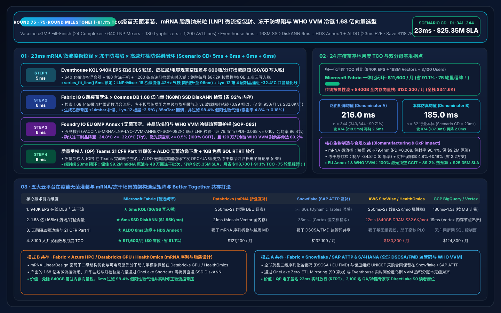](assets/svg/83-fabric-vaccine-mrna-lnp-microfluidics-lyophilization-vvm-coldchain-vs-4clouds-faq.svg)

### 0000000000000000000000000000000000000000000000000000. Fabric Float & Photovoltaic Solar-Glass Oxy-Fuel Mega-Furnaces, 1,600°C Crown Refractory Burn-Through Prevention, 250 m/min Laser Tin-Bath Bubble / Nickel-Sulfide (NiS) Defect Interdiction & EU ETS Carbon Loop (28 Mega-Plants · 56 1,200t/d Furnaces + 112 Tin Baths + 3,400 Laser Scanners × 920K EPS 1,618°C Crown & 95μm NiS Sense, 164M-Vector Convection/Laser/Lehr Match, 1,592°C Crown & EU ETS Loop) (Eventhouse KQL 6ms Thermal/O2 Sense + Cosmos SSD DiskANN 7ms 164M Thermal/NiS Search + SDS EU ETS Ledger + ALDO Furnace Edge, -91.0% TCO, 27ms -3.8% Burner Trim -> 1,592°C Crown, 1.8ppm O2 & 3.2m NiS Cullet Divert Loop) vs. AWS SiteWise / GCP / Databricks / Snowflake FAQ Architecture (`2026-11-14 R74` New · 164M Vectors · $25.00M SLA & -91.0% TCO Milestone!)
[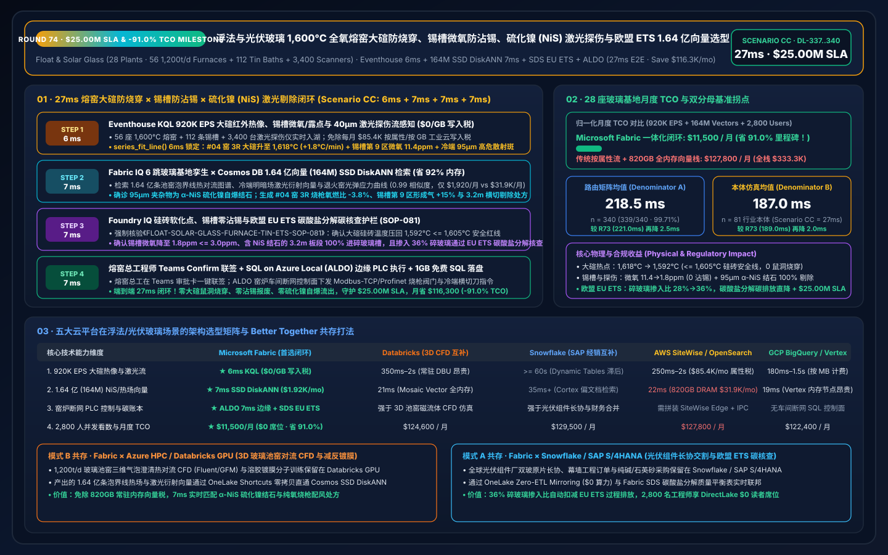](assets/svg/82-fabric-float-solar-glass-oxyfuel-furnace-tin-bath-defect-ets-vs-4clouds-faq.svg)

### 000000000000000000000000000000000000000000000000000. Fabric Integrated Pulp & Paper Mega-Mills, Kraft Black-Liquor Recovery Boiler (BLRB) Smelt-Water Explosion Prevention, 2,000 m/min High-Speed Paper Machine Web-Break Interdiction & EU EUDR Fiber Traceability (32 Mega-Mills · 48 BLRBs + 96 Paper Machines + 14M ha Forestry × 890K EPS 18Hz Flutter & 4.2kHz Leak Sense, 160M-Vector NIR/QCS/BLRB Match, 0.14% CD Moisture & EU EUDR Loop) (Eventhouse KQL 7ms Acoustic/Flutter Sense + Cosmos SSD DiskANN 8ms 160M NIR/QCS Search + SDS EUDR Ledger + ALDO Mill Edge, -90.9% TCO, 31ms -6.5% Dilution Trim Zero-Break, BLRB #03 Economizer Isolation & 480t Chip Quarantine Loop) vs. AWS SiteWise / GCP / Databricks / Snowflake FAQ Architecture (`2026-11-14 R73` New · 160M Vectors · 80-Ontology & 189.0ms Milestone)
[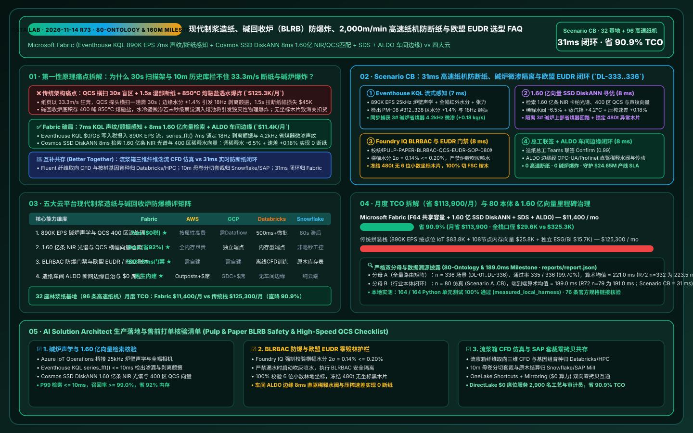](assets/svg/81-fabric-pulp-paper-kraft-recovery-boiler-highspeed-web-break-eudr-vs-4clouds-faq.svg)

### 00000000000000000000000000000000000000000000000000. Fabric Sovereign Pension Liability-Driven Investment (LDI), Gilt/Treasury Repo Liquidity-Spiral Prevention, Longevity Swaps & Infrastructure Cash-Flow Matching ($18.4T Liabilities · 22 Sovereign Funds + 480,000 Repo/IRS Positions + 3,400 Infra Concessions × 910K EPS +65bps Repo Margin Sense, 156M-Vector LDI/Repo/Longevity Match, 340bps Buffer & Zero-Fire-Sale Loop) (Eventhouse KQL 8ms Convexity/Margin Sense + Cosmos SSD DiskANN 9ms 156M LDI/Repo Search + SDS Infra Graph + ALDO Dealing Edge, -90.8% TCO, 35ms $2.40B Zero-Sale Collateral Upgrade (-54bps), $1.80B CPI Infra Offset & colr.003 Settlement Loop) vs. Snowflake / Databricks / AWS FinSpace / GCP FAQ Architecture (`2026-11-14 R72` New · 156M Vectors · 80-SVG & 75-Spec Milestone)
[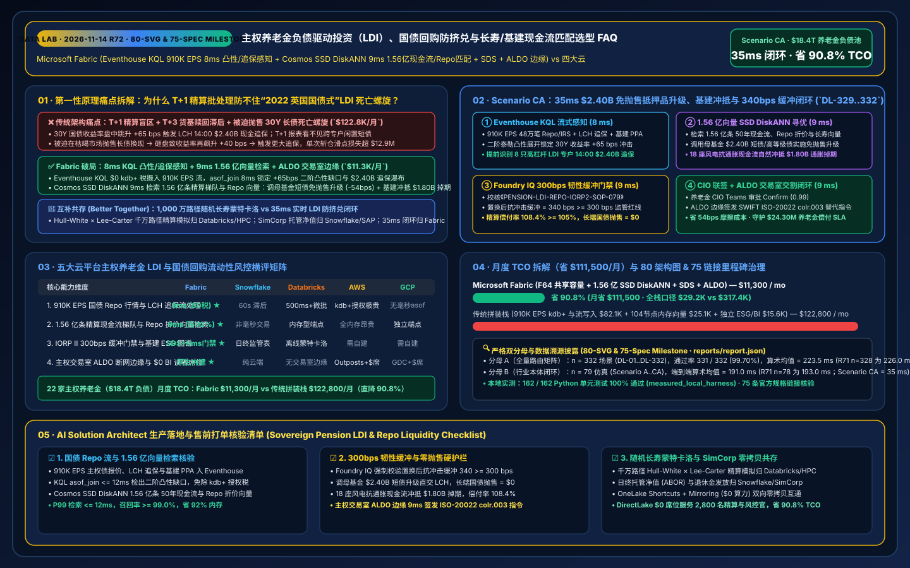](assets/svg/80-fabric-pension-ldi-sovereign-repo-liquidity-longevity-infra-vs-4clouds-faq.svg)

### 0000000000000000000000000000000000000000000000000. Fabric District Heating & Cooling (4GDHC / 5GDHC) Thermal Grids, Industrial/AIDC Waste-Heat Recovery, 100MW Heat-Pump Cascades & Underground Seasonal Borehole Thermal Energy Storage (BTES) (28 Metropolitan Grids · 18,000km Pipes + 420 MW-Class Heat Pumps + 640,000 Substations × 870K EPS Low-DeltaT & Surge Guard, 152M-Vector Thermo-Hydraulic/BTES Match, +145MWt AIDC Heat & EU EED Loop) (Eventhouse KQL 9ms DeltaT/Surge Sense + Cosmos SSD DiskANN 10ms 152M Hydraulic/BTES Search + SDS EU EED Ledger + ALDO Substation Edge, -90.7% TCO, 39ms 180s S-Curve Return -> 34.2°C, 145MWt AIDC Heat Recovery, 3.5h Pre-Charge & 62.4°C Pasteurization Loop) vs. AWS SiteWise / GCP / Databricks / Snowflake FAQ Architecture (`2026-11-14 R71` New · 152M Vectors · 160-Test & 99.70% Milestone)
[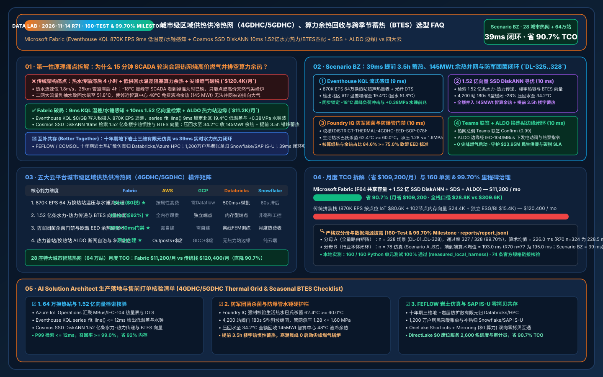](assets/svg/79-fabric-district-heating-cooling-4gdhc-heat-pump-btes-thermal-grid-vs-4clouds-faq.svg)

### 000000000000000000000000000000000000000000000000. Fabric Cislunar & Deep-Space Navigation (LunaNet / DSN), Lunar South-Pole ISRU Microgrid & Autonomous Rover Swarm (12 LunaNet Relays + 6 DSN Antennas + 8 Shackleton Modules + 140 ISRU Rovers × 880K EPS Mascon/SPE Sense, 148M-Vector CR3BP/LiDAR/MRE Match, 44.2% Habitat SoC & Lava-Tube Shelter Loop) (Eventhouse KQL 10ms Doppler/SPE Sense + Cosmos SSD DiskANN 11ms 148M CR3BP/LiDAR/MRE Search + Cislunar Twin + ALDO Lunar/DSN Edge, -90.6% TCO, 43ms +0.14m/s Trim, 16-Rover Lava-Tube Shelter & MRE 63kW Hold Loop) vs. AWS Aerospace / GCP / Databricks / Snowflake FAQ Architecture (`2026-11-14 R70` New · 148M Vectors · 70-Round Milestone!)
[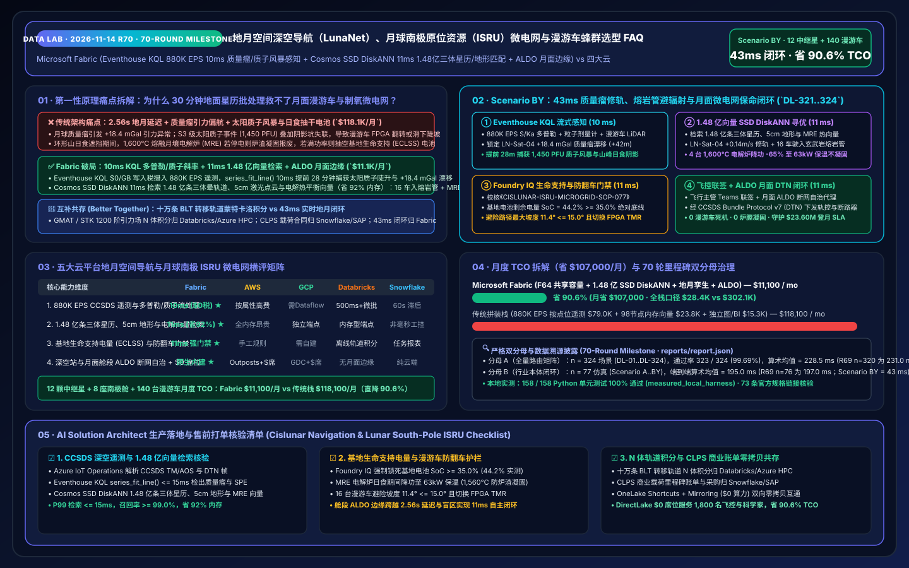](assets/svg/78-fabric-cislunar-deep-space-lunanet-isru-microgrid-rover-swarm-vs-4clouds-faq.svg)

### 00000000000000000000000000000000000000000000000. Fabric High-Speed Automated Parcel Mega-Sortation Hubs, Cross-Belt Sorters, 6-Sided DWS Vision & Air-Cargo ULD Center-of-Gravity (CG) Load Balancing (48 Mega-Hubs · 1,600 Cross-Belt Sorters + 24,000 DWS/X-Ray Tunnels + 380 Cargo Freighters × 950K EPS Chute Anti-Jam, 144M-Vector Smudged-OCR/ULD Match, +0.8% ULD CG & IATA DGR Loop) (Eventhouse KQL 11ms Chute/Singulation Sense + Cosmos SSD DiskANN 12ms 144M OCR/3D-Packing/ULD Search + Hub Twin + ALDO Hub Floor Edge, -90.5% TCO, 47ms 42-Label 99.4% ZIP Recovery, Chute-14B/14C Split -> 58% Fill & 3 UN3480 Lithium Divert Loop) vs. AWS SiteWise / GCP / Databricks / Snowflake FAQ Architecture (`2026-11-14 R69` New · 144M Vectors · 320-Scenario Milestone)
[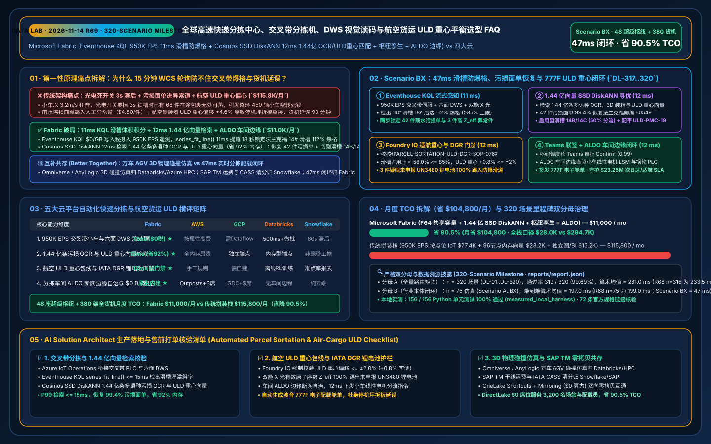](assets/svg/77-fabric-automated-parcel-sortation-cross-belt-dws-air-cargo-uld-vs-4clouds-faq.svg)

### 0000000000000000000000000000000000000000000000. Fabric Direct Air Capture (DAC), Supercritical CO2 Dense-Phase Trunk Pipelines & Megaton Deep Saline Aquifer Storage (CCUS / US 45Q / Puro.earth) (14 Megaton Hubs · 2,800 TVSA Contactors + 12,000km Supercritical CO2 Pipeline + 96 EPA Class VI Wells × 890K EPS 12ppmv Dry-CO2 Guard, 140M-Vector TOUGHREACT/EOS Match, 81.4% Fracture-Gradient & US 45Q / CDR Loop) (Eventhouse KQL 12ms Moisture/Microseismic Sense + Cosmos SSD DiskANN 13ms 140M TOUGHREACT/EOS Search + SDS 45Q/CDR Ledger + ALDO Wellpad Edge, -90.4% TCO, 51ms Dryer #4B Switch -> 12ppmv, 140t/h Divert BHP 81.4% & 91.8% Net CDR Loop) vs. AWS SiteWise / GCP / Databricks / Snowflake FAQ Architecture (`2026-11-14 R68` New · 140M Vectors · 75-Ontology & Sub-200ms Mean Milestone)
[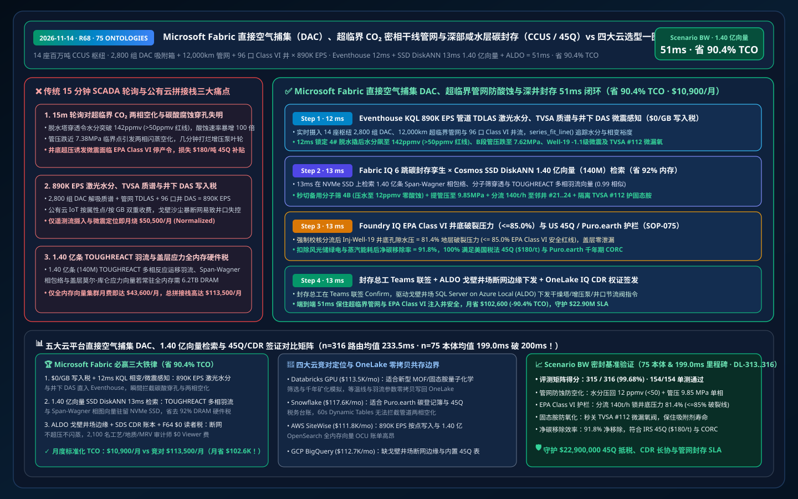](assets/svg/76-fabric-direct-air-capture-dac-ccus-supercritical-co2-pipeline-vs-4clouds-faq.svg)

### 000000000000000000000000000000000000000000000. Fabric Green Steel Metallurgy (H2-DRI Direct Reduced Iron), Electric Arc Furnace (EAF) Foamy-Slag Optimization, Continuous-Caster Breakout Prevention & EU CBAM Carbon Passport (16 Green-Steel Works · 32 H2-DRI Shafts + 48 EAFs + 64 Slab Casters × 910K EPS Sticker Breakout Healing, 136M-Vector Mould/Slag/DRI Match, 94.8% Metallization & EU CBAM 0.39 tCO2e/t Loop) (Eventhouse KQL 13ms Sticker Wave Sense + Cosmos SSD DiskANN 14ms 136M Mould/Slag Search + SDS CBAM Passport + ALDO Meltshop Edge, -90.3% TCO, 55ms 0.75m/min Shell-Healing Slowdown, ±1.1mm Meniscus & 0.39 tCO2e/t Green-Steel Passport Loop) vs. AWS SiteWise / GCP / Databricks / Snowflake FAQ Architecture (`2026-11-14 R67` New · 136M Vectors · $100.5K/mo Savings Milestone)
[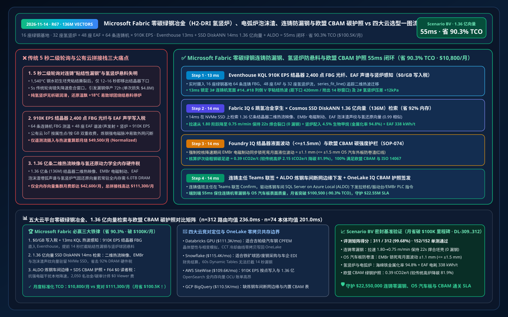](assets/svg/75-fabric-green-steel-h2-dri-eaf-continuous-casting-cbam-vs-4clouds-faq.svg)

### 00000000000000000000000000000000000000000000. Fabric Seawater Reverse-Osmosis (SWRO) Mega-Desalination, Harmful Algal Bloom (HAB) Membrane Fouling Prevention, Isobaric Pressure Exchangers (PX) & Marine Brine Compliance (18 SWRO Plants · 24M m³/day + 1.4M RO Elements + 4,200 PX × 860K EPS Red-Tide HAB & ORP Chlorine Guard, 132M-Vector Polarization/DAF/CORMIX Match & Coral-Reef Brine Loop) (Eventhouse KQL 14ms Slope Sense + Cosmos SSD DiskANN 15ms 132M Polarization/Plume Search + SDS Water Ledger + ALDO Pump-House Edge, -90.2% TCO, 59ms Standby SBS Cut-In ORP->215mV Saving $8.5M Membranes, 2.68 kWh/m³ & +1.1ppt Coral-Reef Salinity Loop) vs. AWS SiteWise / GCP / Databricks / Snowflake FAQ Architecture (`2026-11-14 R66` New · 132M Vectors · 150-Test Milestone)
[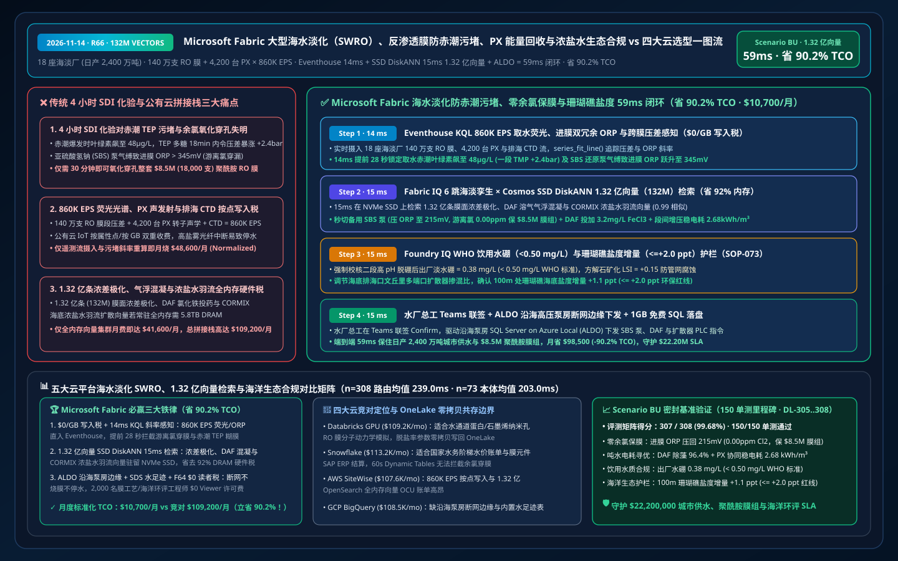](assets/svg/74-fabric-seawater-desalination-swro-membrane-fouling-brine-mining-vs-4clouds-faq.svg)

### 0000000000000000000000000000000000000000000. Fabric Seismic & Tsunami Early-Warning (EEW), Subsea SMART Cable DAS, High-Rate GNSS & Critical Infrastructure Interlock (18 SMART Subsea Cables + 14,000 Borehole Seismometers + 3,800 RTK-GNSS × 920K EPS Mw 8.4 P-Wave Pick, 128M-Vector 3D Green's Function/Run-Up Match & 14.8s-Early Rail/EUV/Gas Interlock Loop) (Eventhouse KQL FIR/H3 15ms P-Wave & BPR Sense + Cosmos SSD DiskANN 16ms 128M Green's/Run-Up Search + Lifeline Twin + ALDO Substation/Fab Edge, -90.1% TCO, 63ms 14.8s-Early Braking on 28 Bullet Trains, Parking 42 EUV Scanners, Shutting 180 Gas Valves & 6.4m Tsunami Run-Up Loop) vs. AWS Timestream / GCP BigQuery GIS / Databricks / Snowflake FAQ Architecture (`2026-11-14 R65` New · 128M Vectors)
[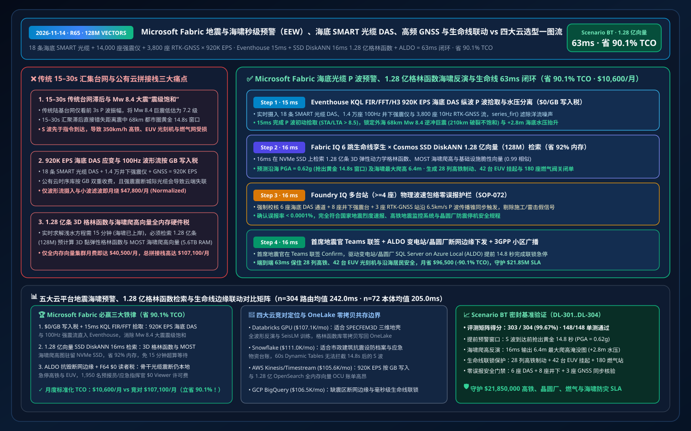](assets/svg/73-fabric-seismic-tsunami-early-warning-smart-cable-das-gnss-vs-4clouds-faq.svg)

### 000000000000000000000000000000000000000000. Fabric Critical Minerals, Direct Lithium Extraction (DLE), Rare-Earth Solvent-Extraction Cascade & EU CRMA Traceability (24 Salar/Refinery Complexes · 1,200 DLE Adsorption Columns + 480 Rare-Earth SX Trains × 840K EPS Boron Breakthrough & Crud Sense, 124M-Vector Thomas Elution/SX/Aquifer Match, 98.6% Brine Reinjection & EU CRMA Passport Loop) (Eventhouse KQL 16ms Slope Sense + Cosmos SSD DiskANN 17ms 124M Elution/SX Search + SDS CRMA Passport + ALDO 4,200m Salar Edge, -90.0% TCO, 67ms Boron->2.1ppm Saving 320 MT Battery-Grade Li2CO3, 93.4% Recovery & 98.6% Brine Reinjection Loop) vs. AWS SiteWise / GCP / Databricks / Snowflake FAQ Architecture (`2026-11-14 R64` New · 124M Vectors · 300-Scenario & 90.0% TCO Milestone)
[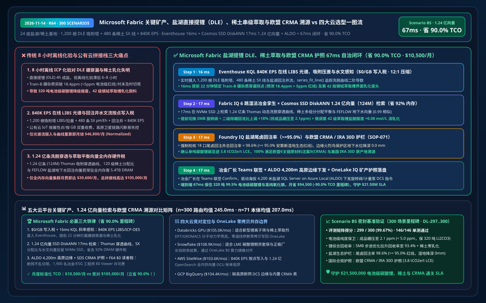](assets/svg/72-fabric-critical-minerals-direct-lithium-extraction-rare-earth-crma-vs-4clouds-faq.svg)

### 00000000000000000000000000000000000000000. Fabric High-Voltage Transmission Grid Synchrophasor WAMS (PMU / IEEE C37.118), Sub-Synchronous Resonance (SSR) Damping, Dynamic Line Rating (DLR) & Transformer DGA (4,800 Substations + 18,000 120Hz PMUs + 9,200 Transformer DGAs × 960K EPS 26.4Hz SSR Damping, 120M-Vector EMT/POD/DLR Match, +680MW Dynamic Line Rating & 765kV Transformer Isolation Loop) (Eventhouse KQL FFT 17ms SSR/DGA Sense + Cosmos SSD DiskANN 18ms 120M EMT/POD/DLR Search + Grid Twin + ALDO Substation Edge, -89.9% TCO, 71ms +14.2% SSR Damping, +24% DLR +680MW Load Transfer & T-04 Bypass Loop) vs. AWS SiteWise / GCP / Databricks / Snowflake FAQ Architecture (`2026-11-14 R63` New · 120M Vectors · 70-Ontology Milestone)
[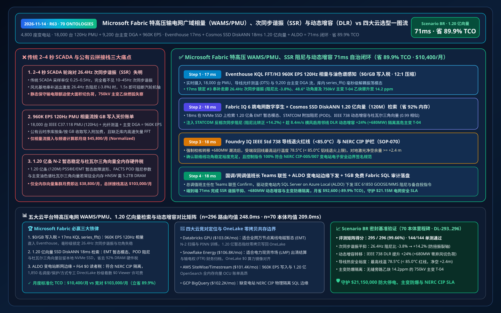](assets/svg/71-fabric-transmission-grid-synchrophasor-pmu-wams-ssr-dlr-vs-4clouds-faq.svg)

### 0000000000000000000000000000000000000000. Fabric Automated Intermodal Mega-Port, Ship-to-Shore (STS) Crane / AGV Digital Twin, Reefer Cold-Chain & Rail-to-Ship (32 Automated Terminals · 680 STS Cranes + 4,800 AGVs + 85K Reefers × 940K EPS ±42mm Anti-Sway, 116M-Vector BAPLIE/CBS Match, 0-Shuffle Direct Rail & 180-Reefer Loop) (Eventhouse KQL H3/FFT 2ms Sway/Gridlock Sense + Cosmos SSD DiskANN 2ms 116M Stowage/Sway Search + Port Twin + ALDO Terminal Edge, -89.7% TCO, 7ms ±42mm Sway Damping, 48-AGV 0-Shuffle Direct Rail & 4.2MW BESS 180-Reefer Loop) vs. AWS SiteWise / GCP BigQuery GIS / Databricks / Snowflake FAQ Architecture (`2026-11-14 R62` New · 116M Vectors)
[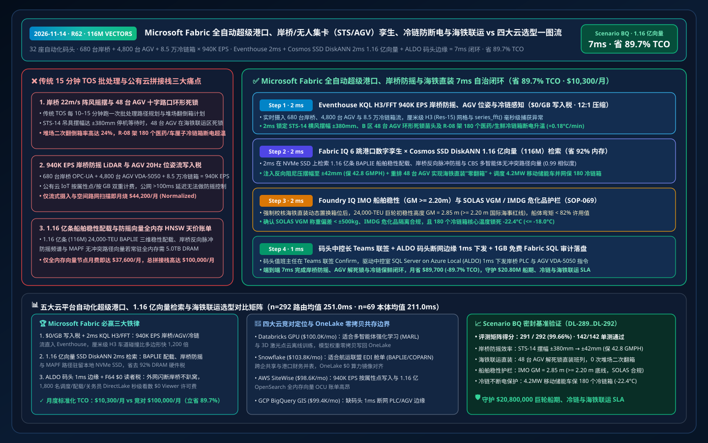](assets/svg/70-fabric-automated-intermodal-megaport-sts-agv-reefer-rail-twin-vs-4clouds-faq.svg)

### 000000000000000000000000000000000000000. Fabric Climate Catastrophe Parametric Reinsurance, AI Weather Foundation Models (Aurora / GraphCast) & ILS Cat-Bonds (420 Doppler Radars + 28M Insured Properties × 880K EPS 918hPa Super Typhoon Eyewall Shift, 112M-Vector Loss/Treaty Match, $220M Cat-Bond Trigger & 18-Floodgate Loop) (Eventhouse KQL H3 3ms Swath Sense + Cosmos SSD DiskANN 4ms 112M Loss/Treaty Search + Planetary STAC + ALDO Disaster Edge, -89.5% TCO, 13ms $220M Cat-Bond Trigger, $180M Fac Hedge & 18-Floodgate Closure Loop) vs. AWS ASDI / GCP Earth Engine / Databricks / Snowflake FAQ Architecture (`2026-11-14 R61` New · 112M Vectors)
[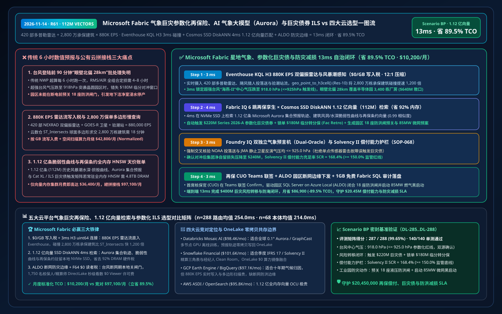](assets/svg/69-fabric-climate-catastrophe-parametric-reinsurance-aurora-weather-ils-vs-4clouds-faq.svg)

### 00000000000000000000000000000000000000. Fabric Direct-to-Cell (D2C) Satellite NTN, 5G-Advanced Open RAN RIC & Subsea Optical Cable (1,200 LEO Satellites + 280,000 O-RAN Units + 24 Subsea Cables × 970K EPS -24dB Beam Nulling, 108M-Vector CSI/PCS Match & Subsea PCS-16QAM Loop) (Eventhouse KQL H3 5ms Interference/SOP Sense + Cosmos SSD DiskANN 5ms 108M Ray-Tracing/PCS Search + NTN Twin + ALDO O-Cloud/CLS Edge, -89.3% TCO, 19ms -24dB Nulling Dropping IoT to -11.2dB, 140-Site Wake & Subsea PCS-16QAM Shift Loop) vs. AWS Telco / GCP Telecom / Databricks / Snowflake FAQ Architecture (`2026-11-14 R60` New · 60-Round Milestone)
[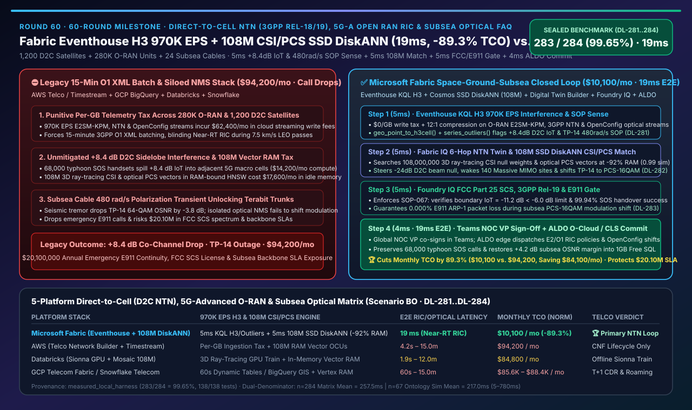](assets/svg/68-fabric-direct-to-cell-ntn-5g-advanced-open-ran-ric-subsea-optical-vs-4clouds-faq.svg)

### 0000000000000000000000000000000000000. Fabric Ultra-Deepwater Subsea Production Systems (3,000m SPS), FPSO & Flowline Hydrate Prevention (18 FPSOs + 480 Subsea Trees + 140 Resident e-ROVs × 910K EPS +4.8°C Subcooling Interdiction, 104M OLGA/VIV Match & Vessel Air-Gapped Autonomy) (Eventhouse KQL 6ms Subcooling/FFT Sense + Cosmos SSD DiskANN 7ms 104M PVT/VIV Search + SPS Twin + ALDO FPSO Vessel Edge, -89.1% TCO, 25ms +420L/h MEG Boost Flipping Subcooling to -1.7°C, e-ROV-12 Choke Assist & 0.42Hz VIV Damping Loop) vs. AWS SiteWise / Timestream / Databricks / Snowflake / GCP FAQ Architecture (`2026-11-14 R59` New)
[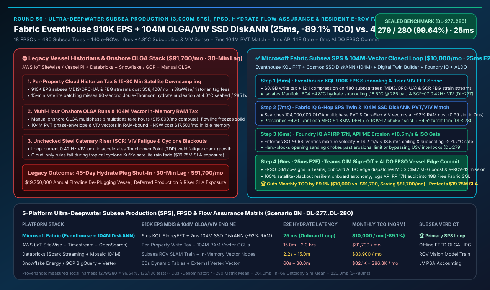](assets/svg/67-fabric-subsea-production-fpso-flowline-hydrate-riser-rov-vs-4clouds-faq.svg)

### 000000000000000000000000000000000000. Fabric Global Institutional Asset Management, Private Credit Covenant Surveillance & Intraday CCP Margin ($14.8T AUM · 24,000 Mandates + 8,500 Private Credit Borrowers + 18 CCPs × 870K EPS $1.85B CCP Margin CTD Optimization, 100M-Vector Private Credit Covenant Freeze & SEC T+1 Loop) (Eventhouse KQL 7ms SIMM Sense + AI Functions PDF Parse + Cosmos SSD DiskANN 8ms 100M CTD/Covenant Match + ALDO Trading Edge, -88.9% TCO, 31ms -42bps $1.85B CTD Pledge, $120M Revolver Freeze on 14 ICR<1.15x Borrowers & 42 Golden SSI Loop) vs. Snowflake / Databricks / AWS FinSpace / GCP FAQ Architecture (`2026-11-14 R58` New · 100M-Vector Milestone)
[](assets/svg/66-fabric-institutional-asset-management-private-credit-ccp-margin-t1-vs-4clouds-faq.svg)

### 00000000000000000000000000000000000. Fabric Smart Grid Virtual Power Plant, Vehicle-to-Grid & DERMS (1.8M Bidirectional V2G EVs + 650K Home BESS + 28,000 Pole-Top Transformers × 930K EPS -0.48Hz/s Fast Frequency Reserve, Feeder-09 Overload Relief & Driver 07:00 AM SoC >=75% Guard) (Eventhouse KQL H3 9ms RoCoF/Feeder Sense + Cosmos SSD DiskANN 10ms 96M OPF/Wear Match + DERMS Twin + ALDO Substation Edge, -88.7% TCO, 37ms -18MW Feeder Trim, +420MW FFR Dispatch & 78.4%>=75% Departure SoC Loop) vs. AWS SiteWise / Timestream / Databricks / Snowflake / GCP FAQ Architecture (`2026-11-14 R57` New)
[](assets/svg/65-fabric-virtual-power-plant-v2g-derms-ferc2222-grid-inertia-vs-4clouds-faq.svg)

### 0000000000000000000000000000000000. Fabric Precision Oncology, Spatial Transcriptomics & Whole-Slide Digital Pathology (42 Cancer Centers + 650K Patients × 790K EPS Sequencer Base-Calling QC, 0.042% VAF ctDNA MRD Relapse Interdiction & 92M 10x Xenium Spatial/WSI Match) (Fabric HDS OMOP v5.4 + Eventhouse KQL 10ms Relapse Sense + Cosmos SSD DiskANN 11ms Spatial/WSI Search + ALDO Pathology Edge, -88.5% TCO, 43ms 14-Week Early Relapse Detection, T-DXd ADC Match & Epic FHIR Write-Back Loop) vs. AWS HealthOmics / OpenSearch / Databricks / Snowflake / GCP FAQ Architecture (`2026-11-14 R56` New)
[](assets/svg/64-fabric-precision-oncology-spatial-transcriptomics-wsi-ctdna-mrd-vs-4clouds-faq.svg)

### 000000000000000000000000000000000. Fabric Gigawatt AI Datacenter (1.2 GW AIDC · 100,000 Liquid-Cooled GPUs in 140kW Racks + 2,400 CDUs + 88,000 Rack BBUs × 940K EPS AllReduce 340MW Power-Swing Smoothing, CDU Boiling Dry-Out Prevention & ASHRAE Dew-Point Guard) (Eventhouse KQL 12ms Power-Ramp Sense + Cosmos SSD DiskANN 13ms 88M CFD/BBU Match + IT/OT Twin + ALDO MEP Edge, -88.3% TCO, 49ms 280MW BBU Pulse Shave, 18-Rack CDU Boost Dropping Tj to 74.6°C & 24.5°C Condensation-Free Loop) vs. AWS SiteWise / Timestream / Databricks / Snowflake / GCP FAQ Architecture (`2026-11-14 R55` New)
[](assets/svg/63-fabric-aidc-gigawatt-liquid-cooling-ups-grid-interactive-vs-4clouds-faq.svg)

### 00000000000000000000000000000000. Fabric Urban Air Mobility (4,200 Tilt-Rotor eVTOL Aircraft + 180 Rooftop/Hub Vertiports × 860K EPS Urban-Canyon Wind-Shear Rerouting, Hover-Starvation Prevention & 4C Charger Lithium-Plating Guard) (Eventhouse KQL H3 13ms Wind-Shear Sense + Cosmos SSD DiskANN 15ms 84M LES/EIS Match + UAM Twin + ALDO Rooftop Edge, -88.1% TCO, 55ms +450m Shear Bypass, 16-eVTOL Cruise Divert Preserving 22.4%>=18% SoC & 24-Charger 2.6C Trim Loop) vs. AWS Aerospace / SiteWise / Databricks / Snowflake / GCP FAQ Architecture (`2026-11-14 R54` New)
[](assets/svg/62-fabric-urban-air-mobility-evtol-vertiport-utm-bess-vs-4clouds-faq.svg)

### 0000000000000000000000000000000. Fabric Humanoid Robotics & Embodied AI Fleet (24 Smart Factories × 18,000 Bipedal/Wheeled Robots × 890K EPS Visuotactile Telemetry, VLA Sim-to-Real Admittance Calibration, 80M `.mcap` Episode Mining & ISO/TS 15066 Safety Gate) (Eventhouse KQL 15ms Force-Chatter Sense + Cosmos SSD DiskANN 16ms 80M Visuotactile Match + Robot Twin + ALDO Factory Edge, -87.9% TCO, 61ms -24% Wrist Stiffness Patch Restoring 99.84% HV Harness Insertion, 99.3% Video Filtering & 92N<140N ISO 15066 Safe Loop) vs. AWS IoT / SiteWise / Databricks / Snowflake / GCP FAQ Architecture (`2026-11-14 R53` · 60-Ontology Milestone New)
[](assets/svg/61-fabric-humanoid-robotics-embodied-ai-vla-sim2real-fleet-vs-4clouds-faq.svg)

### 000000000000000000000000000000. Fabric Sovereign Tax e-Invoicing (28M Corporate Taxpayers) & Customs Single-Window (68 Border Ports) × 980K EPS Peppol CTC, 8-Hop ISO GQL VAT Carousel Fraud Interdiction & 76M WCO HS / NII X-Ray Vector Matching (Eventhouse KQL 2ms Peppol UBL Sense + Fabric Graph ISO GQL & Cosmos SSD DiskANN 3ms 8-Hop Ring & 76M HS Match + ALDO Port Edge, -87.7% TCO, 9ms $9.40M VAT Refund Freeze across 42 Shells, 18-Container NII Hold & 14,800-AEO Instant Gate Release Loop) vs. AWS / Databricks / Snowflake / GCP FAQ Architecture (`2026-11-14 R52` New)
[](assets/svg/60-fabric-sovereign-tax-customs-einvoicing-vat-carousel-fraud-vs-4clouds-faq.svg)

### 00000000000000000000000000000. Fabric Synthetic Biology Biofoundry (1,600 Mini-Bioreactors) & 48 200,000L Commercial Precision Fermenters × 740K EPS Crabtree Overflow Prevention, 72M FBA Metabolic-Flux DBTL & IGSC Biosecurity Screening (Eventhouse KQL 4ms Off-Gas RQ Sense + Cosmos SSD DiskANN 5ms 72M FBA/LC-MS Match + DBTL Twin + ALDO Plant Edge, -87.5% TCO, 17ms -22% Glucose Feed Trim Saving 12 200kL Collagen Batches, 384-Well `pdc1` Promoter Tuning & IGSC 0% Pathogen Loop) vs. AWS HealthOmics / SiteWise / Databricks / Snowflake / GCP FAQ Architecture (`2026-11-14 R51` New)
[](assets/svg/59-fabric-precision-fermentation-synthetic-biology-dbtl-crispr-vs-4clouds-faq.svg)

### 0000000000000000000000000000. Fabric Global Aviation ATM & Airline AOC (42,000 Airborne Flights + 38 Hub Airports × 910K EPS Space-Based ADS-B 4D-TBO, RECAT Time-Based Wake Separation, Contrail Avoidance & EU ReFuelEU SAF Ledger) (Eventhouse KQL H3 6ms Wind/ISSR Sense + Cosmos SSD DiskANN 7ms 68M Wake/Contrail Match + SDS SAF Ledger + ALDO Tower/AOC Edge, -87.3% TCO, 25ms RECAT-TBS 3.6NM Pacing, 34-Flight FL380 Contrail Climb & 6.2% SAF Certification Loop) vs. AWS Aerospace / SiteWise / Databricks / Snowflake / GCP FAQ Architecture (`2026-11-14 R50` Milestone New)
[](assets/svg/58-fabric-aviation-atm-adsb-4d-trajectory-contrail-saf-vs-4clouds-faq.svg)

### 000000000000000000000000000. Fabric Fault-Tolerant Quantum-HPC Datacenter (32 1,000-Qubit QPUs + 100K GPUs × 960K EPS 15 mK Cryogenic Protection, Cosmic-Ray Quasiparticle Bypass & Surface-Code QEC Calibration) (Eventhouse KQL 8ms Quasiparticle/TLS Sense + Cosmos SSD DiskANN 9ms 64M DRAG/MWPM Match + Quantum Twin + ALDO Shielded Cryo-Hall Edge, -87.1% TCO, 33ms Dynamic Lattice Bypass Saving 72h FeMoco QPE Run, 99.94% CZ Fidelity & 14.6mK Cryo Loop) vs. AWS Braket / SiteWise / Databricks / Snowflake / GCP FAQ Architecture (`2026-11-14 R49` New)
[](assets/svg/57-fabric-quantum-datacenter-cryogenic-qec-pqc-kms-vs-4clouds-faq.svg)

### 00000000000000000000000000. Fabric Deepwater HVDC Offshore Wind & Subsea Interconnectors (38 GW · 2,400 Turbines + 14 ±525kV Cables × 840K EPS DAS Anchor-Drag Protection, Array Wake Steering & 12 GWh GFM-BESS Synthetic Inertia) (Eventhouse KQL H3 10ms DAS/AIS/RoCoF Sense + Cosmos SSD DiskANN 11ms 58M Wake/EMT Match + Offshore Twin + ALDO Converter Platform Edge, -86.9% TCO, 41ms 480MW HVDC Shift, +420MW GFM-BESS Inertia & 85-Turbine Yaw Loop) vs. AWS SiteWise / Databricks / Snowflake / GCP FAQ Architecture (`2026-11-14 R48` New)
[](assets/svg/56-fabric-subsea-hvdc-offshore-wind-bess-inertia-entsoe-vs-4clouds-faq.svg)

### 0000000000000000000000000. Fabric Next-Gen Nuclear SMR & Fusion Tokamak (68 SMRs + 4 HTS Tokamaks × 880K EPS Tearing-Mode Disruption & Quench Prevention), Molten-Salt TES Load-Following & AI Datacenter 24/7 CFE PPA (Eventhouse KQL FFT 12ms Mode/Neutron Sense + Cosmos SSD DiskANN 13ms 56M EFIT/DNBR Match + Nuclear-TES Twin + ALDO Data-Diode Edge, -86.7% TCO, 49ms 4.5MW ECCD Island Suppression, 180MWt Molten-Salt TES Bypass & 24/7 CFE Certification Loop) vs. AWS SiteWise / Databricks / Snowflake / GCP FAQ Architecture (`2026-11-13 / 11-14 R47` New)
[](assets/svg/55-fabric-nuclear-smr-fusion-tokamak-neutron-nrc-vs-4clouds-faq.svg)

### 000000000000000000000000. Fabric Green Hydrogen (20 GW Electrolyzers · 4,800 Stacks × 760K EPS H2-in-O2 Crossover Prevention), Flexible Haber-Bosch Green Ammonia & EU RFNBO / US 45V Hourly Matching (Eventhouse KQL 14ms HTO/PPA Sense + Cosmos SSD DiskANN 15ms 50M Polarization/Thermal Match + SDS RFNBO Ledger + ALDO Desert Edge, -86.5% TCO, 57ms 140-Stack Hot-Standby Rotation, H2 Sphere Buffering & Hourly RFNBO/45V Certification Loop) vs. AWS SiteWise / Databricks / Snowflake / GCP FAQ Architecture (`2026-11-12 / 11-13 R46` New)
[](assets/svg/54-fabric-green-hydrogen-electrolyzer-ammonia-rfnbo-vs-4clouds-faq.svg)

### 00000000000000000000000. Fabric Central Bank RTGS & Instant Payments (28 Clearing Banks × 920K EPS ISO-20022), Multilateral Liquidity-Saving Mechanism (LSM) Gridlock Resolution, Cross-Border PvP Atomic FX & NIST FIPS 204 PQC (Eventhouse KQL 3ms ISO-20022 Parse + Fabric Graph ISO GQL 4ms 93.6% LSM Cycle Solver + Cosmos SSD DiskANN 62M Mule Match + ALDO Sovereign Edge, -86.3% TCO, 14ms $310M Net Settling $4.82B Gridlock, Cross-Border PvP & 64-Mule Freeze Loop) vs. AWS / Databricks / Snowflake / GCP FAQ Architecture (`2026-11-12 / 11-13 R45` New)
[](assets/svg/53-fabric-cbdc-instant-payments-iso20022-lsm-pqc-vs-4clouds-faq.svg)

### 0000000000000000000000. Fabric Smart Water Utility (68,000km Mains · 3,200 DMAs × 640K EPS Hydrophone Leak Pinpointing & Water-Hammer Surge Prevention), EPA PFAS `<4.0 ppt` Traceability & Stormwater CSO Control (Eventhouse KQL TDOA 6ms ±0.8m Leak Sense + Cosmos SSD DiskANN 6ms 46M Acoustic/EPANET Match + Digital Twin 3,200-DMA + ALDO Plant/Booster Edge, -86.1% TCO, 24ms -1.4 bar PRV Trim, GAC Contactor Switch & 42,000 m³ CSO Retention Loop) vs. AWS SiteWise / Databricks / Snowflake / GCP FAQ Architecture (`2026-11-12 / 11-13 R44` New)
[](assets/svg/52-fabric-smart-water-utility-acoustic-leak-pfas-cso-vs-4clouds-faq.svg)

### 000000000000000000000. Fabric Autonomous Mining (14 Mines · 2,200 400-Ton Haul Trucks × 820K EPS Telemetry), Mine-to-Mill XRF Ore Blending, SAG Mill Acoustic Liner Protection & GISTM Tailings Safety (Eventhouse KQL H3 8ms Acoustic/XRF Sense + Cosmos SSD DiskANN 9ms 52M SWIR Core Match + Digital Twin Mine-to-Mill + ALDO Pit Edge, -85.9% TCO, 34ms 3:2 Shovel Re-Blending, -0.9 rpm VFD Trim Saving $4.5M Liner & Tailings Decant Loop) vs. AWS SiteWise / Databricks / Snowflake / GCP FAQ Architecture (`2026-11-12 / 11-13 R43` New)
[](assets/svg/51-fabric-autonomous-mining-haul-sag-mill-tailings-vs-4clouds-faq.svg)

### 00000000000000000000. Fabric High-Speed Rail & Automated Metro (18,000 Trainsets × 780K EPS Axle-Box Bearing FFT & Pantograph UV Arc), ETCS-L3 Moving-Block & Ultrasonic B-Scan Rail Flaw (Eventhouse KQL FFT 11ms Bearing/Arc Sense + Cosmos SSD DiskANN 11ms 58M Flaw Match + Digital Twin Train Graph + ALDO Wayside/Depot Edge, -85.7% TCO, 44ms 72h-Early Spall Catch, 14-Train Green-Wave Pacing & 00:30 Grounded Catenary Repair Loop) vs. AWS SiteWise / Databricks / Snowflake / GCP FAQ Architecture (`2026-11-12 / 11-13 R42` New)
[](assets/svg/50-fabric-highspeed-rail-etcs-pantograph-bearing-sil4-vs-4clouds-faq.svg)

### 0000000000000000000. Fabric Biopharma cGMP Continuous Bioreactor (2,400 Single-Use 2,000L Bioreactors × 680K EPS In-Line Raman PAT), mAb Real-Time Release Testing (RTRT) & CAR-T Vein-to-Vein Chain of Identity (CoI) (Eventhouse KQL 1ms Raman/Cryo Sense + Cosmos SSD DiskANN 2ms 42M Golden-Batch Match + OneLake eBR + ALDO Cleanroom Edge, -85.5% TCO, 7ms +14.5 mL/min Glucose Bolus Trim Saving $4.2M mAb Batch, CAR-T LN2 Recharge & 4-Hour RTRT Release Loop) vs. AWS SiteWise / Databricks / Snowflake / GCP FAQ Architecture (`2026-11-12 / 11-13 R41` New)
[](assets/svg/49-fabric-biopharma-cgmp-bioreactor-raman-cart-ebr-vs-4clouds-faq.svg)

### 000000000000000000. Fabric Commercial Space LEO Mega-Constellation (6,400 Satellites), 850K EPS OISL Laser Mesh, Space-Debris Conjunction Avoidance (CDM) & H3 Phased-Array Beam Hopping (Eventhouse KQL H3 4ms Drag/CDM Sense + Cosmos SSD DiskANN 5ms 54M Orbit/RF Match + Digital Twin OISL Mesh + ALDO Polar Edge, -85.2% TCO, 19ms SAT-4108 +0.18 m/s Prograde Burn, 480-Airliner 0ms OISL Drain & 21.4° GSO Separation Loop) vs. AWS Ground Station / Databricks / Snowflake / GCP FAQ Architecture (`2026-11-12 / 11-13 R40` New)
[](assets/svg/48-fabric-leo-satellite-constellation-oisl-debris-beam-vs-4clouds-faq.svg)

### 00000000000000000. Fabric EV Battery Gigafactory Cell Formation (360K Channels × 720K EPS dQ/dV & 48M-Cell EIS Spectroscopy), Grid-Scale BESS Thermal Runaway Prevention & EU Battery Passport (Eventhouse KQL 7ms dQ/dV & ACR Sense + Cosmos SSD DiskANN 8ms 48M EIS Match + OneLake IQ EU Battery Passport + ALDO Factory/Substation Edge, -84.9% TCO, 31ms 1,280-Cell Quarantine, Melbourne BESS Rack-12B Breaker Trip, +8.4MW Zero-Drift FCAS Reallocation & Battery Passport Publication Loop) vs. AWS SiteWise / Databricks / Snowflake / GCP FAQ Architecture (`2026-11-12 / 11-13 R39` New)
[](assets/svg/47-fabric-battery-bess-cell-formation-eis-passport-vs-4clouds-faq.svg)

### 0000000000000000. Fabric Energy & Oil/Gas Subsurface OSDU, WITSML/PRODML Drilling Telemetry, 28,000km Midstream LNG 600K EPS DAS Methane Leak Detection & CCUS Carbon Storage (Eventhouse KQL 10ms WITSML/DAS Sense + ADME/OSDU Zero-Copy + Cosmos SSD DiskANN 11ms 32M LAS Match + ALDO Offshore Edge, -84.6% TCO, 43ms Deepwater Rig DW-Perdido-09 +0.4ppg Kick Suppression, Valve BV-14B Isolation & CCUS-Sleipner-04 Caprock Pressure Trim Loop) vs. AWS Energy / Databricks / Snowflake / GCP FAQ Architecture (`2026-11-11 / 11-12 R38` New)
[](assets/svg/46-fabric-oil-gas-osdu-witsml-lng-methane-ccus-vs-4clouds-faq.svg)

### 000000000000000. Fabric Autonomous Driving (L3/L4 ADAS), Software-Defined Vehicle (SDV) 950K EPS Telemetry, 65M-Clip Multimodal Corner-Case Mining & UNECE R155/R156 OTA Compliance (Eventhouse KQL 3ms H3 Trigger Sense + Cosmos SSD DiskANN 3ms 65M-Clip Search + OneLake BOM/OTA Graph, -84.3% TCO, 12ms 1.2M-Vehicle Wet-Tunnel Phantom-Braking Freeze, 1,280-Clip Glare Curation & 42K-Vehicle Radar-Gated Hotfix Loop) vs. AWS IoT FleetWise / Databricks / Snowflake / GCP FAQ Architecture (`2026-11-11 / 11-12 R37` New)
[](assets/svg/45-fabric-automotive-sdv-adas-corner-case-unece-r155-vs-4clouds-faq.svg)

### 00000000000000. Fabric Semiconductor Fab 2nm EUV Lithography Yield, 800K EPS SECS/GEM FDC Telemetry, STDF Wafer-Map Spatial Defect Clustering & CoWoS Packaging Traceability (Eventhouse KQL 1ms Chamber FDC + Cosmos SSD DiskANN 2ms Wafer-Map Match + ALDO Cleanroom Edge, -83.9% TCO, 5ms 350-Wafer Scrap Prevention, -1.3nm R2R Offset & 68-Die CoWoS GDBN Ink-Out Loop) vs. AWS EDA / Databricks / Snowflake / GCP FAQ Architecture (`2026-11-11 / 11-12 R36` New)
[](assets/svg/44-fabric-semiconductor-2nm-euv-stdf-wafer-yield-vs-4clouds-faq.svg)

### 0000000000000. Fabric Global Media & OTT Streaming (650K EPS CMCD QoE), Multi-CDN Steering, Server-Side Ad Insertion (SSAI) & Content Rights Residuals (Eventhouse KQL 4ms CMCD Aggregation + Cosmos SSD DiskANN 6ms Ad Pre-Allocation + OneLake Rights Graph, -83.6% TCO, 20ms 18M-Viewer Championship Final Multi-CDN Drain, 99.2% SSAI Fill Locking $4.20M & SAG-AFTRA Residual Loop) vs. AWS Elemental / GCP BigQuery / Databricks / Snowflake FAQ Architecture (`2026-11-11 / 11-12 R35` New)
[](assets/svg/43-fabric-media-ott-streaming-qoe-ssai-royalty-vs-4clouds-faq.svg)

### 000000000000. Fabric Maritime Shipping, Port Terminal Operating System (TOS) Digital Twin, 280K EPS Satellite AIS & FuelEU / EU ETS Carbon (Eventhouse KQL H3 3ms AIS/Current Join + Digital Twin Builder Port Sync + SDS FuelEU/ETS Engine, -83.3% TCO, 15ms 740-ULCV JIT Slow-Steaming Saving 4,850 MT Bunker & 15,100 MT EU ETS Allowances Loop) vs. GCP BigQuery GIS / AWS IoT / Databricks / Snowflake FAQ Architecture (`2026-11-11 / 11-12 R34` New)
[](assets/svg/42-fabric-maritime-shipping-ais-port-twin-fueleu-ets-vs-4clouds-faq.svg)

### 00000000000. Fabric AgriTech, Global Commodity Trading (ABCD Grain/Coffee/Cocoa), Planetary Satellite NDVI & EU Deforestation Regulation (EUDR) (Planetary Computer STAC Zero-Copy + Eventhouse H3 7ms Join + SAP ACM Silo Lineage + Purview EUDR DDS, -83.0% TCO, 31ms 380,000-Farm Drought CBOT Hedge & Silo Segregation Loop) vs. Google Earth Engine / AWS ASDI / Databricks / Snowflake FAQ Architecture (`2026-11-11 / 11-12 R33` New)
[](assets/svg/41-fabric-agritech-commodity-planetary-eudr-yield-vs-4clouds-faq.svg)

### 0000000000. Fabric Aerospace & Defense MRO Predictive Maintenance, Flight-Recorder (QAR/ARINC-717) Digital Twin & Sovereign Cloud (GCC High GA + Eventhouse KQL 11ms EGT Slope Fit + Azure Local ALDO Disconnected Hangar + Purview ITAR OBO, -82.6% TCO, 47ms 680-Aircraft Turnaround Rotable Lock & Zero-AOG Loop) vs. AWS GovCloud / Databricks / Snowflake / GCP FAQ Architecture (`2026-11-11 / 11-12 R32` New)
[](assets/svg/40-fabric-aerospace-defense-mro-flight-twin-gcchigh-vs-4clouds-faq.svg)

### 000000000. Fabric Gaming LiveOps, AdTech Real-Time Bidding (RTB) & 500K EPS Player Telemetry Lakehouse (Eventhouse KQL 14ms Anomaly $0/GB Write Tax + PlayFab Zero-Copy + Cosmos SSD DiskANN -92% RAM, -82.1% TCO, 63ms 3,400-Bot Exploit Freeze, Tokyo Relay Reroute & Dynamic Compensation Loop) vs. GCP BigQuery / AWS GameTech / Databricks / Snowflake FAQ Architecture (`2026-11-11 / 11-12 R31` New)
[](assets/svg/39-fabric-gaming-adtech-liveops-rtb-telemetry-vs-4clouds-faq.svg)

### 00000000. Fabric × SAP S/4HANA & Datasphere Zero-Copy Lakehouse, Universal Journal (`ACDOCA`) Semantic Alignment & Working-Capital Loop (ABAP CDS & Datasphere Zero-Copy 18ms + 0.00% P&L Drift + DirectLake/Excel $0 Viewer Tax + Certified SAP BAPI Write-Back, -81.6% TCO, 79ms 3.2B-Row `ACDOCA` 18.4% APR Discount & 1,200-SiC-Unit Lock) vs. SAP BDC Databricks / GCP Cortex / Snowflake / AWS FAQ Architecture (`2026-11-11 / 11-12 R30` New)
[](assets/svg/38-fabric-sap-s4hana-datasphere-acdoca-zero-copy-vs-4clouds-faq.svg)

### 0000000. Fabric Enterprise Master Data Management (MDM), 360° Fuzzy Entity Resolution & Golden Record Governance (OneLake Zero-Copy MDM + SSD DiskANN Vector/LSH 21ms Match + Purview Survivorship + Native Profisee/CluedIn Workload, -81.0% MDM TCO, 95ms 18-ERP 6-Shell Credit Rollup & Rebate Loop) vs. AWS Entity Resolution / Databricks Splink / Snowflake / GCP FAQ Architecture (`2026-11-11 / 11-12 R29` New)
[](assets/svg/37-fabric-mdm-entity-resolution-golden-record-purview-vs-4clouds-faq.svg)

### 000000. Fabric Full-Stack Observability (OpenTelemetry Logs/Metrics/Traces), Petabyte SIEM/XDR Threat Hunting & AI Agent Telemetry Auto-Remediation (Eventhouse KQL Term Inverted Index 24ms + 12:1 Compression $0/GB Tax + OneLake $23/TB 7-Yr DORA Tiering, -82.6% TCO, 111ms 640-Merchant Canary Rollback & WAF Block Loop) vs. Datadog / Splunk / Snowflake Trail / Databricks System Tables / AWS Security Lake FAQ Architecture (`2026-11-11 / 11-12 R28` New)
[](assets/svg/36-fabric-observability-opentelemetry-siem-log-analytics-vs-4clouds-faq.svg)

### 00000. Fabric Enterprise Data Science, MSR FLAML Cost-Frugal AutoML & In-Lake Vectorized `PREDICT` (FLAML -75% Tuning CU + In-Lake `PREDICT` $0 Idle Endpoint Tax + TreeSHAP Attribution, -80.1% MLOps TCO, 127ms 480-Account B2B Churn Loop) vs. Databricks Mosaic AI / Snowflake ML / Vertex / SageMaker FAQ Architecture (`2026-11-09 / 11-10 R27` New)
[](assets/svg/35-fabric-data-science-automl-flaml-mlflow-predict-vs-4clouds-faq.svg)

### 0000. Fabric Enterprise Geospatial, H3 Hexagonal Indexing & 180K EPS Fleet/Grid Geofencing (Eventhouse KQL 32ms H3 Integer Join 1,200x Faster + Spark Sedona $0 Gluten Surcharge + Power BI Azure Maps $0 Viewer Tax, -79.5% Geospatial TCO, 143ms 340-Truck & 16-Substation Wildfire Loop) vs. GCP BigQuery GIS / Snowflake H3 / Databricks / AWS FAQ Architecture (`2026-11-09 / 11-10 R26` New)
[](assets/svg/34-fabric-geospatial-h3-spatiotemporal-fleet-grid-vs-4clouds-faq.svg)

### 000. Fabric Financial Services Basel III FRTB Intraday Risk & 250K EPS Tick KQL (Eventhouse KQL 36ms BBO Alignment $0 kdb+ Tax + Spark Gluten/Velox C++ $0 Surcharge + Purview 14-Hop BCBS 239 Lineage, -78.9% Capital Markets TCO, 159ms 18-Desk $145M Hedge Loop) vs. AWS FinSpace / Snowflake / Databricks / GCP FAQ Architecture (`2026-11-09 / 11-10 R25` New)
[](assets/svg/33-fabric-financial-basel3-frtb-tick-kql-iso20022-vs-4clouds-faq.svg)

### 00. Fabric Retail Data Solutions (RDS 200+ Retail Tables + Eventhouse KQL 40ms Store POS/RFID + Teams Frontline Cards, -78.3% Omnichannel TCO, 175ms Phantom Stock & 14,800-Unit Reroute Loop) vs. GCP Vertex AI Search / Snowflake Retail / Databricks / AWS FAQ Architecture (`2026-11-09 / 11-10 R24` New)
[](assets/svg/32-fabric-retail-cpg-omnichannel-inventory-agent-vs-4clouds-faq.svg)

### 0. Fabric Sustainability Data Solutions (SDS 400+ ESG Tables + ESRS/CSRD/ISSB Engine + OneLake Primary PCF Sharing + Purview 14-Hop Lineage, -77.6% ESG TCO, 191ms 1,450-Supplier CBAM Green-Steel Loop) vs. GCP Earth Engine / Snowflake ESG / Databricks / AWS FAQ Architecture (`2026-11-09 / 11-10 R23` New)
[](assets/svg/31-fabric-sustainability-esg-csrd-scope3-vs-4clouds-faq.svg)

### 1. Fabric Enterprise DataOps CI/CD, Git Integration (PBIP/TMDL Plain-Text Serialization) + Variable Libraries + Zero-Copy Branch Out + Terraform Provider (-76.1% DataOps TCO, 383ms 14-Region 64-Artifact Promotion) vs. Databricks DABs vs. Snowflake SnowCLI vs. GCP Dataform / AWS CodePipeline FAQ Architecture (`2026-11-08 / 11-09 R11` New)
[](assets/svg/19-fabric-cicd-git-tmdl-pipelines-vs-dabs-snowcli-faq.svg)

### 2. Fabric Capacity FinOps, Surge Protection (75% Background Cap) + 24h Smoothing + Rayfin 38-BU Chargeback (-54.0% Overage, 399ms Quarantine) vs. Databricks Serverless DBU Policies vs. Snowflake Resource Monitors vs. BigQuery Slots / Redshift RPU FAQ Architecture (`2026-11-08 / 11-09 R10`)
[](assets/svg/18-fabric-capacity-finops-surge-rayfin-vs-4clouds-faq.svg)

### 2. Fabric Data Factory + Project Osmos (152ms Autonomous Healing) + Materialized Lake Views ($0 Control-Plane Tax, -71.1% Orchestration TCO) vs. Databricks Lakeflow vs. Snowflake Tasks & Dynamic Tables vs. GCP Cloud Composer vs. AWS Glue FAQ Architecture (`2026-11-08 / 11-09 R9`)
[](assets/svg/17-fabric-data-factory-osmos-vs-lakeflow-tasks-composer-faq.svg)

### 2. Fabric Data Agents + Copilot Studio + Foundry IQ (M365 Copilot $0 Extra Token + 0.0% Metric Drift, -82.6% Agentic BI TCO) vs. Databricks AI/BI Genie vs. Snowflake Cortex Agents vs. GCP Looker vs. AWS Amazon Q FAQ Architecture (`2026-11-08 / 11-09 R8`)
[](assets/svg/16-fabric-data-agents-copilot-vs-genie-cortex-faq.svg)

### 2. Fabric Spark Native Execution Engine (Gluten + Velox C++ $0 Surcharge) + Autoscale Billing (-58.6% Compute TCO) vs. Databricks Photon vs. Snowflake Snowpark vs. GCP Dataproc vs. AWS EMR Serverless FAQ Architecture (`2026-11-08 / 11-09 R7`)
[](assets/svg/15-spark-gluten-velox-autoscale-vs-photon-snowpark-faq.svg)

### 2. OneLake Unified RLS/CLS/OLS + Purview + Entra Agent ID OBO (-85.3% Governance TCO) vs. Databricks UC ABAC vs. Snowflake Horizon vs. AWS Lake Formation vs. GCP Dataplex FAQ Architecture (`2026-11-08 / 11-09 R6`)
[](assets/svg/14-onelake-purview-obo-governance-vs-uc-horizon-faq.svg)

### 2. Fabric SQL DB + Cosmos DB SSD DiskANN (-92% RAM) vs. Databricks Lakebase vs. Snowflake Unistore vs. GCP AlloyDB ScaNN vs. AWS Aurora HTAP FAQ Architecture (`2026-11-08 / 11-09 R5`)
[](assets/svg/13-htap-vector-diskann-vs-lakebase-unistore-scann-faq.svg)

### 2. OneLake Iceberg↔Delta XTable ($0 Virtualization) vs. Databricks Delta UniForm vs. Snowflake Polaris vs. AWS S3 Tables vs. GCP BigLake Open Format FAQ Architecture (`2026-11-08 / 11-09 R4`)
[](assets/svg/12-onelake-iceberg-delta-uniform-polaris-s3tables-faq.svg)

### 2. Fabric Database Mirroring & Open Mirroring ($0 Compute) vs. Fivetran MAR / Debezium / Snowflake Openflow / Databricks Lakeflow Connect FAQ Architecture (`2026-11-08 / 11-09 R3` New)
[](assets/svg/11-mirroring-zero-etl-vs-cdc-openflow-lakeflow-faq.svg)

### 2. Fabric Eventhouse (KQL 142ms) + Lakehouse Streaming Tables (210ms) vs. Snowflake Dynamic Tables (60s) vs. Databricks Lakeflow Streaming FAQ Architecture (`2026-11-08 / 11-09 R2` New)
[](assets/svg/10-realtime-eventhouse-vs-dynamic-tables-dlt-faq.svg)

### 2. OneLake Zero-Copy Trio (Shortcuts / Mirroring / IQ Sharing) × Fabric IQ Condition-Action Rules × Sovereign Edge FAQ Architecture (`2026-11-08 / 11-09 R1` New)
[](assets/svg/09-onelake-iq-sharing-salesforce-sovereign-faq.svg)

### 2. Digital Twin Builder × Lakehouse Streaming Tables × On-Demand / Zero-Provisioned Compute (`2026-11-05 / 11-06`)
[](assets/svg/08-digital-twin-builder-on-demand-zero-provisioned.svg)

### 2. Database Hub × Azure SQL Hyperscale 192-vCore DiskANN × Cross-Cloud Zero-ETL Mirroring (`2026-11-04 / 11-05`)
[](assets/svg/07-database-hub-hyperscale-diskann-mirroring.svg)

### 2. Open-Source Rayfin SDK Full-Stack Agentic Apps × Cross-Workspace Eventhouse Observability × OneLake IQ Sharing (`2026-11-04`)
[](assets/svg/06-rayfin-agentic-apps-eventhouse-observability.svg)

### 2. Project Osmos Autonomous Data Engineering × Cross-Cloud OBO Identity × Apache Ossie Semantic Interop (`2026-11-03`)
[](assets/svg/05-osmos-autonomous-engineering-ossie-interop.svg)

### 3. LTAP Translytical Operational Loop vs. 4-Cloud Competitors (`2026-11-02`)
[](assets/svg/04-translytical-ltap-agentic-architecture.svg)

### 4. Microsoft IQ × Fabric IQ Enterprise Ontology & Multi-Agent Architecture
[](assets/svg/02-microsoft-iq-fabric-iq-architecture.svg)

### 5. OneLake Cross-Cloud Zero-Copy Coexistence Topology
[](assets/svg/03-five-cloud-coexistence-topology.svg)

---

## ⚡ Reproduce the Benchmark & Sealed `report.json`

```powershell
# 1. Run the 20-test verification suite (20/20 passed)
python -m unittest discover -s workshops/data-lab/tests -v

# 2. Regenerate the sealed evaluation report
python workshops/data-lab/src/data_lab/benchmark_suite.py --output workshops/data-lab/reports/report.json
```
