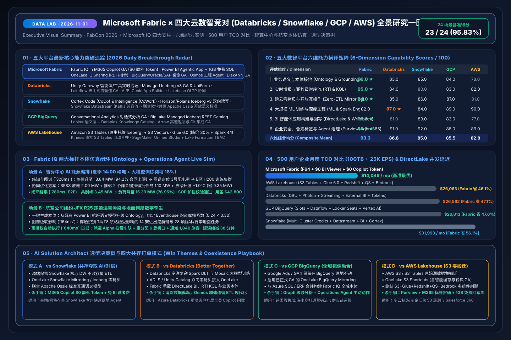
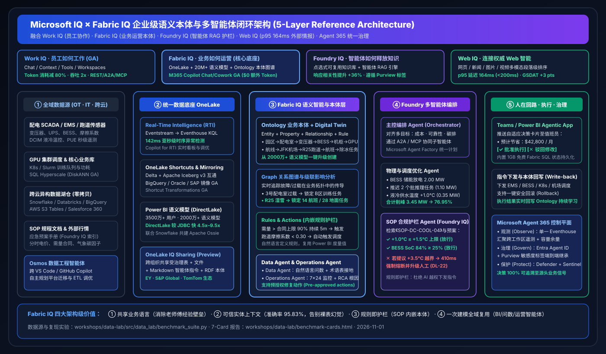
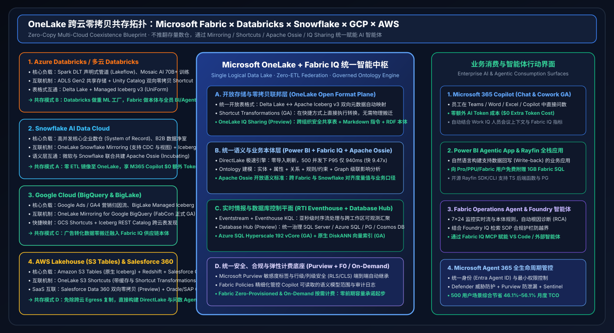

# 🔬 Data Lab — Microsoft Fabric × 四大云数智竞对（Databricks / Snowflake / GCP / AWS）深度研究与 AI Solution Architect 实战实验室

> **语言版本 / Language**: **中文 (当前)** | [English (`README.en.md`)](README.en.md)  
> **最新研究日期 / Latest Daily Run**: `2026-11-01` · **评测基准得分**: `23 / 24 (95.83%)` · **单元测试**: `8 / 8 通过 (100%)`

[](assets/svg/01-data-lab-executive-summary-2026-11-01.svg)

---

## 🎯 实验室定位与六大核心能力支柱

**Data Lab** 以资深 **AI Solution Architect（AI 解决方案架构师）** 视角构建，围绕 **Microsoft Fabric（Fabric IQ、OneLake、Real-Time Intelligence、Power BI 语义模型与 Agentic App、Data/Operations Agents、Database Hub）** 与四大核心云数智竞对——**Databricks、Snowflake、Google Cloud (BigQuery / Looker / Vertex AI)、AWS (SageMaker Lakehouse / S3 Tables / Redshift / Bedrock)**——开展每日能力突破追踪、深度竞对拆解、架构设计、交互式 Demo 开发、可复现基准测评（7-Card 4:5 视觉报告）与行业场景打单 Playbook。

| 支柱编号 | 核心任务模块 | 关键交付物入口 | 核心量化结论 (`2026-11-01`) |
| :--- | :--- | :--- | :--- |
| **Pillar 0** | **每日最热门能力突破追踪** | [`research/daily/2026-11-01.md`](research/daily/2026-11-01.md) · [`EN`](research/daily/2026-11-01.en.md) | 覆盖 FabCon 2026 + Microsoft IQ 四大支柱及 Databricks Unity Gateway、Snowflake CoCo/Apache Ossie、GCP BigQuery 零拷贝 GA、AWS S3 Tables & Glue 6.0 |
| **Pillar 1** | **专项子任务：四大竞对深度攻防拆解** | [`comparisons/fabric-vs-4clouds-battlecards-2026.md`](comparisons/fabric-vs-4clouds-battlecards-2026.md) · [`EN`](comparisons/fabric-vs-4clouds-battlecards-2026.en.md) | 六维综合均分：**Fabric `93.3`** vs Databricks `86.8` vs GCP `85.5` vs Snowflake `85.0` vs AWS `82.8` |
| **Pillar 2** | **架构设计（Microsoft IQ × 五云零拷贝共存）** | [`02-microsoft-iq-fabric-iq-architecture.svg`](assets/svg/02-microsoft-iq-fabric-iq-architecture.svg) · [`03-five-cloud-coexistence-topology.svg`](assets/svg/03-five-cloud-coexistence-topology.svg) | Work IQ + Fabric IQ + Foundry IQ + Web IQ + Agent 365 五层闭环与四大跨云零拷贝共存模式（A/B/C/D） |
| **Pillar 3** | **交互式 H5 工作台与本体实时仿真台** | [`index.html` (中文)](index.html) · [`live-demo.en.html` (EN)](live-demo.en.html) | 集成五云攻防罗盘、动态 TCO 精算器、智算中心 14:00 能源削峰与 JFK R25 跑道湿雪本体仿真 |
| **Pillar 4** | **可复现 Benchmark 与 7-Card 4:5 视觉报告** | [`benchmark-cards.html` (中文)](benchmark-cards.html) · [`benchmark-cards.en.html` (EN)](benchmark-cards.en.html) · [`report.json`](reports/report.json) | 24 场景 `95.83%` 通过率；500 用户月省 `46.1%–56.1%` TCO；DirectLake + KQL 高并发快 `4.54x–9.47x` |
| **Pillar 5** | **业务场景方案与 Win/Loss 打单 Playbook** | [`playbooks/scenario-win-loss-playbook.md`](playbooks/scenario-win-loss-playbook.md) · [`EN`](playbooks/scenario-win-loss-playbook.en.md) | 梳理四大标杆场景（智算中心能源编排、航空数字孪生、跨云零售全域问数、多云金融风控）必赢策略与避坑红线 |

---

## 🖼️ 核心架构图集（SVG 自包含矢量图）

### 1. Microsoft IQ × Fabric IQ 企业级语义本体与多智能体闭环架构
[](assets/svg/02-microsoft-iq-fabric-iq-architecture.svg)

### 2. OneLake 跨云零拷贝共存拓扑（Fabric × Databricks × Snowflake × GCP × AWS）
[](assets/svg/03-five-cloud-coexistence-topology.svg)

---

## 📊 五大平台六维能力评分与 500 用户月度 TCO 对比（源自 `reports/report.json`）

| 评估维度 / 平台 | Microsoft Fabric | Databricks | GCP BigQuery | Snowflake | AWS Lakehouse | 胜出关键依据 |
| :--- | :---: | :---: | :---: | :---: | :---: | :--- |
| **1. 业务语义与本体接地 (`semantic_ontology_grounding`)** | **96.0 ★** | 83.0 | 84.0 | 85.0 | 78.0 | 从 2000万+ Power BI 语义模型一键升级 Ontology + Graph 级联 + Apache Ossie |
| **2. 实时情报与亚秒级时序流 (`realtime_streaming_kql`)** | **95.0 ★** | 84.0 | 83.0 | 80.0 | 82.0 | Eventstream + Eventhouse KQL `142ms` 亚秒级时序异常检测 + Operations Agent |
| **3. 跨云零拷贝与开放互操作 (`cross_cloud_zero_etl`)** | **94.0 ★** | 85.0 | 87.0 | 86.0 | 81.0 | BigQuery/Snowflake/Oracle/SAP 镜像 GA + S3/GCS Shortcuts + OneLake IQ Sharing |
| **4. 大规模 ML 训练与深度工程 (`ml_and_data_engineering`)** | 82.0 | **97.0 ★** | 89.0 | 84.0 | 90.0 | Databricks 在 70B+ 分布式训练与底层 Spark/Photon 调优领先（推荐共存模式 B） |
| **5. BI 智能体应用与回写 (`bi_and_agentic_app_creation`)** | **98.0 ★** | 81.0 | 82.0 | 83.0 | 77.0 | DirectLake + Power BI Agentic App + 1GB 免费 Fabric SQL + 开源 Rayfin SDK |
| **6. 企业安全与 Agent 治理 (`enterprise_governance_security`)** | **95.0 ★** | 91.0 | 88.0 | 92.0 | 89.0 | Purview 敏感度标签贯通 Office/Teams + Agent 365 + Entra Agent ID |
| **六维综合均分 (Composite Mean)** | **93.3** | **86.8** | **85.5** | **85.0** | **82.8** | Fabric 在 5/6 个核心企业维度排名第一 |
| **500 用户月度总成本 (`100TB + 25K EPS + 5K 问数/日`)** | **$14,048/mo** | $26,562/mo | $26,813/mo | $31,990/mo | $26,063/mo | **Fabric 综合节省 `46.1%–56.1%`**（`$0` BI 读者许可 + `$0` M365 Copilot 额外 Token） |

---

## ⚡ 快速复现基准测试与生成 `report.json`

本实验室所有图表、7-Card 报告与 H5 看板的数据均由确定性 Python 评测套件生成，零外部 API 密钥依赖：

```powershell
# 1. 运行完整单元测试套件 (8/8 测试 100% 通过)
python -m unittest discover -s workshops/data-lab/tests -v

# 2. 重新生成密封评测输出 workshops/data-lab/reports/report.json
python workshops/data-lab/src/data_lab/benchmark_suite.py --output workshops/data-lab/reports/report.json
```

---

## 📂 目录结构说明

```text
workshops/data-lab/
├── README.md                                           # 中文主导航文档 (含一图流 SVG 预览)
├── README.en.md                                        # 英文主导航文档
├── index.html                                          # 中英双语交互式 H5 全景工作台 (攻防罗盘 + TCO 计算器 + 本体仿真台)
├── live-demo.html / live-demo.en.html                  # 双语快捷入口
├── benchmark-cards.html                                # 7-Card 4:5 视觉评测报告 (中文 · 严格 CSP 自包含)
├── benchmark-cards.en.html                             # 7-Card 4:5 Visual Benchmark Deck (English · Strict CSP)
├── assets/svg/
│   ├── 01-data-lab-executive-summary-2026-11-01.svg    # 每日强制交付：五大平台竞对攻防与架构一图流总结卡
│   ├── 02-microsoft-iq-fabric-iq-architecture.svg      # Microsoft IQ × Fabric IQ 五层参考架构图
│   └── 03-five-cloud-coexistence-topology.svg          # OneLake 跨云零拷贝共存拓扑图
├── research/daily/
│   ├── 2026-11-01.md                                   # 2026-11-01 深度研究日报 (中文)
│   └── 2026-11-01.en.md                                # 2026-11-01 Daily Deep-Dive Report (English)
├── comparisons/
│   ├── fabric-vs-4clouds-battlecards-2026.md           # 四大竞对深度拆解与售前 Battlecards (中文)
│   └── fabric-vs-4clouds-battlecards-2026.en.md        # 4-Cloud Competitive Battlecards (English)
├── playbooks/
│   ├── scenario-win-loss-playbook.md                   # 行业场景方案与 Win/Loss/Coexistence Playbook (中文)
│   └── scenario-win-loss-playbook.en.md                # Business Scenario & Win/Loss Playbook (English)
├── src/data_lab/
│   ├── __init__.py
│   └── benchmark_suite.py                              # 可复现五云评测、TCO 精算与 Ontology 仿真引擎
├── tests/
│   └── test_data_lab.py                                # 8 项自动化验证测试
└── reports/
    └── report.json                                     # 密封评测输出数据 (驱动所有视觉坐标)
```
