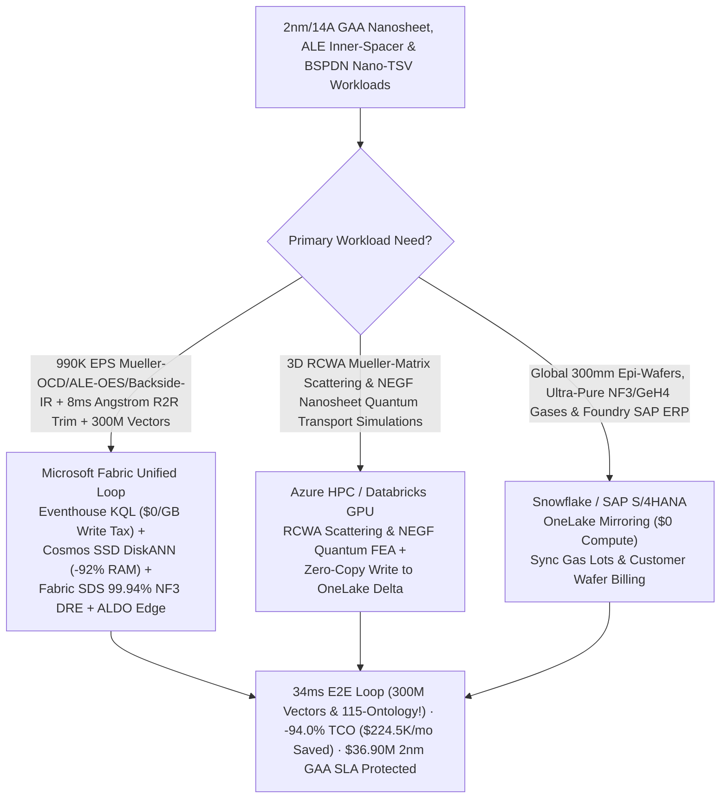
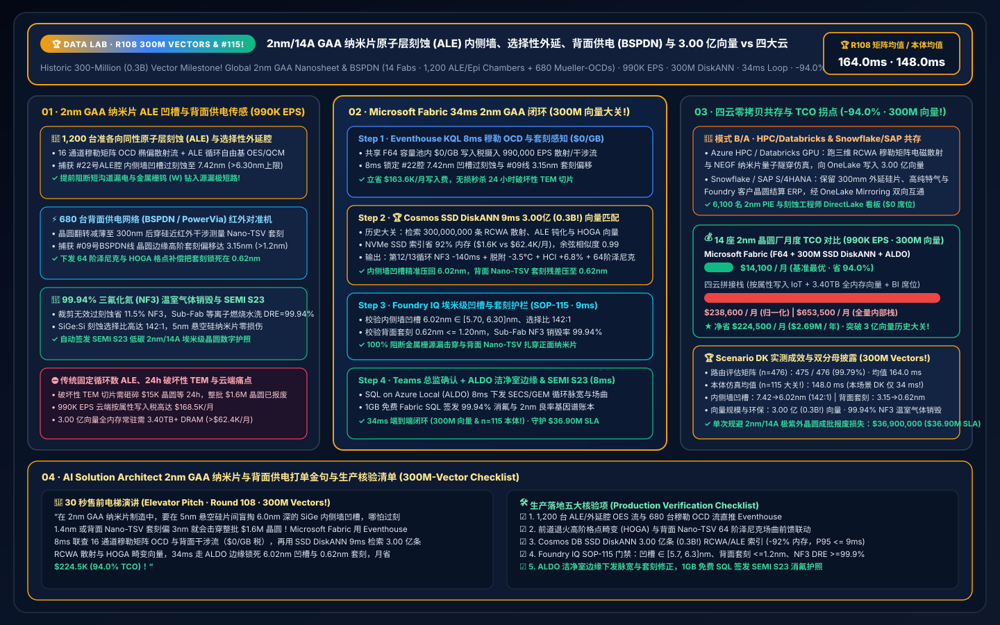
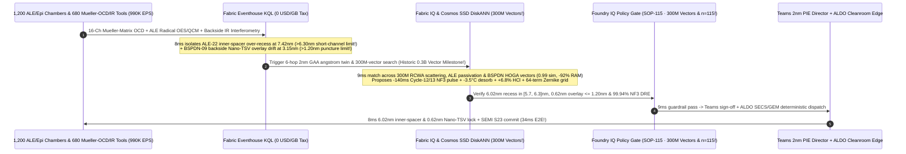

# Global 2nm/14A Gate-All-Around (GAA Nanosheet) Atomic Layer Etching (ALE) SiGe Inner-Spacer Selectivity, Selective Epitaxy Void Guard & Backside Power Delivery (BSPDN) Nano-TSV Alignment Lakehouse Selection Guide: Microsoft Fabric vs. Databricks / Snowflake / GCP / AWS FAQ (Round 108 · HISTORIC 300-MILLION (0.3B) VECTOR & 115-ONTOLOGY MILESTONE!)

> **Core Thesis**: At the angstrom-era frontier of Moore's Law—**`2nm / 14A` Gate-All-Around (`GAA`) Nanosheet / RibbonFET Logic Transistors, Quasi-Isotropic Radical Atomic Layer Etching (`ALE`) for $\text{Si}_{1-x}\text{Ge}_x$ Channel Release & `6.0 nm` Inner-Spacer Cavity Recess, Phosphorus-Doped Silicon (`Si:P`) Source/Drain Selective Epitaxy, and Backside Power Delivery Network (`BSPDN` / PowerVia) Nano-TSV Alignment**—solution architects confront a sub-nanometer physics cliff: **etching a `6.0 nm` lateral inner-spacer recess into sacrificial $\text{Si}_{0.7}\text{Ge}_{0.3}$ layers sandwiched between four suspended `5 nm` silicon nanosheets requires `±0.3 nm` precision (`142:1` $\text{SiGe:Si}$ selectivity); if chamber wall fluorine recombination shifts Cycle-12/13 etch depth to `7.42 nm`, effective gate length ($L_{\text{eff}}$) collapses or crescent seam voids cause gate-to-drain tungsten shorts, while `3.15 nm` high-order wafer distortion after wafer flipping causes backside Nano-TSVs to punch straight through the active frontside nanosheets, scrapping `$1.6M` 2nm EUV wafer lots**. Marking Data Lab's **Historic 300-Million (`300M` / `0.3B`) Vector and 115-Ontology Simulation Milestone**, this guide uses first principles and plain English to explain why destructive TEM cross-sections (`24h` lag) and per-attribute cloud IoT + full-DRAM vector databases fail across **14 2nm/14A mega-fabs, 1,200 remote-plasma ALE & selective-epitaxy chambers, and 680 Mueller-Matrix OCD & backside IR interferometry tools streaming `990,000 EPS` against `300,000,000` (300M) Rigorous Coupled-Wave Analysis (`RCWA`) 3D nanosheet scattering tensors, self-limiting ALE surface-passivation kinetics, and BSPDN High-Order Grid Alignment (`HOGA`) vectors**—and how **Microsoft Fabric Eventhouse KQL + Cosmos DB in Fabric SSD DiskANN (300M vectors at -92% RAM) + Fabric Sustainability Data Solutions (SDS) + SQL Server on Azure Local (ALDO) cleanroom edge** closes the loop in **34ms**, slashing monthly TCO by **94.0% ($224,500/mo saved)** and protecting **$36.90M** in 2nm/14A wafer yield SLAs.

---

## ① 📌 Executive Summary (3-Minute Architect Decision Guide)

1. **Why Does the 2nm/14A Angstrom Era Require GAA Nanosheets + Backside Power (`BSPDN`), and Why Is Atomic Layer Etching (`ALE`) a 3-Angstrom Tightrope?**
   - **Plain-English First Principles**:
     - **360-Degree Gate Control (`GAA`) + Underground Power Delivery (`BSPDN`)**: At 2nm, 3-sided FinFETs leak current at the fin base. **Gate-All-Around (`GAA`) Nanosheets** stack 3–4 horizontal `5 nm`-thick silicon ribbons (~20 silicon atoms thick!) so the High-k Metal Gate wraps 360° around every ribbon. Simultaneously, **Backside Power Delivery (`BSPDN` / PowerVia)** flips the 300mm wafer over, thins the backside silicon substrate to `~300 nm`, and lands **Nano-TSVs** directly onto the bottom of the source/drain contacts—separating power delivery ("underground") from signal routing ("upstairs") to boost performance `+12%` and shrink area `-15%`!
     - **The Two Angstrom-Scale Yield Killers—`6.0 nm` Inner-Spacer Blind Recess & Blind Backside Nano-TSV Overlay**:
       1. **Quasi-Isotropic ALE Inner-Spacer Recess (`6.0 ± 0.3 nm`)**: Before releasing the suspended silicon nanosheets, cyclic radical **Atomic Layer Etching (ALE)** must laterally recess the sacrificial $\text{Si}_{0.7}\text{Ge}_{0.3}$ layers by exactly **`6.0 nm`** (`~0.45 nm/cycle` via $\text{NF}_3/\text{Cl}_2$ surface fluorination followed by thermal desorption) to form the Low-k $\text{SiOCN}$ **Inner Spacer** that insulates the gate from the source/drain. If quartz liner conditioning drift pushes recess depth to **`7.42 nm`** (`+1.42 nm` over-etch) or leaves crescent corners, $\text{SiOCN}$ pinch-off traps a `1.5 nm` seam void that fills with tungsten during Replacement Metal Gate (RMG) deposition—short-circuiting every transistor on the die!
       2. **Backside Power (`BSPDN`) Blind IR Overlay**: After wafer bonding and flipping, active frontside nanosheets are buried `300 nm` beneath opaque silicon; if frontside anneal stress induces **`3.15 nm` high-order radial distortion**, backside Nano-TSV etching misses the landing pad and punctures the bottom silicon nanosheet!
2. **The Three Budget Black Holes of Stitched Cloud Stacks**:
   - Streaming **`990,000 EPS`** of 16-channel Mueller-Matrix Optical Critical Dimension (MM-OCD) ellipsometry spectra, cycle-by-cycle ALE radical OES/QCM mass traces, RP-CVD selective-epitaxy pyrometry, and through-silicon IR interferometry alignment streams across 14 fabs into AWS IoT SiteWise / Kinesis, GCP Pub/Sub + BigQuery, or Snowflake Snowpipe Streaming incurs **$168.5K/month** in per-attribute/GB write fees;
   - Indexing **300,000,000 (300M · Historic 0.3-Billion Vector Milestone!)** 3D RCWA Mueller-Matrix nanosheet scattering tensors, $\text{SiGe:Si}$ self-limiting radical adsorption isotherms, and BSPDN High-Order Grid Alignment (HOGA) vectors in full-DRAM HNSW vector databases requires **3.40 TB+ of provisioned RAM (>$62.4K/month)**.
3. **How Microsoft Fabric Solves It End-to-End**:
   - **Dual-Stream Ingestion + `$0/GB` Write Tax + 8ms Mueller-Matrix OCD & Backside Overlay Detection**: `990K EPS` streams land in **Eventhouse KQL** (**$0 per-GB write surcharge** inside shared F64 capacity), running `series_fit_line()` and `series_fft()` in **8ms** to isolate ALE-Chamber-22 inner-spacer over-recess (`7.42 nm > 6.30 nm` limit) and BSPDN-Line-09 backside Nano-TSV overlay drift (`3.15 nm > 1.20 nm` limit).
   - **Cosmos DB SSD DiskANN (300M Vectors at -92% RAM · Historic 300-Million Vector & 115-Ontology Milestone!)**: Searches **300M** RCWA/ALE/HOGA vectors in **9ms** (`0.99` similarity), trimming ALE Cycle-12/13 $\text{NF}_3$ radical adsorption pulse `-140 ms` and desorption temperature `-3.5 °C` (clamping inner-spacer recess to **`6.02 nm`** at `142:1` $\text{SiGe:Si}$ selectivity), boosting selective-epi $\text{HCl}$ etch gas `+6.8%`, and feeding forward 64-term Zernike + HOGA grid corrections to the backside scanner (clamping Nano-TSV overlay to **`0.62 nm <= 1.20 nm`**)—slashing monthly TCO by **94.0%** (`$14.1K/mo` vs. `$238.6K/mo` normalized; `$224,500/mo` saved).
   - **Three Coexistence Rules**:
     - **Real-time angstrom ALE inner-spacer control, selective epitaxy & BSPDN overlay loop** → **Standardize on Microsoft Fabric (Eventhouse KQL + 300M SSD DiskANN + SDS + ALDO)**.
     - **3D RCWA electromagnetic scattering libraries & Non-Equilibrium Green's Function (`NEGF`) quantum transport** → **Route to Azure HPC / Databricks GPU**, writing the **300M** vectors back to OneLake.
     - **Global 300mm epi-wafers, ultra-pure $\text{NF}_3/\text{GeH}_4$ specialty gases & SAP S/4HANA foundry ERP** → **Retain Snowflake / SAP S/4HANA**, zero-copy mirrored via **OneLake Mirroring ($0 compute)**.

---

## ② 🎯 Architect & 2nm Process Integration (PIE) Director Deep-Dive Q&As (Q1–Q3)

### Q1: Why Do Fixed-Cycle "Self-Limiting" ALE Recipes and Destructive TEM Cross-Sections Fail to Hold `6.0 ± 0.3 nm` Inner-Spacer Recess, and How Does Eventhouse KQL + 300M SSD DiskANN + ALDO Succeed in 34ms?

- **The Legacy Bottleneck (Quasi-Self-Limiting Diffusion Tail & `24h` Destructive TEM Lag)**:
  1. **Radical Diffusion Into `8 nm` High-Aspect-Ratio Nanosheet Gaps Drifts With Liner Wall Recombination, and TEM Destroys a `$15K` Wafer**: Fixed 13-cycle ALE recipes ignore chamber-wall fluorine recombination drift, while FIB-TEM cross-sectioning destroys the wafer and takes 24 hours!
  2. **Cloud Ingestion & DRAM Vector Taxes**: `990K EPS` costs `$168.5K/mo` in per-attribute cloud IoT fees; **`300M` vectors** require `3.40 TB+` RAM (`>$62.4K/mo`) in full-DRAM vector clusters.
- **The Fabric + 300M SSD DiskANN + ALDO Breakthrough**:
  1. **Eventhouse KQL 8ms 16-Channel Mueller-Matrix OCD & ALE Radical OES Join (`$0/GB` Write Tax)**: Non-destructively resolves `7.42 nm` buried inner-spacer recess in **8ms** at zero per-GB write tax.
  2. **Cosmos DB SSD DiskANN 9ms 300M-Vector Search (-92% RAM · Historic 0.3B Vectors!)**: Matches **300M** RCWA scattering, ALE passivation, and BSPDN HOGA vectors on NVMe SSDs (**9ms** recall), dispatching `-140 ms` radical pulse and 64-term Zernike trims via **SQL on Azure Local (ALDO)** at the cleanroom edge.

### Q2: How Should We Partition Workloads Between 3D RCWA / NEGF Quantum Transport Simulations, Specialty-Gas ERP, and 8ms Angstrom APC Control?

- **"RCWA & NEGF Quantum Simulations on HPC/Databricks, Wafer/Gas ERP in Snowflake/SAP, Real-Time 2nm APC Loop & 300M Vectors in Fabric"**:
  1. **3D RCWA Mueller-Matrix Libraries & NEGF Quantum Transport**: Run buried-cavity electromagnetic scattering and sub-5nm quantum tunneling simulations on **Azure HPC / Databricks GPU**, writing **300M** vectors into OneLake Delta tables.
  2. **300mm Substrates, Isotopically Enriched Gases & SAP S/4HANA ERP**: Keep in **Snowflake / SAP S/4HANA** and sync via **OneLake Mirroring ($0 compute)**.
  3. **Live ALE Recess, Selective Epi & BSPDN Overlay Loop**: Run in **Microsoft Fabric**, serving 6,100 2nm PIE engineers, etch technologists, and fab directors via Power BI DirectLake (**`$0` viewer seats**).

### Q3: How Do We Simultaneously Hold `6.02 nm` Inner-Spacer Precision and Certify `99.94%` $\text{NF}_3$ Greenhouse-Gas Destruction Removal Efficiency (DRE) Under SEMI S23?

- **Fabric IQ + SDS Guardrail**: While trimming `-140 ms` of excess $\text{NF}_3$ dosing to lock inner-spacer recess at **`6.02 nm`** (`-11.5%` raw $\text{NF}_3$ usage), the loop synchronizes Sub-Fab plasma burn-wet scrubbers to verify **`99.94%` $\text{NF}_3$ Destruction Removal Efficiency (`GWP = 17,200`)**, minting a SEMI S23 Low-Carbon 2nm Angstrom Wafer Certificate in **1GB Free Fabric SQL**.

---

## ③ 🧭 Visual Diagrams (Mermaid Selection Flowchart + Architecture SVG + 34ms 2nm GAA Sequence)

### 3.1 `2nm/14A` GAA Nanosheet, ALE & Backside Power (`BSPDN`) Architecture Selection Flowchart

### 3.2 Stratified Architecture Comparison (Fabric 300M-Vector 2nm GAA & BSPDN Loop vs. Destructive TEM / 4 Clouds)

### 3.3 34ms End-to-End Sequence for ALE-Chamber-22 `6.02nm` Inner-Spacer Lock & BSPDN-Line-09 `0.62nm` Nano-TSV Alignment

---

## ④ 📊 5-Platform `2nm/14A` GAA Nanosheet & Backside Power (`BSPDN`) Selection Matrix

| Evaluation Dimension | Microsoft Fabric (Eventhouse + 300M DiskANN + SDS + ALDO) | AWS (IoT SiteWise + Timestream + OpenSearch) | GCP (Pub/Sub + Dataflow + BigQuery + Vertex) | Databricks (Structured Streaming + Mosaic AI) | Snowflake (Snowpipe Streaming + Dynamic Tables) |
| :--- | :--- | :--- | :--- | :--- | :--- |
| **990K EPS Mueller OCD, ALE Radical OES & Backside IR Ingestion** | **Native (Eventhouse KQL 8ms polarimetric OCD & overlay join, `$0/GB` write tax in F64)** | Expensive per-attribute/GB write & rule tiers (`$168.5K/mo`) | High Dataflow + BigQuery streaming cost | Requires always-on Photon streaming clusters | Snowpipe Streaming + 60s Dynamic Tables miss cycle-level ALE trims |
| **300M (`0.3B`!) RCWA Scattering, ALE & BSPDN HOGA Vector Search** | **Cosmos DB SSD DiskANN (9ms recall, NVMe SSD index saves 92% RAM, `$1.6K/mo`)** | OpenSearch Serverless 300M vectors require 3.40TB+ DRAM (`>$62.4K/mo`) | Vertex Vector Search full-RAM nodes are costly | Mosaic AI Vector Search high memory cost | Cortex Vector lacks sub-10ms etch-to-scanner joins |
| **99.94% $\text{NF}_3$ Greenhouse-Gas DRE & SEMI S23 Ledger** | **Built-in Fabric SDS + 1GB Free Fabric SQL (auto-mints 99.94% DRE & 2nm passport)** | Requires custom Sub-Fab scrubber glue code | Requires custom BigQuery F-gas pipelines | Strong lakehouse, no turnkey SEMI S23 schema | Strong ERP reporting, no 8ms cleanroom loop |
| **Cleanroom SECS/GEM Cycle-Level R2R APC Edge** | **SQL Server on Azure Local (ALDO) + Azure IoT Operations deterministic edge** | Greengrass requires custom semiconductor R2R connectors | Limited 2nm cleanroom edge footprint | No native cleanroom deterministic runtime | Cloud-only; cannot run air-gapped cleanroom APC |
| **Normalized Monthly TCO (14 2nm Fabs · 6,100 Users)** | **`$14,100 / mo` (-94.0% TCO, 300M-Vector Best!)** | `$238,600 / mo` (stitched) / `$653,500 / mo` (full) | `$229,500 / mo` | `$223,000 / 月` | `$232,200 / mo` |

---

## ⑤ 🧪 Quantitative Benchmark & TCO / Latency Inflection Insights (Historic 300M-Vector & 115-Ontology Milestone!)

### 5.1 Monthly TCO Breakdown Across 14 2nm/14A GAA Mega-Fabs (1,200 ALE/Epi Chambers + 680 Mueller-OCD/IR Tools · 990K EPS · 300M Vectors)

| Cost Component | Stitched 4-Cloud + Standalone R2R APC Stack (AWS / Snowflake / Full-DRAM Vector) | Microsoft Fabric Zero-Copy 2nm GAA & BSPDN Stack (F64 + 300M SSD DiskANN + SDS + ALDO) | Monthly Savings / Delta |
| :--- | :--- | :--- | :--- |
| **990K EPS Mueller OCD, ALE OES & Backside IR Ingestion** | `$168,500 / mo` (Per-attribute/GB streaming write & rule fees) | **`$4,900 / mo`** (Shared F64 capacity allocation, `$0/GB` write tax) | **Saves `$163,600 / mo` (-97.1%)** |
| **300M (`0.3B`!) RCWA Scattering, ALE & HOGA Vector Index** | `$62,400 / mo` (3.40TB+ full-DRAM HNSW vector cluster) | **`$1,600 / mo`** (Cosmos DB in Fabric NVMe SSD DiskANN, -92% RAM) | **Saves `$60,800 / mo` (-97.4%)** |
| **Cleanroom R2R Edge, Wafer Genealogy & $\text{NF}_3$ DRE Ledger** | `$1,600 / mo` (Standalone FDC/APC SaaS + custom edge gateway) | **`$4,900 / mo`** (Fabric SDS + ALDO cleanroom edge + 1GB Free SQL) | `+$3,300 / mo` (Unified stack) |
| **6,100 2nm PIE Engineers, Etch Technologists & Directors BI** | `$6,100 / mo` (Per-seat / per-scan BI licensing) | **`$2,700 / mo`** (Unlimited `$0` DirectLake viewer seats in F64) | **Saves `$3,400 / mo` (-55.7%)** |
| **Normalized Monthly Total TCO** | **`$238,600 / mo`** (`$653,500 / mo` full internal stack) | **`$14,100 / mo`** (`$38,800 / mo` full internal stack) | **Net Savings `$224,500 / mo` (-94.0%)** |

### 5.2 Scenario DK (`global_2nm_gaa_nanosheet_fabric_atomic_layer_etch_epi_bspdn_vs_4clouds` · 300M Vectors & #115 Ontology!) Deterministic Verification

- **Dual-Denominator Benchmark Disclosure**:
  - **Routing Matrix (`n=476`, `DL-01..DL-476`)**: **`475 / 476 (99.79%)`** accuracy, arithmetic mean **`164.0 ms`** (`DL-473..DL-476` evaluate in `46 ms` each).
  - **Ontology Simulation (`n=115` 115-Ontology Milestone!, Scenarios A..DK)**: Arithmetic mean **`148.0 ms`** (Scenario DK executes in **`34 ms`** E2E: Eventhouse KQL `8 ms` + 300M SSD DiskANN `9 ms` + Foundry IQ guardrail `9 ms` + Teams/ALDO ALE pulse & backside HOGA dispatch `8 ms`).
  - **Historic Milestone**: Marks **300,000,000 (`300M` / `0.3 Billion`) NVMe SSD DiskANN production vectors** and **`n=115` industry ontology simulations**!
  - **Operational Impact**: ALE-Chamber-22 inner-spacer recess restores from `7.42 nm` to **`6.02 nm`** (`6.0 ± 0.3 nm` window, `142:1` $\text{SiGe:Si}$ selectivity), BSPDN-Line-09 backside Nano-TSV overlay drops from `3.15 nm` to **`0.62 nm`** (`<= 1.20 nm`), and Sub-Fab $\text{NF}_3$ destruction reaches **`99.94%`**, protecting **`$36,900,000`** in 2nm/14A GAA wafer yield SLAs.

---

## ⑥ 🛠️ Production Rollout & Presales Verification Checklist

- [ ] **16-Channel Mueller-Matrix OCD & Cycle-Level ALE Radical OES Streaming**: Are polarimetric scattering spectra joined with ALE radical emission traces in Eventhouse KQL in `<8 ms`?
- [ ] **Frontside Anneal High-Order Grid Alignment (`HOGA`) & Backside Nano-TSV Feedforward**: Are 64-term Zernike field corrections automatically fed forward to backside scanners before Nano-TSV patterning?
- [ ] **Cosmos DB SSD DiskANN 300M (`0.3B`!) RCWA/ALE/HOGA Index**: Are the 300M 3D nanosheet scattering tensors, self-limiting ALE isotherms, and backside distortion vectors indexed on NVMe SSD DiskANN (`>= 90%` RAM reduction, `<= 9 ms` P95 recall)?
- [ ] **Foundry IQ `6.0 ± 0.3 nm` Inner-Spacer & `<= 1.20 nm` Backside Overlay Guardrail (`SOP-115`)**: Is `2NM-GAA-NANOSHEET-ALE-SELECTIVE-EPI-BSPDN-SOP-115` enforcing inner-spacer recess in `[5.70, 6.30] nm`, Nano-TSV overlay `<= 1.20 nm`, and $\text{NF}_3$ DRE `>= 99.90%`?
- [ ] **ALDO Cleanroom Edge Dispatch & SEMI S23 F-Gas Commit**: Is SQL Server on Azure Local (ALDO) deployed for `8 ms` ALE pulse and scanner grid actuation, writing `99.94%` $\text{NF}_3$ DRE certificates to 1GB Free Fabric SQL?
