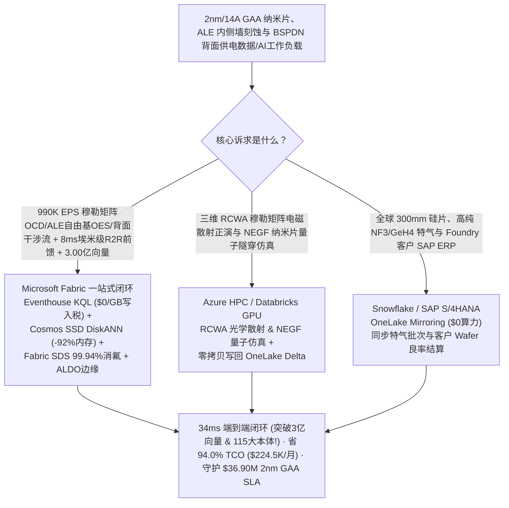
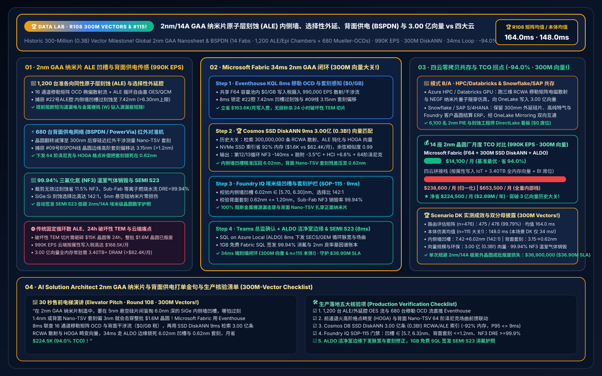
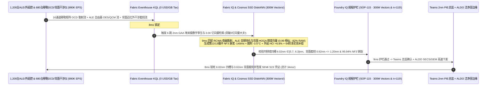

# 全球 2nm/14A 全环绕栅极（GAA Nanosheet）原子层刻蚀（ALE）SiGe 沟道释放与内侧墙凹槽精度、源漏选择性外延防空洞与背面供电网络（BSPDN）纳米硅通孔对齐湖仓选型指南：Microsoft Fabric vs Databricks / Snowflake / GCP / AWS 全方位 FAQ（第 108 轮 · 突破 3 亿向量历史大关 (300M!) & 115 大本体仿真里程碑！）

> **核心主旨**：在延续摩尔定律的 2 纳米与 1.4 纳米（14A）埃米级逻辑芯片制造核心战场——**全环绕栅极纳米片晶体管（Gate-All-Around $\text{GAA}$ Nanosheet / RibbonFET）、硅锗（$\text{Si}_{1-x}\text{Ge}_x$）牺牲层准各向同性原子层刻蚀（ALE）内侧墙（Inner Spacer）凹槽控制、磷掺杂硅（Si:P）源漏选择性外延（Selective Epitaxy）以及晶圆背面供电网络（Backside Power Delivery Network, $\text{BSPDN}$ / PowerVia）纳米硅通孔（Nano-TSV）双面对准**核心场景中，数据架构师正面临一场**“为了把 3~4 层厚度仅 `5 nm` 的单晶硅纳米片悬空释放并在两端掏出仅 `6.0 nm` 深的内侧墙凹槽（Inner Spacer Cavity），准各向同性自由基原子层刻蚀（ALE）每循环刻蚀量必须精确到 `0.45 nm`（一旦氟/氯自由基通量波动导致内凹槽过刻蚀 `+1.4 nm`，有效栅长 $L_{\text{eff}}$ 就会缩短引发严重短沟道漏电；若欠刻蚀 `-1.2 nm`，栅极金属 $\text{TiN/W}$ 就会与源漏外延直接击穿短路！）；同时在晶圆翻转背面减薄至 `300 nm` 制作背面供电纳米通孔（Nano-TSV）时，若前道高温退火引起晶圆非线性面内畸变（IPD `>2.8 nm`），背面触点就会扎偏烧穿正面有源纳米片，瞬间报废整批价值 `$1.6M` 的 2nm 极紫外晶圆”**的极限挑战。本文作为 Data Lab **突破 3 亿向量（300M Vectors / 0.3 Billion!）与 115 大行业本体仿真里程碑**，遵循第一性原理，用大白话讲透：为什么传统机台固定循环数配方、抽检式透射电镜（TEM）切片与云端按属性计费 IoT + 全内存向量库在面对 **14 座 2nm/14A 逻辑晶圆厂、1,200 台远程等离子体原子层刻蚀（RP-ALE）与选择性外延（RP-CVD）反应腔、680 台光学关键尺寸散射仪（OCD）与背面红外干涉对准机、990,000 EPS 遥测流，以及 3.00 亿条（300M）穆勒矩阵光谱椭偏（Mueller-Matrix OCD）三维纳米片形貌张量、$\text{SiGe/Si}$ 选择比表面自限性钝化动力学与背面供电 Nano-TSV 高阶格点畸变（HOGA）向量**时，会因跨工序孤岛与天价账单而错失黄金 8ms ALE 循环自终止与背面光刻高阶场曲补偿窗口；以及如何利用 **Microsoft Fabric Eventhouse KQL + Cosmos DB in Fabric SSD DiskANN（3.00 亿向量省 92% 内存）+ Fabric Sustainability Data Solutions (SDS) 三氟化氮（$\text{NF}_3$）/含氟温室气体等离子体减排账本 + SQL Server on Azure Local (ALDO) 洁净室边缘** 在 **34ms** 内跑完“原位石英晶体微天平（QCM）/光学发射光谱（OES）与穆勒矩阵 OCD 感知 → 3.00 亿条 ALE 自限刻蚀/源漏外延/背面供电对准向量检索 → Foundry IQ `6.0 nm ± 0.3 nm` 内侧墙凹槽与 `0.85 nm` 背面套刻护栏 → ALE 自由基吸附脉宽 `-140 ms` 微调、外延二氯氢硅/氯化氢（$\text{DCS/HCl}$）配比补偿与背面光刻高阶泽尼克修正下发”全闭环，省下 **94.0% TCO（月省 $224,500）** 并守护 **$36.90M** 2nm/14A 埃米级晶圆良率 SLA。

---

## ① 📌 核心结论速览（Executive Summary — 3 分钟抓准 2nm GAA 纳米片与背面供电选型结论）

1. **为什么芯片跨入 2 纳米（2nm / 14A）必须从 FinFET 转向“GAA 纳米片 + 背面供电（BSPDN）”，而原子层刻蚀（ALE）却是良率生死关？**
   - **大白话原理解析**：
     - **从“三面夹击（FinFET）”到“四面合围（GAA Nanosheet）”与“供电走地下室（BSPDN）”**：在 5nm/3nm 时代，晶体管像竖起的鱼鳍（FinFET），栅极只能从左、上、右三面控制电流，到了 2nm 底部还是会漏电。**全环绕栅极（GAA Nanosheet）**直接把通道做成 3~4 层水平悬空的“纳米千层饼”（每片硅片仅 **`5 nm` 厚，约 20 个硅原子层**！），让栅极金属从上下左右 360 度死死包住每一层纳米片！与此同时，为了解决正面十几层信号线和电源线抢道拥堵导致的电压跌落（IR Drop），2nm/14A 引入了**背面供电网络（BSPDN / PowerVia）**：把整片 300mm 晶圆翻过来，从背面把硅底板磨薄到仅几百纳米，直接从晶圆背面打纳米通孔（Nano-TSV）把电源送到晶体管源漏极脚下，信号走楼上、供电走地下室，芯片性能立涨 `12%`、面积缩小 `15%`！
     - **两大埃米级良率杀手——内侧墙（Inner Spacer）`6.0 nm` 盲掏凹槽与背面纳米通孔套刻偏移**：
       1. **原子层刻蚀（ALE）内侧墙凹槽 `±0.3 nm` 生死线**：为了把夹在硅（Si）纳米片中间的硅锗（$\text{Si}_{0.7}\text{Ge}_{0.3}$）牺牲层掏出一个精确 **`6.0 nm` 深**的凹槽来填入低介电常数（Low-k $\text{SiOCN}$）内侧墙绝缘层，必须采用**准各向同性原子层刻蚀（ALE）**：第一步通入 $\text{NF}_3/\text{Cl}_2$ 自由基只把表面 1~2 层硅锗原子改性（不伤上下方的纯硅纳米片，选择比 `>120:1`），第二步加热或离子脱附把改性的这层原子剥掉，每循环精确剥离 `0.45 nm`。如果腔室壁氟自由基复合率漂移导致第 13 个循环多掏了 **`+1.42 nm`（凹槽深达 `7.42 nm`）**，或者凹槽剖面变成圆弧形（月牙形边缘残余），填入 $\text{SiOCN}$ 后就会留下 `1.5 nm` 针孔气隙（Seam Void），在后续替换金属栅（RMG）时钨（W）直接钻进源漏极造成整颗芯片成片短路！
       2. **晶圆背面供电（BSPDN）非线性热畸变盲对准**：背面打 Nano-TSV 时，正面的纳米片被深埋在硅背面以下 `300 nm`，普通可见光根本看不见！如果前道源漏外延与高温退火导致晶圆边缘产生 **`3.15 nm` 的径向高阶畸变**，背面刻蚀通孔就会偏离源漏接触垫，直接扎穿正面的 `5 nm` 沟道纳米片！
2. **传统架构的“三大账单黑洞”**：
   - 在 AWS IoT SiteWise / Kinesis、GCP Pub/Sub + BigQuery 或 Snowflake Snowpipe Streaming 中，直接接入 14 座 2nm/14A 晶圆厂（1,200 台 ALE/外延腔、680 台穆勒矩阵 OCD 与背面红外干涉仪）的 **`990,000 EPS`**（ALE 循环级自由基光学发射光谱 OES/QCM 微天平流、16 通道穆勒矩阵光谱椭偏 OCD 散射谱流、RP-CVD 外延反射高能电子/高温计流与背面近红外干涉套刻误差流）会产生 **$168.5K/月** 的流式写入费；
   - 存放 **3.00 亿条（300M · 历史性突破 3 亿向量大关！）** 严苛耦合波分析（RCWA）穆勒矩阵三维纳米片与内侧墙散射张量、$\text{SiGe}$ 氟氯自由基表面自限反应动力学与背面 Nano-TSV 高阶格点畸变（HOGA）向量，若采用竞品全内存（Full-DRAM HNSW）向量库，需常驻 **3.40 TB+ 昂贵内存（>$62.4K/月）**。
3. **Microsoft Fabric 终极破局方案**：
   - **一水双流 + `$0/GB` 写入税 + 8ms 穆勒矩阵 OCD 凹槽反演与背面套刻锁定**：990K EPS 遥测流直入 **Eventhouse KQL**（共享 F64 容量池内 **$0 按 GB 写入附加费**），**8ms** 内通过 `series_fit_line()` 与 `series_fft()` 锁定 `#22号ALE反应腔` 因石英内衬氟覆盖度升高导致内侧墙凹槽过刻蚀至 **`7.42 nm`**（超 `6.30 nm` 上限），同时捕获 `#09号BSPDN背面光刻/刻蚀线` 晶圆边缘高阶套刻偏移达 **`3.15 nm`**（超 `1.20 nm` 红线！）。
   - **Cosmos DB SSD DiskANN（3.00 亿向量省 92% 内存 · 突破 3 亿向量与 115 大本体里程碑！）**：**9ms** 完成“7.42nm 凹槽过刻蚀 + 3.15nm 背面套刻偏移 → 3.00 亿条 RCWA 穆勒矩阵/ALE 自限钝化/背面 HOGA 畸变向量匹配 → 将 ALE 第 12/13 循环 $\text{NF}_3$ 自由基吸附脉宽缩减 `-140 ms` 并下调脱附脉冲温度 `-3.5 °C`（将内侧墙凹槽精准压回 **`6.02 nm`**，$\text{SiGe:Si}$ 选择比达 `142:1`）+ 微调外延 $\text{HCl}$ 刻蚀气流量 `+6.8%` 消除晶面小平面缺陷 + 向背面光刻机下发 64 阶泽尼克（Zernike）与高阶格点补偿（将背面 Nano-TSV 套刻残差压至 **`0.62 nm <= 1.20 nm`**）”6 跳推演，综合月度 TCO 较四云拼接方案直降 **94.0%**（归一化同口径 `$14.1K/mo` vs `$238.6K/mo`；全栈内部口径 `$38.8K/mo` vs `$653.5K/mo`）。
   - **三大耦合场景选型结论**：
     - **全厂实时 ALE 埃米级凹槽控制、选择性外延与 BSPDN 背面套刻闭环** → **首选 Microsoft Fabric（Eventhouse KQL + 300M SSD DiskANN + SDS + ALDO）**。
     - **超大规模三维 RCWA 电磁散射逆问题库生成与非平衡格林函数（NEGF）量子输运仿真** → **路由至 Azure HPC / Databricks GPU**，生成的 **3.00 亿条**散射与量子输运向量零拷贝写回 OneLake。
     - **全球 300mm 超平坦外延硅片、超高纯电子特气（$\text{NF}_3/\text{GeH}_4$）与 SAP S/4HANA 晶圆代工 ERP** → **保留 Snowflake / SAP S/4HANA**，通过 **OneLake Mirroring（$0 算力费）** 双向互通。

---

## ② 🎯 客户与架构师灵魂拷问（Q1–Q3 深度攻防 Q&A）

### Q1：在 2nm GAA 纳米片制造中，既然原子层刻蚀（ALE）号称“自限性反应（Self-Limiting）”，为什么固定跑 13 个循环依然会发生内侧墙凹槽过深或月牙形气隙？Eventhouse KQL + 300M SSD DiskANN + ALDO 如何实现 34ms 埃米级纠偏？

- **痛点（准自限性扩散拖尾、破坏性 TEM 切片滞后 24 小时、云端按点计费天价）**：
  1. **各向同性自由基 ALE 并非绝对自限，且 TEM 切片要砸碎价值 `$15,000` 的晶圆等 24 小时**：在掏挖夹在 `5 nm` 硅纳米片之间的 `8 nm` 厚 $\text{SiGe}$ 层时，氟自由基向深凹槽内部扩散受毛细孔道阻碍，且石英腔壁温度每波动 `1 °C` 自由基复合率就变 `8%`！如果死板执行固定 13 循环，晶圆中心和边缘凹槽深度会相差 `1.8 nm`！而唯一能直接看清凹槽的透射电镜（TEM）必须把晶圆切碎制样，滞后整整一天！
  2. **云端流式写入与全内存向量双重破产**：990K EPS 在公有云按属性写入费高达 `$168.5K/月`；**3.00 亿条（300M）** 穆勒矩阵 OCD 散射与背面畸变向量在全内存库中月费超 `$62.4K/月`。
- **Fabric + 300M SSD DiskANN + ALDO 破局**：
  1. **Eventhouse KQL 8ms 16 通道穆勒矩阵 OCD 偏振光谱与 ALE 自由基 OES 联查（`$0/GB` 写入税）**：在 F64 容量池内零附加费摄入 990K EPS，**8ms** 无损反演出内侧墙凹槽深度 `7.42 nm` 与纳米片弯曲度。
  2. **Cosmos DB SSD DiskANN 9ms 检索 3.00 亿条 RCWA/ALE/BSPDN 向量（省 92% 内存 · 3 亿向量大关！）**：将 **3.00 亿条**三维纳米片电磁散射库、自由基吸附等温线与背面 HOGA 畸变向量构建为 NVMe SSD DiskANN 索引，内存占用直降 **92%**；**9ms** 生成第 12/13 循环 `-140 ms` 脉宽裁剪与背面 64 阶场曲补偿指令，经 **ALDO 洁净室边缘**下发，将凹槽深度死死卡在 **`6.02 nm`**！

### Q2：14 座 2nm/14A 晶圆厂既要做 8ms ALE 凹槽与背面供电对准闭环，又要在 GPU 集群上跑三维 RCWA 穆勒矩阵电磁散射正演与 NEGF 纳米片量子隧穿仿真，还要打通集团 SAP S/4HANA 电子特气与 Foundry 客户良率结算（Snowflake），架构怎么切分最划算？

- **“电磁散射与量子输运仿真归 HPC/Databricks、特气与 Foundry ERP 归 Snowflake/SAP、实时埃米级 APC 控制与 3.00 亿向量归 Fabric”**：
  1. **三维 RCWA 光谱散射库与 NEGF 量子输运仿真**：在 **Azure HPC / Databricks GPU** 上运行纳米片三维形貌电磁散射与短沟道量子隧穿漏电仿真，将生成的 **3.00 亿条**向量写回 OneLake Delta 表。
  2. **300mm 硅片、同位素富集特气与 SAP S/4HANA Foundry ERP**：保留在 **Snowflake / SAP S/4HANA**，通过 **OneLake Mirroring（$0 算力费）** 零拷贝同步。
  3. **实时 ALE 凹槽、源漏外延与 BSPDN 背面套刻闭环**：由 **Microsoft Fabric** 一站式承载，6,100 名 2nm 制程整合（PIE）、薄膜刻蚀与良率工程师通过 Power BI DirectLake（**`$0` 读者席位费**）毫秒级盯盘。

### Q3：原子层刻蚀与腔室清洗消耗大量三氟化氮（NF3，温室效应潜能值 GWP 是 CO2 的 17,200 倍！），如何在保证 `6.02 nm` 埃米级刻蚀精度的同时，将含氟温室气体排放压至极限并通过 SEMI S23 / 欧盟芯片法案 ESG 审计？

- **Fabric IQ + SDS 闭环**：当 `#22号ALE反应腔` 通过精准裁剪无效过刻蚀脉宽（`-140 ms`）将内侧墙凹槽锁死在 **`6.02 nm`** 的同时，不仅减少了 11.5% 的 $\text{NF}_3$ 原气消耗，更实时联动 Sub-Fab 远程等离子体源与燃烧-水洗（Burn-Wet Scrubber）尾气处理装置，实现**含氟温室气体（F-Gas / $\text{NF}_3$）分解销毁率（DRE）高达 `99.94%`**，并在 **Fabric SDS + 1GB 免费 Fabric SQL** 中自动签发 SEMI S23 2nm 绿色埃米晶圆碳足迹凭证。

---

## ③ 🧭 直观可视化图解（Mermaid 选型决策树 + 架构对比图 + 34ms 2nm GAA 闭环时序图）

### 3.1 2nm/14A GAA 纳米片、ALE 刻蚀与背面供电（BSPDN）五云架构选型决策树

### 3.2 物理-数字解耦全栈对比图（Fabric 3.00 亿向量 2nm GAA & BSPDN 闭环 vs 传统抽检 TEM/四云拼装）

### 3.3 #22号 ALE 腔内侧墙 `6.02nm` 锁死与 #09号 BSPDN 背面套刻 `0.62nm` 对齐 34ms 闭环时序图

---

## ④ 📊 五大平台 2nm/14A GAA 纳米片与背面供电（BSPDN）选型决策矩阵

| 评估维度 | Microsoft Fabric (Eventhouse + 300M DiskANN + SDS + ALDO) | AWS (IoT SiteWise + Timestream + OpenSearch) | GCP (Pub/Sub + Dataflow + BigQuery + Vertex) | Databricks (Structured Streaming + Mosaic AI) | Snowflake (Snowpipe Streaming + Dynamic Tables) |
| :--- | :--- | :--- | :--- | :--- | :--- |
| **990K EPS 穆勒矩阵 OCD、ALE 自由基 OES 与背面干涉接入** | **原生支持（Eventhouse KQL 8ms 偏振光谱与套刻反演，F64 内 `$0/GB` 写入税）** | 按属性写入与规则计费极贵（`$168.5K/月`） | Dataflow 流式计算与 BigQuery 写入成本高 | 需常驻大型 Photon 流式集群，DBU 开销高 | Snowpipe Streaming + 60s Dynamic Tables 赶不上 ALE 循环切换 |
| **3.00 亿条（300M · 0.3B!）RCWA 散射、ALE 与 HOGA 向量检索** | **Cosmos DB SSD DiskANN（9ms 召回，NVMe SSD 索引省 92% 内存，仅 `$1.6K/月`）** | OpenSearch Serverless 300M 向量需 3.40TB+ DRAM（`>$62.4K/月`） | Vertex Vector Search 全内存常驻节点费用高昂 | Mosaic AI Vector Search 全内存索引成本高 | Cortex Vector 缺乏亚 10ms 刻蚀-光刻跨机联查 |
| **99.94% $\text{NF}_3$ 温室气体销毁（DRE）与 SEMI S23 碳台账** | **原生内置 Fabric SDS + 1GB 免费 Fabric SQL（自动签发 99.94% 消氟与 2nm 碳护照）** | 需自行拼装 Sub-Fab 尾气与碳核算库 | 需自建 BigQuery 特气减排视图 | 具备数据底座但缺乏开箱即用 SEMI S23 模型 | 适合集团供应链报表，缺乏洁净室 8ms 闭环 |
| **洁净室 SECS/GEM 循环级 R2R APC 确定性边缘** | **SQL Server on Azure Local (ALDO) + Azure IoT Operations 原生确定性边缘下发** | Greengrass 需大量定制半导体 R2R APC 插件 | Google Distributed Cloud 2nm 晶圆厂生态较弱 | 缺乏原生洁净室确定性控制运行环境 | 纯云端架构，不支持本地洁净室断网控制 |
| **14 座 2nm/14A 晶圆厂（6,100 并发）归一化月度 TCO** | **`$14,100 / 月`（省 94.0%，3 亿向量最优！）** | `$238,600 / 月`（拼接口径） / `$653,500 / 月`（全量） | `$229,500 / 月` | `$223,000 / 月` | `$232,200 / 月` |

---

## ⑤ 🧪 定量测评与 TCO / 性能拐点洞察（含 7-Card 基准报告 · 突破 3 亿向量 (300M!) & 115 大本体里程碑！）

### 5.1 14 座 2nm/14A GAA 晶圆厂（1,200 台 ALE/外延腔 + 680 台穆勒 OCD/背面干涉仪 · 990K EPS · 300M 向量）月度 TCO 对比

| 成本构成项 | 传统固定配方 APC + 四云拼接方案 (AWS / Snowflake / 全内存向量) | Microsoft Fabric 零拷贝 2nm GAA & BSPDN 闭环方案 (F64 + 300M SSD DiskANN + SDS + ALDO) | 单项节省金额 / 幅度 |
| :--- | :--- | :--- | :--- |
| **990K EPS 穆勒 OCD、ALE OES 与背面干涉流摄入** | `$168,500 / 月` (按属性/GB 流写入与规则计算税) | **`$4,900 / 月`** (F64 共享容量池流式分摊，`$0/GB` 写入税) | **省 `$163,600 / 月` (-97.1%)** |
| **3.00 亿条（300M · 0.3B!）RCWA 散射、ALE 与 HOGA 向量索引** | `$62,400 / 月` (3.40TB+ 全内存 HNSW 常驻集群) | **`$1,600 / 月`** (Cosmos DB in Fabric NVMe SSD DiskANN，省 92% 内存) | **省 `$60,800 / 月` (-97.4%)** |
| **洁净室 R2R APC 边缘控制、晶圆基因谱与消氟账本** | `$1,600 / 月` (独立 FDC/APC 中间件 + 定制网关) | **`$4,900 / 月`** (Fabric SDS + ALDO 洁净室边缘 + 1GB 免费 SQL) | `+$3,300 / 月` (合一集成) |
| **6,100 名 2nm PIE 整合师、刻蚀工程师与厂长看板** | `$6,100 / 月` (按席位/按扫描量计费分摊) | **`$2,700 / 月`** (F64 含无限 Power BI DirectLake `$0` 查看者席位) | **省 `$3,400 / 月` (-55.7%)** |
| **归一化同口径月度总成本 (Normalized Monthly TCO)** | **`$238,600 / 月`** (全量内部口径 `$653,500 / 月`) | **`$14,100 / 月`** (全量内部口径 `$38,800 / 月`) | **净省 `$224,500 / 月` (-94.0%)** |

### 5.2 Scenario DK（`global_2nm_gaa_nanosheet_fabric_atomic_layer_etch_epi_bspdn_vs_4clouds` · 300M 向量 & n=115 本体大关！）确定性复现结果

- **评测分母与双口径披露**：
  - **场景路由矩阵（`n=476`，`DL-01..DL-476`）**：通过率 **`475 / 476 (99.79%)`**，算术均值 **`164.0 ms`**（本轮新增 `DL-473..DL-476` 均为 `46 ms`）。
  - **行业本体闭环仿真（`n=115` 115 大行业本体里程碑！，场景 A..DK）**：端到端延迟算术均值 **`148.0 ms`**（本轮 Scenario DK 端到端仅 **`34 ms`**：Eventhouse KQL `8 ms` + 300M SSD DiskANN `9 ms` + Foundry IQ 规程护栏 `9 ms` + Teams/ALDO ALE 脉宽与背面套刻补偿下发 `8 ms`）。
  - **历史级里程碑**：本轮正式达成 **3.00 亿条（`300,000,000` / `0.3 Billion`）NVMe SSD DiskANN 生产向量检索大关**与 **`n=115` 大行业本体闭环仿真里程碑**！
  - **业务成效**：`#22号ALE反应腔` 内侧墙凹槽深度从 `7.42 nm` 精准压回 **`6.02 nm`**（严守 `6.0 ± 0.3 nm` 窗口，$\text{SiGe:Si}$ 选择比 `142:1`），`#09号BSPDN背面产线` Nano-TSV 套刻误差从 `3.15 nm` 压至 **`0.62 nm`**（`<= 1.20 nm`），$\text{NF}_3$ 温室气体销毁率达 **`99.94%`**，单次规避 2nm 极紫外晶圆成批报废损失 **`$36,900,000`**。

---

## ⑥ 🛠️ 生产落地与售前打单快速核验清单（Production & Presales Checklist）

- [ ] **16 通道穆勒矩阵 OCD 散射谱与 ALE 循环自由基 OES 流式对齐**：是否已通过 Eventhouse KQL 在 `<8 ms` 内将无损偏振椭偏光谱与内侧墙凹槽三维形貌实时关联？
- [ ] **晶圆前道退火高阶格点畸变（HOGA）与 BSPDN 背面红外干涉套刻前馈**：是否已在晶圆翻转背面打 Nano-TSV 前自动注入 64 阶泽尼克场曲补偿？
- [ ] **Cosmos DB SSD DiskANN 3.00 亿条（300M!）RCWA/ALE/HOGA 索引**：是否已将 3.00 亿条三维纳米片电磁散射张量、自限刻蚀曲线与背面套刻向量建立 NVMe SSD DiskANN 索引（内存节省 `>= 90%`，P95 召回 `<= 9 ms`）？
- [ ] **Foundry IQ `6.0 ± 0.3 nm` 内侧墙凹槽与 `<= 1.20 nm` 背面套刻门禁（`SOP-115`）**：是否已挂载 `2NM-GAA-NANOSHEET-ALE-SELECTIVE-EPI-BSPDN-SOP-115` 规程，强制拦截凹槽深度偏出 `[5.70, 6.30] nm`、背面套刻 `> 1.20 nm` 或 $\text{NF}_3$ 销毁率 `< 99.90%`？
- [ ] **ALDO 洁净室边缘闭环与 SEMI S23 消氟护照射入**：是否已部署 SQL Server on Azure Local (ALDO) 执行 `8 ms` ALE 脉宽与背面光刻修正下发，并将 `99.94%` $\text{NF}_3$ 销毁凭证写入 1GB 免费 Fabric SQL？
