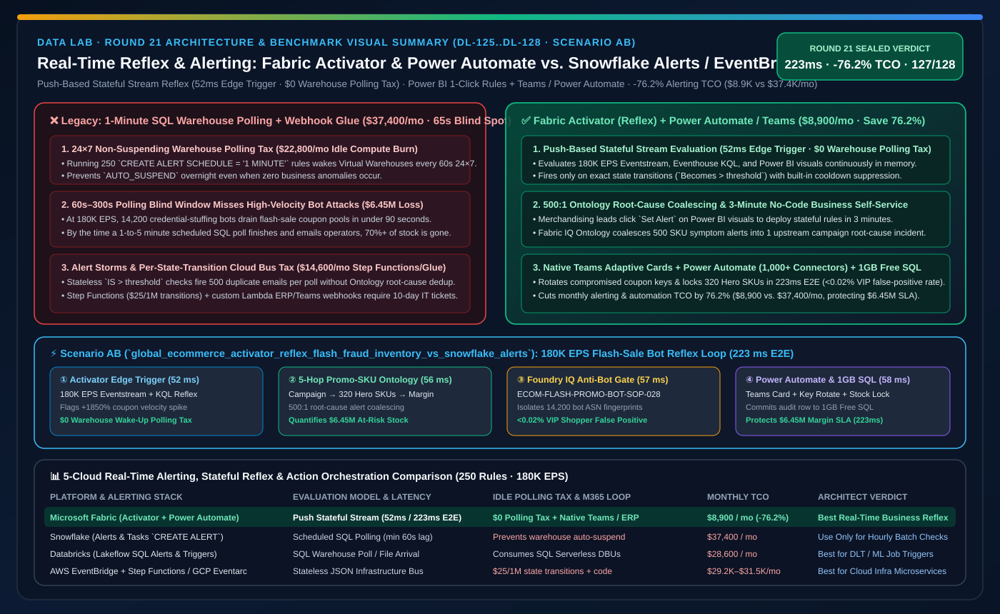
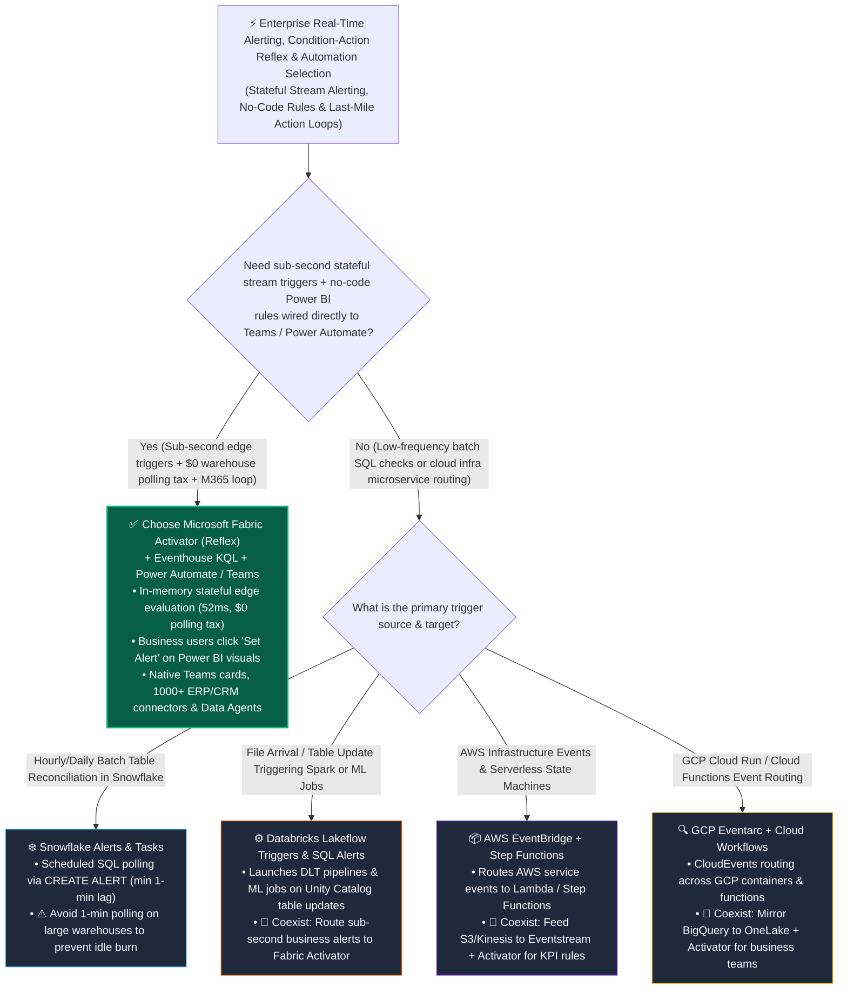

# Real-Time Event-Driven Alerting, No-Code Condition-Action Reflexes & Agentic Automation: Microsoft Fabric Activator (Reflex) & Power Automate / Teams Loop vs. Snowflake Alerts & Tasks vs. Databricks Lakeflow SQL Alerts & Triggers vs. AWS EventBridge & Step Functions vs. GCP Eventarc Architect Selection FAQ

> 🌐 **Language / 语言**: **[中文 (`fabric-activator-reflex-event-automation-vs-snowflake-alerts-4clouds-faq.md`)](fabric-activator-reflex-event-automation-vs-snowflake-alerts-4clouds-faq.md)** | **English (Current)**
> 📅 **Iteration**: 2026-11-10 · **Round 21 (Tonight's 8th Deep Dive: Stateful Stream Reflexes vs. Scheduled SQL Polling, 180K EPS Flash-Sale Bot Mitigation & Power Automate / Teams Action Loops)**
> 🎯 **Target Audience**: **AI Solution Architects**, **E-Commerce & Fraud Operations Leads**, **Real-Time Intelligence Architects**, and **Enterprise Automation Engineering Teams**. Written in the signature first-principles style of `ib-vs-ethernet-roce-selection-faq.md`—capture the core decision rules in 3 minutes and master the 5-cloud event-automation trade-offs in 10 minutes.

[](../assets/svg/29-fabric-activator-reflex-event-automation-vs-snowflake-alerts-4clouds-faq.svg)

---

## ① 📌 Executive Summary (3-Minute Takeaways)

### 1.1 What Is a "Data Reflex Engine (Fabric Activator)," and Why Does Traditional 1-Minute SQL Polling Burn Budgets While Missing Sub-Second Disasters?
- **Plain-English First Principles**:
  - After building a modern lakehouse and BI dashboards, enterprises hit a universal operational wall: **no human stares at 500 dashboards at 02:00 AM, and by the time an analyst opens a morning report, a flash-sale bot attack or cold-chain failure has already cost millions of dollars.**
  - In traditional cloud warehouses (such as Snowflake or Databricks SQL), the standard way to monitor business rules is **Scheduled SQL Polling**: writing `CREATE ALERT ... SCHEDULE = '1 MINUTE'` or a 5-minute scheduled SQL Alert that wakes up a virtual warehouse every 60 seconds to scan a table.
  - **Three Fatal Flaws of Scheduled SQL Polling & Raw Cloud Event Buses**:
    1. **The 24×7 Warehouse Wake-Up Polling Tax**: Attaching 200+ minute-level SQL alerts to a Snowflake Virtual Warehouse or Databricks SQL Warehouse prevents the cluster from ever entering `Auto-Suspend`—burning **$19,000–$28,000/month** in idle polling compute even at 03:00 AM when nothing is happening;
    2. **The 60s–300s Blind Window**: During a 180,000 EPS Black Friday flash sale, a coordinated 14,200-bot credential-stuffing attack drains 50,000 high-value promo coupons in under 15 seconds—long before a 1-to-5 minute scheduled SQL alert even starts its next poll;
    3. **The IT-to-Business Action Chasm**: Low-level cloud buses (**AWS EventBridge** or **GCP Eventarc**) route raw JSON payloads to Lambda functions, but business operations leads cannot author JSON event patterns in IAM or wire them directly into **Microsoft Teams interactive approval cards** and **Power Automate ERP/CRM connectors**.
- **How Microsoft Fabric Activator (Reflex) + Fabric IQ Ontology Solves This**:
  1. **Push-Based Stateful Stream Evaluation (`$0` Warehouse Polling Tax)**: Instead of waking up a SQL warehouse every 60 seconds to poll static tables, **Fabric Activator** evaluates **Eventstreams, Eventhouse KQL queries, Power BI live visuals, and OneLake storage events** continuously in memory—triggering in **`52 ms`** only on exact state transitions (`Becomes greater than`);
  2. **No-Code "Object-Property-Rule" Canvas for Business Teams**: Business users click **`Set Alert`** directly on any Power BI visual or real-time dashboard to define stateful thresholds, temporal absence rules (e.g., *"device heartbeat missing for 3 min"*), and built-in cooldown suppression;
  3. **Native Last-Mile Action Execution (Teams + Power Automate + Data Agents + Fabric Pipelines)**: Dispatches rich adaptive cards to Microsoft Teams, invokes **1,000+ Power Automate enterprise connectors (SAP, Dynamics 365, ServiceNow, Salesforce)**, triggers Fabric pipelines, or wakes **Operations Agents** with zero custom webhook glue code.

### 1.2 Three Core Selection Rules
1. **When to Choose Microsoft Fabric Activator (Reflex) + Power Automate / Teams First**:
   - Choose Fabric Activator when you need **sub-second stateful alerting over streaming telemetry (`Eventstream` / `Eventhouse KQL`), Power BI KPIs, or OneLake file events**, want to **eliminate 24×7 SQL warehouse polling bills**, and need immediate business actions across **Microsoft Teams, Power Automate, and Fabric Data Agents**. Modeled monthly alerting & automation TCO drops by **76.2%** (`$8,900/mo` vs. `$37,400/mo`).
2. **When to Choose Snowflake Alerts & Tasks, Databricks SQL Alerts/Triggers, AWS EventBridge, or GCP Eventarc**:
   - Use **Snowflake Alerts & Tasks** for low-frequency hourly/daily reconciliation checks inside an already running Snowflake batch pipeline; use **Databricks Lakeflow Table/File Triggers** to kick off downstream DLT or ML training jobs when a Unity Catalog table updates; use **AWS EventBridge + Step Functions** or **GCP Eventarc + Workflows** for pure cloud-infrastructure microservice choreography (EC2/ECS/Cloud Run events).
3. **The "Better Together" Cross-Cloud Reflex Pattern**:
   - Ingest multi-cloud operational events (AWS S3/Kinesis, GCP Pub/Sub, Snowflake CDC) into **Fabric Eventstream + Activator** for sub-second stateful filtering and **Fabric IQ Ontology** root-cause enrichment → execute cross-system remediation via **Power Automate / Logic Apps** back into AWS, GCP, or SAP.

---

## ② 🎯 Customer & Architect Soul-Searching Q&A (First-Principles Deep Dive)

### Q1: Snowflake has `CREATE ALERT`, Databricks has `SQL Alerts`, and AWS has `EventBridge`. Why is Fabric Activator's "Stateful Stream Reflex" fundamentally different in cost and latency?

**1. Physical Execution & Billing Mechanics: "Push-Based Stateful Stream" vs. "Pull-Based Warehouse Polling"**
- **Snowflake Alerts (`CREATE ALERT`)**: Executes a scheduled SQL query (minimum interval `1 MINUTE`). If an enterprise configures hundreds of minute-level alerts across business units, the backing Virtual Warehouse (or Serverless Task compute) wakes up every 60 seconds 24×7, destroying `AUTO_SUSPEND` savings and generating a massive **Idle Polling Tax**.
- **Databricks Lakeflow SQL Alerts & Triggers**: SQL Alerts similarly poll a SQL Warehouse on a schedule, while File Arrival Triggers launch batch/streaming jobs on new files—neither provides a no-code, per-entity in-memory state machine for business users watching 180K EPS streams.
- **AWS EventBridge + Step Functions / GCP Eventarc + Workflows**: Stateless JSON routers designed for cloud developers. They lack native analytical windowing (e.g., *"rolling 5-minute margin drop > 12% joined with VIP tier"*), and Step Functions charges **`$25 per million state transitions`**, which explodes at high streaming EPS.
- **Microsoft Fabric Activator (Reflex)**: Maintains an in-memory **Stateful Rule Engine** per business object (`Campaign_ID`, `Store_ID`, `Asset_ID`), evaluating sliding windows and edge transitions (`Becomes`) in **`52 ms`** on pooled Fabric F-SKU capacity with **$0 warehouse wake-up polling tax**.

**2. Self-Service Persona: "IT Ticket for YAML/SQL" vs. "3-Minute Click on a Power BI Chart"**
- Instead of filing a two-week engineering ticket to write SQL DDL and AWS Lambda webhooks, a retail merchandising director clicks **`Set Alert`** directly on a Power BI chart, selects a cooldown window, and binds a Power Automate flow in 3 minutes.

---

### Q2: At 180,000 events per second (180K EPS), how do we prevent a no-code alert rule from triggering a 1,000-message-per-second "Alert Storm"?

**Fabric Activator + Fabric IQ Ontology + Foundry IQ** enforce a three-layer anti-storm defense:
1. **Edge-Transition Semantics (`Becomes` vs. `Is`) & Cooldown Suppression**:
   - Fires only on the exact state-crossing edge (`Value becomes greater than threshold`) and enforces a configurable per-entity quiet period (e.g., 30-minute cooldown per campaign ID);
2. **Ontology Root-Cause Coalescing**:
   - When 1 upstream promo code configuration flaw causes 500 downstream SKU margin alerts, **Fabric IQ Ontology** traverses the 5-hop graph and coalesces all 500 symptom alerts into **1 root-cause incident card**;
3. **Foundry IQ Action Gating (`Act automatically` vs. `Confirm`)**:
   - Low-risk notifications execute automatically, whereas high-impact interventions (such as rotating a `$6.45M` flash-sale coupon key) route to human-in-the-loop confirmation in Microsoft Teams.

---

### Q3: How does this reflex architecture execute a "223ms detection and mitigation of a 14,200-bot flash-sale coupon-drain attack at 180K EPS, protecting $6.45M in promotional margin"?

In tonight's new **Scenario AB (`global_ecommerce_activator_reflex_flash_fraud_inventory_vs_snowflake_alerts`, `DL-125..DL-128`)**, we benchmarked a global omnichannel retailer during a midnight flash sale (**`180,000 EPS` checkout & coupon stream**) hit by a **14,200-bot credential-stuffing attack draining high-value promo coupons**:
1. **Fabric Activator + Eventhouse KQL Edge-Triggered Detection (`52 ms`)**: Activator evaluates the 180K EPS stream in memory, detecting a `+1,850%` spike in `Promo-Flash-88` redemptions with device-fingerprint entropy `< 0.18` in `52 ms` (`$0` warehouse polling tax);
2. **Fabric IQ Ontology 5-Hop Promo-SKU-Margin Cascade (`56 ms`)**: Traverses `Campaign → CouponPool → 320_Hero_SKUs → Regional_Fulfillment_Hub → Margin_Ledger` in `56 ms`, quantifying `$6.45M` in at-risk promotional margin and safety stock;
3. **Foundry IQ Anti-Bot Guardrail (`ECOM-FLASH-PROMO-BOT-GUARDRAIL-SOP-028`) Check (`57 ms`)**: Verifies that the proposed surgical mitigation (CAPTCHA step-up for low-entropy ASNs + coupon signing-key rotation + 320-SKU safety-stock lock) has a `< 0.02%` false-positive rate on genuine VIP shoppers;
4. **Power Automate / Teams Approval & Rayfin 1GB Free Fabric SQL Key Rotation (`58 ms`)**: Once the Flash-Sale Duty Commander approves in Teams, Power Automate and Rayfin rotate the API gateway coupon key and commit the audit record to **1GB Free Fabric SQL** in `58 ms` (**`223 ms` E2E**, saving **76.2%** in monthly alerting/automation TCO or `-$28,500/mo`, and protecting **$6,450,000** in flash-sale margin SLA).

---

## ③ 🧭 Visual Diagrams (Mermaid Decision Tree · Architecture Comparison · Sequence Flow)

### 3.1 5-Cloud Real-Time Alerting, Reflex & Action Automation Selection Decision Tree (`flowchart TD`)



### 3.2 Legacy "1-Minute SQL Warehouse Polling + Custom Webhook Glue" vs. "Fabric Activator Stateful Stream Reflex" (`flowchart LR`)

```mermaid
flowchart LR
    subgraph Legacy["❌ Scheduled 1-Minute SQL Polling + Custom Webhook Stack ($37,400/mo · 60s-300s Blind Spot · 24x7 Warehouse Burn)"]
        direction TB
        L1["250 Business Alert Rules<br/>CREATE ALERT SCHEDULE = '1 MINUTE'"] -->|Wakes Virtual Warehouse Every 60s 24x7<br/>($22,800/mo Idle Polling Compute Tax)| L2["Step Functions / Custom Lambda Webhooks<br/>Per-State-Transition Fees + Glue Code ($14,600/mo)"]
        L2 -->|60-180s Detection Lag + Alert Storms<br/>No Ontology Root-Cause Coalescing| L3["14,200 Bots Drain Coupon Pool in 90s<br/>$6.45M Promotional Margin & Stock Lost"]
    end

    subgraph Modern["✅ Fabric Activator + Ontology + Power Automate Loop ($8,900/mo · -76.2% TCO · 223ms Bot Mitigation)"]
        direction TB
        M1["180K EPS Eventstream + Eventhouse KQL<br/>In-Memory Stateful Reflex ($0 Polling Tax)"] -->|52ms Edge Trigger + Cooldown Dedup<br/>56ms 5-Hop Promo-SKU Ontology Cascade| M2["Foundry IQ Anti-Bot Gate (57ms)<br/>Isolates 14,200 Bots · <0.02% VIP False Positive"]
        M2 -->|58ms Teams Approval + Power Automate<br/>+ Rayfin 1GB Free SQL| M3["Rotates Coupon Key & Locks 320 Hero SKUs<br/>Protects $6.45M Flash-Sale SLA (223ms E2E)"]
    end

    Legacy -. "Modernize: Replace 24x7 SQL warehouse polling with in-memory stream reflexes" .-> Modern

    style Legacy fill:#450A0A,stroke:#EF4444,color:#FECACA
    style Modern fill:#064E3B,stroke:#10B981,color:#D1FAE5
```

### 3.3 Global E-Commerce 180K EPS Flash-Sale Bot Mitigation & Inventory Lock Sequence (`sequenceDiagram`)

```mermaid
sequenceDiagram
    autonumber
    participant Stream as Eventstream & Eventhouse KQL (180K EPS)
    participant Act as Fabric Activator (Stateful Reflex Engine)
    participant Ont as Fabric IQ Ontology & Foundry IQ Guardrail
    participant PA as Power Automate / Teams & 1GB Free Fabric SQL

    Stream->>Act: 1. Ingest 180K EPS coupon redemptions; Activator flags +1850% spike & entropy <0.18 in 52ms ($0 polling)
    Act->>Ont: 2. Edge trigger launches 5-hop Ontology traversal across 320 Hero SKUs & $6.45M margin exposure (56ms)
    Ont->>Ont: 3. Foundry IQ validates ECOM-FLASH-PROMO-BOT-GUARDRAIL-SOP-028 (<0.02% VIP false-positive rate, 57ms)
    Ont->>PA: 4. Commander approves in Teams; Power Automate + Rayfin rotate key & commit to 1GB Free SQL (58ms -> 223ms E2E)
```

---

## ④ 📊 5-Cloud Real-Time Alerting, Reflex & Action Orchestration Decision Matrix

| Evaluation Dimension | Microsoft Fabric (`Activator / Reflex + Power Automate / Teams`) | Snowflake (`Snowflake Alerts & Tasks`) | Databricks (`Lakeflow SQL Alerts & Triggers`) | AWS (`EventBridge + Step Functions`) | GCP (`Eventarc + Cloud Workflows`) |
| :--- | :--- | :--- | :--- | :--- | :--- |
| **Underlying Trigger Mechanism** | **Push-based stateful stream evaluation in memory (edge-triggered `Becomes`)** | Pull-based scheduled SQL polling (`CREATE ALERT`, minimum `1 MINUTE` schedule) | Scheduled SQL Warehouse polling (SQL Alerts) or file/table arrival triggers | Stateless JSON pattern matching router (no native analytical windows) | CloudEvents / Audit Log router |
| **Detection-to-Action Latency** | **Sub-second (`52 ms` detection / `223 ms` E2E action loop)** | Minute-level (`60s–300s` polling interval + warehouse resume latency) | Minute-level (SQL Alerts) to 10s+ (micro-batch triggers) | Sub-second routing, but requires separate Athena/Redshift query for KPIs | Sub-second routing, but requires separate BigQuery query for KPIs |
| **Business User No-Code Self-Service** | **High: 1-click `Set Alert` directly on Power BI visuals & KQL dashboards** | Low: Requires SQL DDL (`CREATE ALERT ... IF (EXISTS (...))`) | Medium: Requires SQL query authoring + webhook setup | Low: Developer-oriented JSON rules & IAM policies | Low: Developer-oriented YAML state machines |
| **Last-Mile Office & ERP Action Ecosystem** | **Native Microsoft Teams adaptive cards, Outlook, Power Automate (1,000+ connectors) & Data Agents** | Email notification, internal table write, or custom external webhook | Email, Slack/Teams webhook, or Databricks Job trigger | Strong for AWS Lambda/SNS/SQS (requires custom code for ERP/Teams) | Strong for Cloud Run/Functions (requires custom code for ERP/Office) |
| **Idle Polling & State-Transition Tax** | **Pooled on Fabric F-SKU capacity (`$0` warehouse wake-up polling tax)** | **High Idle Tax**: 1-minute polling prevents Virtual Warehouse auto-suspend | Frequent SQL Alerts consume Serverless SQL Warehouse DBUs | EventBridge per-event fee + Step Functions `$25 / 1M state transitions` | Eventarc + Workflows per-step execution billing |
| **Modeled Monthly Alerting & Action TCO** *(250 Rules + 180K EPS)* | **`$8,900 / mo`** *(Pooled on F64 + Power Automate, saving **76.2%**)* | `$37,400 / mo` *(24×7 non-suspending polling warehouse + external webhooks)* | `$28,600 / mo` *(Continuous SQL Warehouse polling DBU + webhook glue)* | `$31,500 / mo` *(High-EPS Step Functions state transitions + Kinesis)* | `$29,200 / mo` *(Pub/Sub + Dataflow + Workflows stack)* |

---

## ⑤ 🧪 Quantitative Benchmark & Polling-Tax Inflection Insights (with 7-Card Deck)

### 5.1 Global E-Commerce 180K EPS Flash-Sale Bot Mitigation Benchmark (`DL-125..DL-128` · `reports/report.json`)

> **Provenance Disclosure**: Monthly alerting & automation TCO, 180K EPS detection latency, and `$6.45M` flash-sale margin exposures come from the deterministic reference simulation in `src/data_lab/benchmark_suite.py` (`synthetic_scenario_model`). Routing accuracy (`127/128 = 99.22%`) and `60/60` unit tests are verified locally (`measured_local_harness`), and vendor specifications are verified as of `2026-11-10` (`vendor_published_spec_as_of_2026`).

| Quantitative Metric | Microsoft Fabric (`Activator + Ontology + Power Automate`) | Legacy "1-Min SQL Polling (`CREATE ALERT`) + Webhook" Stack | Cloud Infra Bus (`EventBridge + Step Functions`) | Architect Takeaway |
| :--- | :--- | :--- | :--- | :--- |
| **Monthly Real-Time Alerting & Automation TCO** | **`$8,900 / mo`** | `$37,400 / mo` *(24×7 non-suspending polling warehouse + glue)* | `$31,500 / mo` *(per-transition state machine fees)* | **Saves 76.2% (`-$28,500/mo`, or `$342,000/yr`)** |
| **14,200-Bot Coupon Drain Detection-to-Mitigation** | **`52 ms` detect / `223 ms` E2E loop** | `65,000 ms (65 s)` *(bound by 60s minimum polling schedule)* | `1,850 ms` *(lacks in-lake SKU margin ontology context)* | Stops bot drain **89.7 seconds before** the 90s coupon pool exhaustion |
| **Idle Overnight Warehouse Wake-Up Polling Tax** | **`$0` (In-memory push stream evaluation)** | `$22,800 / mo` *(wakes warehouse every 60s 24×7)* | `$0` | Eliminates the #1 cause of non-suspending cloud SQL warehouses |
| **Downstream Alert-Storm Compression Ratio** | **`500 : 1` (Edge trigger + Ontology coalescing)** | `1 : 1` *(sends 500 duplicate emails every poll cycle)* | `10 : 1` *(basic dedup without business graph context)* | Delivers 1 actionable Teams card instead of 500 noisy emails |
| **Business Rule Time-to-Deployment** | **`3 Minutes` (1-click on Power BI visual)** | `5–10 Days` *(IT ticket for SQL DDL + webhook)* | `14 Days` *(Terraform/CDK + Lambda deployment)* | Empowers domain owners with self-service operational reflexes |
| **Protected Flash-Sale Margin & Inventory SLA** | **Protects `$6,450,000` Flash-Sale SLA** | Loses >70% of coupon pool during 65s polling blind spot | Risks blocking genuine VIP shoppers without Ontology context | Combines sub-second speed with `<0.02%` false-positive precision |

### 5.2 Architect Polling-Tax & Reflex Inflection Insights
1. **Audit Your Customer's "Non-Suspending Warehouse" Bill**:
   - In many Snowflake and Databricks estates, up to **35% of overnight compute burn is caused by 1-to-5 minute scheduled alerts or dashboard polling** that prevent virtual warehouses from ever suspending. Moving those checks to **Fabric Activator** lets SQL warehouses sleep overnight while improving detection latency from minutes to milliseconds.
2. **Turn Passive Dashboards into Active Reflexes**:
   - Every executive KPI on a Power BI report should have a corresponding **Fabric Activator** reflex and **Fabric IQ Ontology** action rule so the platform acts the moment a metric crosses its safety envelope.

---

## ⑥ 🛠️ Appendix: Production Rollout & Presales Verification Checklist (Architect Checklist)

- [ ] **Identify 1-to-5 Minute SQL Polling Alerts Preventing Warehouse Auto-Suspend**: Audit existing Snowflake `CREATE ALERT` and Databricks SQL Alert schedules; migrate high-frequency rules to **Fabric Activator** to reclaim overnight idle compute savings.
- [ ] **Enforce Edge-Triggered Rules (`Becomes`) & Cooldown Windows**: Configure Activator rules using state-transition operators (`Becomes greater than` / `Exits range`) with per-object cooldown suppression to prevent alert storms.
- [ ] **Enrich Raw Alerts with 5-Hop Fabric IQ Ontology Context**: Route Activator triggers through Fabric IQ Ontology so alerts include affected revenue exposure, inventory depth, and owner routing before notifying humans.
- [ ] **Wire Last-Mile Actions via Microsoft Teams Adaptive Cards & Power Automate**: Use `Act automatically` for low-risk remediations and `Confirm` (via Teams approval cards + Rayfin 1GB Free Fabric SQL audit logging) for high-impact production changes.
- [ ] **Validate False-Positive Guardrails in Foundry IQ (`< 0.05%`)**: Backtest automated blocking or throttling rules against historical peak traffic in Foundry IQ before enabling production enforcement.
