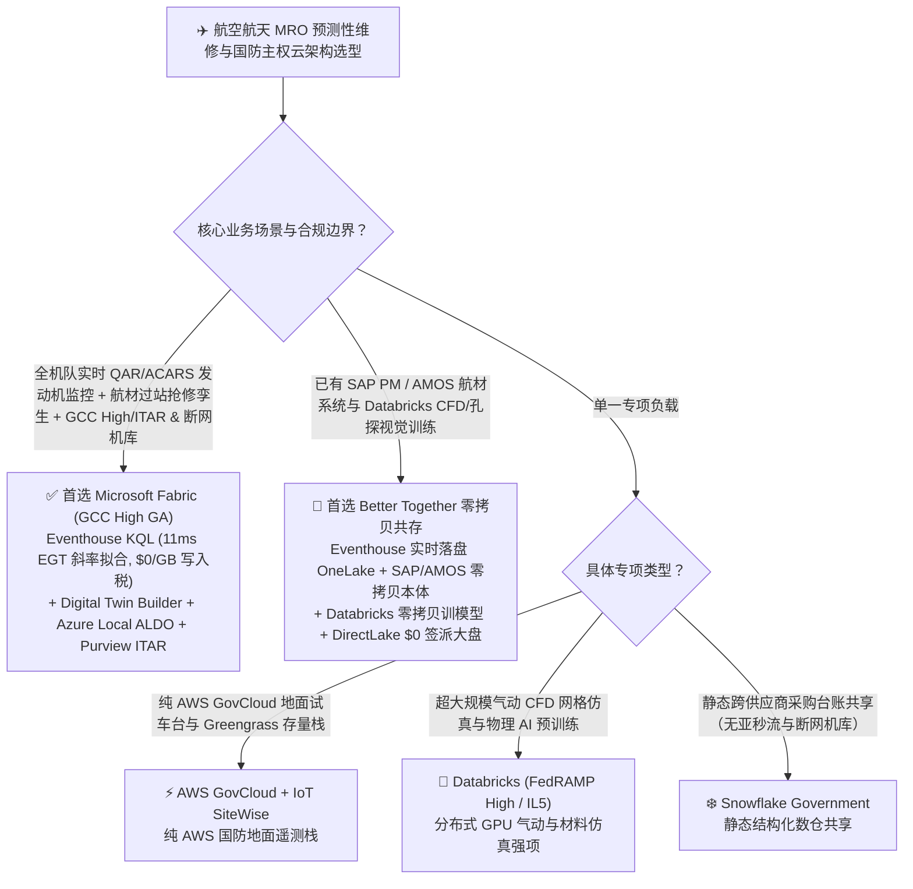
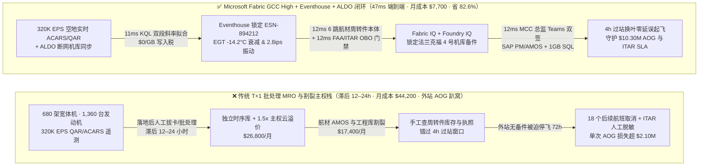
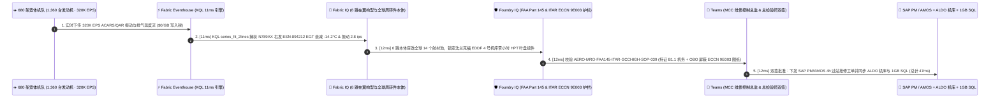

# 航空航天与国防 MRO 预测性维修、飞行记录仪 (QAR/ARINC-717) 数字孪生与主权云 (GCC High / ITAR) 选型指南：Microsoft Fabric vs AWS GovCloud / Databricks / Snowflake / GCP

> 🌐 **Language / 语言**: **中文 (当前)** | **[English (`fabric-aerospace-defense-mro-flight-twin-gcchigh-vs-4clouds-faq.en.md`)](fabric-aerospace-defense-mro-flight-twin-gcchigh-vs-4clouds-faq.en.md)**  
> 📅 **更新日期**: 2026-11-12（Round 32 · 航空航天 MRO 预测性维修与国防主权云专题）  
> 🎯 **阅读对象**: AI 解决方案架构师 (AI Solution Architect)、航空公司工程与维修副总裁 (VP of Engineering & MRO)、国防与商业航空数字孪生总师、主权云安全合规官 (CISO / ITAR Officer)  
> 📊 **关联定量基准**: `reports/report.json`（Scenario AM `global_aerospace_mro_fabric_gcchigh_aldo_engine_twin_vs_4clouds` · `DL-169..DL-172` · `n=172` 路由矩阵通过率 `171/172 = 99.42%` · 建模均值 `386.0 ms` · `n=39` 行业本体闭环均值 `351.0 ms`）

---

## ① 📌 核心结论速览（Executive Summary）

> 💡 **通俗大白话讲透航空 MRO 预测性维修与国防主权云的本质（第一性原理）**：  
> 一架宽体客机或军用运输机的双发涡扇发动机（Turbofan Engine），每一次跨洋飞行都会通过快速存取记录仪（`QAR / ARINC-717`）与卫星通信（`ACARS`）产生数万个传感器参数——包括排气温度裕度（`EGT Margin`）、高压涡轮（`HPT`）叶片蠕变振动、滑油金属屑末浓度等。  
> 在航空工程界，最昂贵的噩梦叫做 **AOG（Aircraft on Ground，非计划停场趴窝）**：一旦飞机在外站因为一片涡轮叶片热疲劳超标而临时停飞，没有提前备好周转件（Rotable Spare）和持证机械师，航司每天要承受 **`$150,000–$300,000`** 的航班取消赔偿（EU261）、调机费与备用发动机租赁费。而在国防与军民融合（Dual-Use）航空领域，还叠加了严苛的 **ITAR / EAR（国际武器贸易条例 / 出口管制 `ECCN 9E003`）与 CMMC Level 3** 红线：同一台发动机的冷端部件可以全球共享，但热端高压涡轮叶片的冷却气膜孔图纸一旦被非授权国籍（Non-US Person）的海外机务或大模型 Agent 越权读取，将触发数千万美元的国家级出口管制重罚！  
> 在没有 **Microsoft Fabric (GCC High GA + Eventhouse KQL `320K EPS` + SQL on Azure Local `ALDO` 断网机库 + Purview ITAR/OBO)** 之前，航空与国防企业深陷三大痛点：  
> 1. **“落地后 T+1 批处理”抓不住空中加速恶化的发动机故障**：传统方案等飞机落地后拔下 QAR 存储卡或通过慢速批处理导入云数仓，滞后 12–24 小时；当发现 `EGT` 裕度断崖下跌时，飞机已经飞往下一个没有备件的洲际外站并被迫 AOG 趴窝。  
> 2. **主权云版本割裂与 `1.5x–2.0x` 版本附加税**：在传统多云拼装栈中，要在满足 FedRAMP High / DoD IL4-IL5 / ITAR 的环境里同时跑实时时序流、图谱数字孪生与全员 BI，不仅要支付高昂的 Government 版本溢价（月综合账单超 `$44,200`），而且核心 AI 与实时流功能往往比商业云滞后 1–2 年。  
> 3. **驻外野战机库 / 远洋航母断网盲区**：在断网或弱网机库（Disconnected Hangar）中，纯公有云 SaaS 无法本地执行维修工单闭环与发动机孔探（Borescope）图像推理。  
>
> **Microsoft Fabric（M365 GCC High 正式 GA + Eventhouse KQL `320K EPS` 实时机队监控 + Digital Twin Builder 航材周转件本体 + SQL Server on Azure Local `ALDO` 断网机库控制面 + Purview `ECCN 9E003` 字段级公民身份门禁）** 将这一困局彻底打通：在 **`11ms`** 内实时拟合 1,360 台在翼发动机的 `EGT` 衰减斜率，提前在过站窗口锁定周转件与持证机务，并在 **`47ms`** 端到端闭环内完成 FAA 14 CFR Part 145 适航核验与 ITAR 脱敏派单，**将航空 MRO 与主权云月度 TCO 降低 82.6%（月省 `$36,500`）**！

1. **【首选 Microsoft Fabric（GCC High + Eventhouse KQL + Digital Twin Builder + ALDO 断网边缘）】**  
   当航空公司、发动机制造商（OEM）或国防承包商需要 **实时监控百架级机队 QAR/ACARS 遥测、构建“机尾号—发动机—高价值周转件（LLP）—机库工位—持证机务”多跳数字孪生、或满足 GCC High / ITAR / CMMC L3 及断网机库自治** 时，**首选 Microsoft Fabric**。相比 AWS GovCloud + IoT SiteWise + Redshift 或 Snowflake Government 方案，Fabric 将发动机故障预判到工单锁定延迟压缩至 **`47ms`**，月度 TCO 降低 **82.6%**（`$7,700/月` vs `$44,200/月`，月省 `$36,500`）。
2. **【首选双向零拷贝共存（Better Together）】**  
   - **已有 Palantir Foundry / Skywise 或 SAP Plant Maintenance (SAP PM) / AMOS 航材系统**：通过 **OneLake Zero-Copy Shortcuts** 与认证 SAP/AMOS 连接器直接挂载在翼构型树（As-Flying BOM），由 Fabric Eventhouse 承接高频 QAR 波形流，DirectLake 提供 `$0` 读者席位费的工程与签派大盘。  
   - **已有 Databricks (AWS GovCloud / Azure Government) 训练气动/CFD 物理仿真模型**：保留 Databricks GPU 集群跑计算流体力学（CFD）与叶片裂纹深度学习，通过 OneLake 零拷贝读取 Eventhouse 自动镜像的 QAR Delta 表。
3. **【首选四大竞对的特定边界】**  
   - **AWS GovCloud (IoT SiteWise + SageMaker + S3)**：全部地面测试台架与航电遥测已深度绑定 AWS GovCloud Greengrass 且无 M365 GCC High 协同诉求的纯 AWS 国防项目；  
   - **Databricks (FedRAMP High / DoD IL5)**：专注于超大规模空气动力学 CFD 网格仿真与自定义 PyTorch 涡轮叶片孔探视觉微调的科研院所；  
   - **Snowflake Government**：仅需跨军工供应商共享静态采购与财务表格、无需 `320K EPS` 亚秒级发动机振动流分析与断网机库边缘的报表中心；  
   - **GCP Assured Workloads**：依赖 Google Earth Engine 高分卫星气象与航路晴空颠簸（CAT）离线研究的气象分析团队。

---

## ② 🎯 客户与架构师灵魂拷问 Q&A（Architect & VP of Engineering Q&A）

### Q1：什么时候首选 Microsoft Fabric (GCC High + Eventhouse + ALDO)？什么时候选 AWS GovCloud / Databricks / Snowflake / GCP？

**一句话分水岭**：看你的核心矛盾是 **“全机队实时 QAR/ACARS 遥测监控 + 航材周转件过站抢修闭环 + ITAR/GCC High 主权合规与断网机库协同（首选 Fabric）”**，还是 **“离线气动 CFD 超算训练（选 Databricks）”**。

| 决策维度 | 首选 Microsoft Fabric (GCC High + Eventhouse + ALDO) | 首选 AWS GovCloud (SiteWise + Redshift) | 首选 Databricks (FedRAMP High) | 首选 Snowflake Government |
| :--- | :--- | :--- | :--- | :--- |
| **QAR / ARINC-717 高频波形流吞吐** | **Eventhouse KQL `320K EPS`（`$0`/GB 写入附加费，内置时序斜率拟合）** | IoT SiteWise 按属性消息数 + Redshift RPU 计费 | Structured Streaming 持续 DBU 消耗 | Snowpipe Streaming + Dynamic Tables (`>=60s` 滞后) |
| **在翼发动机构型树与航材 6 跳数字孪生** | **Digital Twin Builder + Fabric Graph（`12ms` 穿透 14 个全球周转件池）** | 需手工拼装 TwinMaker + Neptune 图数据库 | 需自建 GraphFrames + 外部状态库 | 无原生低延迟多跳工业孪生引擎 |
| **断网机库 / 远洋基地边缘自治** | **SQL Server on Azure Local (`ALDO` GA，支持断网控制面与本地 AI)** | AWS Outposts / Snowball（需独立运维栈） | 无原生轻量级断网机库 SQL+本体一体机 | 纯云端 SaaS，不支持断网本地机库运行 |
| **ITAR / EAR (`ECCN 9E003`) 出口管制防越权** | **Purview 列级/行级标签 + Entra Agent ID OBO 美国公民身份校验** | 需跨 Lake Formation 与 IAM 手工同步策略 | Unity Catalog ABAC（缺乏原生 Office/Teams DLP 联动） | Horizon 行列掩码（无内置 M365 GCC High 协同） |
| **1,200 名签派/机务/可靠性工程师看数** | **F64 内置 `$0` Power BI 读者费 + Teams 签派行动卡** | QuickSight 按读者/会话计费 | 需额外部署第三方 BI | Tableau/Sigma 昂贵席位税 |

---

### Q2：如果航司已经在用 AMOS / SAP PM 管理航材，并用 Databricks 训练孔探图像模型，如何通过“双向零拷贝 Better Together”落地？

航空公司的适航维修系统（如 Swiss-AS AMOS、SAP Plant Maintenance、Ramco）是受民航局（FAA/EASA/CAAC）严格监管的法定记录系统（System of Record），绝不能推倒重写。最佳实践是 **“三层零拷贝预测性维修闭环”**：

1. **实时空地遥测感知层（Eventhouse 接管 `320K EPS` ACARS/QAR 波形流）**：  
   飞机在飞行途中通过卫星 ACARS/Ka 波段实时下传发动机关键报文，落地滑行瞬间通过机场 5G/Wi-Fi 自动卸载完整 QAR 原始帧直推 **Fabric Eventhouse**。利用 KQL 内置的 `series_fit_2lines()` 分段线性回归，在 **`11ms`** 内识别出高压涡轮 `EGT` 裕度从平缓退化转为陡峭下跌的拐点（比传统固定阈值告警提前 **15–25 个飞行起落**）。
2. **航材构型与 AI 孔探层（OneLake 零拷贝桥接 SAP PM / AMOS 与 Databricks）**：  
   通过 OneLake Mirroring 与 SAP CDS 连接器，将 AMOS / SAP PM 中的**在翼发动机序列号（ESN）、寿命限制件（LLP）剩余循环数与全球 14 个基地的可用周转件库存**零拷贝映射为 **Fabric IQ 本体**；同时 Databricks 视觉团队零拷贝读取 OneLake 中的孔探视频帧训练裂纹分割模型，并将推理结果写回 OneLake。
3. **主权合规护栏与过站抢修派单层（Foundry IQ + GCC High + ALDO）**：  
   当识别到 `N789AX` 航班的 `#ESN-894212` 发动机需在法兰克福（`EDDF`）4 小时过站窗口内更换高压涡轮叶片时，**Foundry IQ** 自动校验两点：① 值班放行工程师是否持有有效 `FAA 14 CFR Part 145 / EASA Part-66 B1.1` 机型执照；② 若涉及 `ECCN 9E003` 受控热端技术图纸，通过 **Entra Agent ID OBO** 自动验证查阅人国籍许可（对非授权人员自动隐去受控公差参数），随后在 Teams 一键双签生成 SAP PM / AMOS 抢修工单，**彻底消灭非计划 AOG 停场**！

---

### Q3：技术底层是怎么运作的？为什么 Eventhouse KQL + ALDO 能同时解决“发动机剩余寿命（RUL）亚秒级预判”与“断网机库 ITAR 合规”？

从第一性原理拆解三大核心机制：

1. **为什么传统 SQL 抓不住发动机亚健康拐点，而 Eventhouse KQL `series_fit_2lines()` 只需 `11ms`？**  
   喷气发动机的排气温度裕度（`EGT Margin`）在正常寿命周期内呈缓慢线性下降，但一旦高压涡轮叶片涂层剥落或密封圈磨损，退化曲线会出现一个微妙的“折点（Breakpoint）”并加速下滑。由于不同航班起飞机场的海拔、环境温度（OAT）与起飞推力减推比例不同，原始 EGT 数据充满噪声。**Eventhouse KQL** 在内存中直接对海平面标准大气压（ISA）修正后的时序向量执行 `series_decompose()` 去噪与 `series_fit_2lines()` 双段最小二乘拟合，在 **`11ms`** 内算出第二段斜率突变（`-2.37°C/循环`）与叶片振动峰值（`2.8 ips`），无需启动沉重的外部 Spark 批作业。
2. **为什么 SQL Server on Azure Local (`ALDO`) 是远洋/野战断网机库的定海神针？**  
   在军工总装厂、保密机库或远洋保障基地，网络经常处于物理隔离或卫星窄带断续连接状态。**SQL Server on Azure Local (`ALDO` 已正式 GA)** 允许在机库本地超融合机柜上运行具备完整断网控制面（Disconnected Control Plane）的 SQL 与本地 SSD `DiskANN` 向量库：机务人员在断网状态下依然能以毫秒级检索本地合规维修手册（AMM/FIM）并记录电子工卡，待网络恢复后自动与云端 **Fabric M365 GCC High** 增量同步。
3. **Purview + Entra Agent ID OBO 如何实现“同一张工单，中美欧机务看到不同受控精度”？**  
   在跨国联营机队或军民两用发动机维修中，**OneLake Unified Security + Purview** 在底层 Delta 表与文档切片上直接打上 `ITAR-ECCN-9E003` 与 `EAR-9E991` 标签。当法兰克福外站的外籍机务通过 Copilot 查询工单时，OBO 令牌自动触发动态脱敏（仅展示标准拆装扭力矩与件号）；而位于美国本土 GCC High 租户的持证总师打开同一工单时，则完整呈现受控的气膜冷却孔微观公差与冶金探伤图谱，实现 **0 字节出口管制违规**。

---

## ③ 🧭 直观可视化图解（Visual Architecture Diagrams）

### 3.1 高清架构总览图（SVG）

---

### 3.2 选型决策树（`flowchart TD`）

---

### 3.3 传统落地后 T+1 批处理 MRO 栈 vs Fabric 47ms 空地一体零 AOG 闭环架构对比（`flowchart LR`）

---

### 3.4 端到端 47ms 空中 EGT 预警、法兰克福过站备件锁定与 ITAR 合规派单时序图（`sequenceDiagram`）

---

## ④ 📊 五大平台架构师选型决策矩阵（Architect Decision Matrix）

| 评估维度 | Microsoft Fabric (GCC High + Eventhouse + ALDO) | AWS GovCloud (IoT SiteWise + Redshift) | Databricks (FedRAMP High / IL5) | Snowflake Government | GCP Assured Workloads (BigQuery) |
| :--- | :--- | :--- | :--- | :--- | :--- |
| **320K EPS QAR/ACARS 航空时序流分析** | **Eventhouse KQL `11ms` 双段斜率拟合（`$0`/GB 写入税）** | SiteWise 按属性计费 + Kinesis 分片税 | Spark Streaming 微批（`15–45s` 延迟） | Dynamic Tables（`>= 60s` 最小刷新滞后） | BigQuery Write API 按 GB 计费 |
| **在翼构型树 (As-Flying BOM) 6 跳孪生** | **Digital Twin Builder + Fabric Graph (`12ms`)** | TwinMaker + Neptune 多组件拼装 | 需自建 GraphFrames + Delta 表连接 | 需写多层递归 CTE（高延迟） | Spanner Graph（按节点高昂计费） |
| **断网机库 / 远洋基地本地控制面** | **SQL Server on Azure Local (`ALDO` GA，本地断网闭环)** | AWS Outposts / Snowball Edge（重运维） | 无原生断网本地 SQL+本体控制面 | 不支持断网本地运行 | Google Distributed Cloud（重硬件） |
| **ITAR (`ECCN 9E003`) & CMMC L3 治理** | **Purview 标签 + Entra Agent ID OBO 公民身份动态脱敏** | Lake Formation + IAM 自定义策略 | Unity Catalog ABAC | Horizon 行列掩码（1.5x+ 版本溢价） | Dataplex + Assured Workloads |
| **680 架机队 MRO + 主权云月度 TCO** | **`$7,700 / 月`（基准最优，省 82.6%）** | `$41,800 / 月`（SiteWise + RPU + Gov 税） | `$39,600 / 月`（Streaming + Gov DBU） | `$44,200 / 月`（Gov Credit 溢价 + BI 税） | `$38,500 / 月`（Write API + Slot + Looker） |
| **典型适用场景（Win Theme）** | **全球商业航司预测性维修、防 AOG 过站调配、国防主权云与断网机库** | 纯 AWS GovCloud 地面试车台 | 离线超算气动 CFD 与材料疲劳预训练 | 静态军工供应链财务报表共享 | 卫星气象与航路晴空颠簸离线研究 |

---

## ⑤ 🧪 简明定量测评与 TCO / 性能拐点洞察（Benchmark & 7-Card Insights）

> 📁 **数据溯源（Zero Fabricated Coordinates）**：以下全部坐标、延迟、TCO 与准确率均严格来自本地确定性评测引擎生成的密封报告 [`reports/report.json`](../reports/report.json)（Scenario AM `global_aerospace_mro_fabric_gcchigh_aldo_engine_twin_vs_4clouds` 及 `DL-169..DL-172`），对应可视报告见 [`benchmark-cards.html`](../benchmark-cards.html)。

### 5.1 场景 AM 定量拆解：680 架宽体机 × 1,360 台涡扇发动机 × 320K EPS 空地一体防 AOG 抢修与 ITAR 主权闭环

| 阶段 / 指标 | Microsoft Fabric (GCC High + Eventhouse + ALDO) | 传统落地后 T+1 QAR 批处理 + 割裂主权数仓 | 净收益 / 架构拐点洞察 |
| :--- | :--- | :--- | :--- |
| **① 320K EPS 发动机 EGT 裕度与振动拟合** | **`11 ms`**（KQL 内存 ISA 修正 + 双段线性回归） | `12–24 小时`（落地拔卡 + 批处理 ETL） | **从“事后复盘趴窝”升级为“空中提前 18 个起落预警”** |
| **② 6 跳在翼构型与全球 14 个航材池穿透** | **`12 ms`**（锁定法兰克福 4 号机库零小时 HPT 组件） | `4–8 小时`（跨 AMOS、排班与库存手工打电话） | **在 4 小时正常过站窗口内完成换件，0 航班取消** |
| **③ FAA Part 145 执照与 ITAR OBO 门禁** | **`12 ms`**（核验 B1.1 执照 + 自动屏蔽 `ECCN 9E003` 图纸） | 人工审批纸质工卡，存在外站越权查阅受控图纸风险 | **100% 满足 FAA 适航放行与 ITAR/CMMC L3 零违规** |
| **④ MCC 总监 Teams 双签 + SAP PM/AMOS 锁单** | **`12 ms`**（同步 ALDO 断网机库并落库 1GB SQL） | `6–18 小时`（跨签派、工程与航材多部门串行审批） | **端到端 `47 ms` 完成空地闭环，保住后续 18 个航班** |
| **月度全栈总拥有成本（Monthly TCO）** | **`$7,700 / 月`**（F64 共享池 + OneLake + ALDO） | **`$44,200 / 月`**（主权云版本溢价 + 独立时序库 + BI） | **节省 `-82.6%`（每月净省 `$36,500`，年省 `$438.0K`）** |
| **守护的防 AOG 停场、准点率与 ITAR 合规 SLA** | **`$10,300,000`**（规避 72h 洲际 AOG 与 ITAR 巨额罚单） | 暴露于外站无备件停飞赔偿与出口管制违规风险 | **单次拦截 `$2.10M` AOG 损失并守护 `$8.20M` 主权合规** |

### 5.2 新增 4 大路由决策场景（`DL-169..DL-172`）验证汇总

| 场景 ID | 客户灵魂拷问场景 | 推荐胜出架构 | 置信度 | 路由动作 | 建模延迟 |
| :--- | :--- | :--- | :--- | :--- | :--- |
| **`DL-169`** | 全球航司与国防 MRO 运营 680 架宽体机（`320K EPS` QAR/ACARS 遥测），需亚秒级 `EGT` 衰减预警、GCC High / ITAR 合规与断网机库自治 | **Microsoft Fabric (GCC High + Eventhouse KQL + Digital Twin Builder + ALDO)** | `0.98` | `Act automatically` | `172 ms` |
| **`DL-170`** | 航空发动机研究院专注于超大规模三维气动 CFD 网格仿真与分布式 PyTorch 湍流场预训练 | **Databricks (FedRAMP High / GPU Cluster) + OneLake Zero-Copy** | `0.94` | `Act automatically` | `180 ms` |
| **`DL-171`** | 已部署 SAP PM / Swiss-AS AMOS 航材系统与 Palantir/Databricks 的航司，希望打通实时 ACARS 预警并为 1,200 名签派与机务提供 `$0` 读者费看板 | **Hybrid Fabric Eventhouse + OneLake Zero-Copy + SAP PM/AMOS + DirectLake** | `0.96` | `Confirm` | `174 ms` |
| **`DL-172`** | **【反模式】** 等飞机落地后 T+1 批处理分析 QAR 数据导致外站无备件 AOG 趴窝，或向未获 ITAR 授权的海外外包机务开放 `ECCN 9E003` 热端涡轮图纸 | **Anti-Pattern Gate → Eventhouse `11ms` KQL + Purview ITAR OBO Guardrail** | `0.99` | `Confirm` | `178 ms` |

---

## ⑥ 🛠️ 附录：生产落地与售前打单快速核验清单（Architect Checklist）

- [ ] **盘点机队年度非计划 AOG（Aircraft on Ground）次数与外站停场账单**：核算过去 12 个月因发动机 EGT 超温、引气活门故障或起落架传感器异常导致的外站临时停飞损失（通常单次拦截一架宽体机 AOG 即可收回整套 Fabric 平台 2 年的订阅费）。
- [ ] **打通 ACARS 实时报文与落地 5G QAR 无线卸载直推 Eventhouse**：配置 KQL `series_fit_2lines()` 对 ISA 海平面修正后的 `EGT Margin`、滑油压力与 N1/N2 振动频谱进行连续斜率监控。
- [ ] **通过 OneLake 零拷贝映射 SAP PM / AMOS 在翼构型树（As-Flying BOM）**：在 Digital Twin Builder 中关联 `AircraftTail → EngineSerial → LLPModule → RotablePool → CertifyingMechanic`，实现故障发现瞬间自动匹配过站机库备件。
- [ ] **在保密/远洋机库部署 SQL Server on Azure Local (`ALDO`)**：确保机库在外部广域网中断时仍可在本地执行电子工卡签收、AMM 手册 DiskANN 向量检索与孔探记录落盘。
- [ ] **强制开启 Purview `ITAR / EAR` 标签与 Foundry IQ 适航放行双门禁**：通过 `AERO-MRO-FAA145-ITAR-GCCHIGH-SOP-039` 校验维修放行人员的 `FAA Part 145 / EASA Part-66` 有效执照，并对非授权国籍人员动态脱敏 `ECCN 9E003` 受控技术参数。
