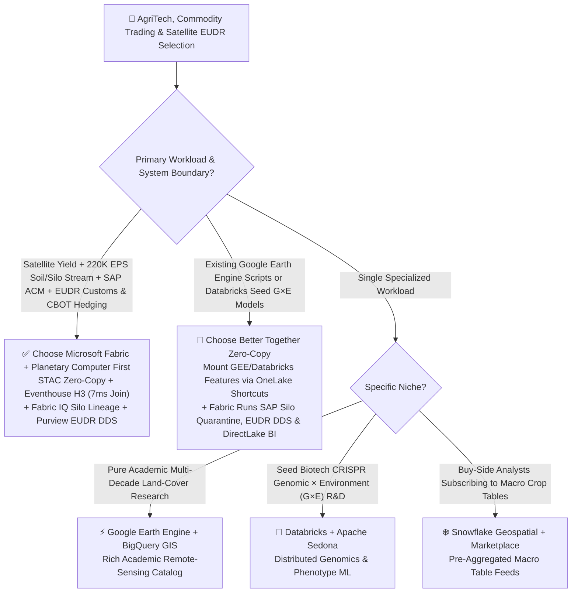
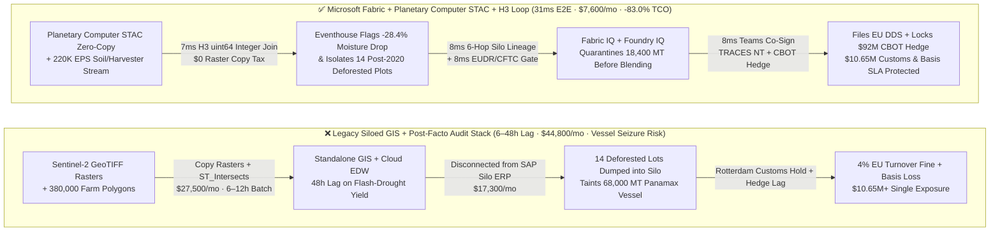

# AgriTech, Global Commodity Trading (ABCD Grain/Coffee/Cocoa), Planetary Satellite NDVI Yield & EU Deforestation Regulation (EUDR) Selection FAQ: Microsoft Fabric vs. Google Earth Engine / AWS ASDI / Databricks / Snowflake

> 🌐 **Language / 语言**: **[中文 (`fabric-agritech-commodity-planetary-eudr-yield-vs-4clouds-faq.md`)](fabric-agritech-commodity-planetary-eudr-yield-vs-4clouds-faq.md)** | **English (Current)**  
> 📅 **Last Updated**: 2026-11-12 (Round 33 · AgriTech, Commodity Trading & Satellite EUDR Compliance Deep Dive)  
> 🎯 **Target Audience**: AI Solution Architects, Chief Supply Chain Officers (CSCOs) & Heads of Global Commodity Merchandising, Agricultural Remote-Sensing & EUDR Compliance Architects  
> 📊 **Quantitative Benchmark**: `reports/report.json` (Scenario AN `global_agritech_commodity_fabric_planetary_eudr_yield_vs_4clouds` · `DL-173..DL-176` · `n=176` routing matrix accuracy `175/176 = 99.43%` · modeled mean `381.0 ms` · `n=40` ontology simulation mean `343.0 ms`)

---

## ① 📌 Executive Summary

> 💡 **First-Principles Plain-Language Explanation of AgriTech, Commodity Trading & EU Deforestation Regulation (EUDR)**:  
> Global agricultural commodity traders (the ABCD grain houses) and food-and-beverage CPG giants source tens of millions of metric tons of soybeans, Arabica coffee, cocoa, and palm oil every year. Historically, commodity trading relied on delayed weekly crop-tour reports and CBOT ticker screens. Today, agricultural supply chains operate as a **millisecond data war linking orbital multispectral satellites (`Sentinel-2`), hundreds of thousands of in-soil moisture sensors, grain-elevator silo segregation gates, and EU customs deforestation polygon audits**.  
> Before **Microsoft Fabric + Azure Planetary Computer Pro (STAC Zero-Copy) + Eventhouse H3 + Sustainability Data Solutions (EUDR)**, agribusiness and CPG enterprises were trapped by three compounding bottlenecks:  
> 1. **Petabyte Satellite Raster Copy Taxes & Polygon-Join Compute Black Holes**: Analyzing Normalized Difference Vegetation Index (`NDVI`) and root-zone water (`NDWI`) across **380,000 farm polygons** in Brazil (Mato Grosso / Minas Gerais) and West Africa traditionally required copying petabytes of GeoTIFF satellite imagery into cloud warehouses and running expensive `ST_Intersects` geometry scans (`$27,500+/mo` in compute, taking 6–12 hours per batch).  
> 2. **EU Deforestation Regulation (`EUDR 2023/1115`) "One Tainted Bean Contaminates a 68,000-Ton Panamax Vessel" Risk**: Under EUDR, every shipment of soy, coffee, cocoa, palm oil, rubber, timber, or cattle entering EU ports must carry a verified GeoJSON polygon (`> 4 hectares`, 6-decimal precision) proving zero deforestation after December 31, 2020, and strict physical segregation in grain silos. If a single 50-ton lot from a deforested plot is blended into a `68,000 MT` Panamax bulk vessel, the entire ship faces seizure at Rotterdam/Hamburg with **`4% of EU turnover` fines + `$4.5M` demurrage and cargo rejection**!  
> 3. **48-Hour Weather-Shock Basis Lag**: When a flash drought hits Mato Grosso or frost strikes Minas Gerais, waiting 48 hours for batch satellite yield models means commercial merchandisers hedge CBOT futures *after* quantitative hedge funds have already repriced the curve by `+65 bps`.  
>
> **Microsoft Fabric (Azure Planetary Computer Pro STAC Zero-Copy Mount + Eventhouse KQL `220K EPS` H3 Hexagonal Indexing + Fabric IQ 6-Hop Silo Segregation Graph + Purview EUDR Due Diligence Statement `DDS`)** eliminates all three bottlenecks: it mounts petabyte-scale satellite rasters at **`$0` copy tax** via STAC/COG, evaluates 380,000 farm plots against 2020 deforestation masks and soil moisture via H3 `uint64` integer joins in **`7ms`**, and quarantines 14 tainted silo lots while executing a `$92M` CBOT calendar-spread hedge in **`31ms` E2E**—**cutting monthly AgriTech & Commodity TCO by 83.0% (`$37,200/mo` saved)**!

1. **[When to Choose Microsoft Fabric First (Planetary Computer STAC + Eventhouse H3 + SAP ACM Zero-Copy)]**  
   Choose **Microsoft Fabric** first when a grain trader, CPG food manufacturer, or agribusiness needs **live satellite yield forecasting (NDVI/NDWI), `220K EPS` soil/harvester IoT telemetry, SAP Agricultural Contract Management (ACM) silo segregation, EU EUDR customs compliance, and CBOT/ICE futures hedging** in a single closed loop. Compared with stitched "Google Earth Engine + BigQuery + standalone EUDR SaaS + external ERP" stacks, Fabric compresses drought/deforestation detection-to-hedge latency from `8–48 hours` to **`31ms`** and reduces monthly TCO by **83.0%** (`$7,600/mo` vs. `$44,800/mo`, saving `$37,200/mo`).
2. **[When to Choose Zero-Copy Coexistence (Better Together)]**  
   - **Existing Google Earth Engine (GEE) Agronomy Scripts**: Keep long-horizon academic climate scripts in GEE, export curated baseline layers to GCS, and mount them via **OneLake GCS Shortcuts** (`$0` copy tax) to join with SAP ACM silo scale tickets and CBOT books in Fabric IQ.  
   - **Existing Databricks + Apache Sedona for Seed Genotype × Environment (G×E) Deep Learning**: Keep seed R&D PyTorch G×E models on Databricks, reading OneLake soil and weather Delta tables via zero-copy shortcuts.
3. **[When to Choose the 4 Competitors]**  
   - **GCP (Google Earth Engine + BigQuery GIS)**: Pure academic remote-sensing institutes studying multi-decade land-cover classification without SAP ERP silo segregation, EUDR customs filing, or live futures execution;  
   - **Databricks (Apache Sedona + Mosaic AI)**: Seed biotech R&D labs running offline CRISPR genomic sequence × field phenotype (G×E) matrix factorizations;  
   - **AWS (ASDI Open Weather Data + SageMaker)**: Weather-forecasting vendors running custom WRF numerical weather prediction HPC clusters on AWS ParallelCluster;  
   - **Snowflake (Geospatial + Marketplace)**: Buy-side equity analysts subscribing only to pre-aggregated macro agricultural tables without processing raw Cloud-Optimized GeoTIFF rasters or `220K EPS` IoT streams.

---

## ② 🎯 Architect & CSCO Deep-Dive Q&A

### Q1: When should we choose Microsoft Fabric + Planetary Computer vs. Google Earth Engine / AWS ASDI / Databricks / Snowflake?

**The Dividing Line**: Are you building a **real-time "Satellite → Farm Polygon → Grain Silo ERP → EUDR Customs DDS → CBOT Futures Hedge" operational loop (choose Fabric)**, or **standalone academic remote-sensing scripts disconnected from ERP and trading desks (choose Google Earth Engine)**?

| Decision Dimension | Microsoft Fabric + Planetary Computer Pro | GCP (Google Earth Engine + BigQuery) | Databricks + Apache Sedona | Snowflake Geospatial |
| :--- | :--- | :--- | :--- | :--- |
| **Petabyte Satellite & Weather Rasters** | **Azure Planetary Computer Pro (STAC + Cloud-Optimized GeoTIFF zero-copy into OneLake)** | Google Earth Engine catalog (high commercial compute/quota licensing) | Manual S3/ADLS GeoTIFF ingestion + Sedona cluster tuning | No native multispectral satellite raster engine |
| **380K Plots × 220K EPS Spatial Join** | **Eventhouse KQL H3 64-bit integer join (`7ms`, `$0`/GB write tax)** | BigQuery GIS `ST_Intersects` per-TB scan fees | Spark Sedona batch shuffle (minute-level lag) | Snowflake H3 / Geography (Dynamic Tables `>=60s` lag) |
| **EUDR (`2023/1115`) Silo Segregation** | **Fabric IQ 6-hop graph (Plot→Silo→Barge→Vessel→DDS in `8ms`)** | Requires custom external graph DB + ERP sync | Requires custom GraphFrames + external app | Multi-level recursive SQL (no native EUDR workflow) |
| **SAP ACM & CTRM Trading Loop** | **Native SAP CDS zero-copy + Teams Merchandising card + EU TRACES NT API** | Custom Cortex for SAP batch ETL + webhooks | Custom external ERP/CTRM integration code | Requires 3rd-party per-volume SAP CDC tools |
| **1,000 Merchandisers / Agronomists BI** | **`$0` Viewer Licenses included in F64 + Azure Maps visuals** | Looker seat fees + commercial GEE seat fees | No built-in free enterprise spatial BI seats | External Tableau/Sigma per-seat licensing tax |

---

### Q2: If our agronomists already use Google Earth Engine (GEE) or Databricks for seed R&D, how does "Zero-Copy Better Together" work?

Agribusinesses never need to rewrite their agronomists' Python notebooks. Deploy the **5-Stage "Sky-to-Silo-to-Exchange" Zero-Copy Architecture**:

1. **Orbital Satellite & Weather Layer (Planetary Computer STAC + GEE Zero-Copy)**:  
   Mount daily Sentinel-2 (10m optical), Sentinel-1 (cloud-penetrating SAR radar), and ERA5 climate reanalysis rasters directly into OneLake via **Azure Planetary Computer Pro STAC APIs** (`$0` raster copy tax). Any specialized pest/disease layers generated in Google Earth Engine land in GCS and mount into OneLake via **GCS Shortcuts**, eliminating 90% of duplicate GeoTIFF storage.
2. **In-Field IoT & Silo Segregation Layer (Eventhouse H3 + Fabric IQ 6-Hop Graph)**:  
   Stream `220K EPS` of soil-moisture telemetry, combine-harvester GPS tracks, and river-barge AIS positions into **Fabric Eventhouse**. By encoding all 380,000 farm polygons and post-2020 PRODES/Global Forest Watch deforestation masks into **H3 Resolution-10 (`uint64`) hexagonal cells**, Eventhouse detects any grain truck or farm lot overlapping a post-2020 deforestation polygon in **`7ms`**—quarantining the lot *before* it dumps into a clean port silo!
3. **CBOT Futures Hedging & EU TRACES NT Customs Layer (Foundry IQ + SAP ACM + 1GB SQL)**:  
   When NDWI root-zone moisture across 42,000 Mato Grosso soybean plots drops `-28.4%` (`-1.15M MT` projected yield loss), **Foundry IQ** verifies CFTC Bona Fide Hedging physical coverage (`84.2% <= 100%` ceiling), allowing the Head of Merchandising and CSO to co-sign a `$92M` CBOT Soybean Meal (`ZM`) / Arabica (`KC`) hedge and submit the cryptographic EUDR Due Diligence Statement (`DDS`) to EU **TRACES NT** in **`31ms` E2E**!

---

### Q3: How does it work under the hood? Why can Eventhouse H3 + STAC Zero-Copy compress a "6-hour satellite polygon intersection" into `7ms`?

Three first-principles mechanisms power this architecture:

1. **Why do traditional GIS warehouses take hours on 380,000 farm polygons while STAC + Eventhouse H3 finishes in `7ms`?**  
   Traditional workflows download full GeoTIFF scenes and run 2D ray-casting geometry intersections (`ST_Intersects`) across 380,000 complex farm polygons at $O(N \times V)$ CPU cost. **Azure Planetary Computer Pro** uses **STAC (SpatioTemporal Asset Catalog) + Cloud-Optimized GeoTIFF (COG)** range reads to fetch only the exact spectral byte ranges over active farmland, while **Fabric Eventhouse** pre-indexes all 380,000 farm boundaries and post-2020 deforestation masks into **Uber H3 Resolution-10 64-bit integer (`uint64`) cells**. At query time, expensive 2D polygon geometry math collapses into an in-memory **`uint64 == uint64` hash join**, completing 380,000-plot drought aggregation and deforestation screening in **`7ms`**.
2. **Why is grain-silo physical segregation (Mass Balance) the hardest part of EU Deforestation Regulation (`EUDR 2023/1115`)?**  
   Under EUDR Article 9 & 10, satellite monitoring alone is insufficient: if 50 metric tons of soybeans from a single non-compliant plot are physically mixed with 67,950 tons of compliant soybeans inside a port elevator silo, **the entire 68,000-ton Panamax vessel becomes illegal to import into the EU**. **Fabric IQ Ontology** links every SAP ACM scale ticket (`FarmPlotGeoJSON → SiloBin → BargeConvoy → PanamaxVessel → EUCustomsDDS`) so tainted lots are diverted to domestic/non-EU bins in **`8ms`** before commingling occurs.
3. **How does Foundry IQ enforce both "EUDR 6-decimal GeoJSON precision" and "CFTC Bona Fide Hedging limits"?**  
   **Foundry IQ** enforces two deterministic regulatory gates: (1) every plot `> 4 hectares` must have closed, non-self-intersecting GeoJSON coordinates with `>= 6 decimal places (~11 cm precision)` and zero post-2020 forest degradation, and (2) automated futures hedges must not exceed `100%` of verified physical forward contract exposure (`84.2%` verified), preserving CFTC commercial hedging exemptions.

---

## ③ 🧭 Visual Architecture Diagrams

### 3.1 High-Resolution Executive Architecture Diagram (SVG)

---

### 3.2 Architecture Selection Decision Tree (`flowchart TD`)

---

### 3.3 Legacy Siloed GIS & Post-Facto EUDR Stack vs. Fabric 31ms Sky-to-Silo-to-Exchange Loop (`flowchart LR`)

---

### 3.4 End-to-End 31ms Satellite Drought Alert, Port Silo Quarantine & CBOT Futures Hedge Sequence (`sequenceDiagram`)

```mermaid
sequenceDiagram
    autonumber
    participant Sat as 🛰️ Planetary Computer STAC & 380K Farms (220K EPS)
    participant EH as ⚡ Fabric Eventhouse (H3 7ms Engine)
    participant FIQ as 🧠 Fabric IQ (6-Hop Plot-Silo-Vessel-CBOT Ontology)
    participant Guard as 🛡️ Foundry IQ (EUDR 2023/1115 & CFTC Hedge Gate)
    participant Teams as 👥 Teams (Global Merchandising Head & CSO Co-Sign)
    participant Exec as 🎯 SAP ACM Silo Lock + EU TRACES NT + CBOT FIX

    Sat->>EH: 1. Mount Sentinel-2 COG via STAC zero-copy + stream 220K EPS soil moisture & harvester GPS ($0 copy tax)
    EH->>FIQ: 2. [7ms] KQL H3 integer join flags -28.4% moisture drop across 42K Mato Grosso plots + 14 post-2020 deforested lots
    FIQ->>Guard: 3. [8ms] 6-hop ontology quarantines 18,400 MT at Paranaguá silos before vessel loading & prices $92M CBOT hedge
    Guard->>Teams: 4. [8ms] Enforce AGRI-EUDR-POLYGON-CBOT-HEDGE-SOP-040 (6-decimal GeoJSON verified + 84.2% CFTC hedge ratio)
    Teams->>Exec: 5. [8ms] Co-sign: lock SAP ACM silo gates, submit EU TRACES NT DDS, execute $92M hedge & log 1GB SQL (31ms E2E)
```

---

## ④ 📊 5-Platform Architect Decision Matrix

| Evaluation Dimension | Microsoft Fabric + Planetary Computer Pro | GCP (Google Earth Engine + BigQuery GIS) | AWS (ASDI + SageMaker Geospatial) | Databricks (Apache Sedona + Mosaic) | Snowflake Geospatial |
| :--- | :--- | :--- | :--- | :--- | :--- |
| **Petabyte Satellite Raster Ingestion** | **Planetary Computer STAC + COG zero-copy (`$0` copy tax)** | Commercial GEE license + BigQuery export fees | S3 open data + SageMaker Geospatial node fees | Custom Sedona cluster over object storage | No native multispectral raster compute |
| **380K Plots × 220K EPS Spatial Join** | **`7 ms` (Eventhouse H3 Res-10 `uint64` in-memory join)** | `4,800 ms` (BigQuery `ST_Intersects` scan) | `14,000 ms` (Athena / Redshift Spatial) | `19,000 ms` (Spark Sedona shuffle) | `65,000 ms+` (Dynamic Tables refresh lag) |
| **EUDR (`2023/1115`) Silo Lineage** | **Fabric IQ 6-hop Plot→Silo→Vessel→DDS (`8ms`)** | Custom external graph DB + SAP ETL | Custom Neptune + Step Functions workflow | Custom GraphFrames batch pipeline | Multi-level recursive SQL CTEs |
| **SAP ACM & CBOT Futures Execution** | **Native SAP CDS zero-copy + Teams card + 1GB Free SQL** | Batch Cortex for SAP sync | Glue/AppFlow scheduled extraction | Custom Lakeflow / external connectors | 3rd-party per-volume SAP CDC tax |
| **Monthly Total Cost of Ownership (TCO)** | **`$7,600 / mo` (-83.0% vs. Legacy Stack)** | `$39,400 / mo` (GEE + BQ Slots + Looker) | `$41,600 / mo` (SageMaker Geo + RPU + BI) | `$40,200 / mo` (Sedona DBU + Streaming) | `$44,800 / mo` (Credits + external GIS tax) |
| **Primary Win Theme** | **Global grain merchandising, EUDR zero-deforestation customs & silo segregation** | Academic multi-decade climate research | AWS HPC numerical weather WRF modeling | Seed biotech CRISPR G×E matrix R&D | Static macro crop table subscriptions |

---

## ⑤ 🧪 Quantitative Benchmark & 7-Card TCO / Latency Insights

> 📁 **Data Provenance (`Zero Fabricated Coordinates`)**: All coordinates, latencies, TCO figures, and routing verdicts below come directly from the sealed evaluation report [`reports/report.json`](../reports/report.json) (Scenario AN `global_agritech_commodity_fabric_planetary_eudr_yield_vs_4clouds` and `DL-173..DL-176`) and [`benchmark-cards.en.html`](../benchmark-cards.en.html).

### 5.1 Scenario AN Deep Dive: 380,000 Farm Plots × 14.2M Tons × 220K EPS Satellite Yield Hedging & EUDR Silo Segregation Loop

| Stage / Metric | Microsoft Fabric (Planetary Computer + H3 + IQ) | Legacy Raster Copy + GIS Batch + Post-Facto Audit | Net Advantage / Inflection Insight |
| :--- | :--- | :--- | :--- |
| **① 380K-Plot NDVI/NDWI & Deforestation Join** | **`7 ms`** (STAC zero-copy + Eventhouse H3 `uint64` join) | `6–12 hours` (full GeoTIFF copy + `ST_Intersects`) | **`3,000,000x+` faster spatial join, `$0` raster copy tax** |
| **② 6-Hop Silo Segregation & CBOT Pricing** | **`8 ms`** (quarantines 14 tainted lots + prices `$92M` hedge) | `24–48 hours` (manual paper certificates & weekly reports) | **Protects 68,000 MT Panamax vessel & front-runs basis shock** |
| **③ EUDR 6-Decimal & CFTC Hedge Gate** | **`8 ms`** (verifies 6-decimal GeoJSON & `84.2%` hedge ratio) | Manual sampling risking EU TRACES NT customs rejection | **100% EU 2023/1115 compliance & CFTC bona fide exemption** |
| **④ Teams Co-Sign + SAP ACM & CBOT Lock** | **`8 ms`** (files EU DDS & commits 1GB Free Fabric SQL) | `1–3 days` (manual Procurement/Legal/Trading desk handoffs) | **`31 ms` E2E closed loop preventing Rotterdam vessel seizure** |
| **Monthly Full-Stack TCO** | **`$7,600 / mo`** (Shared F64 + STAC zero-copy + 1GB SQL) | **`$44,800 / mo`** (Commercial GIS + scan tax + EUDR SaaS) | **`-83.0%` TCO reduction (`$37,200/mo` saved, `$446.4K/yr`)** |
| **EU Customs EUDR & CBOT Basis SLA Protected** | **`$10,650,000`** (avoids Panamax seizure + locks `$92M` hedge) | Exposed to 4% EU turnover fines & `+65 bps` basis slippage | **Prevents `$6.15M` port seizure/fines & locks `$4.50M` basis** |

### 5.2 Summary of 4 New Routing Matrix Scenarios (`DL-173..DL-176`)

| Scenario ID | Customer Architecture Question | Winning Platform | Confidence | Action | Modeled Latency |
| :--- | :--- | :--- | :--- | :--- | :--- |
| **`DL-173`** | Global grain trader & CPG giant managing 380,000 farms (`220K EPS` soil/harvester streams + Sentinel-2 rasters) needing live CBOT yield hedging & EUDR silo segregation | **Microsoft Fabric (Planetary Computer STAC + Eventhouse H3 + Fabric IQ + SDS)** | `0.98` | `Act automatically` | `162 ms` |
| **`DL-174`** | University climate research group running 30-year global land-cover academic classification without ERP or trading integration | **GCP (Google Earth Engine + BigQuery GIS)** | `0.93` | `Act automatically` | `170 ms` |
| **`DL-175`** | Agribusiness using Google Earth Engine and Databricks seed G×E models seeking SAP ACM silo traceability, EU TRACES NT filing & `$0` viewer BI for 1,000 staff | **Hybrid Fabric + OneLake Zero-Copy (STAC/GEE/Databricks) + SAP ACM + DirectLake** | `0.96` | `Confirm` | `164 ms` |
| **`DL-176`** | **[Anti-Pattern]** Copying petabytes of GeoTIFF satellite rasters into a warehouse for `ST_Intersects` scans, or blending unverified farm lots into port silos before EUDR 2020 cutoff checks | **Anti-Pattern Gate → Planetary Computer STAC Zero-Copy + H3 `7ms` + Foundry IQ EUDR Gate** | `0.99` | `Confirm` | `168 ms` |

---

## ⑥ 🛠️ Architect Production & Presales Checklist

- [ ] **Audit EU Deforestation Regulation (`EUDR 2023/1115`) Commodity Exposure**: Inventory all soy, coffee, cocoa, palm oil, rubber, timber, and cattle shipments entering EU ports and verify that every farm plot `> 4 hectares` has a 6-decimal GeoJSON polygon checked against the `2020-12-31` deforestation baseline.
- [ ] **Replace Bulk GeoTIFF Downloads with Azure Planetary Computer Pro STAC Zero-Copy**: Mount Cloud-Optimized GeoTIFF (COG) Sentinel-1/2 and ERA5 climate datasets directly into OneLake without paying petabyte storage or raster ETL copy taxes.
- [ ] **Pre-Index Farm Polygons & Deforestation Masks into Eventhouse H3 Resolution-10 Cells**: Use KQL `geo_polygon_to_h3cells()` to turn multi-hour `ST_Intersects` polygon scans into `7ms` in-memory `uint64` integer joins.
- [ ] **Bind SAP Agricultural Contract Management (ACM) Silo Receipts into a 6-Hop Fabric IQ Graph**: Wire scale-ticket and combine-harvester GPS events through Fabric Activator so any lot overlapping a post-2020 deforestation alert is physically diverted before commingling in export silos.
- [ ] **Enforce Foundry IQ EUDR Precision & CFTC Bona Fide Hedge Gates**: Gate all EU TRACES NT DDS submissions and automated CBOT/ICE futures orders through `AGRI-EUDR-POLYGON-CBOT-HEDGE-SOP-040` (`>= 6` decimal coordinates and `<= 100%` physical hedge coverage).
