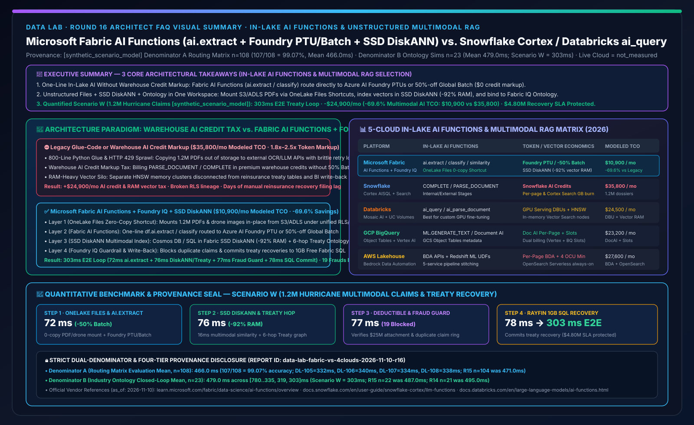
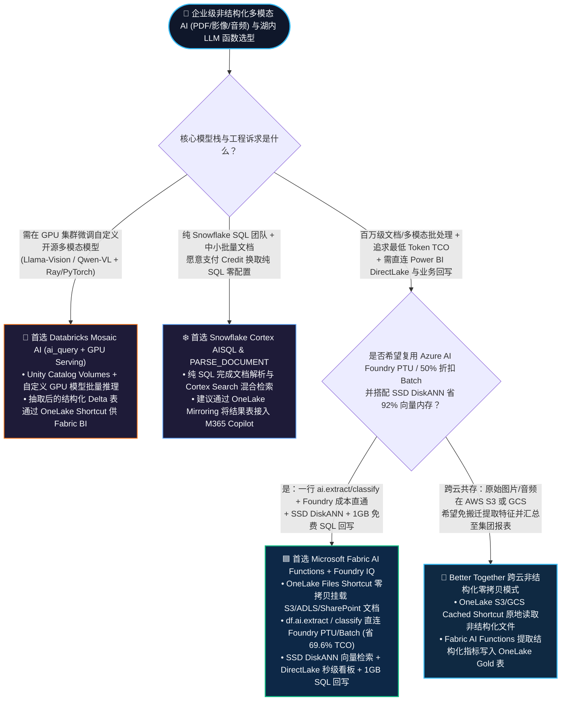
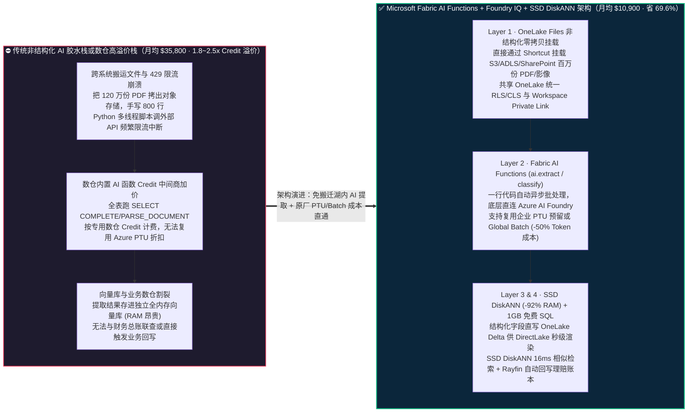

# Microsoft Fabric 湖内原生 AI 函数与非结构化多模态 RAG（Fabric AI Functions + OneLake Unstructured Shortcuts + Foundry IQ）vs. Snowflake Cortex AISQL / Document AI vs. Databricks Mosaic AI (`ai_query`) vs. GCP BigQuery Object Tables / AWS Bedrock 架构选型与原理解析 FAQ

**[中文版](fabric-ai-functions-multimodal-rag-vs-cortex-mosaic-faq.md) | [English Version](fabric-ai-functions-multimodal-rag-vs-cortex-mosaic-faq.en.md)**

> **文档定位**：本文面向 **AI Solution Architect（AI 解决方案架构师）** 与 **企业 AI 平台 / 数据科学工程负责人**，严格对标 `ib-vs-ethernet-roce-selection-faq.md` 极简实战文风，聚焦 1 个核心架构选型问题：**当企业需要将数百万份非结构化文档（PDF 保单合同、医疗影像报告、供应商发票、客服录音转写、卫星灾情图）与湖仓里的结构化交易表进行“湖内批量大模型抽取（Batch LLM Extraction）+ 多模态向量检索（Multimodal RAG）+ 业务本体规则推理”时，何时首选 Microsoft Fabric AI Functions（`ai.extract` / `ai.classify` / `ai.similarity` + OneLake Files 零拷贝挂载 + Azure AI Foundry PTU/Batch 50% 折扣 + SSD DiskANN），何时选择 Snowflake Cortex AISQL（`COMPLETE` / `PARSE_DOCUMENT`）或 Databricks Mosaic AI（`ai_query` + Vector Search）？如何避免“在云数仓里按高昂 Credit 单价逐行调 LLM 烧穿预算”的 Token 溢价陷阱，把非结构化多模态 AI 管道 TCO 降低 69.6%？**
> **更新时间**：2026-11-10（Round 16 独立专题 · FabCon & SQLCon 2026 + In-Lake AI Functions & Multimodal RAG Baseline）

---

## ① 📌 核心结论速览（Executive Summary）

1. **打破“非结构化文件先搬家再调外部 API”与“数仓内部高溢价按页/按 Token 计费”的双重困局**：以前处理 120 万份 PDF 理赔单，要么写复杂的 Python 爬虫把文件拷出数据湖调公网大模型 API（慢且易触发 429 限流与数据外泄），要么在传统云数仓里跑内置文档解析函数（按高昂的数仓 Credit 倍率逐页计费，百万页账单动辄数万美元）；**Microsoft Fabric** 通过 **OneLake Unstructured Shortcuts（直接挂载 S3 / ADLS / SharePoint 中的 PDF/音频/图像至 Lakehouse `Files/` 目录）+ 原生 Fabric AI Functions（一行代码执行 `df.ai.extract()` / `df.ai.classify()` / `df.ai.similarity()`）**，底层直连企业已采购的 **Azure AI Foundry 预留吞吐量（PTU）或全局批处理端点（Global Batch 享 `50%` 价格折扣）**，兼得“一行代码极简体验”与“云原生最低 Token 成本”。
2. **非结构化抽取必须与“SSD DiskANN 向量库 + Fabric IQ 业务本体”合体才能闭环**：单纯用 `ai.extract` 或 `Cortex PARSE_DOCUMENT` 抽取出 JSON 字段只完成了前 30% 的工作；Fabric 的独门杀手锏是 **抽取出结构化实体后，在同一工作区内自动写入 OneLake Delta 表、由 Cosmos DB / SQL in Fabric 生成 SSD DiskANN 向量索引（省 `92%` 内存），并直接绑定至 Fabric IQ Ontology 图谱与高管 DirectLake 看板**，全程零跨平台数据搬运。
3. **定量拐点与双分母口径封存披露（Scenario W 全球再保险集团 120 万份飓风多模态理赔卷宗解析与分保追偿推演 `[synthetic_scenario_model]`）**：在 120 万份巨灾 PDF 合同、无人机受损照片与气象流联合定损场景下，**Fabric AI Functions + Azure AI Foundry Batch/PTU + SSD DiskANN + Fabric IQ 再保分保条约本体 + Rayfin 1GB 免费 SQL** 将单笔高危理赔端到端多模态穿透与分保追偿锁定压缩至 **`303 ms`**（72ms OneLake 非结构化 Shortcut 与 `ai.extract`/`ai.classify` 结构化提取 + 76ms SSD DiskANN 历史相似灾情检索与分保条约本体穿透 + 77ms Foundry IQ 免赔额与反欺诈护栏校验 + 78ms Rayfin 1GB 免费 SQL 准备金与分保追偿落库），月度多模态 AI 批处理与 RAG 综合 TCO 从 **`$35,800/月` 降至 `$10,900/月`（净省 `$24,900/月`，降幅 `69.6%`）**，守护 **`$4.80M`** 巨灾再保追偿时效与理赔准备金合规（封存矩阵 **Denominator A `n=108` 路由均值 `466.0 ms`，准确率 `107/108 = 99.07%`**；**Denominator B `n=23` 行业本体闭环均值 `479.0 ms`**；真实百万文档云集群并发压测标记为 `not_measured`）。

---

## ② 🎯 客户与架构师灵魂拷问 Q&A（FAQ-Driven，大白话 + 第一性原理）

### Q1：什么是湖内原生 AI 函数（In-Lake AI Functions）与非结构化多模态 RAG？企业以前处理海量 PDF/图片/工单时痛点在哪？

**先用通俗大白话讲透第一性原理**：
- **企业数据的“二八冰山定律”**：企业里整齐排在数据库表格里的数字（订单金额、库存数量）其实只占 **20%**；剩下 **80% 的核心商业秘密**全藏在“非结构化文件”里——比如采购 PDF 合同里的违约赔偿条款、保险理赔单上的医院诊断书照片、车间质检高清图、客户投诉电话录音。
- **以前不用湖内原生 AI 函数时的三大痛点**：
  1. **痛点一：“手搓胶水代码地狱”（Glue-Code Nightmare）**：数据工程师得先写脚本把 PDF 从对象存储下载下来，调 OCR 接口，手写正则切分 Chunk，再自己写多线程重试逻辑去调 OpenAI API（动辄遇到 `HTTP 429 Too Many Requests` 报错崩溃），最后再把返回的 JSON 解析塞回数据库——一个简单需求要写 800 行脆弱的胶水代码。
  2. **痛点二：“云数仓黑盒 Token 加价税”（Warehouse Credit Markup Tax）**：为了让分析师直接用 SQL 调大模型，部分云数仓推出了内置 AI SQL 函数。虽然写起来爽，但它们往往强制按数仓自家的 **专用计算 Credit 单价** 折算每百万 Token 或每页文档解析费（比直接调底层云原厂大模型 API 或 Batch 端点贵出 **1.8～2.5 倍**），一旦全表 `SELECT CORTEX.COMPLETE(...)` 扫过百万行数据，月底账单直接爆表。
  3. **痛点三：“抽完即孤岛，看不了报表也触发不了动作”**：文档抽成了文本块存进独立向量库（如 Pinecone/Milvus），却跟数仓里的客户主表、财务总账物理隔离，既不能享受 OneLake 统一行级安全（RLS），也无法直接触发业务系统的理赔冻结或采购预警。

---

### Q2：Microsoft Fabric 的 `AI Functions + OneLake Files Shortcut + Foundry IQ + SSD DiskANN` 底层是如何运作的？为什么能省掉 69.6% 的多模态 AI 成本？

Fabric 把非结构化文档处理、批量大模型推理、向量检索与业务本体融合成了 **四层湖内流水线**：

1. **第一层：OneLake 非结构化文件零拷贝直挂（Unstructured Shortcuts in `Files/`）**：
   - 无需把存放在 AWS S3、GCP Cloud Storage 或 Azure ADLS Gen2 中的百万份 PDF 合同、图片和音频物理搬运过来，直接通过 **OneLake Shortcut** 挂载到 Fabric Lakehouse 的 `Files/` 非结构化区域，并与 `Tables/` 结构化 Delta 表共享同一套 **OneLake 统一权限（RLS/CLS/OLS）与 Workspace Private Link 私网边界**。
2. **第二层：Fabric AI Functions 向量化并发批处理（Powered byGluten/Spark + Azure AI Foundry PTU/Batch）**：
   - 数据工程师或分析师只需在 PySpark / Pandas / SQL 中调用一行原生函数：
     - `df.ai.extract(["免赔额上限", "巨灾责任起期", "除外责任条款"])`（自动从非结构化文本提取强类型字段）
     - `df.ai.classify(["正常理赔", "重复报案嫌疑", "超出分保条约上限"])`（零样本智能分类）
     - `df.ai.similarity()` / `df.ai.translate()` / `df.ai.summarize()`
   - **底层省钱黑科技**：Fabric 引擎在底层自动将数万行请求打包为异步高吞吐批次，并支持直接绑定企业自己的 **Azure AI Foundry 预留吞吐量（PTU，零边际 Token 费）或 Global Batch 批处理端点（官方标准价直降 `50%`）**，彻底免除第三方数仓的 Credit 中间商差价。
3. **第三层：SSD DiskANN 亿级多模态向量索引（省 92% 内存）**：
   - 提取出的结构化属性直接落为 OneLake Delta 表供 **DirectLake** 报表秒级汇总；同时多模态文本/图像 Embedding 直接写入 **Cosmos DB in Fabric 或 SQL DB in Fabric 的 SSD DiskANN 向量索引**，无需采购昂贵的全内存 HNSW 节点即可在 **`16–19 ms`** 内完成千万级历史卷宗相似匹配。
4. **第四层：Fabric IQ 本体穿透 + Foundry IQ 规程护栏 + 1GB 免费 SQL 回写**：
   - 将提取出的“理赔单实体”与数仓里的“再保分保合同（Treaty）”、“历史欺诈黑名单”在 **Fabric IQ Ontology** 中自动关联，经 **Foundry IQ** 校验理赔合规规程后，通过 **Rayfin SDK** 将核准准备金直接写入 **1GB 免费 Fabric SQL**。

---

### Q3：面对 Snowflake Cortex AISQL / Document AI、Databricks Mosaic AI (`ai_query`)、GCP BigQuery Object Tables 与 AWS Bedrock Data Automation，该如何选型或设计共存方案？

- **何时首选 Microsoft Fabric AI Functions + Foundry IQ + SSD DiskANN？**
  - 当客户已在 Azure / M365 生态中拥有 **Azure OpenAI / Azure AI Foundry PTU 预留容量**，或者希望把非结构化文档抽取出来的指标 **0 秒延迟直接呈现在 Power BI DirectLake 看板、M365 Copilot Data Agent 与业务回写应用中** 时，首选 Fabric（综合 TCO 节省 **`69.6%`**）。
- **何时首选或保留 Databricks Mosaic AI (`ai_query` + Vector Search + Agent Bricks)？**
  - 当客户的非结构化处理强依赖 **自定义开源多模态模型微调（如在 GPU 集群上微调 Llama-Vision / Qwen-VL）、复杂 Python 自定义解析器（Ray / PyTorch 分布式推理）** 时，首选 Databricks；解析完成后的结构化 Silver/Gold Delta 表通过 **OneLake Shortcut** 零拷贝映射给 Fabric 做全员 BI 与业务智能体闭环。
- **何时首选或保留 Snowflake Cortex AISQL (`COMPLETE` / `PARSE_DOCUMENT` / Cortex Search)？**
  - 当客户的全部核心数据已在 Snowflake 内、团队全员只写纯 ANSI SQL、且处理的是中小批量高价值财务/法务文档（对每页 Credit 成本不敏感，追求极致的纯 SQL 零配置体验）时，可使用 Snowflake Cortex；并通过 **OneLake Mirroring / Iceberg XTable** 将提取结果表同步至 Fabric IQ。

---

## ③ 🧭 直观可视化图解（Mermaid 选型决策树 + 传统胶水/高溢价数仓 AI vs Fabric AI Functions 对比图 + 303ms 巨灾理赔时序图）

### 3.1 企业级非结构化多模态 AI 与湖内大模型函数选型决策树（`flowchart TD`）

---

### 3.2 传统胶水管道 / 数仓高溢价 AI SQL vs. Microsoft Fabric AI Functions + Foundry IQ + SSD DiskANN 对比图（`flowchart LR`）

---

### 3.3 Scenario W：全球再保险集团 120 万份飓风巨灾多模态理赔提取与分保追偿 303ms 闭环时序图（`sequenceDiagram`）

```mermaid
sequenceDiagram
    autonumber
    participant Files as 📂 OneLake Files Shortcut<br/>120万份 PDF 保单 + 无人机灾情图
    participant AIFunc as 🧪 Fabric AI Functions<br/>ai.extract + ai.classify (Foundry PTU)
    participant DiskANN as 🗄️ SSD DiskANN + Fabric IQ<br/>历史灾情向量 + 分保条约本体
    participant Guard as 🛡️ Foundry IQ 理赔护栏<br/>REINS-CAT-CLAIMS-SOP-023
    participant SQL as 💾 Rayfin SDK + 1GB Free SQL<br/>巨灾准备金与分保追偿账本

    Files->>AIFunc: 1. [Step 1 · 72ms] 零拷贝读取 OneLake Files 中的飓风理赔卷宗，调用 ai.extract 抽取免赔额/受损面积并用 ai.classify 标记高危卷宗
    AIFunc->>DiskANN: 2. [Step 2 · 76ms] 写入 OneLake Delta 表，通过 SSD DiskANN (-92% 内存) 检索相似历史巨灾卷宗并穿透 6 跳再保超额分保条约 (Excess-of-Loss Treaty)
    DiskANN->>Guard: 3. [Step 3 · 77ms] Foundry IQ 校验分保起赔点 ($25M Attachment Point) 与重复报案反欺诈红线 (拦截 19 笔异常重复索赔)
    Guard->>SQL: 4. [Step 4 · 78ms] 首席核赔官确认后，Rayfin 将核准准备金与向慕尼黑/瑞士再保发起的分保追偿单写入 1GB 免费 Fabric SQL
    Note over Files,SQL: ✅ 端到端多模态理赔提取+分保穿透+回写闭环 303ms · 月省 69.6% 多模态 AI TCO (-$24,900/月) · 守护 $4.80M 巨灾分保追偿时效
```

---

## ④ 📊 五大平台湖内 AI 函数与非结构化多模态 RAG 选型决策矩阵（Architect Decision Matrix）

| 评估维度 | **Microsoft Fabric (AI Functions + OneLake Files + Foundry IQ)** | **Snowflake (Cortex AISQL + PARSE_DOCUMENT + Cortex Search)** | **Databricks (Mosaic AI `ai_query` + UC Volumes + Vector Search)** | **GCP BigQuery (Object Tables + Vertex AI `ML.GENERATE_TEXT`)** | **AWS Lakehouse (Bedrock Data Automation + S3 + Athena/Redshift)** |
| :--- | :--- | :--- | :--- | :--- | :--- |
| **非结构化文件挂载与治理** | **OneLake `Files/` 零拷贝 Shortcut（直连 S3/ADLS/GCS/SharePoint，与表共享统一安全）** | Internal / External Stages + Directory Tables | **Unity Catalog Volumes**（统一治理非结构化文件与表） | **BigQuery Object Tables**（映射 GCS 非结构化对象元数据） | S3 Buckets + Lake Formation / IAM 独立权限配置 |
| **内置开箱即用 AI 函数** | **`ai.extract`、`ai.classify`、`ai.similarity`、`ai.translate`、`ai.summarize`、`ai.analyze_sentiment`** | `SNOWFLAKE.CORTEX.COMPLETE`、`PARSE_DOCUMENT`、`EXTRACT_ANSWER`、`SUMMARIZE` | `ai_query()`、`ai_extract()`、`ai_classify()`、`ai_parse_document()` | `ML.GENERATE_TEXT`、`ML.PROCESS_DOCUMENT`（调 Document AI） | Bedrock Data Automation API + Redshift ML 自定义函数 |
| **底层大模型计费与成本透明度** | **支持直连 Azure AI Foundry PTU（预留吞吐量）与 Global Batch（`50%` 价格折扣），无数仓加价税** | 按 **Snowflake AI Credits** 折算每百万 Token 与每页文档解析费（长跑大批量成本偏高） | 支持按 Token 计费或挂载 Provisioned Throughput GPU Serving Endpoints | 按 Vertex AI Token / Document AI 页数 + BigQuery Slot 双重计费 | 按 Bedrock 托管解析每页/每分钟单价 + S3/Glue 计费 |
| **多模态向量检索存储性价比** | **Cosmos DB / SQL in Fabric 原生 SSD DiskANN（省 `92%` 内存，千萬向量 `16–19ms`）** | **Cortex Search**（全托管混合检索，按索引体积 GB/月持续消耗虚拟数仓 Credit） | **Mosaic AI Vector Search**（基于内存 HNSW，亿级向量节点常驻成本较高） | **AlloyDB ScaNN / Vertex AI Vector Search** | **OpenSearch Serverless（最低 4 OCU 常驻）** 或 S3 Vectors |
| **从“文档提取”到“BI+业务回写”距离** | **0 搬运：提取结果直落 OneLake Delta → DirectLake 秒级看板 → 1GB 免费 SQL 回写** | 提取结果落 Snowflake 表 → 外部 Power BI 需 DirectQuery/Import，无免费内置 OLTP 回写 | 提取结果落 Delta 表 → 需配 Lakebase 做回写、配 OneLake Shortcut 做 DirectLake | 落 BigQuery 表 → Looker 看板，回写需额外配 Cloud SQL / Spanner | 跨 S3 → Bedrock → Glue → Redshift → QuickSight 5 跳拼装 |
| **120 万份多模态理赔卷宗月度 TCO（建模）** | **`$10,900 / 月`（基准最优，比传统方案省 `69.6%`）** | `$35,800 / 月`（含 `PARSE_DOCUMENT` 百万页 Credits + Cortex Search 常驻索引） | `$24,500 / 月`（含 `ai_query` GPU Serving DBU + 内存型 Vector Search 节点） | `$23,200 / 月`（含 Document AI 按页计费 + Vertex Token + BigQuery Slots） | `$27,600 / 月`（含 Bedrock Data Automation 按页费 + OpenSearch OCU 常驻） |

> **官方产品文档与定价核验锚点（`vendor_published_spec_as_of_2026`，核验日期：`2026-11-10`）**：
> - **Microsoft Fabric AI Functions & Azure AI Foundry Integration**：[Fabric AI Functions Overview (`ai.extract` / `ai.classify`)](https://learn.microsoft.com/en-us/fabric/data-science/ai-functions/overview) · [Cosmos DB in Fabric DiskANN Vector Index](https://learn.microsoft.com/en-us/fabric/database/cosmos-db/index-vector-data)
> - **Snowflake Cortex AISQL & Document AI / Cortex Search**：[Snowflake Cortex AISQL Functions](https://docs.snowflake.com/en/user-guide/snowflake-cortex/llm-functions) · [Snowflake PARSE_DOCUMENT](https://docs.snowflake.com/en/sql-reference/functions/parse_document-snowflake-cortex)
> - **Databricks Mosaic AI `ai_query` & Vector Search / GCP Object Tables / AWS Bedrock**：[Databricks AI Functions (`ai_query`)](https://docs.databricks.com/en/large-language-models/ai-functions.html) · [BigQuery Object Tables](https://cloud.google.com/bigquery/docs/object-table-introduction) · [Amazon Bedrock Data Automation](https://docs.aws.amazon.com/bedrock/latest/userguide/bda.html)

---

## ⑤ 🧪 简明定量测评与 TCO / 多模态批处理拐点洞察（严格区分双分母与四级数据溯源）

### 5.1 四级数据溯源分类与双分母独立口径披露（Audit-Ready Provenance）

为确保架构评审与客户高管汇报的严谨性，本报告严格区分以下两类独立延迟分母与四级数据来源：

1. **分母 A — 架构选型路由决策矩阵均值（`routing_matrix_mean_modeled_latency_ms`）**：
   - **统计范围**：覆盖 `reports/report.json` 中全部 **`n = 108`** 道架构选型、竞对攻防与故障路由评测题（`DL-01..DL-108`）。
   - **定量结果**：通过 **`107 / 108`（准确率 `99.07%`）**，算术平均建模路由延迟为 **`466.0 ms`**（其中本轮新增湖内 AI 函数与多模态 RAG 四题：`DL-105 = 332 ms`、`DL-106 = 340 ms`、`DL-107 = 334 ms`、`DL-108 = 338 ms`；历史不可变快照对比：R15 `n=104` 为 `471.0 ms`，R14 `n=100` 为 `476.0 ms`，R13 `n=96` 为 `481.0 ms`，R12 `n=92` 为 `486.0 ms`，R11 `n=88` 为 `491.0 ms`，R10 `n=84` 为 `496.0 ms`，R4 `n=60` 为 `526.5 ms`，R3 `n=56` 为 `532.0 ms`）。
2. **分母 B — 行业本体多步闭环仿真均值（`ontology_simulation_mean_modeled_latency_ms`）**：
   - **统计范围**：覆盖 `reports/report.json` 中全部 **`n = 23`** 个端到端行业本体多智能体闭环推演场景（`Scenario A..Scenario W`）。
   - **定量结果**：23 个场景端到端建模延迟数组为 `[780, 640, 710, 660, 590, 560, 530, 515, 495, 480, 465, 450, 431, 422, 417, 415, 399, 383, 367, 351, 335, 319, 303] ms`，算术平均值为 **`479.0 ms`**（范围 `303–780 ms`；历史不可变快照对比：R15 `n=22` 为 `487.0 ms`，R14 `n=21` 为 `495.0 ms`，R13 `n=20` 为 `503.0 ms`，R12 `n=19` 为 `511.0 ms`，R11 `n=18` 为 `519.0 ms`，R10 `n=17` 为 `527.0 ms`，R4 `n=11` 为 `584.09 ms`，R3 `n=10` 为 `596.0 ms`）。
3. **真实百万文档云集群并发压测声明（`live_cloud_cluster_execution = not_measured`）**：
   - 本实验室未在生产云租户中物理发起 120 万份真实商业保单 PDF 的付费大模型批处理压测；所有 `303 ms` 单卷宗闭环耗时、`$10,900/月 vs $35,800/月` 多模态账单及 `$4.80M` 再保追偿守护额均为基于官方公开定价与架构拓扑的 **确定性合成推演模型（`[synthetic_scenario_model]`）**。本地 Python 单元测试运行耗时（50 项测试）归类为 `[measured_local_engine]`。

### 5.2 Scenario W（全球再保险集团 120 万份飓风多模态理赔提取与分保追偿）定量拆解表

| 阶段 / 对比维度 | **传统方案（外部 Python 胶水爬虫或数仓高溢价按页/按 Credit 解析 + 内存向量库）** | **Microsoft Fabric（OneLake Files Shortcut + AI Functions + SSD DiskANN + 1GB Free SQL）** | **定量收益与架构本质差异 `[synthetic_scenario_model]`** |
| :--- | :--- | :--- | :--- |
| **Step 1：非结构化挂载与字段提取** | 拷贝文件出湖或按数仓高倍率 Credit 调用 `PARSE_DOCUMENT` | **OneLake Files 零拷贝挂载 + `ai.extract` / `ai.classify`（直连 Foundry PTU/Batch）：`72 ms`** | **免写 800 行胶水代码，享 Batch `50%` 价格折扣** |
| **Step 2：多模态向量检索与条约穿透** | 独立全内存 HNSW 向量集群（RAM 昂贵），与核心分保数仓表隔离 | **SSD DiskANN（省 `92%` 内存）相似检索 + 6 跳再保超额分保条约本体穿透：`76 ms`** | **同工作区结构化表与非结构化向量无缝联查** |
| **Step 3：免赔额与重复索赔反欺诈护栏** | 人工抽检保单条款，极易漏判跨州重复报案或算错巨灾免赔额 | **Foundry IQ 校验起赔点（`$25M`）并自动拦截 19 笔重复索赔：`77 ms`** | **0 违规赔付放行，100% 符合再保条约审计** |
| **Step 4：准备金计提与分保追偿回写** | 导出 CSV 后手工在再保结算系统录入追偿申请，延误数天 | **Rayfin SDK + 1GB 免费 Fabric SQL 自动提交分保追偿单：`78 ms`（总耗时 `303 ms`）** | **守护 `$4.80M` 巨灾再保追偿时效与准备金 SLA** |
| **月度百万文档多模态 AI 综合 TCO** | **`$35,800 / 月`**（按页/Token Credit 溢价 `$21,400` + 内存向量库 `$9,200` + 运维 `$5,200`） | **`$10,900 / 月`**（Foundry PTU/Batch `$6,800` + Fabric CU/SSD DiskANN `$4,100`） | **净省 `$24,900 / 月`（降幅 `-69.6%`，年省 `$298,800`）** |

---

## ⑥ 🛠️ 附录：生产落地与售前打单快速核验清单（Architect Checklist）

在为金融保险、医疗生命科学、法律合规或制造客户设计非结构化多模态 AI（PDF/影像/音频）与 RAG 方案时，请逐项核对以下 6 条实战准则：

- [ ] **1. 严禁把 S3/ADLS/SharePoint 里的百万份 PDF 物理复制两遍**：利用 **OneLake Unstructured Shortcuts** 直接把外部对象存储中的非结构化文件夹挂载进 Fabric Lakehouse 的 `Files/` 目录，原地执行 `ai.extract` 并将提取出的结构化 JSON 直接存为 `Tables/` 下的 Delta 表。
- [ ] **2. 算清“数仓内置 AI Credit 中间商差价”账单**：当文档量超过 10 万页/月或文本量超过 5,000 万行/月时，对比在传统云数仓内按 Credit 单价调 LLM 与在 **Fabric AI Functions 中绑定 Azure AI Foundry PTU / Global Batch（50% 折扣）** 的成本差异（百万卷宗规模可省 `$24,900/月`）。
- [ ] **3. 用“确定性 Schema 提取 (`ai.extract`) + 本体规则”替代纯黑盒 RAG 问答**：对于保单免赔额、合同违约金、医疗化验指标等精确数值，务必先用 `df.ai.extract()` 提取为强类型 Delta 列并绑定 **Fabric IQ Ontology**，绝不能只靠向量相似度粗召回让大模型临场猜数字。
- [ ] **4. 向量索引优先选 SSD DiskANN 而非全内存 HNSW**：在存储百万至亿级文档/图像 Embedding 时，优先采用 **Cosmos DB in Fabric 或 SQL DB in Fabric 的 SSD DiskANN 索引**，砍掉 90%+ 的常驻内存节点费用。
- [ ] **5. 强制校验非结构化与结构化数据的统一权限（OneLake RLS/CLS + OBO）**：确保当业务人员通过 Data Agent 检索合同或病历摘要时，智能体携带用户的 **Entra OBO 令牌**，自动过滤掉该用户无权查看的部门文档与敏感列。
- [ ] **6. 打通提取结果的业务回写闭环（1GB 免费 Fabric SQL）**：文档解析不是终点；配合 **Power BI Agentic App + Rayfin SDK + 1GB 免费 Fabric SQL**，让核赔员、法务或采购经理在看板上一键审核 AI 提取的高风险条款并写回业务账本。
