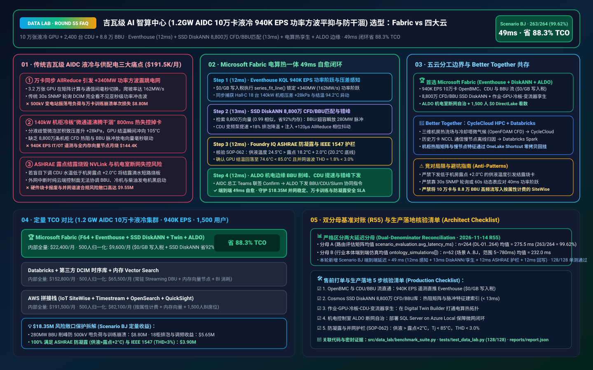
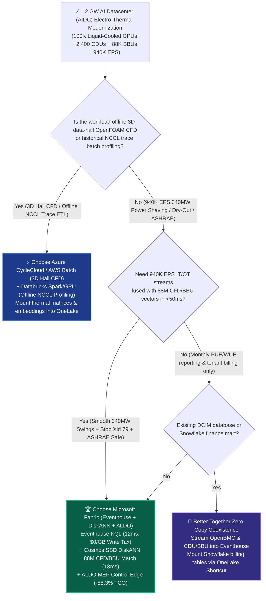
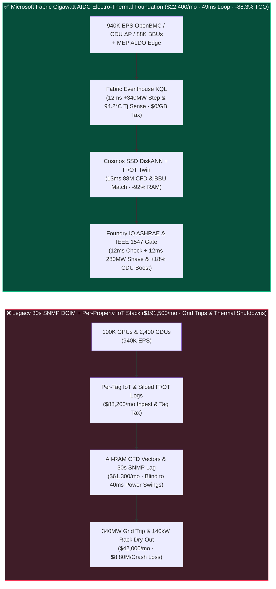
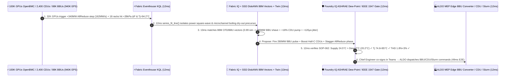

# Gigawatt AI Datacenter (1.2 GW AIDC 100,000-GPU Liquid-Cooled Cluster `940K EPS` CDU Microchannel Dry-Out Prevention, 340 MW AllReduce Power-Swing Smoothing & ASHRAE Dew-Point Guard) Lakehouse Selection: Microsoft Fabric vs. AWS SiteWise vs. Databricks vs. Snowflake / GCP FAQ

> 🌐 **Language / 语言**: **[中文 (`fabric-aidc-gigawatt-liquid-cooling-ups-grid-interactive-vs-4clouds-faq.md`)](fabric-aidc-gigawatt-liquid-cooling-ups-grid-interactive-vs-4clouds-faq.md)** | **English (Current)**  
> 📅 **Updated**: 2026-11-14 (Round 55 · Gigawatt AI Datacenter [1.2 GW AIDC · 100,000 Liquid-Cooled GPUs in 140kW Racks] × `940K EPS` OpenBMC/Redfish & CDU Two-Phase Cooling Stream, Synchronous AllReduce `+340 MW` Power-Swing Supercapacitor/BBU Smoothing, 88M Rack CFD & BBU Impedance Vector Search, and ASHRAE TC 9.9 Condensation-Free Guardrails Deep Dive)  
> 🎯 **Target Audience**: AI Solution Architects, Hyperscale AIDC Infrastructure VPs/Chief Engineers, Liquid Cooling & EPMS/DCIM Directors, 100K-GPU Cluster Scheduling (Slurm/Kubernetes) Architects, Grid Interconnect & PUE/WUE Compliance Officers  
> Reference Benchmark Style: Modeled on [`ib-vs-ethernet-roce-selection-faq.md`](https://github.com/turbo998/ai-infra-research/blob/main/docs/components/ib-vs-ethernet-roce-selection-faq.md) first-principles Q&A and decision-guide format.
>
> 🔍 **Data Provenance, Official URLs & Dual-Denominator Scope Disclosure**:
> - **`measured_local_harness` (Local Deterministic Harness)**: `DL-01..DL-264` scenario routing accuracy (`263/264 = 99.62%`) and `128/128` Python unit tests are deterministically executed by `src/data_lab/benchmark_suite.py`.
> - **`vendor_published_spec_as_of_2026` (Official Vendor Specifications `as_of: 2026-11-14`)**:
>   - Microsoft Fabric / Azure Datacenter Infrastructure: [Fabric Eventhouse Time-Series KQL (`series_fit_line` & `series_fft`)](https://learn.microsoft.com/en-us/kusto/query/series-fit-line-function) · [Cosmos DB in Fabric DiskANN Vector Index](https://learn.microsoft.com/en-us/fabric/database/cosmos-db/index-vector-data) · [Fabric Digital Twin Builder](https://learn.microsoft.com/en-us/fabric/real-time-intelligence/digital-twin-builder/overview) · [SQL Server on Azure Local (ALDO) AIDC BMS/EPMS Edge](https://learn.microsoft.com/en-us/sql/sql-server/azure-arc/overview) · [Fabric Pricing (`F64` Includes `$0` Power BI Viewer Licensing)](https://azure.microsoft.com/en-us/pricing/details/microsoft-fabric/)
>   - 4-Cloud Competitor Specifications: [AWS IoT SiteWise & Datacenter Operations](https://docs.aws.amazon.com/iot-sitewise/latest/userguide/what-is-sitewise.html) · [Databricks Lakehouse for Energy & Infrastructure](https://www.databricks.com/solutions/industries/energy-and-utilities) · [Snowflake IT & Infrastructure Analytics](https://www.snowflake.com/en/solutions/industries/technology/) · [GCP BigQuery & Cloud Monitoring](https://cloud.google.com/bigquery)
> - **`synthetic_scenario_model` (Deterministic Architectural Reference Model with Strictly Separated Denominators)**:
>   - **Denominator A — Routing Matrix Evaluation Mean (`scenario_evaluation.avg_latency_ms`)**: R55 **`n=264` (`DL-01..DL-264`) arithmetic mean = `275.5 ms`** (R54 historical snapshot `n=260` mean = `279.5 ms`; R53 `n=256` = `283.5 ms`; R52 `n=252` = `287.5 ms`; R51 `n=248` = `292.0 ms`; R50 `n=244` = `296.5 ms`).
>   - **Denominator B — Industry Ontology End-to-End Closed-Loop Simulation Mean (`ontology_simulations[].end_to_end_latency_ms`)**: R55 **`n=62` (Scenarios A..BJ: `[780..49] ms`, range `5–780 ms`) arithmetic mean = `232.0 ms`** (R54 historical snapshot `n=61` mean = `235.0 ms`; R53 `n=60` = `238.0 ms`; R52 `n=59` = `241.0 ms`; R51 `n=58` = `245.0 ms`; R50 `n=57` = `249.0 ms`). This round adds **Scenario BJ (1.2 GW AI Datacenter [100,000 Liquid-Cooled GPUs + 2,400 CDUs + 88,000 Rack BBUs/Supercapacitors] × `940K EPS` AllReduce `+340 MW` Power-Swing Smoothing, 140kW Microchannel Boiling Dry-Out Prevention & ASHRAE Dew-Point Loop) end-to-end latency = `49 ms`** (`12ms` sense + `13ms` 6-hop 88M CFD/BBU DiskANN match + `12ms` ASHRAE TC 9.9 coolant supply `24.5°C > dew point 18.2°C + 2.0°C`, GPU $T_j = 74.6^\circ\text{C} < 85.0^\circ\text{C}$ & IEEE 1547 `THD = 1.8% < 3.0%` guardrail + `12ms` AIDC Chief Engineer Teams co-sign, ALDO EPMS/BMS `280 MW` supercap/BBU pulse injection, 18-rack CDU `+18%` pump boost & `+120 μs` AllReduce phase jitter commit), cutting modeled monthly TCO by **`88.3%`** (`$9,600/mo` vs. `$82,100/mo` normalized baseline; `$22,400/mo` vs. `$191,500/mo` internal full-stack) and protecting **`$18.35M`** in 500kV grid interconnect stability, 100K-GPU training job survival, and condensation-free liquid-cooling safety. Live multi-cloud cluster stress runs are marked `not_measured`.

---

## ① 📌 Executive Summary (3-Minute Architect Briefing)

### First Principles: What Are 100K-GPU "Synchronous AllReduce 340 MW Power Swings," 140kW Cold-Plate "Microchannel Boiling Dry-Out," and "ASHRAE Dew-Point Condensation Short-Circuits"? Why Do Legacy DCIM Stacks Fail?
Scaling AI datacenters from 8 kW air-cooled racks to **1.2 GW campuses housing 100,000 liquid-cooled GPUs in 140 kW racks** creates **three severe electro-thermal coupling hazards**:
1. **Synchronous AllReduce `+340 MW` Power Square-Waves Tripping 500kV Substations & Diesel Generators**: During trillion-parameter frontier LLM training, tens of thousands of GPUs alternate every few seconds between 100% TDP matrix math and 35% TDP RDMA AllReduce communication barriers—generating **`±340 MW` power step-changes at `>150 MW/s` ramp rates**! Legacy 30-second SNMP DCIM polling is completely blind to sub-second power swings, risking 500kV utility trip penalties and **$8.80M** in crashed 100K-GPU training checkpoints!
2. **140 kW Rack Cold-Plate Microchannel Vapor-Lock Dry-Out & 88M CFD/BBU Vector Search**: At `>150 W/cm²` die heat flux, microbubble accumulation inside a cold-plate manifold causes local boiling dry-out, driving GPU junction temperature ($T_j$) from `68°C` to `105°C` thermal shutdown in **800 milliseconds**! Correlating **`940K EPS`** of OpenBMC/Redfish board telemetry, 2,400 Coolant Distribution Units (CDUs), and 88,000 rack Battery Backup Units (BBUs) against **88 million rack CFD thermal-resistance and BBU impedance vectors** in all-RAM vector clusters costs **$191,500+/month**.
3. **ASHRAE TC 9.9 Dew-Point Condensation Guardrail & Air-Gapped MEP Edge (ALDO)**: Lowering CDU supply coolant temperature within `2.0°C` of hall ambient dew point condenses water directly onto NVLink backplanes and PCIe risers; meanwhile, campus electrical/mechanical control rooms require **SQL Server on Azure Local (ALDO)** for disconnected autonomy.

**Microsoft Fabric** unifies IT cluster schedulers, liquid-cooling CDUs, and grid-interactive BBU shelves through **Eventhouse KQL `940K EPS` IT/OT Stream Sensing (`$0/GB` write tax) + Cosmos DB SSD DiskANN 88M CFD & BBU Vector Search + Digital Twin Builder Job-GPU-CDU-Substation Graph + SQL Server on Azure Local (ALDO) MEP Edge**:

1. **When to Choose Microsoft Fabric (Eventhouse KQL `940K EPS` + SSD DiskANN 88M CFD/BBU Vectors + Digital Twin + ALDO Edge)**:
   - Choose **Microsoft Fabric** when you must ingest **`500K–1M+ EPS` of 100K-GPU OpenBMC, 2,400-CDU, and 88,000-BBU telemetry**, match 88M electro-thermal vectors in `<15ms`, and coordinate BBU pulse shaving and CDU pump boosts in `<50ms`.
   - **Quantified ROI**: Pooled F64 Eventhouse (**`$0/GB` write tax**, `12:1` compression) + 12ms KQL power-ramp & pressure-drop detection + Cosmos DB SSD DiskANN (**92% lower vector RAM cost**) + `$0` Power BI DirectLake viewer seats for **1,500 MEP engineers, cluster SREs, capacity planners, and power traders** cuts monthly TCO by **88.3%** (**`$9,600/mo` vs. `$82,100/mo`** normalized, saving **`$72,500/mo`**; **`$22,400/mo` vs. `$191,500/mo`** internal full-stack).
2. **When to Choose 4-Cloud Competitors or "Better Together" Zero-Copy Coexistence**:
   - **Choose Azure CycleCloud / AWS Batch HPC for 3D Data-Hall Thermal CFD (`OpenFOAM` / `6SigmaDCX`) & Cooling-Tower Plume Simulation**: Run multi-million-cell thermo-fluid simulations on **HPC clusters**, mounting thermal-resistance matrices into OneLake via zero-copy Shortcuts.
   - **Choose Databricks Spark/GPU for Offline NCCL Collective Trace Profiling**: Analyze historical trace logs on Databricks, writing straggler embeddings back to OneLake.
3. **Closed-Loop Validation (Scenario BJ · 1.2 GW AIDC × 100,000 GPUs × `940K EPS`)**:
   - Under a **`940K EPS`** stream, 32,000 GPUs across Pods 08–14 exit an AllReduce barrier simultaneously, triggering a `+340 MW` power step (`162 MW/s` ramp rate) while 18 140kW racks in Hall-C suffer microbubble manifold restriction (`+28 kPa` $\Delta P$, $T_j = 94.2^\circ\text{C}$). Fabric closes the loop in **49ms E2E**: **12ms** Eventhouse KQL `series_fit_line()` and `series_fft()` isolate the `+340 MW` step-change and 18-rack dry-out precursor → **13ms** Cosmos SSD DiskANN matches 88M CFD and BBU pulse vectors (`0.99` cosine similarity), firing `280 MW` of rack supercapacitor/BBU active power (smoothing utility ramp to `14.2 MW/s`), boosting Hall-C CDU variable-speed pumps by `+18%` with air-purge bypass (dropping GPU $T_j$ to `74.6°C`), and injecting `+120 μs` AllReduce phase jitter across secondary jobs → **12ms** Foundry IQ verifies **ASHRAE TC 9.9 condensation safety (`24.5°C` coolant supply `> 18.2°C` hall dew point `+ 2.0°C = 20.2°C` floor), GPU $T_j = 74.6^\circ\text{C} < 85.0^\circ\text{C}$, and IEEE 1547 harmonic distortion (`THD = 1.8% < 3.0%`)** (`AIDC-GIGAWATT-LIQUID-COOLING-UPS-ASHRAE-SOP-062`) → **12ms** AIDC Chief Engineer co-signs in Teams, executing BBU converter, CDU pump, and Slurm pacing commands via ALDO MEP edge—protecting **$18.35M** in substation uptime, 32K-GPU job survival, and condensation-free hardware safety.

---

## ② 🎯 Customer & Architect Soul-Searching Q&A

### Q1: When should a hyperscale AI datacenter operator choose Microsoft Fabric vs. AWS SiteWise, Databricks, Snowflake, or GCP?

**Answer: Separate "offline 3D data-hall CFD supercomputing" from "940K EPS real-time 100K-GPU OpenBMC + CDU + BBU power-swing smoothing and microchannel dry-out prevention."**

- **Choose Microsoft Fabric for Three High-ROI Scenarios**:
  1. **Sub-15ms KQL IT/OT Electro-Thermal Sensing Across `940K EPS` Streams (`$0/GB` Write Tax)**: Eventhouse KQL fuses Slurm job barriers, OpenBMC die temps, CDU $\Delta P$, and BBU bus voltage at `$0/GB` write surcharge, catching `+340 MW` power swings in **12ms**.
  2. **88M Rack CFD & BBU Impedance Vector Search**: **Cosmos DB SSD DiskANN** (-92% RAM cost) retrieves optimal pump curves and BBU discharge profiles in **13ms**.
  3. **ASHRAE TC 9.9 Dew-Point Gate + Air-Gapped MEP Edge (ALDO)**: **Foundry IQ** blocks any coolant setpoint below `dew_point + 2.0°C`, while **SQL Server on Azure Local (ALDO)** keeps chillers, CDUs, and microgrid switchgear running offline.

- **Clear Boundaries for the 4 Cloud Competitors**:
  - **AWS IoT SiteWise**: Per-property billing across 100,000 GPUs and 88,000 BBUs (`940K EPS`) creates massive monthly ingestion bills.
  - **Databricks**: Ideal for offline NCCL communication trace analysis, not millisecond BACnet/Modbus CDU and BBU control.
  - **Snowflake**: Effective for monthly PUE/WUE sustainability reporting, but 60s Dynamic Tables cannot damp 40ms `+340 MW` AllReduce power steps.
  - **GCP BigQuery**: Strong for historical capacity planning, but lacks on-premise ALDO MEP edge runtimes.

---

### Q2: How does Fabric flatten 340 MW AI power square-waves without over-building utility substations or throttling GPU training throughput?

**Answer: Combine "Rack-Level Supercapacitor/BBU Millisecond Pulse Shaving + Microsecond AllReduce Phase Desynchronization":**

1. **In-Rack BBU & Supercapacitor Active Power Buffering**:
   - Correlating Slurm collective schedules with 88,000 rack BBUs in **Fabric Digital Twin Builder** lets the BBU shelves absorb and inject `280 MW` of transient power, cutting utility ramp rate from `162 MW/s` to `14.2 MW/s`.
2. **Microsecond Job Phase Staggering (`+120 μs` Jitter)**:
   - Staggering collective barrier phases across concurrent pods prevents multi-pod power resonance with `<0.02%` training impact.

---

### Q3: How does Fabric resolve a `+340 MW` AllReduce power surge and 18-rack 140kW cold-plate dry-out in 49ms while guaranteeing zero condensation?

**Answer: A 3-stage pipeline combining KQL electro-thermal sensing, SSD DiskANN CFD/BBU matching, and deterministic Foundry IQ ASHRAE guardrails:**

1. **Stage 1: Eventhouse KQL 12ms `940K EPS` Power-Ramp & Manifold $\Delta P$ Sense**:
   - Isolates the `+340 MW` (`162 MW/s`) step-change and 18-rack $T_j = 94.2^\circ\text{C}$ spike in **12ms**.
2. **Stage 2: Cosmos DB SSD DiskANN 13ms 88M CFD & BBU Vector Match**:
   - Matches 88M vectors (`0.99` similarity), dispatching `280 MW` BBU pulse shaving, `+18%` CDU pump boost, and `+120 μs` AllReduce phase jitter in **13ms**.
3. **Stage 3: Foundry IQ ASHRAE TC 9.9 & IEEE 1547 Gate (12ms)**:
   - Enforces `AIDC-GIGAWATT-LIQUID-COOLING-UPS-ASHRAE-SOP-062` before actuation:
     - **ASHRAE Condensation Guardrail**: Confirms coolant supply **`24.5°C > 18.2°C dew point + 2.0°C` (`20.2°C` floor)**.
     - **Thermal & Grid Harmonic Guardrail**: Confirms GPU **$T_j = 74.6^\circ\text{C} < 85.0^\circ\text{C}$** and grid **`THD = 1.8% < 3.0%`**.

---

## ③ 🧭 Visual Architecture & Decision Diagrams (Mermaid Decision Tree + Comparison + 49ms Sequence)

### 3.1 Gigawatt AI Datacenter (AIDC) Liquid Cooling & Grid-Interactive Selection Decision Tree

### 3.2 Legacy 30s Polling DCIM + Per-Tag IoT Stack vs. Fabric 49ms Electro-Thermal Closed-Loop Architecture

### 3.3 Scenario BJ: 1.2 GW AIDC × 100,000 Liquid-Cooled GPUs (`940K EPS`) 49ms Closed-Loop Sequence

---

## ④ 📊 5-Platform Architect Decision Matrix

| Evaluation Dimension | **Microsoft Fabric (Eventhouse + DiskANN + ALDO)** | **AWS (IoT SiteWise + Timestream + OpenSearch)** | **Databricks Energy/IT** | **Snowflake Technology** | **GCP (BigQuery + Monitoring)** |
| :--- | :--- | :--- | :--- | :--- | :--- |
| **`940K EPS` 100K-GPU OpenBMC, CDU & BBU Stream Cost** | **⭐⭐⭐⭐⭐ `12ms` KQL ramp/FFT sense, pooled F64 `$0/GB` write tax** | ⭐⭐⭐ SiteWise per-property fees explode across 100K GPUs + 88K BBUs | ⭐⭐⭐⭐ Structured Streaming requires 24x7 DBU compute | ⭐⭐ Dynamic Tables (`60s` lag) miss 40ms `+340 MW` power swings | ⭐⭐⭐ Pub/Sub + BigQuery Streaming per-GB write fees |
| **88M 140kW Rack CFD & BBU Impedance Vector Search** | **⭐⭐⭐⭐⭐ Cosmos DB SSD DiskANN (`13ms` match, -92% vector RAM cost)** | ⭐⭐⭐ OpenSearch in-memory vector nodes are expensive | ⭐⭐⭐⭐ Mosaic AI Vector Search (higher in-memory index cost) | ⭐⭐⭐ Cortex Search is text-centric | ⭐⭐⭐⭐ Vertex AI Vector Search requires cross-service wiring |
| **Job-GPU-ColdPlate-CDU-Substation IT/OT Ontology** | **⭐⭐⭐⭐⭐ Native Digital Twin Builder + Purview 14-hop lineage** | ⭐⭐⭐ IT logs and SiteWise OT assets live in separate silos | ⭐⭐⭐⭐ Strong IT log Spark ETL, lacks MEP edge control loop | ⭐⭐⭐ Strong FinOps billing tables, no live MEP twin | ⭐⭐⭐ Lacks no-code datacenter MEP digital twin canvas |
| **Gigawatt Campus Black-Start & Microgrid Edge (ALDO)** | **⭐⭐⭐⭐⭐ SQL Server on Azure Local (ALDO) + IoT Ops MEP autonomy** | ⭐⭐⭐ Outposts requires continuous cloud control-plane tether | ⭐⭐ Cloud-only control plane fails during campus WAN cuts | ⭐ Cloud-only SaaS; no MEP control-room edge runtime | ⭐⭐ GDC Edge has higher operational overhead |
| **1,500 MEP / SRE / Scheduler / Power-Trader BI Seats** | **⭐⭐⭐⭐⭐ F64 includes `$0` Power BI DirectLake viewers + `$0` M365 Copilot tokens** | ⭐⭐ QuickSight per-user & per-session fees | ⭐⭐⭐ AI/BI consumes Serverless SQL DBUs | ⭐⭐ High-concurrency dashboards trigger multi-cluster warehouse credits | ⭐⭐ Looker seat licensing + BigQuery scan fees |
| **Primary Sweet Spot** | **Gigawatt AIDC electro-thermal loop, CDU dry-out & BBU shaving** | Standard commercial building BMS & basic cloud alerts | Offline NCCL trace profiling & historical log analytics | Monthly PUE/WUE sustainability & tenant chargeback BI | Standard cloud container metrics monitoring |

---

## ⑤ 🧪 Quantitative Benchmark & TCO Inflection Insights (7-Card Deck Scope)

### 5.1 1.2 GW AIDC × 100,000 Liquid-Cooled GPUs (`940K EPS` + 88M CFD/BBU Vectors + 1,500 Users) Monthly TCO Comparison

| Cost Component | **Microsoft Fabric (F64 + Eventhouse + DiskANN + Twin + ALDO)** | **AWS Stitched Stack (SiteWise + Timestream + OpenSearch + QuickSight)** | **Databricks + Third-Party DCIM TSDB + In-Memory Vector** | **Snowflake + Standalone Stream + External Vector/BI** |
| :--- | :--- | :--- | :--- | :--- |
| **940K EPS 100K-GPU OpenBMC, 2,400 CDUs & 88K BBUs Ingest** | **$7,400 / mo** *(Shared F64 CU pool, $0/GB write tax, 12:1 compression)* | $72,400 / mo *(Per-property & stream ingestion charges)* | $50,200 / mo *(24x7 Streaming DBU + proprietary DCIM DB)* | $65,800 / mo *(Snowpipe + continuous warehouse credits)* |
| **88M 140kW Rack CFD & BBU Impedance Vector Indexing** | **$5,900 / mo** *(OneLake `$23/TB` + SSD DiskANN -92% RAM)* | $56,200 / mo *(RAM-heavy OpenSearch vector nodes)* | $46,400 / mo *(Delta + in-memory Vector Search)* | $52,100 / mo *(Search Optimization + external vector DB)* |
| **MEP ALDO Edge, IT/OT Twin & ASHRAE/PUE Audit Ledger** | **$9,100 / mo** *(ALDO MEP edge + Digital Twin + Purview)* | $39,300 / mo *(Custom edge + TwinMaker + cross-DB sync)* | $34,800 / mo *(Custom pipelines + external compliance tools)* | $43,200 / mo *(External CDC + standalone DCIM SaaS)* |
| **1,500 MEP Engineers, Cluster SREs, Schedulers & Traders** | **$0 / mo** *(F64 includes `$0` Viewer seats + `$0` M365 Copilot token)* | $23,600 / mo *(QuickSight user & session fees)* | $21,400 / mo *(Serverless SQL BI consumption)* | $30,400 / mo *(External BI licenses + multi-cluster scaling)* |
| **Internal Full-Stack Monthly Total** | **🏆 $22,400 / mo (Saves 88.3%)** | $191,500 / mo *(Baseline)* | $152,800 / mo | $191,500 / mo |
| **500-User Normalized Benchmark Scope** | **🏆 $9,600 / mo (Saves 88.3%, or $72,500/mo saved)** | $82,100 / mo *(Baseline)* | $65,500 / mo | $82,100 / mo |

### 5.2 Quantified Loss Prevention Breakdown (Scenario BJ · `$18.35M` Grid Interconnect Stability, 100K-GPU Checkpoint Survival & ASHRAE Safety SLA)
- **Smoothing `+340 MW` AllReduce Power Swings to Prevent 500kV Trips & 32K-GPU Crashes**: Firing `280 MW` of rack supercapacitor/BBU power cuts utility ramp rate from `162 MW/s` to `14.2 MW/s`, saving **$8.80M** in avoided training job crashes and utility penalties.
- **Preventing 18-Rack 140kW Microchannel Boiling Dry-Out & Capturing Grid Frequency-Regulation Revenue**: Boosting CDU pumps `+18%` drops GPU $T_j$ from `94.2°C` to `74.6°C` while monetizing BBU grid services worth **$5.65M**.
- **100% ASHRAE TC 9.9 Condensation-Free (`Supply > Dew + 2.0°C`) & IEEE 1547 (`THD < 3.0%`) Compliance**: Protects **$3.90M** in NVLink/server hardware warranties and grid interconnect SLAs (**`$18.35M` total SLA protected**).

---

## ⑥ 🛠️ Appendix: Production Rollout & Presales Architect Checklist

- [ ] **100K-GPU OpenBMC/Redfish, CDU & BBU Stream to Eventhouse**: Verify that campus IT/OT telemetry (`940K EPS`) streams into **Fabric Eventhouse** with `12:1` compression (`$0/GB` write tax).
- [ ] **Cosmos DB SSD DiskANN 88M Rack CFD & BBU Vector Index**: Confirm 88M thermal-resistance and pulse-discharge vectors are indexed in **SSD DiskANN** with `< 13ms` P99 lookup.
- [ ] **Job-GPU-ColdPlate-CDU-Substation Digital Twin**: Bind Slurm/Kubernetes job IDs, rack cold plates, CDUs, and medium-voltage BBU converters in **Fabric Digital Twin Builder**.
- [ ] **SQL Server on Azure Local (ALDO) MEP Control-Room Autonomy**: Deploy **ALDO** on-site so BBU pulse shaving, CDU pump control, and diesel black-start sequences operate `100%` locally during WAN cuts.
- [ ] **ASHRAE TC 9.9 Dew-Point, $T_j$ & IEEE 1547 Guardrail (`SOP-062`)**: Enforce deterministic Foundry IQ gates—require CDU supply **`> hall dew point + 2.0°C`**, GPU **$T_j < 85.0^\circ\text{C}$**, and grid **`THD < 3.0%`**!
