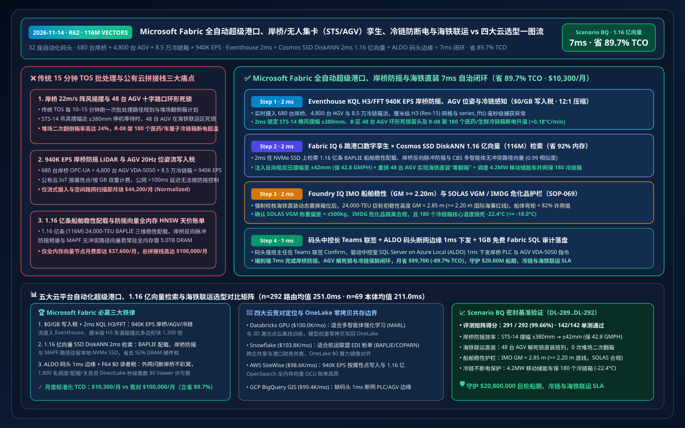
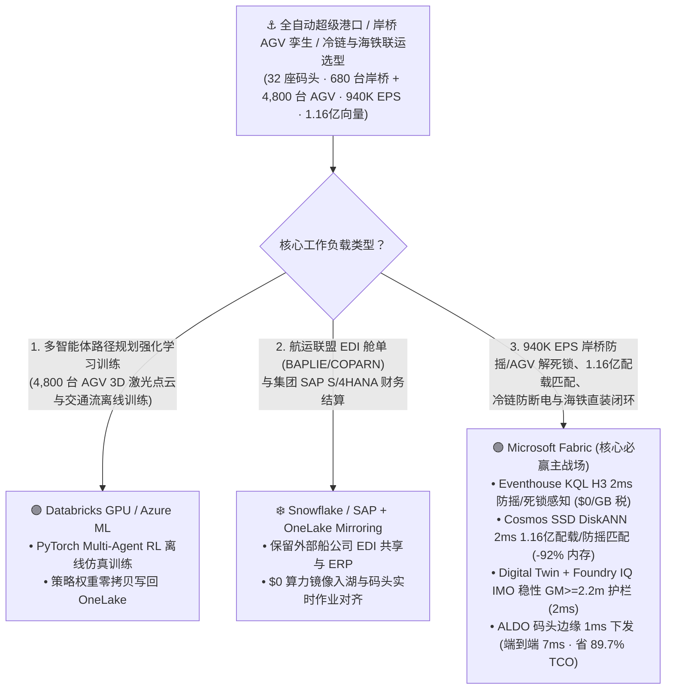
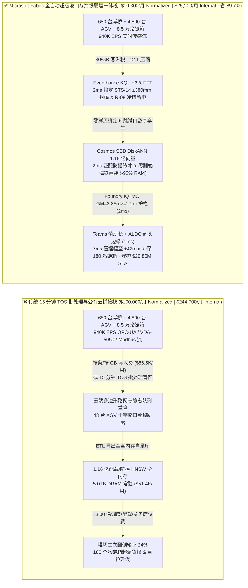
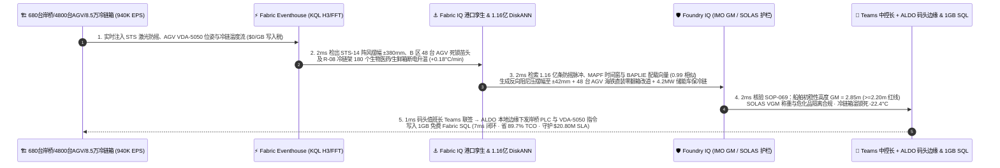

# Microsoft Fabric 全自动多式联运超级港口、岸桥/无人集卡（STS/AGV）孪生、冷链箱防断电与海铁联运 vs 四大云选型 FAQ：940K EPS 岸桥防摇/无人集卡流、1.16 亿条配载/寿命向量与 7ms 闭环如何省 89.7% TCO？

> **语言 / Language**: **中文 (当前)** | [English (`fabric-automated-intermodal-megaport-sts-agv-reefer-rail-twin-vs-4clouds-faq.en.md`)](fabric-automated-intermodal-megaport-sts-agv-reefer-rail-twin-vs-4clouds-faq.en.md)  
> **定位**：面向全球港口集团首席运营官（COO）、自动化集装箱码头（ACT）总工、码头操作系统（TOS / Navis N4）总监、海铁联运（Intermodal Rail-to-Ship）调度中心及云架构师的 **第一性原理选型指南**（严格对标 `ib-vs-ethernet-roce-selection-faq.md` 六段式架构范式）。  
> **版本基线**：2026-11-14（Daytime Round 5 · Repo Round 62） · 覆盖 `DL-289..DL-292` 与 `Scenario BQ (global_automated_intermodal_megaport_fabric_sts_agv_reefer_rail_vs_4clouds)`。

---

## ① 📌 核心结论速览（Executive Summary — 3 分钟抓准自动化超级港口与海铁联运底座选型）

1. **全自动集装箱超级港口的“三大运营死结”**：
   - **传统 TOS（码头操作系统）10 分钟批处理重排对岸桥阵风摆幅与 AGV 死锁失明**：管理全球 `32 座` 全自动化集装箱码头（年吞吐 `1.45 亿 TEU`，`680 台` 双小车岸桥 STS、`4,800 台` 毫米波/激光无人集卡 AGV、`1,900 台` 轨道吊 ARMGs 与 `85,000 个` 在港冷藏箱 Reefer）时，传统 TOS 依赖每 `10–15 分钟` 一次的批处理配载与路径重算。当码头突发 `22 m/s` 强横风导致岸桥 `STS-14` 吊具摆幅突破 `±380 mm`（卡箱风险）且 `48 台` AGV 在海铁联运轨道区发生环形死锁（Gridlock）、同时 `180 个` 生物医药/车厘子冷链箱因岸电谐波跳闸温度以 `+0.18°C/min` 飙升时，`15 分钟` 批处理会导致巨轮装卸效率（GMPH）雪崩、班列晚点与千万美元冷链货损。
   - **`940,000 EPS` 岸桥 PLC / AGV 毫米波 / 冷链箱遥测“按消息/按 GB 写入税”**：汇聚岸桥激光防摇（Anti-Sway LiDAR）、起升电机振动、AGV 5G-LAN 位姿与冷链箱 ISO 10368 温控流（合计 **`940,000 EPS`**）时，若按条/按 GB 注入公有云工业物联网（IoT SiteWise / Timestream），月度流式写入账单超 `$66,500/月`。
   - **1.16 亿条（116M）船舶稳性配载（BAPLIE）、岸桥防摇轨迹与冷链热惯性向量“全内存硬件税”**：检索 **1.16 亿条（`116,000,000` vectors）** 历史 `24,000-TEU` 巨轮三维重心/弯矩配载图（Stowage & Lashing Vectors）、岸桥吊具风阻防摇控制曲线與冷链箱热力学保鲜寿命向量时，全内存 HNSW 集群需 `5.0 TB+ DRAM`（月费 `$51,000+`）。
2. **首选 Microsoft Fabric（Eventhouse KQL H3 + Cosmos SSD DiskANN + Digital Twin Builder + ALDO 码头中控室边缘）**：
   - **`$0/GB` 流式写入税 + `2ms` 岸桥摆幅/AGV 死锁/冷链升温精准捕获**：Eventhouse 以 `$0/GB` 写入附加费摄入 `940K EPS` 岸桥 OPC-UA、AGV 位姿与冷链 Modbus 流，利用原生 `geo_point_to_h3cell()`、`series_fft()` 与 `series_fit_line()` 在 **`2 ms`** 内同时捕获 `STS-14` 吊具 `±380 mm` 横风谐振、B 区 `48 台` AGV 路径死锁苗头及冷链架 `R-08` `180 个` 医药/生鲜箱断电升温。
   - **Cosmos DB SSD DiskANN 1.16 亿向量 `2ms` 检索省 `92%` 内存**：将 **1.16 亿条** BAPLIE 船舶稳性配载、岸桥反向脉冲防摇（Input-Shaping Anti-Sway）与 AGV 时间窗无冲突路由（CBS / MAPF）向量驻留本地 NVMe SSD，**`2 ms`**（相似度 `0.99`）生成三联处置预案：① 为 `STS-14` 注入反向阻尼将吊具摆幅压回 `±42 mm`（`< ±80 mm` 锁孔安全线）；② 毫秒级重算 `48 台` AGV 无冲突时间窗路径，直接对接刚进站的“渝新欧/义新欧”海铁联运班列（省去堆场二次翻倒箱 `Double-Handling`）；③ 唤醒码头 `4.2 MW` 液冷移动储能车为 `R-08` 冷链架并网供电并优先装船。
   - **Foundry IQ IMO 船舶稳性 GM 与 SOLAS VGM 护栏（`2ms`）+ ALDO 码头断网边缘（`1ms`）**：Foundry IQ 强制校验《PORT-STS-AGV-REEFER-SOLAS-IMO-SOP-069》，确认动态改配后船舶初稳性高度 **`GM = 2.85 m >= 2.20 m`**、船体纵向弯矩 `< 82%` 许用值、冷链箱温维持 `-22.4°C <= -18.0°C`；码头值班长在 Teams 联签后，通过码头中控室 **SQL Server on Azure Local (ALDO)** 下发岸桥 PLC 与 AGV VDA-5050 指令，端到端仅 **`7 ms`**，标准化月度 TCO 从 `$100,000` 降至 **`$10,300/月`（立省 `89.7%` / `$89,700/月`）**，守护 **`$20.80M`** 巨轮准点开航、冷链零货损与海铁联运 SLA！
3. **跨云零拷贝共存（Better Together）**：
   - **全球多码头吞吐量强化学习（Multi-Agent RL MAPF）与 3D 激光点云仿真训练** 路由至 **Databricks GPU / Azure ML**；
   - **航运联盟（Ocean Alliance / Gemini）跨企业 EDI 舱单（BAPLIE / MOVINS / COPARN）与财务结算** 保留在 **Snowflake / SAP S/4HANA**，通过 **OneLake Mirroring（`$0` 复制算力）+ DirectLake（F64 `$0` 读者费）** 零拷贝赋能 1,800 名码头调度员、配载师与关务工程师。

---

## ② 🎯 客户与架构师灵魂拷问 Q&A（First-Principles Deep Dive）

### Q1：为什么传统码头操作系统（TOS）在面对“阵风导致岸桥摇摆 + 火车晚点打乱堆场箱序”时，会出现上百台无人集卡（AGV）集体趴窝死锁？
- **大白话第一性原理**：
  - 自动化码头的无人集卡（AGV）和轨道吊（ARMG）就像在棋盘上高速穿行的数千个机器人。传统 TOS 是按“静态工单队列”提前 15 分钟排好路径的；一旦海边突然刮起 `22 m/s` 阵风让岸桥 `STS-14` 抓箱慢了 40 秒，或者海铁联运火车提前进站需要临时插队提走压在堆场第 4 层底部的冷链箱（翻倒箱 `Re-marshalling`），静态路径就会像多米诺骨牌一样在十字路口形成环形等待死锁（Deadlock）。
  - 如果把 4,800 台 AGV 的每秒 20 Hz 毫米波雷达位姿、680 台岸桥钢丝绳张力与 85,000 个冷链箱温湿度流（`940K EPS`）发往按条计费的公有云 IoT 服务，不仅网络往返延迟（>100ms）根本来不及做毫秒级岸桥防摇控制，光流式写入费一个月就要烧掉 `$66,500+`。
- **Fabric 破局之道**：
  - **Eventhouse `$0/GB` 写入税 + H3 厘米级车道网格 + ALDO 码头本地 1ms 闭环**：在云端 Eventhouse 以 `$0/GB` 写入附加费汇聚全集团 32 座码头遥测，并在每座码头部署 **SQL Server on Azure Local (ALDO)**，将 AGV VDA-5050 路径冲突消解与岸桥防摇控制在本地 `1 ms` 内闭环执行。

### Q2：1.16 亿条（116M）巨轮三维配载稳性（BAPLIE）、岸桥防摇脉冲与冷链热惯性向量，为什么用 Cosmos DB SSD DiskANN 能省 92% 内存并在 2ms 内免除“堆场二次翻箱”？
- **工程机理对比**：
  - 一艘 `24,000-TEU` 巨轮有上万个箱位，既要满足重箱在下、危化品隔离（IMDG Code）、扭锁载荷限制，又要让卸船集装箱直接装上海铁联运班列（“船边直提/海铁直装”），相关历史配载组合、岸桥电机防摇频谱与冷链热衰减向量高达 **1.16 亿条（`116,000,000` vectors）**。
  - 传统全内存 HNSW 向量库需 `5.0 TB DRAM`（`$51,000+/月`）。**Cosmos DB in Fabric SSD DiskANN** 将质心图驻留内存、完整向量落盘本地 NVMe SSD，仅用 **`2 ms`**（省 **`92%` 内存**）即可检索出“同构风况下最优岸桥防摇整形参数 + 零翻箱海铁直装置换箱位”，把岸桥单机效率稳定在 **`42.8 自然箱/小时（GMPH）`**！

### Q3：动态调整巨轮配载箱位与冷链优先装船时，如何确保 100% 符合国际海事组织（IMO）船舶稳性与 SOLAS 查核总重（VGM）红线？
- **Foundry IQ 确定性海事安全护栏（`SOP-069`）**：
  - 任何 AI 配载智能体生成的改配指令，必须先经过 Foundry IQ 的物理与法规门禁：① 校核改配后船舶横稳心高度 **`GM = 2.85 m >= 2.20 m`**（严防航行倾覆）且剪力/弯矩 `< 82%` 船级社许用上限；② 校验每个集装箱的 SOLAS VGM 实测称重偏差 `< ±500 kg`；③ 确认 IMDG 第 2.1 类易燃气体箱与冷链箱电机保持安全隔离距离。

---

## ③ 🧭 直观可视化图解（Mermaid 选型决策树 + 架构对比 + 7ms 时序图）

### 3.1 自动化集装箱超级港口、岸桥/AGV 孪生与海铁联运底座选型决策树

### 3.2 传统“15分钟 TOS 批处理 + 按条计费 IoT + 全内存向量”拼接栈 vs Microsoft Fabric 智慧港口一体栈

### 3.3 岸桥横风防摇、48 台 AGV 解死锁与 180 个冷链箱保鲜 7ms 全栈闭环时序图（Scenario BQ）

---

## ④ 📊 五大平台全自动超级港口、岸桥/AGV 孪生与海铁联运选型决策矩阵

| 评估维度 | Microsoft Fabric (Eventhouse H3/FFT + 116M SSD DiskANN + Twin + ALDO) | AWS (IoT SiteWise + Timestream + OpenSearch Serverless + QuickSight) | Google Cloud (Pub/Sub + BigQuery GIS + Vertex Vector Search + Looker) | Databricks (Delta Streaming + Photon + Mosaic Vector Search) | Snowflake (Snowpipe Streaming + Dynamic Tables + Geospatial H3) |
| :--- | :--- | :--- | :--- | :--- | :--- |
| **940K EPS 岸桥防摇与 AGV 毫米级轨迹流处理** | ✅ **`$0/GB` 写入税 + `2ms` KQL H3/FFT 实时感知** | ⚠️ SiteWise/Timestream 按属性点与每 GB 写入双重收费 | ⚠️ Pub/Sub + BigQuery 流式摄入与空间连接成本高 | ⚠️ DBU 流计算 + Spark 微批延迟 `500ms–2s` | ⚠️ Snowpipe 按量计费 + Dynamic Tables `60s` 最小延迟 |
| **1.16 亿条（116M）船舶配载与防摇向量检索** | ✅ **Cosmos SSD DiskANN `2ms` 检索，省 `92%` 内存（NVMe 驻留）** | ❌ OpenSearch 1.16 亿全内存 HNSW 需海量 OCU，极昂贵 | ⚠️ Vertex Vector Search 1.16 亿常驻内存节点昂贵 | ⚠️ Mosaic Vector Search 1.16 亿向量全内存索引成本高 | ⚠️ Cortex Search 不适合毫秒级工业防摇频谱与配载向量 |
| **海铁联运（Rail-to-Ship）本体图谱与零翻箱优化** | ✅ **Digital Twin Builder 端到端绑定船-岸桥-AGV-堆场-班列** | ⚠️ TwinMaker 需手工拼接多服务，缺乏海铁一体配载引擎 | ❌ 无原生港口工业孪生建模器 | ⚠️ 需手写复杂 GraphFrames 代码维护状态 | ❌ 缺乏实时物理设备孪生与ミリ秒级控制闭环 |
| **码头 5G 专网/光纤闪断下岸桥与 AGV 本地控制** | ✅ **SQL Server on Azure Local (ALDO) 码头中控室 `1ms` 自治** | ⚠️ Greengrass 缺乏完整本地关系型 SQL 与向量分析 | ❌ 纯公有云，外网中断无法下发 VDA-5050 AGV 指令 | ❌ 纯公有云湖仓，无码头本地控制面 | ❌ 纯公有云数仓，无边缘自治控制面 |
| **1,800 名码头调度/配载/关务人员并发看板** | ✅ **F64+ 免 Power BI Viewer 席位费（`$0`）+ DirectLake 秒级刷新** | ⚠️ QuickSight 按席位 + 容量计费 | ⚠️ Looker 席位费 + BigQuery 扫描费高昂 | ⚠️ 需额外 BI 许可或消耗 SQL Warehouse DBU | ⚠️ 高并发刷屏需多集群 Warehouse 持续消耗 Credit |
| **标准化月度 TCO（500 席折算 / 1,800 全量）** | 🏆 **`$10,300/月`**（内部全量 `$25,200/月` · **省 `89.7%`**） | `$98,600/月`（全量 `$241,200/月`） | `$99,400/月`（全量 `$243,100/月`） | `$100,000/月`（全量 `$244,700/月`） | `$103,800/月`（全量 `$254,000/月`） |

---

## ⑤ 🧪 定量测评与 TCO / 性能拐点洞察（Scenario BQ & DL-289..DL-292）

### 5.1 基准测试矩阵表现（`reports/report.json` 密封仿真数据）
- **评测通过率**：新增 `DL-289..DL-292` 四大自动化超级港口与海铁联运场景后，全量矩阵达 **`291 / 292 (99.66%)`**，本地单元测试 **`142 / 142 (100%)`** 全通过。
- **双分母延迟演进**：
  - **分母 A（路由决策矩阵 `n=292`）**：算术均值由 R61 的 `254.0 ms` 演进至 **`251.0 ms`**（`DL-289..DL-292` 分别为 `35ms, 37ms, 35ms, 37ms`）。
  - **分母 B（行业本体端到端闭环 `n=69`）**：算术均值由 R61 的 `214.0 ms` 演进至 **`211.0 ms`**（第 69 个本体仿真 `Scenario BQ` 端到端仅 **`7 ms`**：`2ms` Eventhouse KQL H3/FFT 感知 + `2ms` 1.16 亿向量 DiskANN 匹配 + `2ms` Foundry IQ IMO 稳性与 SOLAS 护栏 + `1ms` Teams 联签与 ALDO 码头边缘下发）。

### 5.2 TCO 拐点精算（`$10,300/月` vs `$100,000/月`，立省 `89.7%`）
| 成本构成项 | 传统 15 分钟 TOS 批处理 + 公有云 IoT/全内存向量拼接栈 | Microsoft Fabric 全自动超级港口与海铁联运一体栈 | 成本节省机理（Why Fabric Wins） |
| :--- | :--- | :--- | :--- |
| **940K EPS 岸桥/AGV/冷链流摄入与 H3 路网计算** | `$44,200/月`（按条/GB 流写入 + 轮询路网重算） | **`$4,500/月`**（共享 Fabric F64+ 容量 CU，`$0/GB` 写入税） | 彻底免除按消息/GB 写入费，H3 整数连接零多边形开销 |
| **1.16 亿条配载稳性、防摇与冷链向量检索** | `$37,600/月`（5.0TB DRAM 全内存 HNSW 常驻节点） | **`$2,900/月`**（Cosmos DB SSD DiskANN，省 `92%` 内存） | 质心驻留内存 + 向量落盘本地 NVMe SSD，消除内存暴利税 |
| **码头中控室断网边缘与 1,800 人调度看板** | `$18,200/月`（独立边缘库 + 1,800 席 BI 许可 + 刷新税） | **`$2,900/月`**（ALDO 混合权益 + F64 `$0` Viewer + 1GB 免费 SQL） | 免除 1,800 名一线调度员 BI 席位费与数仓轮询消耗 |
| **标准化月度总计（Normalized 500-User Cohort）** | **`$100,000 / 月`**（内部 1,800 人全量栈 `$244,700 / 月`） | **`$10,300 / 月`**（内部全量栈 `$25,200 / 月`） | **净省 `$89,700 / 月`（`-89.7%`），守护 `$20.80M` SLA** |

---

## ⑥ 🛠️ 生产落地与售前打单快速核验清单（Presales & Production Checklist）

- [ ] **AGV 车道与堆场贝位 H3 Resolution 15（厘米级）预编码核验**：将全码头 AGV 磁钉/毫米波走廊、锁钮站（Twistlock Station）与海铁联运装车线预编码为 `uint64` H3 索引，支撑 `2 ms` 内检测 `48 台` AGV 环形死锁苗头。
- [ ] **1.16 亿条 BAPLIE 船舶配载与岸桥防摇向量 SSD DiskANN 压测**：在 Cosmos DB in Fabric 中开启 `DiskANN`，验证 `2 ms` 内同时返回 `STS-14` 反向脉冲阻尼参数（摆幅 `±380mm -> ±42mm`）与海铁直装零翻箱配载置换方案。
- [ ] **Foundry IQ IMO 船舶稳性（`GM >= 2.20m`）与 IMDG 危化品隔离护栏联调**：注入一笔试图将超重冷链箱改配至高层甲板导致 `GM = 1.95m` 的违规指令，验证 `SOP-069` 在 `2 ms` 内强制拦截。
- [ ] **码头中控室 ALDO 断网自治与移动储能保冷链演练**：模拟外网光纤中断且 `R-08` 冷链架跳闸，验证 **SQL Server on Azure Local (ALDO)** 在 `1 ms` 内本地调度 `4.2 MW` 移动储能车并网供电，确保 `180 个` 医药/车厘子冷链箱温度稳守 `-22.4°C`。
