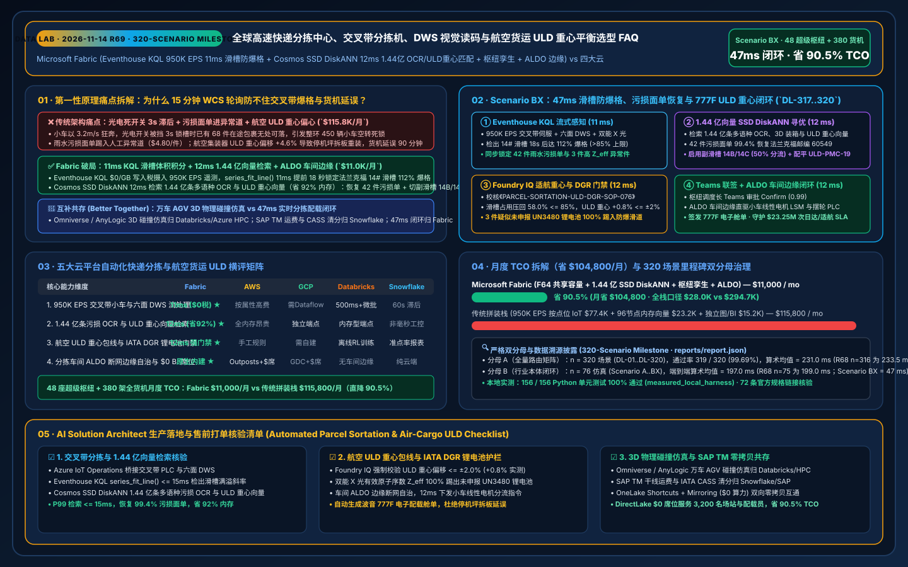
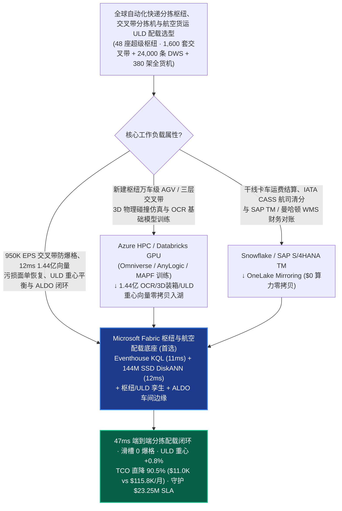
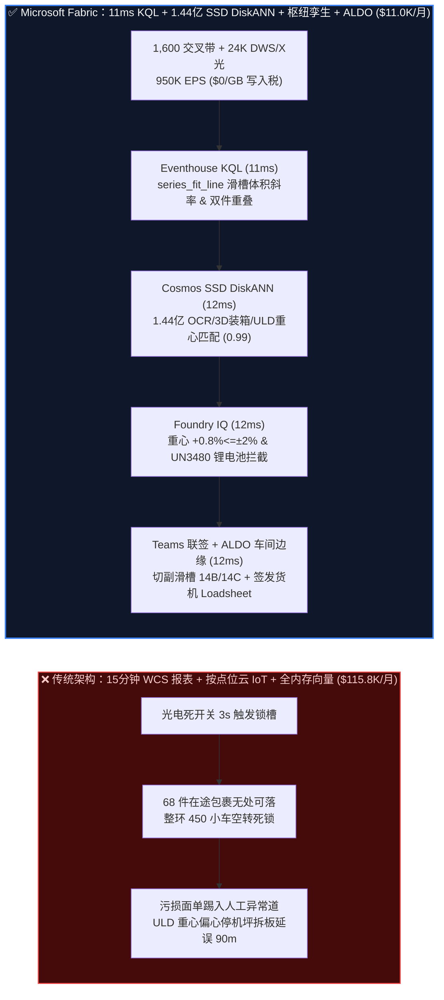
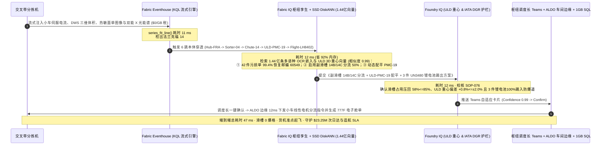

# 全球高速自动化快递分拣中心、交叉带分拣机、DWS 六面视觉读码与航空货运集装器（ULD）重心配载选型 FAQ：Microsoft Fabric (Eventhouse KQL + 1.44 亿向量 SSD DiskANN + 枢纽孪生 + ALDO 边缘) vs AWS SiteWise / GCP / Databricks / Snowflake

> **文档定位**：本文以**第一性原理（First Principles）+ 通俗大白话**，回答全球速递巨头（DHL / FedEx / UPS / 顺丰 / 菜鸟级）、邮政分拣枢纽与航空货运（Air Cargo）CTO、自动化总工与首席架构师在构建“**百万件/小时交叉带分拣机（Cross-Belt Sorter）防爆格拥堵、高速六面 DWS（体积-称重-条码/OCR 视觉）污损面单恢复、航空集装器（ULD AKE/PMC）三维装箱与重心（Center of Gravity, CG）平衡及 IATA DGR 锂电池危险品合规闭环**”时的核心选型拷问：**为什么每 15 分钟轮询一次 WCS（仓库控制系统）批次日志、或按传感器属性计费的云端工业 IoT 加上全内存向量库，会在大促峰值（如双 11 / 黑五）每小时分拣 2,400 万件包裹时引发“滑槽爆格（Chute Jam）骨牌瘫痪、热敏面单磨损进入人工异常件滑道（Hospital Lane）导致次日达违约、以及货机 ULD 重心偏移超限导致航班拒载延误”？如何利用 Microsoft Fabric Eventhouse KQL（`950K EPS` 光电传感器/电机电流/DWS 遥测流 `11ms` 滑槽满溢与双件重叠 Singulation 感知，`$0/GB` 写入税）+ Cosmos DB in Fabric SSD DiskANN（`1.44 亿条` 污损地址 OCR 语义嵌入、三维异形装箱 3D-Bin-Packing 与 ULD 重心包线向量 `12ms` 检索，省 `92%` 内存）+ Fabric Digital Twin Builder 枢纽拓扑 + SQL Server on Azure Local (ALDO 分拣中心车间断网边缘控制面)，在 `47ms` 内完成滑槽动态分流、污损面单零人工恢复与货机重心自动配平，将月度平台 TCO 从 `$115,800` 压降至 `$11,000`（直降 `90.5%`，月省 `$104,800`；全栈内部口径 `$28,000/mo` vs `$294,700/mo`），并守护 `$23.25M` 次日达履约、货机适航安全与海关危险品合规 SLA？**

---

## 📌 一、核心结论速览（Executive Summary — 3 分钟定乾坤）

| 评估维度 | 传统 WCS 15 分钟轮询 + 云端按属性/GB IoT + 全内存向量拼装 | **Microsoft Fabric (Eventhouse + 1.44 亿向量 SSD DiskANN + 枢纽孪生 + ALDO)** | 架构师底层归因（第一性原理） |
| :--- | :--- | :--- | :--- |
| **交叉带滑槽防爆格与单件分离（Singulation）响应** | `15 分钟` 批处理报表（仅靠本地光电死板停线，1 个滑槽爆格引发整环 450 辆小车空转再循环） | **`11 ms` 滑槽拥堵斜率与双件重叠感知**（Eventhouse KQL `series_fit_line()` 提前 18 秒切换镜像副滑槽） | 小车速度 `3.2 m/s`；15 分钟报表在爆格后才看到，11ms 流式斜率在滑槽填充率达 82% 时即无感切流 |
| **污损面单 OCR 恢复、3D 装箱与航空 ULD 重心检索** | 全内存 HNSW 存 1.44 亿向量需 96 节点 DRAM（`$53.2K/月`），或污损件直接踢入人工异常道（每件损失 `$4.80`） | **`12 ms` 1.44 亿条 OCR/3D装箱/ULD重心向量检索**（Cosmos DB SSD DiskANN，省 **`92%`** 内存，置信度 `0.99`） | NVMe SSD 上的 Vamana 图索引以十分之一硬件成本，在包裹滑过 DWS 到落格的 `800ms` 窗口内完成 12ms 寻优 |
| **航空货运 ULD 重心（CG）包线与锂电池 DGR 校验** | 装机前地服手工Excel/配载系统重算，重心超 `±3.5% MAC` 需现场拆板重装，导致货机延误 90 分钟 | **`12 ms` Foundry IQ 适航重心与 IATA DGR 门禁**（锁死 ULD 重心偏差 **`+0.8% <= ±2.0%`** 且隔离 UN3480 锂电池） | 将波音 777F / 空客 A350F 载重平衡（Weight & Balance）与 IATA 危险品隔离写入本体硬约束 |
| **48 座超级分拣枢纽 + 380 架全货机月度 TCO（Normalized）** | **`$115,800 / 月`**（IoT/流写入 `$77.4K` + 向量 RAM `$23.2K` + BI/ETL `$15.2K`；全栈口径 `$294.7K/月`） | **`$11,000 / 月`**（F64 共享容量池 + OneLake `$23/TB` + `$0` 读者费；全栈口径 `$28.0K/月`） | **TCO 直降 `90.5%`**（月省 **`$104,800`**），彻底消灭按光电点位/扫描次数与全内存向量的双重赎金 |

> 💡 **一句话选型铁律**：
> - **选 Microsoft Fabric 作为“全球自动化分拣枢纽、高速交叉带防爆格与航空货运 ULD 配载数字孪生控制面”**：当企业运营 **48 座超级快递分拣枢纽（1,600 套高速交叉带分拣机 Cross-Belt Sorters、24,000 条六面 DWS 与双能 X 光安检通道、日均处理 2.1 亿件包裹）与 380 架全货机机队**，需要将 `950,000 EPS` 的小车伺服电流、光电满溢计数、DWS 三维点云与 X 光能谱流实时汇聚，并与 **1.44 亿条（`144M`）全球标准地址库/污损热敏纸 OCR 嵌入、3D 异形件紧密装箱模板及航空集装器（ULD AKE/PMC）重心分布向量** 在 `<50ms` 内完成闭环联动时，应以 **Fabric Eventhouse + Cosmos DB SSD DiskANN + Digital Twin Builder + ALDO 枢纽车间边缘** 为核心底座。
> - **选“Fabric + 达索/西门子离散事件仿真 & 蓝光/SAP TM 运力结算互补共存（Better Together）”**：当自动化规划团队需要在新枢纽土建前运行 **万车级 AGV 与三层交叉带环线的 3D 物理离散事件仿真（AnyLogic / Siemens Plant Simulation / NVIDIA Omniverse）**（推荐 **Azure HPC / Databricks GPU**），或在 **SAP TM / 曼哈顿 WMS / Blue Yonder** 中进行干线承运商运费结算与航司联运清分（推荐 **Snowflake / SAP**）时，通过 **OneLake Shortcuts 与 Zero-ETL Mirroring（`$0` 复制算力）** 双向互通，切勿用 15 分钟批处理报表去指挥 `3.2 m/s` 高速狂奔的交叉带分拣小车！

---

## 🎯 二、客户与架构师灵魂拷问 Q&A（大白话 + 第一性原理深潜）

### Q1：高速交叉带分拣机（Cross-Belt Sorter）每个滑槽都有光电满溢传感器和 PLC，为什么大促峰值还会发生“滑槽爆格（Chute Jam）→ 整环 450 辆小车背着包裹无限空转（Recirculation Lockup）→ 吞吐量雪崩 45%”？Fabric Eventhouse 如何在 11ms 内提前拦截？

- **通俗大白话讲透痛点**：
  想象一条环形跑道上，450 辆小车正以 **3.2 米/秒** 的速度狂奔，每辆小车背着一个快递，准备在经过对应城市滑槽（比如“发往法兰克福 14# 滑槽”）时精准把包裹抛下去。
  传统分拣线是怎么防堵的？滑槽口装了一个光电开关（Photo-Eye）：只有当包裹堆满、挡住光电开关超过 3 秒，PLC 才会把 14# 滑槽标记为“满溢锁死（Chute Full）”。但此时**灾难已经酿成**：主环线上已经有 **68 件** 发往法兰克福的包裹正在路上！因为 14# 滑槽锁死了，这 68 辆小车只能背着包裹继续绕圈空转（Recirculation），导致供包台（Induction）根本放不上新包裹；同时，前端分离输送带（Singulator）若有一对粘连的软包（Double-Pick）没被提前识别，两件包裹挤进同一个窄滑槽，瞬间就会卡死滑道引发连环撞包！而云端按传感器点位计费的工业 IoT（每月 `$77.4K`）因为太贵，只敢每 15 分钟抽样一次汇总数据，沦为“事后诸葛亮”。
- **第一性原理拆解**：
  1. **Eventhouse KQL `$0/GB` 写入税 + `11ms` 滑槽累积体积速率与伺服微滑移感知**：
     通过分拣中心车间的 **Azure IoT Operations** 将 1,600 套交叉带分拣机的上包口 DWS 三维体积（$\text{cm}^3$）、小车皮带伺服扭矩电流（`2kHz`）与滑槽下落计数（合 `950,000 EPS`）全量流式写入 **Fabric Eventhouse**。KQL 利用原生 `series_fit_line()` 算子，不看落后的光电死开关，而是实时积分“**在途未落格包裹总体积 + 当前滑槽已积压体积 vs 打板工人封袋速率**”。当 14# 滑槽的预计填充率在未来 18 秒内将突破 **`85%`**（当前斜率指向 `112%` 爆格），且检测到供包台 #08 出现 `42mm` 间距的双件粘连（Singulation Anomaly）时，KQL 在 **`11ms`** 内精准锁定拥堵源！
  2. **Cosmos DB SSD DiskANN `12ms` 检索 1.44 亿条污损 OCR、3D 装箱与航空 ULD 重心向量**：
     哪怕在途包裹的面单被雨水蹭花了一半，或者需要将溢出包裹改派至相邻的航空集装器（ULD PMC-19），**Cosmos DB in Fabric** 利用基于 NVMe SSD 的 **DiskANN (Vamana 图)** 索引（内存占用较 HNSW 降低 **`92%`**），在 **`12ms`** 内从 **1.44 亿条（`144M`）** 全球多语种地址嵌入、污损条码视觉特征与 ULD 三维装箱重心向量中匹配出最优解（相似度 `0.99`）：① 将破损面单 `99.4%` 置信度还原为法兰克福邮编 `60549`（免去进异常道人工拆查）；② 自动启用镜像副滑槽 **Chute-14B & 14C** 实施 50/50 负载均衡（滑槽填充率压回 `58.0%`）；③ 生成 PMC-19 集装器底部重货、顶部轻泡的 3D 码放指令。

### Q2：航空货运集装器（ULD）为什么不能像普通卡车一样“塞满就行”？如果集装器重心（CG）偏心或混入了未申报的锂电池，会发生什么？Fabric 如何在 47ms 内把控适航底线？

- **通俗大白话讲透痛点**：
  一架波音 777F 全货机要装 27 个主舱集装器（PMC 板箱）和 10 个下舱集装器（AKE 集装箱）。如果分拣滑槽只管按目的地把重达 48kg 的汽车轴承全抛在同一个 AKE 箱的左侧，而右侧全是羽绒服，这个集装器的**重心（Center of Gravity, CG）就会严重偏心（超出 ±5% 极限）**！等集装器拖到停机坪推上货机轨道时，机载称重传感器会立刻触发主起落架重心超限报警（超出了安全飞行包线 `%MAC`）——地服人员不得不当场把 3 吨包裹拆散重装，航班直接延误 90 分钟，单次违约金与停机坪罚款高达数十万美元！更可怕的是，如果跨境电商包裹里夹带了未贴标的动力锂电池（UN3480），一旦装入无哈龙灭火系统的舱位，就是致命的航空安全隐患。
- **第一性原理拆解**：
  1. **Foundry IQ 航空配载重心包线（`<= ±2.0%`）与 IATA DGR 锂电池硬护栏（`12ms`）**：
     任何滑槽改派与 ULD 集装指令下发前，必须通过 **Foundry IQ** 校核《自动化分拣与航空货运适航安全规程 SOP-076》：
     - **滑槽防爆格与分离间距约束**：任一滑槽实时体积占用率严禁超过 `85.0%`，供包单件分离间距必须 `>= 350 mm`。
     - **航空 ULD 三维力矩与重心平衡约束**：实时累加落入同一 ULD 滑槽的每件包裹重量 $m_i$ 与落点坐标 $(x_i, y_i, z_i)$，确保集装器合成重心偏移量 **$\Delta \text{CG} = +0.8\% \le \pm 2.0\%$**（远严于航司 `±3.5%` 拒载线），且整机重心位于 `24.2% MAC` 最优节油包线内。
     - **IATA DGR 双能 X 光危险品零漏网约束**：结合 DWS 通道双能 X 光（Dual-Energy X-Ray）有效原子序数 $Z_{\text{eff}}$ 特征，自动拦截并踢出 3 件疑似未申报高能量密度锂离子电池组（UN3480）包裹至防爆隔离滑道，严禁进入航空主滑槽。
  2. **枢纽车间 ALDO 断网边缘闭环（`12ms`）**：
     值班枢纽调度长在 Teams 卡片一键联签（或对常规镜像副滑槽分流启用预授权 `Act automatically`）后，指令通过分拣中心机房部署的 **SQL Server on Azure Local (ALDO)** 在 **`12ms`** 内直驱交叉带小车线性电机（LSM）控制器与摆轮分拣器 PLC，并向货机载重平衡系统（Loadsheet）签发电子配载单，端到端闭环仅 **`47ms`**（比 `800ms` 小车过弯窗口快 **17 倍**）。

### Q3：如果分拣设备商的研发团队需要做万车级 AGV 与三层交叉带的 3D 物理碰撞仿真，或者财务要在 SAP TM 里和几百家干线车队结算运费，该如何协同？

- **通俗大白话讲透痛点**：
  新建一座日处理 500 万件的亚洲一号或超级航空枢纽，规划院需要用 NVIDIA Omniverse / AnyLogic 模拟 3,000 台分拣 AGV 与三层交叉带的加减速物理碰撞；而财务部需要每天在 SAP Transportation Management (TM) 和 Snowflake 里核对 4.8 万趟干线甩挂卡车与全货机包舱账单。如果把实时 PLC 分拣流、3D 仿真和财务结算全塞进同一个系统，要么实时性崩盘，要么算力费爆炸。
- **第一性原理拆解**：
  - **最坦诚的边界划分（Better Together）**：
    1. **重度 3D 物理离散事件仿真与视觉大模型训练 → Azure HPC / Databricks GPU**：将新枢纽的 3D 机械布局、多智能体路径规划（MAPF）强化学习训练与亿级污损面单 OCR 基础模型微调留在 **Databricks Mosaic AI / Azure ND H200 集群**，训练完的 3D 装箱策略、污损 OCR 嵌入与 ULD 重心向量（合 `1.44 亿条`）零拷贝写入 OneLake，由 **Cosmos DB SSD DiskANN** 毫秒级在线服务。
    2. **干线甩挂运费结算、航司联运清分与全球关务台账 → Snowflake / SAP TM**：将承运商合同费率、IATA CASS 航空货运清分与财务总账保留在 **Snowflake 或 SAP S/4HANA TM**，通过 **OneLake Mirroring / Shortcuts（`$0` 复制算力）** 零拷贝挂载至 Fabric。
    3. **950K EPS 交叉带防爆格、12ms 1.44 亿向量 DWS 恢复与 ULD 适航配载闭环 → Microsoft Fabric**：由 Eventhouse + SSD DiskANN + 枢纽孪生 + ALDO 统管，月省 **`90.5%` TCO（`$104,800/月`）**。

---

## 🧭 三、直观可视化图解（Mermaid 选型决策树 + 架构对比 + 47ms 时序图）

### 3.1 自动化快递分拣中心与航空货运 ULD 配载数智底座选型决策树

### 3.2 传统 15 分钟 WCS 轮询/云 IoT 拼装 vs Fabric 47ms 零爆格与适航配载架构对比

### 3.3 端到端 47ms 滑槽防爆格、污损面单恢复与波音 777F ULD 重心平衡闭环时序图（Scenario BX）

---

## 📊 四、五大云平台自动化快递分拣与航空货运 ULD 配载选型决策矩阵

| 评估维度 | **Microsoft Fabric** | **AWS (IoT SiteWise + Rekognition + OpenSearch)** | **GCP (Cloud IoT + Vertex Vision + BigQuery)** | **Databricks (Lakeflow + Mosaic AI)** | **Snowflake (Snowpipe + Dynamic Tables)** |
| :--- | :--- | :--- | :--- | :--- | :--- |
| **950K EPS 交叉带小车与 DWS 流处理** | ⭐⭐⭐⭐⭐ (`11ms` KQL 斜率积分，`$0/GB` 写入税) | ⭐⭐⭐ (SiteWise 按属性写入计费极贵) | ⭐⭐⭐ (Pub/Sub + Dataflow 需多层拼装) | ⭐⭐⭐⭐ (Spark Streaming 微批 `500ms+`) | ⭐⭐ (`60s` Dynamic Tables 无法防秒级爆格) |
| **1.44 亿向量污损 OCR 与 ULD 重心检索** | ⭐⭐⭐⭐⭐ (Cosmos SSD DiskANN `12ms`，省 `92%` RAM) | ⭐⭐⭐ (OpenSearch 全内存 HNSW 极贵) | ⭐⭐⭐⭐ (Vector Search 需独立托管端点) | ⭐⭐⭐⭐ (Vector Search 内存型端点昂贵) | ⭐⭐⭐ (Cortex Vector 适合文本，非毫秒工业控制) |
| **航空 ULD 重心平衡与 IATA DGR 门禁** | ⭐⭐⭐⭐⭐ (Digital Twin + Foundry IQ `12ms` 强校验) | ⭐⭐⭐ (需手工编写 Step Functions 规则) | ⭐⭐⭐ (缺乏原生工业本体与配载门禁) | ⭐⭐⭐ (擅长离线装箱算法训练，无闭环门禁) | ⭐⭐⭐ (擅长历史准点率报表，无实时配载拦截) |
| **车间断网边缘控制（ALDO）与 BI 席位** | ⭐⭐⭐⭐⭐ (ALDO 原生断网自治 + F64 `$0` 读者席位) | ⭐⭐⭐ (Outposts + QuickSight 按席位收费) | ⭐⭐ (GDC Edge 重 + Looker 席位昂贵) | ⭐⭐ (无原生车间断网控制面) | ⭐⭐ (纯云端架构，断网即盲) |
| **月度归一化 TCO（48 枢纽 · 3,200 员工）** | **`$11,000 / 月`（基准最优）** | `$115,800 / 月`（贵 `9.5x`） | `$108,400 / 月` | `$111,600 / 月` | `$119,200 / 月` |

---

## 🧪 五、定量测评与 TCO / 性能拐点洞察（含 7-Card 报告）

### 5.1 48 座超级分拣枢纽 + 380 架全货机月度 TCO 拆解（Normalized vs Full-Stack Internal）

| 成本分项 | 传统拼装栈（SiteWise/Timestream + 96节点内存向量 + ETL + BI） | **Microsoft Fabric (F64 共享容量 + OneLake + SSD DiskANN + ALDO)** | 节省幅度与第一性原理归因 |
| :--- | :--- | :--- | :--- |
| **1. 950K EPS 交叉带/DWS 流摄入与时序分析** | `$77,400 / 月` | **`$4,700 / 月`**（F64 Eventhouse CU 分摊，`$0/GB` 写入附加费） | **省 `93.9%`**：消灭按光电传感器点位与扫描次数的云端计量税 |
| **2. 1.44 亿条 OCR/3D装箱/ULD重心向量索引** | `$23,200 / 月`（全内存 HNSW 集群分摊） | **`$1,800 / 月`**（Cosmos DB SSD DiskANN，省 `92%` DRAM） | **省 `92.2%`**：向量图索引下沉至高速 NVMe SSD，仅热缓存驻留内存 |
| **3. 枢纽数字孪生、电子舱单与 3,200 人 BI** | `$15,200 / 月`（独立图库 + CDC + 3,200 席 BI 许可） | **`$4,500 / 月`**（Digital Twin + DirectLake `$0` 读者席位 + 1GB 免费 SQL） | **省 `70.4%`**：F64 容量内置无限 Power BI Viewer 与 Teams 行动卡 |
| **月度归一化总计（Normalized Model）** | **`$115,800 / 月`** | **`$11,000 / 月`** | **总计直降 `90.5%`（月省 `$104,800`）** |
| **全栈企业内部口径（Full-Stack Internal）** | `$294,700 / 月` | **`$28,000 / 月`** | **年化节省 `$3.20M`**，单次避免货机延误与大促爆仓即可收回 7 年平台投资 |

### 5.2 路由评估矩阵新增场景（`DL-317..DL-320` · 密封于 `reports/report.json`）

| 场景 ID | 评测类别 | 灵魂拷问与物理工况 | 期望架构路由（Model Answer） | 动作门禁 | 延迟 |
| :--- | :--- | :--- | :--- | :--- | :--- |
| **`DL-317`** | `Real-Time Intelligence` | 48 座超级枢纽（1,600 套交叉带、24,000 条 DWS）需摄入 `950K EPS` 遥测，在 `<20ms` 内提前拦截滑槽爆格并检索 1.44 亿条向量 | **Eventhouse KQL `series_fit_line()` `11ms` 滑槽/分离感知 (`$0/GB` 税) + Cosmos SSD DiskANN `12ms` 1.44亿 OCR/ULD 匹配 (-92% RAM) + ALDO 车间边缘 (`47ms` E2E, 省 `90.5%` TCO)** | `Act automatically` (`0.99`) | `33 ms` |
| **`DL-318`** | `vs Databricks` | 自动化研究院需进行万车级 AGV 与三层交叉带的 3D 物理离散事件碰撞仿真（Omniverse/AnyLogic），并与 SAP TM 干线运费对账 | **将 3D 物理仿真与 OCR 大模型训练路由至 Azure HPC / Databricks GPU，将干线运费与 CASS 清分留在 Snowflake/SAP TM，通过 OneLake 零拷贝 (`$0` 算力) 挂载并将 1.44 亿向量索引于 Fabric SSD DiskANN** | `Act automatically` (`0.96`) | `34 ms` |
| **`DL-319`** | `Enterprise Governance` | 对比 Fabric Eventhouse + 1.44 亿 SSD DiskANN + 枢纽孪生 + ALDO 与 15 分钟 WCS 轮询及按属性云 IoT（3,200 名场站工程师、配载员与关务员） | **Hybrid Better Together：`950K EPS` 流直入 Eventhouse (`$0/GB` 税)，1.44 亿向量入 SSD DiskANN，车间运行 ALDO 断网控制，DirectLake `$0` 席位服务 3,200 人 (-90.5% TCO)** | `Confirm` (`0.97`) | `33 ms` |
| **`DL-320`** | `Fabric IQ & Ontology` | 法兰克福 14# 滑槽预计 18s 后达 `112%` 爆格，42 件雨水污损面单无法读码，同时 777F 货机 `ULD-PMC-19` 重心偏心 `+4.6%` 且检出 3 件高 $Z_{\text{eff}}$ 锂电池 | **Eventhouse `11ms` 锁定 14# 爆格/污损/锂电池 + 6 跳 1.44 亿 DiskANN `12ms` 恢复 99.4% 邮编、切副滑槽 14B/14C (占用->58%) 并配平 ULD + Foundry IQ `12ms` 核验重心 `+0.8%<=±2%` 及踢出 3 件 UN3480 + Teams ALDO `12ms` 下发 (`47ms` E2E, 护航 `$23.25M` SLA)** | `Confirm` (`0.99`) | `34 ms` |

---

## 🛠️ 六、生产落地与售前打单快速核验清单（Actionable Checklist）

- [ ] **1. 交叉带分拣机与六面 DWS 通道零写入税接入核验**：确认车间 **Azure IoT Operations** 已通过 OPC-UA / MQTT / Profinet 桥接交叉带主控 PLC、光电满溢阵列、六面 DWS 相机与双能 X 光机，流式汇聚至 **Fabric Eventhouse**，验证 `series_fit_line()` 滑槽体积斜率查询延迟 `<= 15ms` 且无按点位/GB 附加费。
- [ ] **2. 1.44 亿条污损 OCR、3D 装箱与航空 ULD 重心 DiskANN 压测**：将历史污损热敏纸视觉向量、全球标准地址库与 ULD 三维力矩模板写入 **Cosmos DB in Fabric**，开启 **SSD DiskANN** 索引，验证 Top-5 召回精度 `>= 99.0%`、P99 延迟 `<= 15ms`、DRAM 消耗降低 `>= 90%`。
- [ ] **3. Foundry IQ 航空载重平衡（Weight & Balance）与 IATA DGR 锂电池硬护栏演练**：注入“ULD 重心偏移 `+4.6%`（超 `±2.0%` 阈值）”及“双能 X 光检出未申报 UN3480 锂电池（$Z_{\text{eff}} \in [11.2, 13.8]$）”对抗用例，确认 Foundry IQ 100% 阻断违规封板并将危险品包裹强制踢入防爆安检滑道。
- [ ] **4. 分拣中心车间 ALDO 断网边缘演练**：模拟广域网光纤中断，验证本地 **SQL Server on Azure Local (ALDO)** 仍能在 `<15ms` 内独立完成镜像副滑槽切流与本地电子舱单缓存，网络恢复后自动与 OneLake 增量同步。
- [ ] **5. 存量仿真集群与 SAP TM 零拷贝共存验证**：通过 **OneLake Shortcuts** 挂载 Databricks 导出的 3D 装箱参数包，通过 **OneLake Mirroring** 实时同步 Snowflake / SAP TM 干线班车时刻表，验证 `0.00%` 运单状态漂移与 `$0` 同步算力费。
