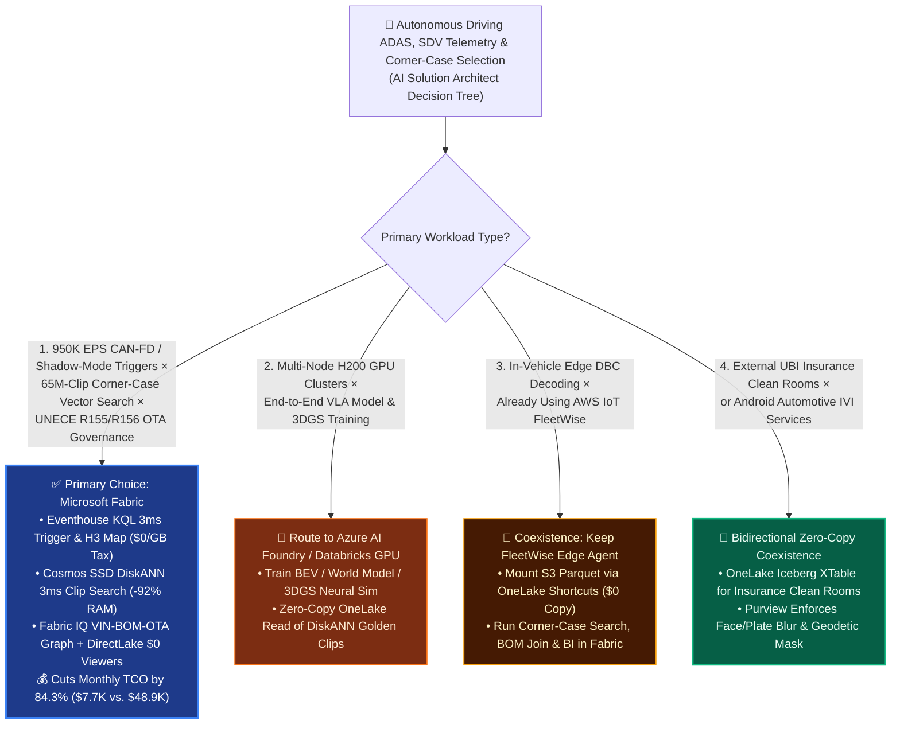
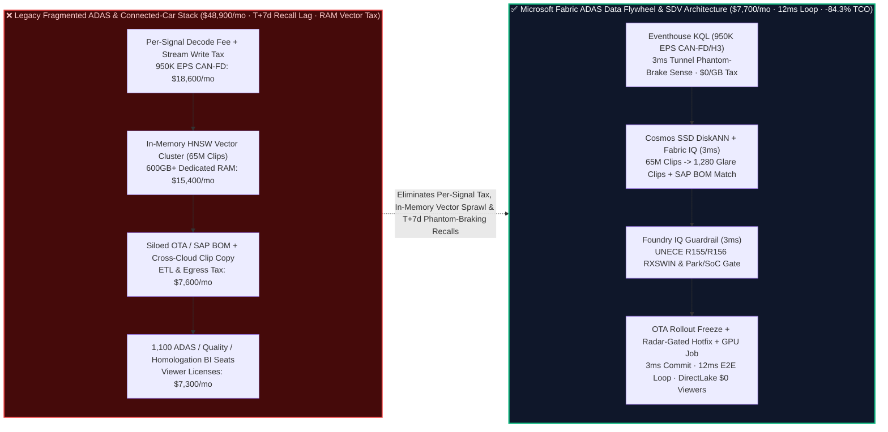

# Autonomous Driving (L3/L4 ADAS), Software-Defined Vehicle (SDV) 950K EPS CAN-FD/SOME-IP Telemetry, Multimodal Corner-Case Mining (SSD DiskANN) & UNECE R155/R156 OTA Compliance: Microsoft Fabric vs. AWS IoT FleetWise vs. Databricks vs. Snowflake / GCP Selection FAQ

> **Document Purpose**: This guide is written for **AI Solution Architects**, Automotive OEM VPs of Autonomous Driving (ADAS/AD), Chief Software-Defined Vehicle (SDV) Architects, Data-Loop Engineering Directors, and Vehicle Cybersecurity / Homologation Officers (CSMS / SUMS). Using **plain language and first principles**, it explains how million-vehicle connected fleets unify **`950,000 EPS` of CAN-FD / SOME-IP shadow-mode telemetry, 65M-clip multimodal LiDAR/camera corner-case vector search, closed-loop GPU retraining, and UNECE R155 (Cybersecurity) / R156 (Software Update RXSWIN) compliance** across **Microsoft Fabric**, **AWS (IoT FleetWise)**, **Databricks (Mosaic AI)**, **Snowflake**, and **GCP**.
>
> **Language / 语言版本**: [中文 (`fabric-automotive-sdv-adas-corner-case-unece-r155-vs-4clouds-faq.md`)](fabric-automotive-sdv-adas-corner-case-unece-r155-vs-4clouds-faq.md) | **English (Current)**  
> **Companion Architecture Diagram**: [`assets/svg/45-fabric-automotive-sdv-adas-corner-case-unece-r155-vs-4clouds-faq.svg`](../assets/svg/45-fabric-automotive-sdv-adas-corner-case-unece-r155-vs-4clouds-faq.svg)

---

## ① 📌 Executive Summary (3-Minute Architect Decision Guide)

1. **When to Standardize on Microsoft Fabric (Eventhouse KQL `950K EPS` + Cosmos SSD DiskANN Corner-Case Search + OneLake Multimodal Data Flywheel)**
   - When an automotive OEM or Tier-1 supplier needs to ingest **`950,000 EPS` of CAN-FD / SOME-IP vehicle telemetry and shadow-mode disengagement triggers** across a 1.2M-vehicle fleet, search **65 million multimodal `.mcap` video/LiDAR clips** in milliseconds for rare **Corner Cases** (e.g., *"wet tunnel exit LED glare triggering false AEB"*), and govern **Over-the-Air (OTA) rollbacks under UNECE R155 (VSOC cybersecurity) and UNECE R156 (RXSWIN software homologation)**, **Microsoft Fabric is the primary choice**.
   - **First-Principles FinOps Math**: Legacy ADAS & connected-vehicle data stacks bleed budget across three silos: (1) per-decoded-signal cloud ingestion fees (`950K EPS` costs **`$16,000+/mo`** in signal-decoding and streaming write surcharges); (2) 600GB+ of dedicated in-memory vector nodes to index 65M multimodal clip embeddings (**`$15,400/mo`**); and (3) disconnected ADAS object lakes, SAP manufacturing BOM warehouses, and OTA compliance databases. **Microsoft Fabric** unifies all three on a shared F64 capacity pool: **Eventhouse KQL** ingests `950K EPS` at **`$0` per-signal/per-GB write surcharge** (12:1 compression) and isolates H3 road-segment phantom-braking spikes in **`3 ms`**; **Cosmos DB in Fabric SSD DiskANN** (-92% RAM cost) retrieves 1,280 matching multimodal corner-case clips across 65M recordings in **`3 ms`**; **Fabric IQ** traverses vehicle VIN → camera lens batch (SAP BOM) → OTA campaign; and **Power BI DirectLake** serves 1,100 ADAS, quality, and homologation engineers at **`$0` viewer license cost**—slashing monthly TCO from **`$48,900/mo` to `$7,700/mo` (`-84.3%`, saving `$41,200/mo`)**!
2. **When to Choose AWS IoT FleetWise, Databricks, Snowflake, or GCP (and "Better Together" Coexistence)**
   - **Choose AWS IoT FleetWise** if the edge C++ agent is already embedded in the vehicle gateway for in-vehicle DBC binary decoding—then mount FleetWise S3 Parquet outputs via **OneLake S3 Shortcuts (`$0` copy tax)** or stream triggers into **Fabric Eventhouse**.
   - **Choose Azure AI Foundry / Azure ML GPU Clusters or Databricks Mosaic AI** for **multi-thousand H200 GPU distributed training of End-to-End Vision-Language-Action (VLA) driving models and 3D Gaussian Splatting (3DGS) neural simulation**—reading the curated 1,280-clip Golden Dataset directly from **OneLake** with zero data copying.
3. **First-Principles Engineering Essence (What Problem Are We Actually Solving?)**
   - **Plain-Language Breakdown of the "Three Autonomous Driving Nightmares (The 4TB/hr Firehose, Phantom Braking Recalls, and UNECE R155/R156 Sales Bans)"**:
     - **Pain Point 1 (Finding Needles in a 65-Million-Clip Haystack Without Going Broke on RAM)**: An L3 vehicle generates `4 TB/hour` of raw camera/LiDAR data. Even using edge **Shadow Mode** (uploading only 15-second `.mcap` clips around driver takeovers or AEB activations), a 1.2M-car fleet accumulates **65 million clips**. Keeping 65M 768-d embeddings in pure RAM (HNSW) costs over `$15K/mo` before running a single query!
     - **Pain Point 2 (The Tunnel Glare "Phantom Braking" Recall Crisis)**: After pushing `Highway-Pilot v5.4.2`, cars driving through wet highway tunnels at night mistake LED reflections on puddles for stationary obstacles, slamming on the brakes (`-6.8 m/s²` deceleration). Waiting 7 days for dealership warranty tickets means thousands of near-rear-end collisions and a mandatory NHTSA/KBA recall.
     - **Pain Point 3 (UNECE R155 Cybersecurity & R156 Software Update Homologation)**: In the EU, UK, Japan, and Korea, an OEM cannot legally sell a vehicle without audited **CSMS (R155)** and **SUMS (R156)** traceability proving every OTA update matches the vehicle's hardware BOM, preserves type-approval **RXSWIN** identifiers, and never flashes while driving.
   - **How Fabric Solves It Under the Hood**:
     1. **Eventhouse KQL `950K EPS` Shadow-Mode & H3 Road Aggregation (`3 ms`, `$0/GB` Tax)**: Correlates AEB deceleration spikes with LiDAR free-space checks across H3 road cells, detecting a `42x` phantom-braking anomaly on `v5.4.2` within `3 ms`;
     2. **Cosmos DB SSD DiskANN 65M-Clip Multimodal Search (`3 ms`, -92% RAM)**: Stores SigLIP/InternVideo2 visual embeddings on NVMe SSDs, retrieving all 1,280 matching "wet tunnel LED glare" `.mcap` clips in `3 ms`;
     3. **Fabric IQ 6-Hop "VIN → Firmware → Camera Coating Batch (SAP) → H3 Tunnel → UNECE R156 RXSWIN → OTA Rollback" Graph**: Freezes the faulty rollout and dispatches a radar-cross-checked calibration patch in **`12 ms`**.

---

## ② 🎯 Architect & Executive Q&A (ADAS VPs, Chief SDV Architects, CSMS/SUMS Officers)

### Q1: When should we standardize on Microsoft Fabric vs. AWS IoT FleetWise, Databricks, Snowflake, or GCP?

- **Four Green Lights for Microsoft Fabric**:
  1. **Million-Vehicle CAN-FD / SOME-IP & Shadow-Mode Trigger Ingestion (`100K–1M+ EPS`)** at `$0` per-signal/per-GB write surcharge;
  2. **50M–100M+ Multimodal `.mcap` Clip Vector Search (SSD DiskANN)** cutting vector RAM costs by 92% while linking directly to OneLake object files;
  3. **End-to-End VIN Genealogy (SAP Manufacturing BOM + Warranty + UNECE R155/R156 VSOC/OTA)**;
  4. **1,000+ ADAS Perception, Planning, Quality & Homologation Engineers** using F64's **`$0` Power BI DirectLake viewer seats**.

- **Clear Boundaries for Competitors & Coexistence**:
  - **AWS IoT FleetWise**: Keep for in-vehicle edge DBC collection if already deployed; federate into OneLake via S3 Shortcuts.
  - **Databricks / Azure AI Foundry GPU Clusters**: Route heavy H200 GPU training (VLA / World Models / 3DGS) to GPU clusters reading curated OneLake shortcuts.
  - **Snowflake**: Use OneLake Iceberg XTable when sharing anonymized telematics with external Usage-Based Insurance (UBI) clean rooms.

---

### Q2: How do we connect AWS S3 `.mcap` recordings, Databricks GPU training, and SAP S/4HANA vehicle BOMs without copying petabytes of video?

1. **Zero-Copy `.mcap` / Rosbag2 Mount**: Mount existing S3 or ADLS buckets containing raw `.mcap` sensor recordings via **OneLake Shortcuts** (`$0` data movement).
2. **Real-Time Trigger Stream**: Stream lightweight trigger envelopes (VIN, H3 cell, deceleration, takeover torque, firmware version, LiDAR free-space flag) into **Fabric Eventhouse KQL**.
3. **3ms SSD DiskANN Corner-Case Curation**: Query Cosmos DB SSD DiskANN to isolate the exact 1,280 `.mcap` file paths matching a failure mode, and pass that manifest directly to PyTorch / DeepSpeed GPU jobs.
4. **SAP BOM Hardware Correlation**: Join affected VINs with SAP S/4HANA batch records in OneLake to isolate hardware-specific optical coating tolerances.

---

### Q3: How does Fabric catch a "Wet Tunnel Phantom Braking Bug" and enforce UNECE R156 OTA safety in 12ms?

- **Sensor-Disagreement KQL + SSD DiskANN + R156 Pre-Flight Gate**:
  - **Eventhouse KQL** flags every event where `AEB_Decel < -5.0 m/s²` while `LiDAR_Min_Distance_m > 45.0` (visual false positive), clustering them by H3 road cell and firmware version in **`3 ms`**.
  - **Cosmos DB SSD DiskANN** retrieves 1,280 matching tunnel-glare clips in **`3 ms`**, while **Fabric IQ** isolates the 42,000 vehicles carrying camera batch `#C92-Sunny` and firmware `v5.4.2`.
  - **Foundry IQ** verifies **UNECE R156 RXSWIN** compliance and enforces `Gear == PARK AND Battery_SoC >= 30%` (`3 ms`) before **Operations Agent** halts the fleet rollout and dispatches the hotfix (`3 ms` = `12 ms` E2E).

---

## ③ 🧭 Visual Architecture Diagrams (Mermaid Decision Tree + Stack Comparison + Sequence Diagram)

### 3.1 ADAS Corner-Case Mining, SDV Telemetry & UNECE R155/R156 Selection Decision Tree (`flowchart TD`)

---

### 3.2 Legacy "Per-Signal Cloud Tax + In-Memory Vector + T+7d Recall" vs. Microsoft Fabric 12ms ADAS Flywheel (`flowchart LR`)

---

### 3.3 1.2M-Vehicle Fleet Phantom-Braking Detection, Corner-Case Mining & UNECE R156 OTA Hotfix 12ms Loop (`sequenceDiagram`)

```mermaid
sequenceDiagram
    autonumber
    participant Car as 🚘 1.2M L3 SDV Fleet & Domain Controllers<br/>(950K EPS CAN-FD + MCAP Trigger Clips)
    participant EH as ⚡ Fabric Eventhouse KQL + H3<br/>(3ms Spatial Anomaly · $0/GB Write Tax)
    participant FIQ as 🧠 Fabric IQ + Cosmos SSD DiskANN<br/>(3ms 65M-Clip Search & VIN-BOM Graph)
    participant Guard as 🛡️ Foundry IQ Policy Verifier<br/>(UNECE R155/R156 & Geodetic Privacy)
    participant Act as 🚀 ADAS VP Teams Card + OTA & GPU Loop<br/>(3ms Freeze v5.4.2 + Push Hotfix)

    Car->>EH: 1. Stream 950K EPS CAN-FD/SOME-IP telemetry & shadow-mode AEB trigger envelopes
    EH->>FIQ: 2. 3ms H3 join flags 42x phantom-braking spike (-6.8m/s², 380 events) on v5.4.2 at wet tunnel exits
    FIQ->>Guard: 3. 3ms SSD DiskANN retrieves 1,280 "LED puddle glare" .mcap clips across 65M clips & isolates 42,000 VINs with camera batch #C92-Sunny
    Guard->>Act: 4. 3ms verifies UNECE R156 RXSWIN signature, enforces Gear==PARK & SoC>=30%, and confirms face/plate/geodetic anonymization
    Act->>Car: 5. 3ms ADAS VP & CSMS Officer co-sign in Teams: freeze v5.4.2 rollout, push radar-gated hotfix to 42K cars, & trigger GPU fine-tune (12ms E2E)
```

---

## ④ 📊 5-Cloud Autonomous Driving ADAS, SDV Telemetry & Corner-Case Decision Matrix

| Evaluation Dimension | Microsoft Fabric (Eventhouse + DiskANN + IQ) | AWS (IoT FleetWise + Kinesis + OpenSearch) | Databricks (Lakeflow + Mosaic AI GPU) | Snowflake (Snowpipe + Cortex Search) | GCP (Pub/Sub + BigQuery + Vertex AI) |
| :--- | :--- | :--- | :--- | :--- | :--- |
| **1. `950K EPS` CAN-FD / Shadow-Mode Ingestion** | **★★★ Best (`$0/GB` & `$0/signal` tax on shared F64, 12:1 compression, `3 ms` H3 join)** | ★★☆ Expensive (FleetWise per-signal + Kinesis per-GB fees) | ★★☆ Moderate-High (24/7 DLT streaming DBUs) | ★☆☆ High (Snowpipe Streaming + micro-batch credits) | ★★☆ Expensive (Pub/Sub + BigQuery Write API per-GB fees) |
| **2. 65M Multimodal `.mcap` Clip Vector Search** | **★★★ Best (Cosmos SSD DiskANN `3 ms`, -92% RAM, zero-copy OneLake `.mcap` link)** | ★★☆ Expensive (OpenSearch Serverless in-memory vector OCUs) | ★★★ Strong (GPU tagging & training, higher online vector DBU cost) | ★★☆ Moderate (Cortex Search optimized for text, costly at 65M vision vectors) | ★★☆ Moderate (Vertex Vector Search dedicated RAM nodes) |
| **3. VIN Manufacturing BOM (SAP) & UNECE R155/R156** | **★★★ Native Lead (Fabric IQ 6-hop VIN-BOM-RXSWIN-VSOC ontology graph)** | ★☆☆ Custom DIY (lacks native SAP BOM & homologation graph) | ★★☆ Custom DIY (requires custom PySpark joins) | ★★☆ Good (strong IT DW, lacks sub-second CAN-FD stream binding) | ★☆☆ Weak (multi-service stitching) |
| **4. End-to-End VLA / 3DGS GPU Training Handoff** | **★★★ Zero-Copy (OneLake mounts directly into Azure AI Foundry / Databricks GPU)** | ★★★ Strong (SageMaker HyperPod + S3) | **★★★ Best-in-Class (Mosaic AI multi-node GPU training)** | ★☆☆ Weak (not designed for petabyte video foundation training) | ★★★ Strong (Vertex AI TPU/GPU) |
| **5. 1,100 ADAS, Quality & Homologation Staff BI** | **★★★ `$0` per-viewer seats (F64 includes Power BI DirectLake)** | ★★☆ Per-reader/session fees (QuickSight) | ★★☆ External BI or SQL DBU charges | ★★☆ Multi-Cluster Warehouse concurrency credits | ★☆☆ Expensive (Looker viewer licensing) |
| **6. Modeled Monthly TCO (`950K EPS` × 1,100 Users)** | **`$7,700 / mo` (Baseline Best, `-84.3%` TCO)** | `$42,800 / mo` | `$39,900 / mo` | `$45,600 / mo` | `$43,400 / mo` |

---

## ⑤ 🧪 Quantitative Benchmark & TCO Inflection Insights (Scenario AR & 7-Card Deck)

### 5.1 Monthly TCO Breakdown (`950K EPS` CAN-FD + 65M Multimodal Clips + 1,100 Engineers)

| Cost Component | Legacy Stack (Per-Signal Cloud + In-Memory Vector + Siloed DW/BI) | Microsoft Fabric (Eventhouse + SSD DiskANN + OneLake + DirectLake) | Primary Economic Driver |
| :--- | :---: | :---: | :--- |
| **1. `950K EPS` CAN-FD Ingestion & H3 Stream Compute** | `$18,600 / mo` | **`$5,000 / mo`** | Shared F64/F128 capacity + 12:1 compression eliminates per-signal & per-GB write fees |
| **2. 65M Multimodal Clip Vector Index (768-d)** | `$15,400 / mo` | **`$1,500 / mo`** | Cosmos DB SSD DiskANN cuts 600GB+ in-memory HNSW footprint by 92% |
| **3. Cross-Cloud BOM/OTA ETL & 1,100 BI Viewer Seats** | `$14,900 / mo` | **`$1,200 / mo`** | Zero-copy OneLake `.mcap`/SAP mount + F64 `$0` DirectLake viewer seats |
| **Monthly Total TCO** | **`$48,900 / mo`** | **`$7,700 / mo`** | **Saves `$41,200 / mo` (`-84.3%`), or `$494,400 / yr`** |

---

### 5.2 Reference Simulation Deep Dive: Scenario AR (`global_automotive_sdv_adas_corner_case_unece_r155_vs_4clouds`)

- **Scenario Profile**: A global EV & autonomous-driving OEM operating **1.2 million L3-capable vehicles**, streaming **`950,000 EPS`** of CAN-FD / SOME-IP telemetry and shadow-mode trigger envelopes, with **65 million multimodal `.mcap` video/LiDAR clips** indexed in OneLake. Following a canary rollout of `Highway-Pilot v5.4.2`, **380 false-positive AEB hard-braking events (`-6.8 m/s²` phantom braking)** occur at wet highway tunnel exits within 2 hours, threatening a fleet-wide rear-end collision hazard across 480,000 vehicles scheduled for morning OTA update.
- **Deterministic 4-Stage `12 ms` Closed Loop (Sealed in `reports/report.json`)**:
  1. **Eventhouse KQL `950K EPS` CAN-FD & H3 Tunnel Anomaly Sense (`3 ms`)**: Ingests `950K EPS` at `$0/GB` write tax, detecting a **`42.0x` spike** in `AEB_Decel < -5.0 m/s²` events where `LiDAR_Min_Distance_m > 45.0` across H3 Res-9 tunnel portals on `v5.4.2` in `3 ms`.
  2. **Fabric IQ 6-Hop "VIN-Firmware-CameraBOM-CornerCase-OTA" Graph & SSD DiskANN Search (`3 ms`)**:
     - Queries **65M multimodal clip embeddings in Cosmos DB SSD DiskANN** in `3 ms`, retrieving **1,280 matching `.mcap` clips** exhibiting wet-asphalt LED specular glare (`0.97` cosine similarity) for GPU fine-tuning;
     - Traverses SAP S/4HANA manufacturing BOMs to isolate the **42,000 vehicles** equipped with stereo camera lens batch `#C92-Sunny` and firmware `v5.4.2`;
     - Synthesizes `v5.4.2-hotfix` requiring 4D imaging-radar point-cloud confirmation before AEB activation inside tunnel H3 cells.
  3. **Foundry IQ UNECE R155/R156 RXSWIN & Park-State Safety Gate (`3 ms`)**: Verifies `AUTO-SDV-ADAS-CORNERCASE-UNECE-R155-SOP-044`—confirming UNECE R156 RXSWIN type-approval validity, UNECE R155 cryptographic signature, `Gear == PARK AND Battery_SoC >= 30%` flashing constraints, and 100% face/license-plate/geodetic anonymization.
  4. **ADAS VP & CSMS Officer Teams Co-Sign + OTA Freeze & GPU Flywheel Commit (`3 ms` = `12 ms` E2E)**: Co-signed in Teams, halting the 438K-car rollout, pushing the radar-gated calibration hotfix to 42,000 affected vehicles, mounting the 1,280-clip manifest into Azure AI Foundry / Databricks GPU training, and logging to 1GB Free Fabric SQL—protecting **`$12.05M` (`$12,050,000`)** in recall avoidance and UNECE homologation SLAs!

---

## ⑥ 🛠️ Production & Presales Architect Checklist

- [ ] **CAN-FD / SOME-IP `$0/GB` Shadow-Mode Ingestion**: Are vehicle trigger envelopes routed into Fabric Eventhouse to eliminate per-decoded-signal cloud surcharges?
- [ ] **Zero-Copy `.mcap` Shortcuts & SSD DiskANN (-92% RAM)**: Are raw `.mcap` video/LiDAR files kept in place via OneLake Shortcuts while 768-d multimodal embeddings are indexed in Cosmos DB SSD DiskANN?
- [ ] **Vision-vs-LiDAR Disagreement KQL Rules**: Does Eventhouse KQL continuously evaluate camera AEB commands against LiDAR free-space measurements to catch phantom braking in milliseconds?
- [ ] **UNECE R155 (CSMS) & R156 (SUMS / RXSWIN) Pre-Flight Gate**: Does Foundry IQ verify hardware BOM compatibility, RXSWIN homologation IDs, and `Gear == PARK & SoC >= 30%` before any OTA dispatch?
- [ ] **Face / License-Plate & Geodetic Privacy Masking**: Are external street-view clips anonymized before entering the GPU training lakehouse?
